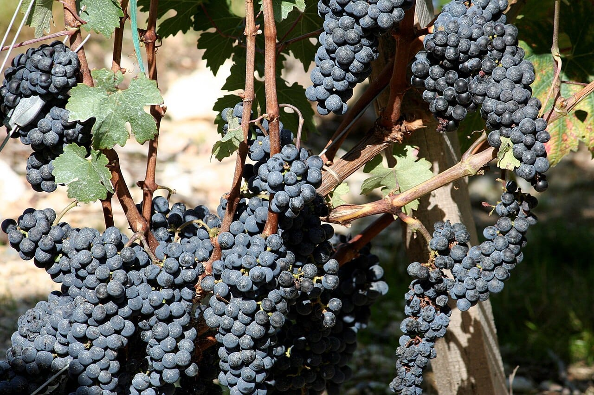

# 赤霞珠

赤霞珠（Cabernet Sauvignon）是重要的红葡萄品种，学名 Vitis vinifera。遗传研究显示，它的亲本是品丽珠（Cabernet Franc）与白苏维翁（Sauvignon Blanc）。这个组合解释了它兼具品丽珠的结构与白苏维翁的香气特征。赤霞珠果粒小、皮厚、色深，晚熟，单宁与色素含量较高，是世界上种植最广的红葡萄品种之一。

图：赤霞珠。摄影：Cabernet Sauvignon grapes from Château Cos D'Estournel。署名：Megan Mallen，CC BY 2.0，来自 Wikimedia Commons（[来源](https://commons.wikimedia.org/w/index.php?curid=13318021)）。

## 定义与身份

赤霞珠是品种名称，不是一种固定的风味模板。同一品种在波尔多左岸表现为紧致、高单宁、带雪松与铅笔芯气息；在纳帕谷可能更成熟、果味更饱满；在智利、澳大利亚与中国宁夏又各有取向。品种页描述植物学特征与酿造潜力，酒款页描述具体产品，两者层级不同。

这种区分很重要，因为市场上常有“赤霞珠”标注的单一品种酒，也有以赤霞珠为主的混酿。单一品种强调的是品种表达，混酿强调的是整体平衡。同名不同做法，需要看酒标上的品种比例与产区法规，而不能只凭品种名判断风格。

## 植物学特征与亲本

赤霞珠的果穗较紧凑，果粒较小，果皮厚且呈深蓝黑色。厚皮意味着较高的色素与单宁潜力，也让它比许多品种更耐受运输与浸渍。它通常发芽中等、成熟偏晚，在凉爽地区可能难以完全成熟，出现青椒或草本气息；在温暖地区则更容易达到黑加仑与雪松的成熟度。

亲本组合说明它的双重性格：品丽珠提供结构、单宁与部分草本香气，白苏维翁提供芳香物质与较高的酸度。赤霞珠的香气因此常带有黑加仑、薄荷、青椒等特征，这些物质在成熟度不足时更明显。理解亲本关系，有助于解释同一品种为何在不同年份差异很大。

## 主要产区

赤霞珠原产于法国波尔多，是左岸梅多克与格拉夫的核心品种。[波尔多](ref:bordeaux)左岸的砾石土壤排水性好、升温快，适合晚熟的赤霞珠；右岸则以梅洛为主，形成鲜明对照。除波尔多外，美国加州纳帕谷、智利、澳大利亚、南非、阿根廷，以及中国宁夏、河北、新疆等地都有规模种植。

不同产区的气候差异，会让赤霞珠从紧致高单宁走向更成熟、果味更饱满的风格。凉爽产区的酒通常酸度更高、草本气息更明显；温暖产区的酒单宁更成熟、果味更甜润。土壤、海拔与昼夜温差也会影响成熟节奏，因此不能用一个产区的经验套用到另一个产区。

## 气候与成熟度

赤霞珠晚熟，需要足够的积温才能达到酚类成熟。成熟不足时，单宁可能粗糙，香气偏青，出现明显的青椒与草本味；成熟过度时，酸度下降，果味变得果酱化，酒体失去张力。生产者常通过控制产量、改善通风、延迟采收来追求成熟度，但每个措施都有代价。

采收决策还要看天气预报与病害压力。降雨后果实吸水会稀释糖分与风味，霉病风险也会上升。许多产区会在雨前抢收，或分批采收不同地块。年份差异在赤霞珠上表现明显，这也是同一酒款不同年份风格差异较大的原因之一。

## 典型风味与结构

成熟良好的赤霞珠常呈现黑加仑、黑樱桃、李子等黑色水果香气，并带有雪松、铅笔芯、烟草和薄荷等次级气息。它的单宁通常较高，酸度中等偏高，酒体饱满，适合长期陈年。年轻时单宁可能显得紧，经过瓶中陈年逐渐柔化，香气也从单纯果味发展为更复杂的皮革与林地气息。

未完全成熟时的青椒、青草与草本气味不是缺陷本身，而是成熟度与气候的信号。完全成熟的黑加仑与雪松组合，也不等于品质更高；关键在于单宁、酸度、果味与酒体是否平衡。评价赤霞珠时，结构感与香气复杂度需要一起看。

## 栽培与酿造

栽培上，赤霞珠需要良好的排水与足够的热量，过多氮肥会导致枝叶过旺、果实成熟不均。酿造上，浸渍时间、压帽频率与发酵温度会显著影响单宁提取；橡木桶的容量、新旧比例与烘烤程度则影响香气与单宁质地。

赤霞珠也常与梅洛、品丽珠、小维多混酿，以调整结构与香气层次。梅洛可以柔化单宁并增加圆润感，品丽珠增加香气与酸度，小维多提供颜色、单宁与香料气息。单一品种赤霞珠在部分新世界产区也很常见，但混酿仍是波尔多的主流。

## 代表酒款与关系

在波尔多，赤霞珠是许多列级庄混酿的核心，[拉菲古堡](ref:lafite)就是波亚克以赤霞珠为主的代表之一。意大利的“超级托斯卡纳”也用赤霞珠酿造，说明品种的表达会随产区与法规变化。美国、智利与澳大利亚则发展出更成熟的果味风格，部分酒款以高比例新橡木桶陈酿。

评价赤霞珠时，品种只是起点，产区、年份、混酿比例与酿造方式同样重要。相关风格可参见[红葡萄酒](ref:red-wine)与[葡萄酒](ref:wine)。把某一款名庄酒的风味当作品种标准，会忽略其他产区的合理表达。

## 常见误区

第一，认为赤霞珠等于所有波尔多红酒。波尔多左岸以赤霞珠为主，右岸以梅洛为主，混酿比例差异很大。

第二，认为单宁越强越好。单宁需要与酸度、果味和酒体平衡，过量会显得干硬。

第三，认为赤霞珠只能陈年后再喝。许多产区的赤霞珠在年轻时也有充足果味，适饮窗口取决于具体酒款。

第四，把青椒味一律当作缺陷。轻微草本气息可能来自品种与年份，严重且压倒果味时才需要警惕。

第五，认为品种标注一定代表高比例。混酿酒的品种标注受产区法规约束，应查看具体比例或法规要求。

## 延伸阅读

- [波尔多](ref:bordeaux)：左岸与右岸的品种结构、土壤与分级体系。
- [拉菲古堡](ref:lafite)：波亚克以赤霞珠为主的代表酒款。
- [红葡萄酒](ref:red-wine)：红葡萄酒的浸渍、单宁与陈年框架。
- [葡萄酒](ref:wine)：理解赤霞珠的类别、年份与产地规则的入口。

## 相关图像

图：拉菲古堡红葡萄酒。图片：PA，CC BY-SA 4.0，via Wikimedia Commons（[原图页面](https://commons.wikimedia.org/wiki/File:Ch%C3%A2teau_Lafite-Rothschild.jpg)）。关联图像：赤霞珠。
