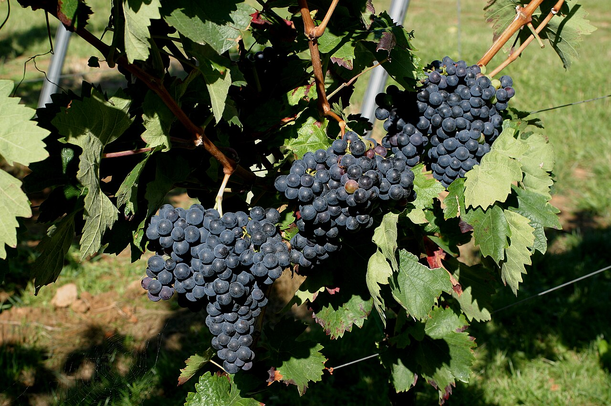

# 佳丽酿

地中海西部的红葡萄，原产西班牙阿拉贡一带，在法国朗格多克、西班牙加泰罗尼亚与意大利撒丁岛广泛种植；老藤低产时酸度高、单宁强、带香料与泥土。

图：Carignan：VIVC2098 CARIGNAN NOIR Cluster in the field 8921（Wikimedia Commons）。图片：Please note: This photo can be reproduced. Please quote the source as indicated below: Doris Schneider, Julius Kühn-Institut (JKI), Federal Research Centre for ，CC BY-SA 4.0，via Wikimedia Commons（[原图页面](https://commons.wikimedia.org/wiki/File:VIVC2098_CARIGNAN_NOIR_Cluster_in_the_field_8921.jpg)）。

## 定义与命名

佳丽酿（Carignan）是一种深色果皮酿酒红葡萄，名字随产地变化：西班牙称 Cariñena，里奥哈用名 Mazuelo，加泰罗尼亚称 Samsó，撒丁岛称 Carignano，美国加州旧称 Carignane，撒丁岛当地还有 Bovale Grande 的叫法。它与西班牙马士罗、意大利波瓦雷经基因分析为同一品种，法国名 Carignan 是国际酒标上最常见的写法。读到这些异名时，先对照品种登记确认同一性，再按所在产区的法规理解风格。

作为古老品种，它拥有几十组欧洲同义词，本身也参与培育过 Argaman、Ruby Cabernet 等杂交品种；变异类型包括白佳丽酿 Carignan Blanc 与灰佳丽酿 Carignan Gris。品种层级之外，酒标还会写产区、地块或混酿角色，三者不是同一信息层级。

## 起源与传播

品种最可能起源于西班牙东北部阿拉贡的 Cariñena 一带，位于萨拉戈萨省，名称即来自这个城镇；当地 15 世纪已有栽培记录，1562 年的 Nájera 文献也提到过它。现代基因研究确认一个亲本为 Castellana Blanca，另一亲本尚未鉴定出来；原产地究竟是阿拉贡还是周边邻近地带，仍有讨论空间。Cariñena 法定产区地处埃布罗河谷中段，葡萄园海拔在 400 至 800 米之间，受 Cierzo 干冷风影响，自罗马时代起就有葡萄栽培。

它随地中海贸易与殖民路线扩散到法国南部、撒丁岛与北非。法国种植在 1988 年达到顶峰，约 167,000 公顷，是当时法国种植面积最大的葡萄品种；此后 EU 拔藤计划与口味转变推动不断拔除，到 2009 年全法面积降至约 53,155 公顷。历史上它与 Aramon 一起被视为法国"葡萄酒湖"的主要推手之一；1962 年阿尔及利亚独立战争后，跨地中海的葡萄酒贸易中断，法国南部商人转而自行种植佳丽酿，进一步推高了面积。在西班牙，它在 Priorat 老藤灌木葡萄与里奥哈 Mazuelo 混酿中长期扮演配角；撒丁岛则在 1323 至 1720 年阿拉贡统治时期引入，发展出当地克隆系。

## 植物学与栽培

佳丽酿果串大而紧实，果粒中等、圆形、果皮厚而颜色深，果肉多汁；属于晚熟品种，喜热耐旱，在偏北的大陆性气候或潮湿的西南法国难以充分成熟。植株长势旺盛，放任产量可达每公顷 200 百升以上，这时颜色变浅、酒体偏薄，并带一丝苦味；只有在贫瘠、低肥力土壤与水分胁迫下，果粒才变小、皮果比提高，酿出深色、高酸、单宁坚实且带紫罗兰花香的酒。

栽培上控产是第一要务。南部产区多用灌木形（alberello）或低篱架，疏果、限产与成熟度判断比浇水施肥更影响成品。老藤根系深、产量自然压低，是今天高端佳丽酿的基础；新藤或高产园则容易稀释颜色与结构。病害方面，它在干燥多风的地块压力较小，花期与成熟期降雨会带来串腐风险。

## 风格与味觉

高产佳丽酿常被做成易饮的日常红或混酿成分；低产老藤款则呈现黑莓、黑樱桃、桑葚、李子干、甘草、黑胡椒、烟草与湿土气息，单宁粗犷有力，酸度偏高，结构感强。年轻时果香直接，陈年后逐渐出现皮革、干果与熏香料。法国南部常用二氧化碳浸渍让年轻酒更柔顺、适合早饮；浓郁老藤款则需要较长瓶陈或醒酒来软化单宁。

它最常见的角色是混酿骨架：与歌海娜交换果香与酒精度，与西拉交换香料与颜色，与慕合怀特交换结构与陈年感。朗格多克-鲁西永的 Minervois、Corbières、Faugères、Fitou、St-Chinian 等 AOC 规则中，都规定了佳丽酿在混酿中的最低比例。品种单一酿造时，风格从清新果味到厚重浓缩都有，取决于地块、产量与萃取方式；与 [syrah](ref:syrah) 这类芳香型红品种相比，佳丽酿更偏酸、单宁与泥土骨架。

## 主要产区与代表酒款

法国南部是它种植最集中的区域，Aude、Gard、Hérault、Pyrénées-Orientales 与 Var 都有大片地块。老藤代表包括 Fitou 的 Domaine Bertrand Bergé、Languedoc 的 Domaine de l'Aupilhac 等以老藤佳丽酿单一酒款或混酿见长的庄园。西班牙 Priorat 的 llicorella 板岩坡地上留有百年灌木老藤，Clos Mogador 的 Manyetes 是代表性单一款；蒙特桑特的 Celler de Capçanes 也以低产老藤佳丽酿酒款知名。

撒丁岛西南部 Sulcis 地区是佳丽酿另一个高质量支点：Carignano del Sulcis DOC 设于 1977 年，砂质土阻碍根瘤蚜，保留了不少未嫁接老藤。Cantina Santadi 合作社创立于 1960 年，旗舰 Terre Brune（Superiore）与 Rocca Rubia（Riserva）是当地标杆。新世界方面，智利马乌莱谷的 VIGNO（Vignadores de Carignan）协会成立于 2011 年，成员包括 Miguel Torres、Undurraga、Valdivieso 与 Gillmore 等；其规则要求葡萄来自至少 30 年树龄的旱地栽培藤，酒中佳丽酿比例至少 65%，把老藤旱作做成了事实上的小型产区规范。

## 怎么喝与配餐

结构厚重的老藤佳丽酿适合 16–18°C 饮用，温度偏低会把单宁与酸感收紧，偏高则酒精与粗粝感放大。年轻果香型可以稍凉到 14–16°C。杯中选大肚宽杯，单宁强的酒款提前醒酒半小时到一小时，让果香与单宁逐步展开；陈年已久的酒则注意滤除沉淀。

配餐围绕南北地中海与内陆家常菜：烤羊肉、炖牛肉、扁豆炖肉、香肠与腌腊制品、蘑菇炖菜、硬质陈年奶酪都能接住它的酸度与单宁。带酱汁的红肉、野味与番茄炖菜是稳妥组合；清淡鱼白肉或辛辣菜式会被酒中的单宁与苦味压住，不宜搭配。作为 [red-wine](ref:red)，它的浓郁度更适合分量扎实的主菜，而不是餐前小食。

## 选购与常见误区

一个常见误区是把佳丽酿等同于廉价散装混酿。这种印象来自过去高产园与大宗 jug wine；今天的老藤低产款在颜色、酸度与结构上都有独立分量，价格与定位也明显高于日常款。另一个误区是只看品种名：法国混酿、Priorat 老藤、Sulcis 砂土与智利旱作老藤，虽然同一葡萄，风土与工艺带来的风格差别很大，年份对成熟度与单宁粗细影响显著。

选购时先分辨单一品种酒还是混酿，再看地块层级、树龄与年份。老藤不是法律等级标签，具体产量与树龄要以酒庄说明为准；有机栽培是种植方式，不等于风味保证。储存避开高温、强光与震动，结构红葡萄酒开瓶后可存放两到三天，用真空塞减缓氧化。

## 延伸阅读与另见

比较这个品种最直接的方式，是同年份试一支朗格多克老藤、一支 Priorat 单一款与一支 Sulcis DOC，对照酸度、单宁与泥土香的差别。它与 [terroir](ref:terroir) 层面的贫瘠坡地风土、[oak-ageing](ref:oak) 的桶陈选择、[vintage](ref:vintage) 带来的成熟度差异都密切相关，也可与西拉、歌海娜等混酿伙伴的条目对照阅读。

- 相关条目：[syrah](ref:syrah)、[red-wine](ref:red)、[terroir](ref:terroir)、[oak-ageing](ref:oak)、[vintage](ref:vintage)。

对照阅读：[西拉](ref:syrah)、[风土（terroir）](ref:terroir)。
