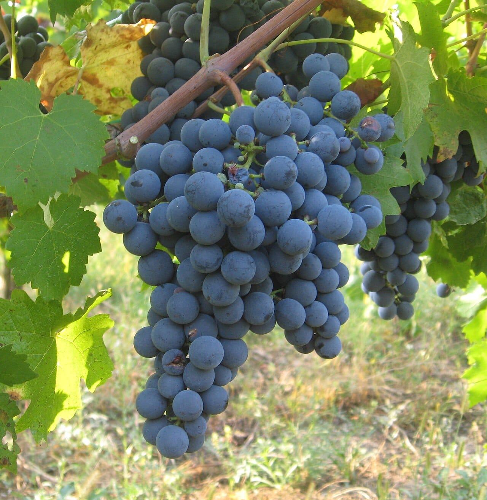

# 佳美娜

佳美娜（Carménère）的故事几乎全部围绕“误认”展开：它曾是波尔多混酿的一员，根瘤蚜危机后在欧洲几乎消失，却在智利被当成梅洛种了一百多年，直到 1994 年才被重新识别。这个品种晚熟、颜色深、单宁中等偏厚，既有黑李子的甜熟果味，也有青椒、烟草与黑巧克力的草本和烘烤气息。它既是智利葡萄酒的身份符号，也是理解“品种、气候与法规如何共同塑造风格”的一个好例子(ref:wine)。

图：佳美娜。图片：Lebowskyclone，CC BY-SA 3.0，via Wikimedia Commons（[原图页面](https://commons.wikimedia.org/wiki/File:CarmenereW.jpg)）。

> **先给结论**
> **一句话：** 这页判断佳美娜适不适合你，以及怎么比较其他品种。
>
> - **适合谁：** 正在比较佳美娜与其他品种、想弄懂风味差异的人。
> - **不适合谁：** 只想要单一名庄推荐、不关心品种本身的人。
> - **先看这两点：**
>   - 佳美娜属于欧洲葡萄 Vitis vinifera，是红葡萄品种。
>   - 佳美娜原产法国波尔多，18 世纪已见于梅多克一带，曾与赤霞珠、品丽珠、梅洛一起参与混酿。

## 定义与别名

佳美娜属于欧洲葡萄 Vitis vinifera，是红葡萄品种。英文常写作 Carmenère 或 Carmenere，中文也有卡曼尼等音译。历史上它还有一个波尔多别名 Grande Vidure，但这个名字也曾被用来指称其他品种，容易造成混淆。最重要的区分是：佳美娜不是梅洛，也不是梅洛的克隆；两者亲缘相近，但品种特征、成熟节奏与酒风都不同(ref:red-wine)。智利酒标上的“Carmenère”是官方认可的品种名称，而不是产区名。

## 亲本与起源

佳美娜原产法国波尔多，18 世纪已见于梅多克一带，曾与赤霞珠、品丽珠、梅洛一起参与混酿。DNA 研究确认它是品丽珠（Cabernet Franc）与巴斯克地区品种 Gros Cabernet 的自然杂交后代，因此与梅洛、赤霞珠共享部分亲本，但并非同一品种。19 世纪后期根瘤蚜席卷欧洲，佳美娜因为晚熟、坐果不稳、在凉爽的波尔多难以稳定成熟，逐渐被酒农放弃，欧洲一度认为它已经灭绝。智利在 1850 年代前后已引入该品种，当地干燥的气候与未受根瘤蚜严重侵袭的老园让它得以延续；由于叶片与梅洛相似，它长期被误标为梅洛。1994 年，法国葡萄品种学家 Jean-Michel Boursiquot 在智利葡萄园中重新鉴定出佳美娜，随后 DNA 检测确认了它的身份。

## 植物学特征

佳美娜的果粒较小，果皮颜色深，色素含量高，因此酒液颜色通常比梅洛更深。果穗相对松散，叶片与梅洛相似，但裂刻往往更深，这是田间辨认它的一个线索。它属于晚熟品种，通常比梅洛晚两到三周成熟；在凉爽地区，果实可能停留在青椒与草本阶段，单宁也变得生硬。它的坐果不稳定，容易出现落果（coulure）与大小粒，产量年际波动较大。果皮中的花青素丰富，但单宁质地比赤霞珠柔和，这也是它在混酿中常被用来增加颜色与中段果味的原因。

## 栽培特性

佳美娜需要漫长而温暖的秋季才能完全成熟，因此在波尔多这样的海洋性凉爽气候中表现不稳定，这也是它被边缘化的栽培原因。智利中央山谷的干燥秋季、充足的日照与安第斯山融雪灌溉，为它提供了更可靠的成熟条件。它对土壤的适应范围较广，但在排水良好的冲积土与坡地砾石土上表现更好。由于落果与大小粒常见，酒农需要通过控制负载、改善开花期水分与养分管理来稳定产量。晚采可以降低青椒味，但也可能带来酒精偏高与酸度不足的问题，因此采收时机是佳美娜酿造中最关键的决策之一。

## 产区分布

智利是佳美娜最重要的产区(ref:chile)。科尔查瓜谷（Colchagua）是核心，尤其是阿帕尔塔（Apalta）与马奇格（Marchigüe）一带，花岗岩、黏土与冲积土给酒带来颜色、结构与香料感(ref:colchagua)。迈波谷、卡查波阿尔谷、库里科谷与马乌莱谷也有大量种植，风格从饱满果味到草本清爽不等。波尔多今天仍允许种植佳美娜，但面积很小，已不是主流品种，只有零星老树与实验性地块。意大利、阿根廷、巴西与中国也有少量栽培，通常用于混酿或实验性单一品种酒。智利之外，很少有产区把佳美娜作为标志性品种。

## 法定规则

智利以原产地命名（Denominación de Origen）体系管理葡萄酒，品种标注通常要求酒液中至少 75% 来自所标注的品种，对欧盟出口时按 85% 执行，具体比例以最新法规与出口市场要求为准。佳美娜是智利官方认可的品种名称，酒标可以标注“Carmenère”；若与赤霞珠、西拉、小维多等混酿，也可只标注主要品种或使用地区名称。智利对采收年份、产区与品种的标注都有相应规定，监管由农业与畜牧服务局（SAG）负责。波尔多仍把佳美娜列为允许的红葡萄品种之一，但种植面积很小；具体产区的品种比例与法规以最新规范为准。

## 酿造

佳美娜的酿造核心是“成熟度管理”。酒农通常延迟采收以降低青椒与草本感，同时避免过熟带来果酱味与高酒精。发酵温度不宜过高，以保留果味与颜色；浸渍时间视风格而定，短浸渍更清爽，长浸渍则增加单宁与结构。优质酒款常进入法国橡木桶陈年(ref:oak-ageing)，新桶比例因酒庄而异，目的是增加香料、烟草与烘烤气息，而不是掩盖果味。苹果酸-乳酸发酵几乎是标准步骤，用以柔化酸度。佳美娜也常与赤霞珠、西拉或小维多混酿，以补充酸度、单宁或颜色；单一品种酒则更强调智利的品种身份。

## 感官风格

年轻佳美娜以黑李子、黑莓、蓝莓、黑樱桃与紫罗兰为主，常伴随青椒、红椒粉、烟草、黑巧克力与酱油般的发酵气息。酒体中等偏饱满，单宁中高但比赤霞珠柔顺，酸度中等，酒精通常偏高。成熟度不足时，青椒与草本会压过果味；成熟度良好时，果味甜美、单宁圆润，草本感变成复杂度的一部分。经过橡木陈年与瓶陈，酒会发展出皮革、雪松、松露与咖啡的香气。它的陈年潜力中等偏长，优质科尔查瓜佳美娜可以陈放十年以上。

## 代表生产者与年份

智利代表酒庄包括 Concha y Toro（Carmín de Peumo）、Montes（Alpha 系列）、Lapostolle（Clos Apalta 为混酿）、De Martino、Viu Manent 与 Santa Rita。Concha y Toro 的 Carmín de Peumo 常被视为佳美娜单一品种的标杆之一，Montes 与 Lapostolle 则更强调阿帕尔塔坡地的结构感。年份差异主要来自春季坐果期的天气与秋季温度：坐果稳定的年份产量更均匀，温暖漫长的秋季则更容易获得成熟的果味与柔顺的单宁；凉爽年份草本感更明显，酒庄往往通过延迟采收与混酿来平衡。具体年份表现仍取决于地块与酿造选择。

## 常见误区

第一，把佳美娜当成梅洛。两者亲缘相近，但佳美娜更晚熟、颜色更深、草本与烟草气息更明显。第二，认为佳美娜已经灭绝。它在智利大量存在，只是长期被误认。第三，把青椒味一律视为缺陷。适度的青椒与草本可以增加复杂度，只有压倒果味时才成为问题。第四，以为佳美娜只产自智利。它原产波尔多，今天在多个国家有少量种植。第五，认为佳美娜只能做便宜酒。科尔查瓜的老藤与低产地块可以酿出结构完整、可陈年的酒。第六，把 Grande Vidure 当成另一个独立品种。它是佳美娜的历史别名之一。

对照阅读：[葡萄酒](ref:wine)、[智利](ref:chile)。

## 延伸阅读

- [葡萄酒](ref:wine)：理解品种、产区与酒标体系的入口。
- [红葡萄酒](ref:red-wine)：佳美娜所属的酒类。
- [智利](ref:chile)：佳美娜最重要的现代产区。
- [科尔查瓜](ref:colchagua)：智利佳美娜的核心子产区。
- [橡木陈年](ref:oak-ageing)：理解佳美娜香料与结构的重要工艺。

**关键事实。**

| 项目 | 内容 |
| --- | --- |
| 一句话定位 | 原产法国波尔多的红色品种，19 世纪传入智利后长期被误认作梅洛；1994 年重新鉴定，成为智利标志性品种 |
| 物种 | Vitis vinifera |
| 代表产区 | 智利、科尔查瓜 |

**来源与边界。** 本页关于「佳美娜」的关键事实，主要由以下来源交叉核对：International Organisation of Vine and Wine (OIV)（品种描述与 Vitis 物种框架）、Oxford University Press（提供关于佳美娜、波尔多与智利种植的条目；由原条目末尾参考资料迁移，未逐条复核访问日期）、Wines of Chile（佳美娜在智利的品种历史、产区与风格概况）。价格、批次与状态会变，涉及这些字段时以页面所列来源的最新版本为准。正文为项目自写，来源只作核验，不复制原文。
