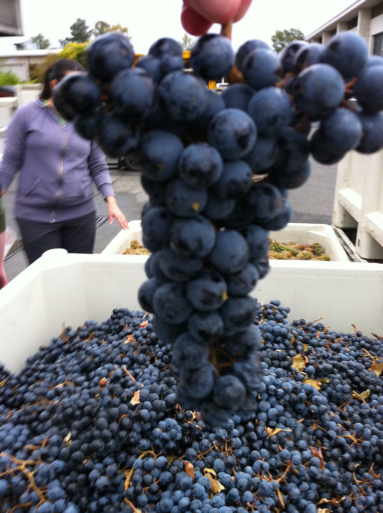

# 神索

神索（Cinsault，法国官方拼法 Cinsaut）是法国南部地中海气候孕育的红葡萄，耐热耐旱、长势旺、产量高，果皮薄、酒色浅、单宁柔和，酸度中高，以红樱桃、草莓、白桃与花香见长。它长期作为混酿与桃红品种存在，为歌海娜、西拉、慕合怀特等补充果香、花香与酸度；近年老藤单一品种酒在法国南部、南非与黎巴嫩重新受到重视（ref:grenache）。

读这个品种要抓住一条主线：它的名声问题几乎都来自高产。放任产量，酒会苍白、简单、寡淡；限制产量、依靠老藤并把握采收时机，才会出现有层次、单宁细腻的神索。理解了“产量与克制”这组对比，就能理解它在不同产区的风格落差。

图：Cinsault：Cinsault cluster（Wikimedia Commons）。图片：Agne27，CC BY-SA 3.0，via Wikimedia Commons（[原图页面](https://commons.wikimedia.org/wiki/File:Cinsault_cluster.JPG)）。

## 定义与命名

神索学名为 Vitis vinifera，红葡萄、果汁无色。法国官方名称为 Cinsaut，国际通行拼法 Cinsault。它的同义词数量很多：在美国称 Black Malvoisie，澳大利亚称 Blue Imperial、Black Prince，意大利普利亚称 Ottavianello，南非旧称 Hermitage，西班牙称 Samsó、Sinsó，保加利亚称 Senso，希腊称 Mavro Kara Melkii；另有 Oeillade noire、Marocain、Plant d'Arles、Picardan noir、Piquepoul d'Uzès 等地方名。部分俗名同时被其他品种借用，不能单凭名字对号入座。

两个名称上的混淆要先排除：南非旧称 Hermitage 与罗讷河谷的 Hermitage 产区没有直接关系；神索也不等于朗格多克-普罗旺斯历史上栽培的“true Oeillade”，后者已基本不再种植。辨识上，它叶片中等大、五裂，果穗圆锥形、较紧凑，果粒球形、皮薄、果肉多汁，果汁颜色浅，发芽偏晚、能避开春霜；普罗旺斯与 Tavel 酒标上它多作为桃红直接压榨或短暂浸皮的品种，南罗讷混酿中则只是允许的次要品种。

## 起源与传播

神索最可能起源于法国普罗旺斯一带，自中世纪起在南部栽培，随后扩散到罗讷河谷、朗格多克-鲁西永，并随法国殖民影响进入阿尔及利亚、摩洛哥、突尼斯与黎巴嫩。基因研究显示，它是南非品种 Pinotage 的亲本之一，并与 Bouteillan、Morrastel 有亲缘关系。二十世纪它曾因高产、耐旱被大面积种植，用于替代直接杂交品种，二十世纪后期在法国部分产区被逐步拔除。

全球栽培面积约 25,000 公顷，法国 2006 年登记近 24,773 公顷，集中在朗格多克-鲁西永、罗讷河谷南部与普罗旺斯。北非是另一块重要版图：摩洛哥按产量计神索是第一大品种，在阿尔及利亚与突尼斯也占重要位置。南非、黎巴嫩、意大利普利亚、西班牙、澳大利亚与美国加州都有种植，规模远不及地中海传统产区。

## 植物学与栽培

叶片中等大、五裂；果穗圆锥形、较紧凑，果粒球形、皮薄、果肉多汁，果汁颜色浅。发芽偏晚，能避开春季霜冻；长势旺、产量潜力高，常规产量可达每公顷 40–60 百升。皮薄使它对白粉病、霜霉病较敏感，潮湿年份需要重点防治；它对高温与干旱耐受极强，深根能在干燥土壤中找到水分。

栽培上的核心是控产与叶果平衡：产量过高时香气稀薄、单宁松散、酒色更浅；枝叶过密造成遮阴则降低酸度、加重病害。修剪方式、引缚高度、疏叶时机与有限灌溉都围绕这条平衡线调整。向阳坡地、排水良好的砾石或石灰岩土更适合做有质感的酒；平坦肥沃地块多用于清爽的年轻酒与混酿原料。

## 风格与味觉

典型神索红酒与桃红颜色浅淡明亮，单宁柔和、酸度中高，入口轻盈解渴。年轻酒以草莓、红樱桃、覆盆子、白桃与紫罗兰、玫瑰等花香为主，带少许 Garrigue 灌木与辛香；随瓶陈发展出蜜饯水果、柔和香料与干草气息，单宁变得更融。酒精度通常在 12.5–13.5%，不属于厚重浓郁的类型。

酿造路线上，它最常进入混酿：为歌海娜、慕合怀特、西拉等提供果香、花香与新鲜酸度；在普罗旺斯与 Tavel 则大量用于桃红，直接压榨或短暂浸皮获得淡三文鱼色与红色果味。单一品种装瓶时，老藤与低产地块能支撑更集中的结构；橡木使用克制，以免新桶香草味压住品种本身的清新花香（ref:red）。

## 主要产区与代表酒款

法国境内，普罗旺斯的 Côtes de Provence、Bandol、Coteaux d'Aix-en-Provence 把神索作为直接压榨桃红的关键品种；Tavel 是法国唯一专属桃红的 AOC，常与歌海娜调配成较有结构、可陈年的桃红；南罗讷的 Châteauneuf-du-Pape 允许将其作为 minor 品种进入混酿，Gigondas、Vacqueyras、Lirac 一带也常见。朗格多克-鲁西永则以混酿与地区餐酒为主。

黎巴嫩贝卡谷地的 Château Musar 是最知名的海外案例：成熟神索与赤霞珠、佳利酿等调配，贡献红色果味、花香与近乎轻盈的质感，酒款具备极长的瓶陈寿命。南非是神索的另一处复兴地：它在当地旧称 Hermitage，1925 年由 Abraham Izak Perold 与黑皮诺杂交育成 Pinotage；如今 Swartland、Stellenbosch、Bot River 一带的生产者重新用老藤神索做单一品种酒，代表有 Bot River 的 Beaumont Family Wines。普罗旺斯 Bandol 的 Château de Pibarnon 酒庄 1977 年建立，桃红由神索与慕合怀特调配（早期比例约 40% 神索、60% 慕合怀特），葡萄园位于海拔约 300 米的梯田台地，有机种植。

## 怎么喝与配餐

神索红酒与桃红适合在 12–16 °C 饮用：清爽年轻款与桃红偏低，有一定结构的老藤红酒略高。不需要长时间醒酒，开瓶即饮即可；桃红用中等肚径白葡萄酒杯，红酒用通用杯型。它是典型的夏日与配餐型酒，酸度与果香能接上清淡料理。

配餐上，桃红与轻红适合烤蔬菜沙拉、冷盘、烤鸡、海鲜、烤鱼、蒜香虾仁与火腿；南法料理如 ratatouille、橄榄酱、香草烤羊排也搭配稳妥。风格清淡的海鲜、水果甜点不宜配单宁厚重的版本；与重辣菜式搭配时，选果味更清爽、酒精度更低的酒款。

## 选购与常见误区

第一个误区是把神索当成平淡的填充品种：高产混酿确实简单，但老藤、低产的单一品种酒有完整果香与细腻单宁。第二个误区是把南非旧名 Hermitage 当成罗讷 Hermitage 产区酒；两者只是名称巧合。第三个误区是把 Pinotage 直接等同于神索：Pinotage 是神索与黑皮诺的杂交后代，风格更浓重，不能混用。

看酒标先分清桃红还是干红、单一品种还是混酿、产区与年份。年轻神索适合一到八年内饮用，陈年潜力取决于地块与酿造；储存平放、避光、远离温度波动。它在海外以专业进口渠道为主，购买时留意储存条件，过热仓库里的清新型白酒与桃红容易果味发闷。

相关条目：[普罗旺斯](ref:provence)、[歌海娜](ref:grenache)、[桃红葡萄酒](ref:rose)。

## 延伸阅读与另见

- 相关条目：[provence](ref:provence)、[grenache](ref:grenache)、[rose-wine](ref:rose)、[red-wine](ref:red)、[terroir](ref:terroir)。
- 想比较混酿与单一品种的差别，可选一款普罗旺斯桃红与一款南非老藤神索干红，对比果香浓度、单宁粗细与花香表现。
