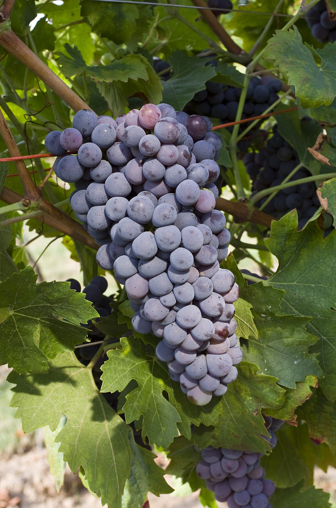
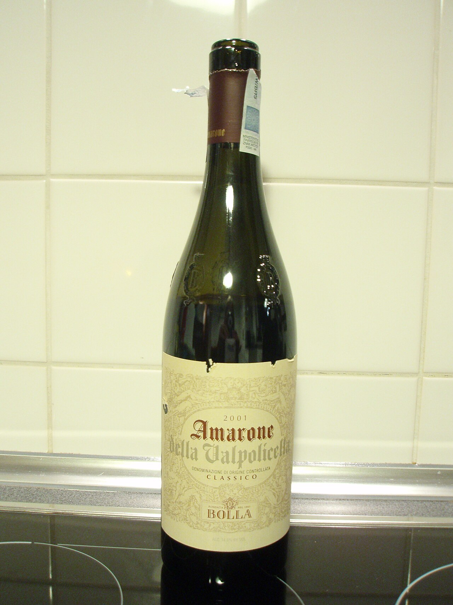

# 科维纳

科维纳是意大利威尼托的红葡萄品种，果皮较薄、颜色中等，以酸樱桃、杏仁与草本香气著称。它是瓦坡里切拉与阿玛罗尼的核心品种，通常与科维诺内、罗迪内拉同组混酿，而不是单独成酒。

图：科维纳。图片：Please note: This photo can be reproduced. Please quote the source as indicated below: Ursula Brühl, Julius Kühn-Institut (JKI) Bundesforschungsinstitut für Kul，CC BY-SA 4.0，via Wikimedia Commons（[原图页面](https://commons.wikimedia.org/wiki/File:VIVC2863_CORVINA_VERONESE_Cluster_in_the_field_19664.jpg)）。

## 定义与别名

科维纳的意大利语名是 Corvina，在威尼托常写作 Corvina Veronese，以区别于其他地区同名或近名的品种。它属于欧洲葡萄 Vitis vinifera，是一个独立品种。

历史上，科维诺内（Corvinone）长期被当作科维纳的一个类型或克隆，后来被确认为独立品种；罗迪内拉（Rondinella）则是另一个独立品种。三者在瓦坡里切拉的传统混酿中常被一起讨论，但植物学与栽培表现并不相同，酒标上的品种比例也分别计算。

## 植物学特征

科维纳果穗中等偏大，果粒中等，果皮较薄，色素与单宁含量中等偏低，因此酒色通常不算深。它的萌芽与成熟节奏适中，在威尼托的丘陵地带表现稳定。

果皮薄带来一个直接后果：它适合风干，但也更容易在潮湿年份受霉菌影响。风干过程中水分蒸发、糖分与风味浓缩，同时必须控制湿度与通风，否则果实在入罐前就可能腐败。

## 主要产区

核心产区是意大利东北部威尼托的瓦坡里切拉（Valpolicella）与巴多利诺（Bardolino）一带，丘陵、砾石与石灰质土壤混合，北面有加尔达湖调节气候。除威尼托外，其他地区种植面积有限。

[意大利](ref:italy)的法定产区体系对品种比例有明确规定：瓦坡里切拉与阿玛罗尼都要求以科维纳为主体，并与科维诺内、罗迪内拉等品种配合。产区页描述地理与制度，品种页只描述品种潜力。

## 典型风味

典型香气是酸樱桃、红樱桃、杏仁、干草与草本，陈年后发展出干果、香料与皮革气息。酸度中等到偏高，单宁中等，酒体偏轻到中等；经风干酿造后，糖分与酒精提高，风味变得更浓。

科维纳单独品尝时容易显得清瘦，这正是它在传统混酿中需要伙伴的原因：科维诺内提供颜色与结构，罗迪内拉提供果味与酸度。判断一款瓦坡里切拉时，品种比例与风干工艺都比单纯看颜色重要。

## 代表酒款

[阿玛罗尼](ref:amarone)是科维纳最知名的酒款：葡萄采收后风干数月，再进行发酵与[橡木桶陈年](ref:oak-ageing)，酒体饱满、酒精度高。瓦坡里切拉普通款与里帕索（Ripasso）也以这组品种为基础，风格更轻。

同一品种在不同工艺下差异极大：新鲜葡萄直接发酵得到轻盈的红酒，风干后发酵得到浓缩的甜型或干型酒。品种页描述潜力，酒款页才记录具体酒庄的风干时长与陈年决策。

里帕索的做法是把新鲜葡萄发酵得到的瓦坡里切拉酒液，与刚完成阿玛罗尼发酵的风干酒渣混合，进行第二次浸渍与发酵，借酒渣补充颜色、酒精与干果香气；因此里帕索的酒体介于普通瓦坡里切拉与阿玛罗尼之间。风干室要求通风、低温与低湿，果串单层摆放或挂在架上，期间需翻动并剔除霉变果；失水使糖分、酸度与香气浓缩，也提高发酵后期酒精带来的风险。工艺细节由各酒庄决定，本页不给出统一时长。

## 栽培要点

科维纳的栽培重点是成熟度与果皮完整度。成熟不足时酸度高、香气偏青；成熟过度则失去酸度与清爽感。威尼托传统使用棚架式（pergola）整形，以适应丘陵地形与光照条件。

用于阿玛罗尼的果实需要额外筛选：无破损、无霉变的果串才能进入风干房。产量控制与采收时机直接影响风干损失率与最终酒质，具体参数因酒庄而异，本页不给出统一数值。

## 常见误区

第一，把科维纳与科维诺内当成同一品种。两者曾被视为同类，现为独立品种。
第二，把罗迪内拉当成科维纳的别名。它是另一个品种，在混酿中有不同作用。
第三，认为科维纳颜色浅就是酒体单薄。风干与混酿可以显著改变结构。
第四，认为阿玛罗尼是单一品种酒。法定产区规则允许并通常使用多个品种。
第五，把瓦坡里切拉所有酒款当成同一工艺。普通款、里帕索与阿玛罗尼的工艺完全不同。

科维纳是威尼托的红葡萄品种，薄皮、中等色深，酸樱桃、杏仁与草本香气是常见线索；它是瓦坡里切拉与阿玛罗尼的核心，常与科维诺内、罗迪内拉同组混酿。阿玛罗尼的浓缩来自采后风干，不是把科维纳本身变甜；读品种页时要区分品种特征与风干工艺。

对照阅读：[红葡萄酒](ref:red-wine)、[阿玛罗尼](ref:amarone)。

## 延伸阅读

- [红葡萄酒](ref:red-wine)：科维纳的分类、单宁与基本工艺。
- [意大利](ref:italy)：威尼托在意大利葡萄酒版图中的位置。
- [阿玛罗尼](ref:amarone)：以科维纳为核心、经风干酿造的代表酒款。
- [橡木桶陈年](ref:oak-ageing)：陈年对风干型红酒风格的影响。

**关键事实。**

| 项目 | 内容 |
| --- | --- |
| 一句话定位 | 意大利威尼托的红葡萄品种，果皮较薄、颜色中等，以酸樱桃、杏仁与草本香气著称；是瓦坡里切拉与阿玛罗尼的核心品种，常与科维诺内、罗迪内拉同组混酿 |
| 物种 | Vitis vinifera |
| 代表产区 | 意大利 |

**来源与边界。** 本页关于「科维纳」的关键事实，主要由以下来源交叉核对：International Organisation of Vine and Wine (OIV)（品种描述与 Vitis 物种框架）、Consorzio Tutela Vini della Valpolicella（瓦坡里切拉与阿玛罗尼的品种构成与风干工艺）、Oxford University Press（提供关于科维纳、科维诺内、罗迪内拉与瓦坡里切拉的条目；由原条目末尾参考资料迁移，未逐条复核访问日期）等 5 条来源。价格、批次与状态会变，涉及这些字段时以页面所列来源的最新版本为准。正文为项目自写，来源只作核验，不复制原文。

**并读。** 把「科维纳」与「红葡萄酒」、「意大利」、「阿玛罗尼」放在一起读时，先确认它们是同一层级还是上下游关系：先确认品种身份与允许产区，再比较成熟期、抗性、克隆与酿造表现。本页负责给出品种的基本坐标，对照条目补上具体案例与差异；读完再回到本页，才能分清哪些差别属于品种本身，哪些只是产地、批次或品牌选择。

**适用边界。** 对「科维纳」而言，品种表现随产区、气候与克隆选择变化；同名品种在不同国家可能指不同材料。

## 相关图像

图：A bottle of Amarone della Valpolicella。图片：Jerzy Kociatkiewicz，CC BY-SA 2.0，via Wikimedia Commons（[原图页面](https://commons.wikimedia.org/w/index.php?curid=8844471)）。关联图像：科维纳。
