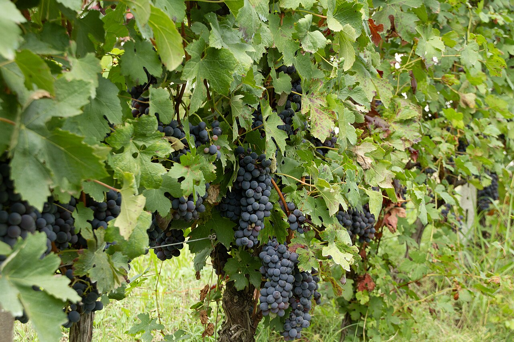

# 多切托

多切托（Dolcetto）是意大利西北部皮埃蒙特三大红品种之一，与内比奥罗、巴贝拉并列。意大利语名字意为“小甜”，但成品几乎总是干型；它早熟、低酸、单宁可经柔和萃取变得圆润，酒色深紫，带黑樱桃、李子、甘草与标志性的苦杏仁余味。多数酒款为年轻时即饮，是朗格产区在昂贵内比奥罗与巴贝拉成熟之前的日常红酒（ref:piedmont）。

读这个品种要抓住它在皮埃蒙特葡萄园里的位置：它比内比奥罗早几周成熟，往往种在相对冷凉、朝向偏北或海拔较高的地块，最好的向阳坡留给内比奥罗。理解了这层“果园分工”，就能理解多切托为什么以果味、酸度平衡与易饮性见长，而不是以陈酿结构取胜。

图：Dolcetto：Old Vine Dolcetto - Fontanavi（Wikimedia Commons）。图片：Tenutailfinale，CC0，via Wikimedia Commons（[原图页面](https://commons.wikimedia.org/wiki/File:Old_Vine_Dolcetto_-_Fontanavi.jpg)）。

## 定义与命名

多切托学名为 Vitis vinifera，黑皮红葡萄。VIVC 编号 3626，登记名称 Dolcetto。地方同义词包括 Dolsin；在利古里亚称 Ormeasco，在 Oltrepò Pavese 被叫作 Nebbiolo 或 Nibièu；Dogliani 当地方言里称 duzet、duset。部分名字与其他品种或产区重名，不能单凭俗名判断。

名字“小甜”是否来自果实糖度并无定论，另一种说法是它得名于栽培它的山丘地名；真正让酒尝起来偏甜的是偏低的酸度，而不是残糖。辨识上，它果粒中小、果皮深紫、花青素含量高，短暂浸皮即可取色，发芽与成熟都偏早，比内比奥罗早几周完成成熟；因此冷凉、海拔较高或偏北的地块更适合它。它在 Oltrepò Pavese 被叫成 Nebbiolo 或 Nibièu，只是地方俗名，不能据此与皮埃蒙特晚熟的内比奥罗混为一谈。

## 起源与传播

家谱研究把多切托的亲本确定为 Dolcetto Bianco 与 Moissan，这一组合已由分子标记确认；2020 年 9 月 25 日发表的西北意大利古老葡萄 DNA 谱系研究指出，双亲分布区在今天的朗格一带重叠，这里很可能就是多切托的摇篮。关于起源地另有两说：一种认为它来自法国，11 世纪前后传入蒙费拉托；另一种认为它起源于 Dogliani 村周边。

文献记录方面，1593 年 Dogliani 市政条例禁止在圣马太节之前采收 dozzetti 葡萄，被认为指的就是这个品种；1633 年 Valenza 的 Arboreo 家族酒窖档案中有多切托的记载；1700 年 Barnabà Centurione 曾把这种酒作为礼物送给英国女王 Anne。今天它几乎全部集中在皮埃蒙特的 Cuneo 与 Alessandria 两省，利古里亚与伦巴第边缘有少量同名栽培；海外有巴西、澳大利亚、美国加州等地的小规模种植。

## 植物学与栽培

果穗中等，果粒中小，果皮深紫、花青素含量高，短暂浸皮即可获得深颜色。它发芽与成熟都偏早，比内比奥罗早几周，也比巴贝拉更早完成成熟；因此在葡萄园分工中，相对冷凉、海拔较高或朝向偏北的地块更适合它，最优质的向阳坡留给晚熟的内比奥罗。

品种天然酸度偏低、单宁潜力不低；酿酒师通常用较短的发酵与温和压榨控制萃取，避免单宁粗硬。栽培上要防的是霜霉、灰霉与潮湿年份的病害；叶果平衡、疏叶与排水决定果味集中度。老藤与低产地块能支撑更复杂的酒款，普通高产园的果味则清淡直接（ref:terroir）。

## 风格与味觉

典型多切托酒色深宝石红到紫红，年轻时近乎不透光，带紫色反光；香气以黑樱桃、李子、蓝莓、黑加仑、甘草为主，伴随薰衣草、紫罗兰、橙皮与红茶气息，余味有品种标志性的苦杏仁。口感干、中等酒体、多汁，酸度低于巴贝拉，单宁经柔和萃取后圆润而不扎口；与低酸并列的特点是果味在口中显得饱满甜美。

酿造上，多数入门款在温控不锈钢罐完成发酵与短暂陈酿，以保留新鲜果味；大桶或旧桶短期陈酿可以增加一点结构，新桶比例过高反而会压住品种本身的果香。Superiore 级别与老藤单一园版本更复杂，发展出干果、墨水、香料与矿物层次。它不属于需要数十年瓶陈的类型，普通款在采收后一到五年内饮用最佳，优质 Dogliani 与老藤 Alba 款可放五到八年（ref:nebbiolo）。

## 主要产区与代表酒款

皮埃蒙特有七个多切托 DOC/DOCG 体系。Dolcetto d'Alba 是最广为人知的 DOC，1974 年获批，覆盖 Alba 周边 36 个市镇，限山坡地、海拔不超过 650 米；标准款最低酒精度 11.5%，Superiore 为 12.5% 并陈酿 14 个月。Dogliani DOCG 位于 Cuneo 省 21 个市镇，1974 年先获 DOC，2005 年 Superiore 升入 DOCG，2011 年又把原 Langhe Monregalesi 地块并入；2018 年该区种植 542 公顷，产量约 218,900 箱。Dolcetto di Diano d'Alba 于 2010 年成为 DOCG，Dolcetto d'Ovada Superiore 于 2008 年成为 DOCG，另有 Dolcetto d'Acqui、Dolcetto d'Asti 与 Langhe Dolcetto。利古里亚的 Riviera Ligure di Ponente Ormeasco 要求至少 95% 为多切托/Ormeasco。

代表生产者方面，Dogliani 的 Poderi Luigi Einaudi 出品 Dogliani Superiore Vigna Tecc，葡萄园位于 San Giacomo 与 Madonna delle Grazie 坡地，海拔约 350 米，面积 4.5 公顷，部分植株 1937 年栽种，年产约 20,000 瓶；同产区还有 San Fereolo、Clavesana。Alba 一线的 Fratelli Giacosa 自 1895 年在 Neive 一带经营，旗下 Madonna Como Dolcetto d'Alba 是该产区常见的单一品种酒；Paitin、Elio Grasso、Vietti、Damilano 等也都有多切托酒款。

## 怎么喝与配餐

多切托适合略微冰镇，饮用温度约 14–17 °C；年轻果香款偏低，结构较厚的 Superiore 略高。杯子用中等肚径红酒杯即可，不需要长时间醒酒，开瓶后短时间内喝完。它是典型的配餐型红酒，低酸与圆润单宁接上油脂与咸鲜。

皮埃蒙特本地搭配包括 tajarin 肉酱面、bagna cauda 蘸菜、腌火腿与风干肉、陈年奶酪、蘑菇与肝类小菜；苦杏仁余味与泥土气息的菜式相得。番茄酱汁炖肉、烤禽肉也稳妥；清淡海鲜或甜味甜点与它的果味和单宁不搭。

## 选购与常见误区

第一个误区是被名字“小甜”误导，以为多切托是甜酒；它几乎总是干型，口中的甜美感来自低酸与成熟果味，不是残糖。第二个误区是把它和内比奥罗混为一谈：两者都产在朗格，但成熟节奏、酸度、单宁与陈年方向完全不同，多切托是早饮日常款。第三个误区是以为所有多切托都清淡：Dogliani Superiore 与老藤单一园有明显结构与陈年空间。

看酒标先分清 DOC 与 DOCG、标准款与 Superiore、是否单一园（Vigna），再看年份与酒精度。普通款三到五年内饮用，Superiore 与老藤款可放更久；储存平放、避光、远离温度波动。海外市场上它常作为皮埃蒙特入门红酒出现，价格分层主要来自地块、树龄与陈酿级别。

相关条目：[内比奥罗](ref:nebbiolo)。

## 延伸阅读与另见

- 相关条目：[piedmont](ref:piedmont)、[nebbiolo](ref:nebbiolo)、[barbera](ref:barbera)、[red-wine](ref:red)、[terroir](ref:terroir)。
- 想比较产区差别，可选同一年份一款 Dolcetto d'Alba 与一款 Dogliani Superiore，对比果香浓度、单宁粗细与苦杏仁余味的长短。

对照阅读：[皮埃蒙特](ref:piedmont)、[巴贝拉](ref:barbera)。

## 相关图像

图：内比奥罗。图片：Hanna，CC BY 2.0，via Wikimedia Commons（[原图页面](https://commons.wikimedia.org/wiki/File:Close_up_of_Nebbiolo_cluster_in_Italy.jpg)）。关联图像：多切托。
