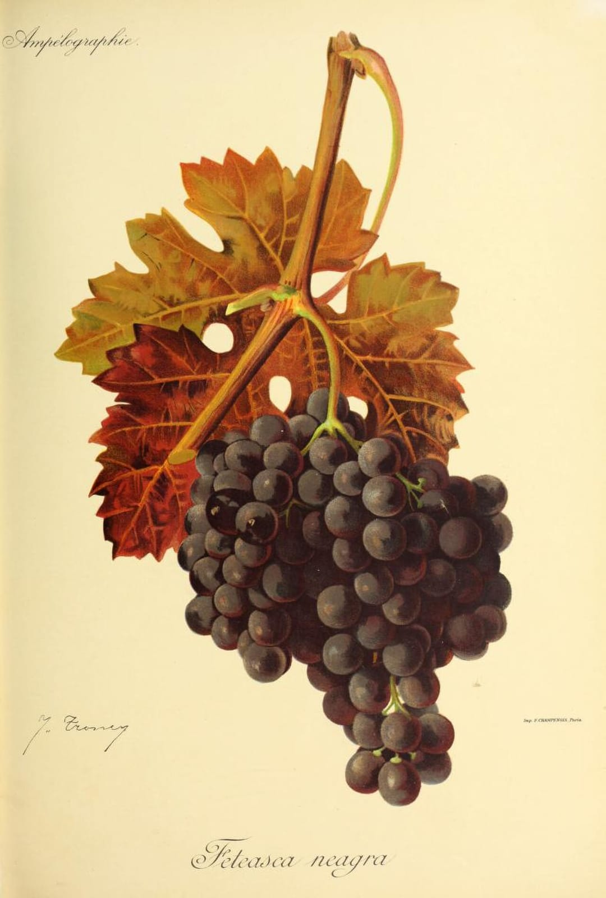

# 黑姑娘

Fetească Neagră 是罗马尼亚与摩尔多瓦一带的古老原生红葡萄，名字意为“黑姑娘”；集中生长在旧摩尔达维亚公国的 Prut 河谷与喀尔巴阡山前丘陵，果皮厚、成熟晚，酿成的红酒酸度清晰、单宁中高，带黑樱桃、李子、黑莓、香料与泥土气息，是罗马尼亚本土红品种中最受重视的名字之一。

读这个品种时先回到原产地：看它在大陆性气候下的成熟节奏、果串结构与单宁走向，再看它被酿成千红、半甜或桃红之后，哪些特征被保留、哪些被工艺放大。同名品种在不同资料里描述不同，有人讲植物学分类，有人讲市场风格，有人只谈某一产区的法规，把这三层分开，才不会被单一标签带走。

图：Fetească Neagră：Feteasca Neagra（Wikimedia Commons）。图片：Jules Troncy，Public domain，via Wikimedia Commons（[原图页面](https://commons.wikimedia.org/wiki/File:Feteasca_Neagra.jpg)）。

> **先给结论**
> **一句话：** 这页判断黑姑娘适不适合你，以及怎么比较其他品种。
>
> - **适合谁：** 正在比较黑姑娘与其他品种、想弄懂风味差异的人。
> - **不适合谁：** 只想要单一名庄推荐、不关心品种本身的人。
> - **先看这两点：**
>   - 黑姑娘干红建议在 15–18 °C 饮用：年轻、果香为主的酒款放在 15–16 °C，结构扎实、经过橡木陈酿的酒款可以到 17–18 °C。
>   - 最常见的误区是把“Fetească”当成同一个品种：白姑娘、皇姑娘是白葡萄，黑姑娘才是红葡萄，三者在酒标上不能互相替代。

## 定义与命名

黑姑娘学名为 Vitis vinifera，名称由罗马尼亚语 fetească（少女、姑娘）与 neagră（黑色）组合而成。各地登记的同义词包括德语 Schwarze Mädchentraube、匈牙利语 Fekete Leányka、俄语 Chornaya Fetyaska，以及罗马尼亚本土名 Păsărească neagră、Poama fetei neagră、Coada rândunicii；酒标上出现这些名字时，指向的通常都是同一品种。

容易混淆的是同语族的白姑娘 Fetească Albă 与皇姑娘 Fetească Regală：两者都是白葡萄，而黑姑娘是黑皮红葡萄，果粒近圆、黑紫色、皮厚多汁，果汁无色；名字里的“Fetească”只是传统命名，并不意味着三者互为芽变。区分三者最直接的线索是果皮颜色与酒液颜色：白姑娘、皇姑娘酿浅色白葡萄酒，黑姑娘酿深色红酒；若酒标写 Negru de Purcari 这类名称，那是本土品种与国际品种调配的混酿酒款，不能直接当作百分之百黑姑娘。

## 起源与传播

黑姑娘的原生地是旧摩尔达维亚公国，即今日摩尔多瓦共和国东部与罗马尼亚同名的摩尔多瓦地区，核心起源在 Prut 河谷、Uricani 城一带。考古与文献互证显示，它在这一带被栽培了超过 2,000 年，罗马尼亚境内古代遗存中出土过被认为属于该品种的葡萄种子。长期以来研究者以为它是白姑娘的深色芽变；近年 DNA 分型显示黑姑娘并非白姑娘的突变，至少存在四个不同类型，本身是历史悠久、独立演化的品种。

苏联时期，黑姑娘在摩尔多瓦本土近乎消失：产量导向的政策把大面积本土品种换成国际品种，品种主要依靠罗马尼亚东部家族葡萄园的碎片地块保存。1989 年之后的私有化与品质复兴让它重新受到重视，如今种植集中在罗马尼亚与摩尔多瓦，乌克兰、匈牙利、保加利亚有少量栽培，法国也有试种小片地块，商业化生产基本仍在东欧。面积上，罗马尼亚境内登记约 2,971.9 公顷，位列该国红葡萄品种前列；摩尔多瓦在 2019 年 12 月 30 日登记 242.0 公顷，其中 54.0 公顷用于生产地理标志葡萄酒，在本土品种中面积排第三。

## 植物学与栽培

黑姑娘果穗较大，呈圆锥形或圆柱圆锥形，常带副穗；果粒近圆、黑紫色，皮厚、果肉多汁，果汁本身无色。果皮硬、果粒紧实，不适合作鲜食葡萄，几乎全部用于酿酒；厚皮带来更高的皮果比与花青素含量，酿成的酒颜色深、单宁提取更扎实。品种成熟偏晚，耐寒耐旱，在大陆性气候下可耐低至 −24 °C 的冬季低温；春季发芽不算早，花期与坐果期仍要防备大风与倒春寒。

栽培上的核心是叶果平衡：叶面积太小则糖分积累不足，叶片过密造成遮阴又会降低酸度、诱发病害。修剪、引缚、疏叶时机与有限灌溉都在这条平衡线上调整。葡萄园多选朝南或西南的坡地，利用日照与排水帮助晚熟品种完成成熟；低洼排水不畅的地块容易加重病害、拖慢成熟节奏。至少四个已辨识类型之间存在果粒、成熟与香气差异，选苗与克隆登记对最终风格的影响比品种名单上的笼统描述更具体。

## 风格与味觉

黑姑娘红酒在杯中呈深红色，带红宝石或紫色反光；年轻酒款以野樱桃、李子、黑莓、黑加仑与葡萄干为主香，伴随肉桂、黑胡椒、多香果等辛香与少许干燥草本、泥土气息。随瓶陈发展，香气转向干李子、无花果、烟熏、黑巧克力、皮革与烟草，这些次级香气通常来自橡木陈酿。口感上酸度清晰、单宁中高、骨架扎实，不是果香甜腻的柔和风格；酒精度通常在 12–14%，部分高端低产地块可达 14.5% 以上。按采摘成熟度与发酵控制，它可以酿干型、半干或半甜红酒，也可酿成桃红，半干与半甜版本更突出日晒李子的甜香。

酿造方向上，整串发酵增加香料感与结构，去梗发酵更干净；低温浸渍偏向颜色与花香，较高温度发酵提取更多单宁与色素。橡木使用从大橡木桶到小橡木桶不等，带来香草、烘烤与烟熏的次级香气；橡木比例与陈酿时间，是同一地块两款酒拉开差距的主要工艺变量。市场上常把它形容为介于黑皮诺的红色果香与西拉的香料结构之间 (ref:pinot) (ref:syrah)，但这只是类比，并不意味着它是两者的混酿或杂交后代。

## 主要产区与代表酒款

罗马尼亚的种植区覆盖 Muntenia 与 Oltenia 丘陵、摩尔达维亚丘陵、Banat、Crișana 与 Maramureș、Dobrogea 丘陵、多瑙河阶地与特兰西瓦尼亚高原。Dealu Mare 位于喀尔巴阡山前南坡，出产的黑姑娘结构感强、单宁集中；Banat 的 Recaș 一带气候更温和，酒款通常更圆润、果香外放；摩尔达维亚的 Cotnari 除贵腐甜白传统外，也用黑姑娘酿桃红与干红。

摩尔多瓦一侧集中在 Ștefan Vodă 地理标志区，靠近 Dniester 河与黑海方向的河谷。Château Purcari 是该区最具代表性的酒庄，历史可追溯到 1827 年，2003 年经重组复兴；酒庄的 Fetească Neagră Limited Edition 与 Academia Purcari 系列用单一品种表达本土特色，Negru de Purcari 则是本土品种与国际品种调配的标志酒款，并非百分之百黑姑娘。罗马尼亚 Dealu Mare 一线的代表生产者包括 Budureasca、Vitis Metamorfosis（Cramele Halewood 旗下）、1000 de Chipuri 与 Anima Wines，后者的“3 Fete Negre”是 100% 黑姑娘干型，在 225 升橡木桶中陈酿 12–24 个月；Recaș 的 Petro Vaselo 以“Melgis”单一品种款见长，摩尔多瓦一侧还有 Radacini、Cricova 等生产者。

## 怎么喝与配餐

黑姑娘干红建议在 15–18 °C 饮用：年轻、果香为主的酒款放在 15–16 °C，结构扎实、经过橡木陈酿的酒款可以到 17–18 °C。杯子选中等肚径的通用红酒杯即可；单宁厚重的年份开瓶后先醒约 30 分钟，让香气散开、单宁柔化，不必长时间醒酒以免果味流失。配餐上，它与烤羊肉、香料羊排、炖鹿肉配玉米糊、红焖牛肉和陈年奶酪搭配稳妥；菌菇、茄子等带泥土气息的蔬菜也能接上酒里的草本与咸鲜。桃红版本在 8–10 °C 饮用，适合白肉、冷盘与开胃菜，不宜配太油重的酱汁。

## 选购与常见误区

最常见的误区是把“Fetească”当成同一个品种：白姑娘、皇姑娘是白葡萄，黑姑娘才是红葡萄，三者在酒标上不能互相替代。另一个误区是把 Negru de Purcari 这类名字直接读成黑姑娘，它是混酿酒款，品种构成以酒庄技术资料为准。看酒标时先分清产区级别（DOC 或 IGP）、年份、甜度类型与混酿比例；年份差异明显，花期大风、采收降雨与霜冻都会改变产量与成熟度，温暖年份酒精度更高、果味更甜熟，偏凉年份酸度更亮、草本感更强。储存上，带陈年潜力的酒应平放、避光、远离温度波动；它在海外出口量有限，购买时留意进口渠道与储存条件。

相关条目：[红葡萄酒](ref:red)。

## 延伸阅读与另见

- 相关条目：[pinot-noir](ref:pinot)、[syrah](ref:syrah)、[red-wine](ref:red)、[oak-ageing](ref:oak)、[terroir](ref:terroir)。
- 想比较 Dealu Mare 与 Recaș 的风土差别，最直接的方法是选同一年份、同一甜度的两款单一品种黑姑娘，对比酸度亮度、单宁粗细与果香集中度。

## 相关图像

图：Syrah Grapes on the Vine。图片：U.S. Geological Survey，CC0，via Wikimedia Commons（[原图页面](https://commons.wikimedia.org/w/index.php?curid=114429512)）。关联图像：黑姑娘。
