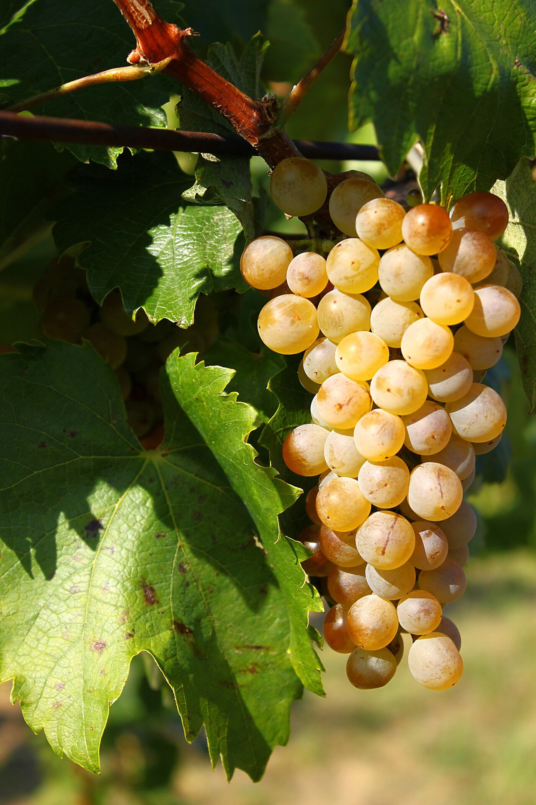

# 富尔民特

富尔民特（Furmint）是匈牙利托卡伊（Tokaj）最重要的白葡萄，也是世界上最容易被误解的品种之一。多数人只把它与甜腻的贵腐酒联系在一起，却不知道它酸度高、皮厚、晚熟，能酿出极具张力的干白。托卡伊的雾季与河流、贵腐菌与橡木桶，塑造了阿苏（Aszú）的蜂蜜与杏脯；而近二十年的干型富尔民特，则让这个品种的柑橘、烟熏与盐感走到前台。

图：富尔民特。图片：Andrs.kovacs，CC BY-SA 3.0，via Wikimedia Commons（[原图页面](https://commons.wikimedia.org/wiki/File:Furmint_grape_cluster.jpg)）。

## 定义与别名

富尔民特是品种名，托卡伊是产区名，两者不能互换。它的英文与匈牙利文都写作 Furmint，斯洛伐克、奥地利、斯洛文尼亚与克罗地亚也有种植，但名称基本沿用 Furmint。Szamorodni 是一种酒款类型——可以用整串带贵腐菌的葡萄酿成干型或甜型——不是品种别名；Aszú 同样指酒款，不是葡萄。关于 Furmint 这个名字的来源没有定论，一种常见说法与“小麦”有关，指成熟果实的麦黄色；另一种说法把它与地方古语联系起来。可以确定的是，它在中欧有数百年的种植记录，并与 Hárslevelű、Sárgamuskotály 一起构成托卡伊的传统混酿。

## 亲本与起源

富尔民特原产于喀尔巴阡盆地，托卡伊—海吉亚（Tokaj-Hegyalja）是其核心。文献中它在 17 世纪初已有明确记载，17 世纪托卡伊的贵腐甜酒开始进入欧洲宫廷，阿苏的酿造传统由此形成。基因研究把富尔民特归入中欧古老品种群，与 Gouais Blanc 有亲缘关系；它与 Hárslevelű 是不同的品种，虽然两者常被混酿，也常被消费者混淆。富尔民特不是近代杂交品种，而是长期无性繁殖与地方选择的结果，因此不同村庄、不同克隆在成熟期、酸度与香气上存在差异。它的历史与托卡伊的火山岩、黄土、河流雾气以及犹太商人的贸易网络紧密相连。

## 植物学特征

富尔民特的果穗中等，果粒中小、呈黄绿色，成熟时有时带粉晕；果皮较厚，果肉多汁，糖分积累较慢，酸度下降也慢。晚熟是它的重要特征：在托卡伊，它需要漫长而温暖的秋季才能完全成熟，这也让它有机会在枝头感染贵腐菌。厚果皮既能保护果粒在秋季挂果，也让贵腐菌在表皮上生长而不至于立即破裂。它的香气以柑橘、梨、白花与矿物为主，成熟后出现蜂蜜与杏。与 Hárslevelű 相比，富尔民特的酸度更高、骨架更紧，Hárslevelű 则更香、更柔。

## 栽培特性

富尔民特晚熟，需要充足的日照与较长的生长季，适合朝南或东南的坡地。秋季成熟慢，因此在凉爽年份可能成熟不足；在温暖年份则容易积累糖分而失去部分酸度。果皮厚、果穗中等偏紧，潮湿年份容易发生灰霉病，但托卡伊的雾季正是贵腐菌（Botrytis cinerea）理想的条件：白天温暖、夜晚有雾、午后干燥。栽培上的关键是通过修剪、控产与采收分拣来平衡产量与品质：干型酒需要成熟但保留酸度，甜酒则需要充分贵腐化的果粒。托卡伊的火山岩、黄土与黏土赋予酒款不同的矿物感与质地。

## 产区分布

托卡伊—海吉亚是富尔民特的核心，涵盖匈牙利东北部的一系列村庄，葡萄园分布在火山岩、黄土与河流沉积物上。匈牙利其他产区包括 Somló（火山岩、酒体紧致）、Eger、Balaton 周边的 Balatonfüred-Csopak 与 Badacsony，以及 Mátra。斯洛伐克的托卡伊产区与匈牙利共享历史与部分法规；奥地利布尔根兰、斯洛文尼亚的 Štajerska 与克罗地亚有少量种植。富尔民特在匈牙利以外的种植面积有限，但近年在英国、美国与澳大利亚有实验性栽培。不同产区的风格差异明显：托卡伊更饱满、矿物感强，Somló 更紧致、烟熏感突出。

## 法定规则

托卡伊是受保护的 origin 名称，匈牙利与斯洛伐克共享部分历史名称的使用权。托卡伊阿苏（Tokaji Aszú）自 2013 年份起要求最低残糖为 120 克/升，传统的 puttonyos 分级不再是法定基础，但在市场与酒评中仍常被提及；具体的最低酸度、陈年与标签规则以最新法规为准。Eszencia 由贵腐葡萄的自流汁酿造，糖分极高、酒精度极低。Szamorodni 可分为干型与甜型，原料是整串带贵腐菌的葡萄。干型富尔民特可以标注品种与产区，匈牙利 PDO 体系对产量、酒精度与陈年有具体要求。购买时应区分 Tokaji Aszú、Szamorodni、Eszencia 与干型 Furmint，它们不是同一种酒。

## 酿造

干型富尔民特的酿造强调保留酸度与矿物感：整串或轻柔压榨，低温发酵，部分酒庄使用野生酵母与旧橡木桶，酒泥陈酿增加质地。苹果酸-乳酸发酵可以选择性进行，但许多酒庄会阻止，以保留明亮的酸度。甜型阿苏的工艺更为复杂：贵腐葡萄被手工逐粒采摘，放入基酒或发酵中的葡萄醪中浸渍，随后压榨并在橡木桶中陈年，通常一年半以上，具体时间以法规与酒庄风格为准。Eszencia 依靠极高的糖分进行极缓慢的发酵，酒精度很低、甜度极高。发酵过程中的温度、酵母与氧气管理决定了最终风格；托卡伊的酒窖湿度高，有利于橡木桶中的缓慢演化。

## 感官风格

干型富尔民特通常呈浅金黄色，香气以青柠、榅桲、梨、青苹果、白胡椒、烟熏与湿石为主，酸度高、酒体中等，收口带咸感与轻微的酚类质感。优质酒款可以陈年，发展出蜂蜜、蜂蜡与坚果。甜型阿苏则展现杏脯、桃子、橙皮、蜂蜜、姜与贵腐菌的香料气息，酸度高到足以平衡极高的糖分，口感浓稠而不腻，余味悠长。Eszencia 更像糖浆，需以小杯慢饮。Szamorodni 介于两者之间：甜型圆润，干型则带有酵母、坚果与氧化风味。无论是干型还是甜型，富尔民特的共同点是高酸度与明显的矿物骨架。

## 代表生产者与年份

托卡伊的代表酒庄包括 Royal Tokaji、Disznókő、Oremus、Château Pajzos、István Szepsy、Demeter Zoltán 与 Bott Frigyes；这些酒庄既生产阿苏，也生产干型富尔民特。年份对富尔民特的影响极大：秋季雾季与湿度决定贵腐菌的成败，凉爽年份酸度更高、干型酒更紧致，温暖年份糖分更高、甜酒更浓郁；降雨过多的年份则可能出现灰霉腐烂，需要严格分拣。干型富尔民特的年份差异体现在成熟度与酸度之间，优质年份可以陈年，普通年份适合早饮。购买时应关注酒庄、村庄与年份，而不是只看 Tokaji 字样。

## 常见误区

第一，认为托卡伊只有甜酒。干型富尔民特已有数百年历史，近二十年更成为产区重点。第二，认为富尔民特只能酿甜酒。它的高酸度与矿物感非常适合干型。第三，把 Tokaji 当成葡萄品种。Tokaji 是产区名。第四，把 Szamorodni 当成富尔民特的别名。它是一种酒款类型。第五，把富尔民特与 Hárslevelű 混为一谈。两者常混酿，但品种不同。第六，认为阿苏越甜越好。酸度与贵腐菌的复杂度同样重要。第七，认为富尔民特只产自匈牙利。斯洛伐克、奥地利与斯洛文尼亚也有种植。

## 延伸阅读

- [葡萄酒](ref:wine)：富尔民特所属的总体酒类。
- [白葡萄酒](ref:white-wine)：富尔民特的主要酒类形态。
- [贵腐菌](ref:noble-rot)：托卡伊阿苏的核心。
- [晚收](ref:late-harvest)：理解甜型富尔民特的采收逻辑。
- [酸度](ref:acidity)：富尔民特干型与甜型风格的骨架。
- [发酵](ref:fermentation)：从干白到阿苏的工艺基础。

相关条目：[葡萄酒](ref:wine)、[白葡萄酒](ref:white-wine)。

**关键事实。**

| 项目 | 内容 |
| --- | --- |
| 一句话定位 | 富尔民特是匈牙利托卡伊的核心白葡萄，酸度高、皮厚、易感染贵腐菌；既酿出以阿苏为代表的贵腐甜酒，也酿出日益重要的干型富尔民特，风格从蜂蜜杏脯到柑橘与烟熏 |
| 物种 | Vitis vinifera |
