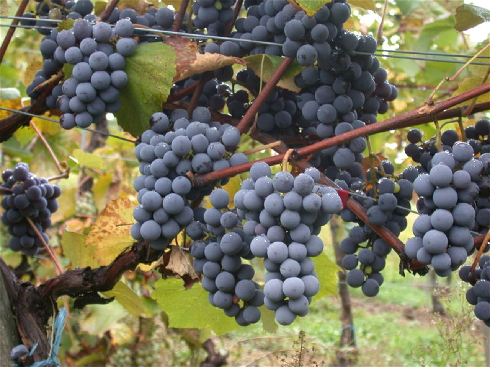

# 佳美

佳美（Gamay）是红葡萄品种，学名 Vitis vinifera，全名常写作 Gamay Noir à Jus Blanc。它皮薄、早熟、酸度高，是[博若莱](ref:beaujolais)[红葡萄酒](ref:red-wine)的核心品种；在法国[卢瓦尔](ref:loire)等地也有种植。与[黑皮诺](ref:pinot-noir)相比，佳美更易栽培、果味更直接，风格从轻盈易饮到可陈年的村庄级 cru 都能成立。

图：佳美。图片：Viking59，Public domain，via Wikimedia Commons（[原图页面](https://commons.wikimedia.org/wiki/File:Gamay.jpg)）。

## 定义与别名

佳美是品种名，不是酒名或产区名。[红葡萄酒](ref:red-wine)是大类，佳美是品种，博若莱是产区，具体 cru 与酒庄是产品层面。中文也译作“加美”，英文常简写为 Gamay，法文全名强调其白色汁液，用于与染色品种区分。

把品种与酒款分开，才能理解同一品种为何差异很大：博若莱村庄级 cru 的佳美可以有结构、有陈年潜力，而大区级博若莱新酒则是轻快、以果味为主的[葡萄酒](ref:wine)。

## 植物学特征

佳美果穗较紧、果粒中等，果皮薄，色素与单宁含量都不高，酸度较高。它的芽眼萌动早、成熟期早，适合生长季较短或秋季转凉较快的地区；皮薄也意味着更容易受灰霉病与采收期降雨影响。

遗传研究显示，佳美是黑皮诺与古埃白（Gouais Blanc）的自然杂交后代，与霞多丽的亲本组合相同。田间存在大量变异与克隆，不同克隆在产量、果粒大小与成熟期上有差异，是酒庄风格差异的来源之一。

## 主要产区

佳美的核心产区是法国[博若莱](ref:beaujolais)，位于勃艮第以南、里昂以北，花岗岩与片岩土壤上的坡地是村庄级 cru 的主要分布区。博若莱以北的马孔内也有种植，卢瓦尔河谷的图兰与安茹则用佳美酿造更轻盈的红酒。

法国之外，瑞士、美国俄勒冈与新西兰也有佳美种植，但规模远小于博若莱。不同产区的风格差异主要来自气候、土壤与是否使用整串发酵，而不是品种本身。

## 典型风味

佳美的典型香气是红樱桃、覆盆子、草莓与紫罗兰、牡丹，部分酒款带白胡椒与花岗岩的矿物感。单宁轻到中等，酸度清晰，酒体偏轻到中等；年轻时常有香蕉、泡泡糖般的香气，这多与特定酵母和快速发酵有关，不是品种的固有味道。

陈年后的佳美会发展出干花、泥土与蘑菇气息，颜色从紫红转向砖红。村庄级 cru 的结构更紧，陈年潜力更长；大区级与博若莱新酒则以新鲜果味为目标，不适合长期存放。

## 代表酒款

[莫尔贡](ref:morgon)是博若莱最具代表性的村庄级 cru 之一，以花岗岩坡地与较厚的酒体著称，说明佳美也可以有结构感与陈年能力。博若莱新酒则是另一种极端：强调当年采收后的新鲜果味，适合尽早饮用。

把这两类酒放在一起看，可以理解佳美的宽度：同一品种在不同土壤、产量与酿造方式下，可以从轻快果味走到有骨架的陈年型红酒。

## 栽培要点

佳美对栽培条件相对宽容，但产量控制仍然关键。产量过高会稀释果味、加重“香蕉味”的错觉；产量适中、成熟度均衡时，果味更集中、酸度更鲜活。

博若莱的坡地多由花岗岩风化而成，排水好、根系扎得深；平坦地带的土壤更肥沃，产量容易偏高。栽培上常通过修剪、疏果与冠层管理平衡产量与成熟度，采收时间则决定酸度与果味的比例。

## 常见误区

第一，认为佳美只能做博若莱新酒。它也能酿造有结构、可陈年的村庄级 cru。
第二，把香蕉味当成佳美的品种香。那多来自特定酵母与快速发酵工艺。
第三，认为佳美颜色浅就没有风味。它的风味来自酸度、果香与质地，而不是色素浓度。
第四，把佳美与黑皮诺混为一谈。两者亲缘相近，但成熟期、皮厚与酒体不同。
第五，认为所有博若莱都适合陈年。大区级与新酒应尽早饮用，只有部分 cru 适合存放。

佳美皮薄、早熟、酸度高，是博若莱红葡萄酒的核心；整串发酵与花岗岩土壤让果味更直接，风格从轻盈易饮到可陈年的村庄级 cru 都有。它和黑皮诺同为薄皮红葡萄，但佳美更早熟、酸度更明亮；“博若莱新酒”只是其中一个产品，不代表佳美的全部潜力。在博若莱，村庄级 cru 与普通博若莱的差别来自地块、坡度与酿造，而不是品种本身；同一佳美在不同酒农手里可以是轻快果味，也可以是带结构与陈年潜力的酒。读标签时，村庄名与酒农名往往比“佳美”三字提供更多信息。

对照阅读：[葡萄酒](ref:wine)、[法国](ref:france)。

## 延伸阅读

- [红葡萄酒](ref:red-wine)：佳美所属的葡萄酒大类。
- [葡萄酒](ref:wine)：葡萄酒的基本分类与酿造逻辑。
- [法国](ref:france)：法国葡萄酒法规与产区体系。
- [博若莱](ref:beaujolais)：佳美的核心产区与分级框架。
- [莫尔贡](ref:morgon)：以佳美酿造的博若莱村庄级 cru。

**关键事实。**

| 项目 | 内容 |
| --- | --- |
| 一句话定位 | 皮薄、早熟、酸度高的红葡萄品种，是博若莱红葡萄酒的核心品种；以整串发酵与花岗岩土壤上的果味著称，风格从轻盈易饮到可陈年的村庄级 cru 都有 |
| 物种 | Vitis vinifera |
| 代表产区 | 卢瓦尔河谷、法国 |

**来源与边界。** 本页关于「佳美」的关键事实，主要由以下来源交叉核对：International Organisation of Vine and Wine (OIV)（品种描述与 Vitis 物种框架）、Oxford University Press（提供关于佳美亲本、博若莱产区与酿造方式的条目；由原条目末尾参考资料迁移，未逐条复核访问日期）、INAO（法国原产地命名制度中佳美与产区的对应关系）。价格、批次与状态会变，涉及这些字段时以页面所列来源的最新版本为准。正文为项目自写，来源只作核验，不复制原文。

**并读。** 把「佳美」与「葡萄酒」、「红葡萄酒」、「法国」放在一起读时，先确认它们是同一层级还是上下游关系：先确认品种身份与允许产区，再比较成熟期、抗性、克隆与酿造表现。本页负责给出品种的基本坐标，对照条目补上具体案例与差异；读完再回到本页，才能分清哪些差别属于品种本身，哪些只是产地、批次或品牌选择。

**适用边界。** 对「佳美」而言，品种表现随产区、气候与克隆选择变化；同名品种在不同国家可能指不同材料。

**更新提示。** 「佳美」最近核对于 2026-11-05；允许产区、克隆与栽培数据会更新，引种前以官方品种目录为准。

**编者注。** 本页把「佳美」作为品种条目处理：定义、流程与关键数字以正文表格为准，与「葡萄酒」、「红葡萄酒」的差异用对照阅读验证；遇到价格、批次或地址，回到页面所列来源核对。
