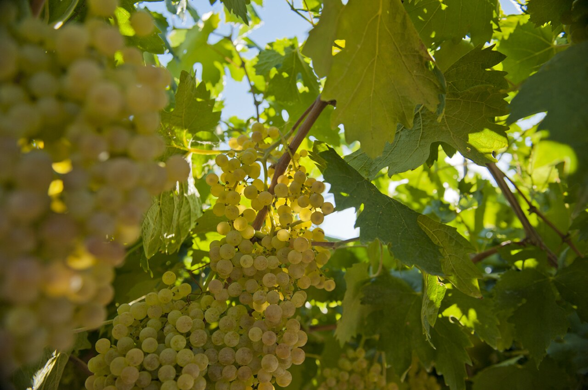

# 加尔加内加

意大利威尼托索阿韦产区的白葡萄，晚熟、产量高，带柠檬、杏仁、白花与矿物；可酿干型 Soave、甜型 Recioto di Soave 与起泡酒。

加尔加内加是意大利威尼托的白葡萄，索阿韦的核心品种；它晚熟、酸度稳，带白花、柠檬、杏仁与矿物，也能酿甜型 Recioto。

图：Garganega：Garganega Soave（Wikimedia Commons）。图片：Alessandro Pighi，CC BY-SA 4.0，via Wikimedia Commons（[原图页面](https://commons.wikimedia.org/wiki/File:Garganega_Soave.jpg)）。

## 定义与命名

加尔加内加是意大利威尼托索阿韦（Soave）的主导白葡萄，晚熟、产量高，果皮薄；成熟时带柠檬、杏仁、白花与矿物。它可酿干型 Soave、甜型 Recioto di Soave，也可用于起泡酒。

索阿韦 DOC 规定干型酒以加尔加内加为主，通常与 Trebbiano di Soave 混酿；Classico 指 Monteforte 与 San Bonifacio 的传统核心，Superiore 要求更高酒精度与更低产量。名称来自产区，不是葡萄的旧名；酒标上的“Soave”比“Garganega”更常见。

加尔加内加与雷司令、白皮诺没有直接关系；它属于意大利本土品种，与维罗纳一带的其他白葡萄可能有亲缘。读标签时，先看产区与等级，再看品种比例。

加尔加内加在威尼托有时写作 Garganega，在 Soave 与 Gambellara 是两个法定产区；它不是“索阿韦”的同义词，索阿韦是产区名，加尔加内加是品种名。部分酒标会写“Soave”而不写品种，按产区法规它仍以加尔加内加为主。

## 起源与传播

加尔加内加的原产地估计在威尼托东部，名称可能与加尔加诺（Gargano）或当地地名有关，但没有定论。中世纪文献已提到索阿韦一带的白葡萄；20 世纪，合作社与大型酒厂把它做成意大利最常见的白葡萄酒之一。

1968 年索阿韦获得 DOC，Classico 与 Superiore 的规则随后细化；1990 年代以后，Pieropan、Inama、Gini、Suavia 等酒庄用山坡地块、低产量与大桶发酵，重新强调加尔加内加的矿物与杏仁尾韵。

在巴西、阿根廷与澳大利亚也有少量种植，但索阿韦仍是核心。传播过程中，克隆与砧木的选择改变了成熟期与香气，高产版本往往香气淡，需要通过产量控制找回风味。

## 植物学与栽培

果穗中等偏大，果粒中等、皮薄，晚熟；产量高，树势旺。发芽早、成熟晚，需要长秋季；在潮湿年份容易感染灰霉，但贵腐菌也正是 Recioto 甜酒的原料基础。

索阿韦的火山岩、石灰岩与冲积土混合，山坡排水好、昼夜温差大；Classico 的 hillside 地块比平原更晚熟、更矿物。修剪与疏果控制产量，避免过密冠层；采收常分两次，先取干型，再留果风干做 Recioto。

加尔加内加的克隆很多，VCR 与 ISV 系列选育出不同香气与成熟期的品系；酒农会按地块选择，山坡晚熟克隆用于 Superiore，平原高产克隆用于日常酒。

## 风格与味觉

干型 Soave 呈浅柠檬黄，香气带柠檬、青苹果、白花、杏仁与湿石；入口酸度中高，酒体中等，收口带杏仁苦韵。Classico 与 Superiore 更紧、更矿物，平原版本更轻、更易饮。

Recioto di Soave 用风干葡萄酿甜酒，带杏干、蜂蜜、无花果与坚果，酒精度与残糖都高；起泡版本则更清爽，气泡细。橡木桶发酵的版本会增加香草、奶油与烤面包，但传统派更强调不锈钢罐与酒泥。

判断典型性，先看杏仁尾韵与矿物感，再看产量与产区；只喝一款平原 Soave，很容易把“淡”当成品种本身。

Recioto 的酿造要把葡萄放在竹帘或木架上风干 3–4 个月，糖分浓缩后再发酵；发酵中途停止保留残糖，酒精度约 12–14%，残糖可达 100 g/L 以上。

Soave 的甜型 Recioto 与干型共享同一品种，但采收与风干方式完全不同；甜型不是“加甜”，而是浓缩。Classico 的边界由传统村镇划定，Superiore 则强调最低酒精度与产量。

## 主要产区与代表酒款

索阿韦 Classico 的核心是 Monteforte d’Alpone、San Bonifacio 与 Soave 镇周边的山坡；Colli Berici 与 Gambellara 也有加尔加内加，但风格更偏圆润。

代表生产者包括 Pieropan（La Rocca 与 Calvarino）、Inama（Vigneto Froscà）、Gini（Salvarenza）、Suavia、Tessari 等；Recioto 的代表有 Pieropan Le Colombare、Gini Recioto 等。

索阿韦的火山岩土壤来自远古火山活动，basalt 与 tuff 提供排水与矿物；Calvarino 等地的石灰岩则带来更紧的酸度。土壤差异比“Soave”这个大名字更能解释风格。

加尔加内加在 Colli Berici 与 Gambellara 也有种植，常与 Tai 等品种混酿，风格比索阿韦更圆、更少矿物。

索阿韦的经典区（Soave Classico）以火山土与山坡为主，酒体更紧、矿物感明显；Colli Scaligeri 与东部平原更暖，杏仁与柑橘更熟。Recioto di Soave 用风干葡萄酿甜酒，但品种仍是加尔加内加；酒标上的 Soave 与 Recioto 是两种工艺，不是两个品种。

## 怎么喝与配餐

干型饮用温度 10–12°C，用中等口径白酒杯；先闻杏仁与白花，再小口感受酸度与矿物。配餐适合海鲜、贝类、蔬菜、意式烩饭与油炸食物；Classico 可以配鸡肉与奶油酱汁。

Recioto 温度 12–14°C，用小甜酒杯，配蓝纹奶酪、杏仁饼干、水果塔；也可配鹅肝。开瓶后冷藏，干型 2–3 天喝完，甜型可放 1–2 周。

索阿韦干白适合配淡水鱼、蔬菜、香草与轻奶酪；Recioto 甜酒配杏仁饼、蓝纹奶酪与干果。干白温度 10–12°C，甜酒 12–14°C；不要用重冰镇压住杏仁与白花。

## 选购与常见误区

先看 Classico / Superiore 与年份，再看酒精度与残糖；Soave 不等于“廉价白葡萄酒”，Classico 山坡版本可以很复杂。价格高可能来自地块与低产量，不代表所有 Soave 都值得陈年。

常见误读：把加尔加内加当成雷司令；以为 Soave 只能配海鲜；以为甜型 Recioto 是“加糖”。它的甜度来自风干葡萄的浓缩，不是后期加糖。

Superiore 要求更高酒精度与更低产量，Classico 限定传统村镇；这些规则让同一品种在不同标签下呈现不同浓度。加尔加内加在潮湿年份容易感染灰霉，酒农会通过疏叶与早采控制风险。

Soave 的干型与甜型都值得分别尝试，不要把两者当成同一种酒。

## 参见

- [威尼托](ref:veneto)：索阿韦的产区背景。
- [白葡萄酒](ref:white)：白葡萄的发酵与风格。
- [起泡酒](ref:sparkling)：二次发酵与气泡。
- [风土（terroir）](ref:terroir)：山坡、土壤与成熟度。
- [橡木桶陈酿](ref:oak)：桶发酵对白葡萄酒的影响。

对照阅读：[威尼托](ref:veneto)、[白葡萄酒](ref:white)、[起泡酒](ref:sparkling)。

**关键事实。**

| 项目 | 内容 |
| --- | --- |
| 一句话定位 | 意大利威尼托索阿韦产区的白葡萄，晚熟、产量高，带柠檬、杏仁、白花与矿物；可酿干型 Soave、甜型 Recioto di Soave 与起泡酒 |
| 物种 | Vitis vinifera |
| 代表产区 | 威尼托 |

**来源与边界。** 本页关于「加尔加内加」的关键事实，主要由以下来源交叉核对：Julius Kühn-Institut（品种名称、同义词、起源与全球分布）、OIV（葡萄品种与栽培框架）、USDA ARS（植物分类、种质与栽培信息）等 4 条来源。价格、批次与状态会变，涉及这些字段时以页面所列来源的最新版本为准。正文为项目自写，来源只作核验，不复制原文。

## 相关图像

图：Vineyard, San Giorgio di Valpolicella, Veneto, Italy。图片：Unknown photographer，CC BY-SA 2.0，via Wikimedia Commons（[原图页面](https://commons.wikimedia.org/w/index.php?curid=354325)）。关联图像：加尔加内加。
