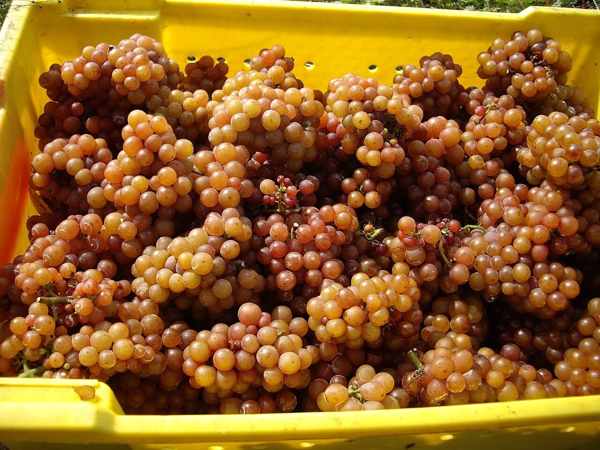
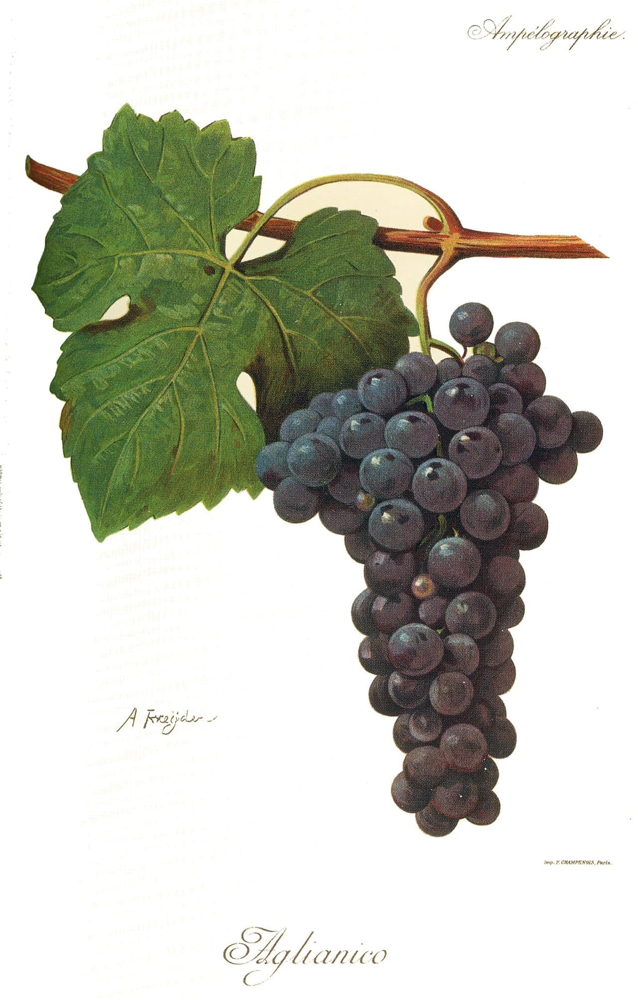

# 琼瑶浆

琼瑶浆（Gewürztraminer）是世界上最容易辨认的白葡萄之一：荔枝、玫瑰、姜与肉桂的香气几乎不需要训练就能识别。但它的辨识度也带来误解——很多人以为它一定是甜酒，或者以为香气越浓质量越高。实际上，琼瑶浆的酸度低、酒精高，风格从干型到贵腐甜酒都有，平衡才是难点。

图：琼瑶浆。摄影：Gewürztraminer grapes。署名：Robert Pitkin，CC BY-SA 2.0，来自 Wikimedia Commons（[来源](https://commons.wikimedia.org/w/index.php?curid=20125056)）。

## 定义与别名

琼瑶浆的德文名是 Gewürztraminer，其中“Gewürz”意为香料，“Traminer”指意大利南蒂罗尔的特拉明（Tramin/Termeno）。它属于欧洲葡萄 Vitis vinifera。常见别名包括 Traminer、Savagnin Rose 与 Roter Traminer；其中 Traminer 在不同地区可能指芳香程度不同的类型，不能一概等同于琼瑶浆。它不是一个独立物种，而是萨瓦宁（Savagnin）的芳香变异，这一点是理解它香气与酸度的关键。

## 亲本与起源

琼瑶浆被视为萨瓦宁（Savagnin Blanc）的芳香突变，而不是一次新的杂交。萨瓦宁原产于阿尔卑斯地区，名称与 Traminer 同源；琼瑶浆因果皮呈粉红色、香气更浓而被单独命名。它的起源地一般指向意大利北部的特拉明村，中世纪经阿尔卑斯山口传入阿尔萨斯与德国。DNA 研究确认它与萨瓦宁、灰皮诺等人群有亲缘关系，但“突变”与“杂交”是两种不同的机制，不能混为一谈。

## 植物学特征

果穗中等偏小，果粒小、排列紧，果皮呈粉红到浅紫红色，这是它与大多数白葡萄最直观的区别。它发芽中等，成熟期偏晚，糖分积累快而酸度下降也快；果皮薄，容易感染灰霉病与贵腐菌。果粒小意味着皮汁比高，香气物质集中，但也让产量偏低、成熟不整齐。与灰皮诺相比，琼瑶浆的果皮更粉、果粒更小、香气更浓。

## 栽培特性

琼瑶浆长势中等，产量偏低，适合在凉爽、排水良好的坡地种植。它对土壤适应性较强，阿尔萨斯的石灰岩、泥灰岩与花岗岩都能给出不同风格；德国巴登与普法尔茨的火山岩土壤则带来更明显的香料感。它晚熟，秋季降雨会影响采收；果皮薄，贵腐菌发展快，适合酿晚收甜酒，但也需要严格挑选。种植者常在产量与成熟度之间做取舍，以避免酒精度过高而酸度不足。

## 阿尔萨斯的核心地位

阿尔萨斯是琼瑶浆最经典的产区，它与雷司令、灰皮诺、麝香并称“四种贵族品种”。阿尔萨斯有 51 个特级园（Grand Cru），琼瑶浆是允许种植的品种之一；特级园的酒标必须标注园名与品种。晚收（Vendanges Tardives）与贵腐粒选（Sélection de Grains Nobles）是阿尔萨斯的两个甜型级别，琼瑶浆在这两类酒中表现突出。阿尔萨斯的琼瑶浆通常酒体饱满、酸度低，干型与甜型并存。

## 德国、奥地利与意大利

德国是琼瑶浆的重要产地，巴登（Baden）与普法尔茨（Pfalz）有较多种植，风格从干型到甜型都有，常带玫瑰与香料气息。奥地利把它称为 Traminer，施泰尔马克与下奥地利有少量种植，风格更清爽。意大利北部的上阿迪杰（Alto Adige）与弗留利有种植，特拉明村周边仍保留传统；这里的琼瑶浆酸度略高，风格更克制。新世界如美国加州、澳大利亚与新西兰也有实验性种植，但面积不大。

## 酿造与风格

琼瑶浆的低酸度与高pH让酿造需要特别注意：发酵温度不宜过高，以避免香气流失；苹乳发酵会进一步降低酸度，多数酒庄选择避免；残糖从干型到甜型不等，取决于产区法规与酒庄风格。部分酒庄会做短暂皮接触，增加质地与颜色，但过度浸渍会带来苦味。典型香气来自单萜类化合物（香叶醇、芳樟醇）与顺式玫瑰氧化物，后者是荔枝香气的关键。陈年后，琼瑶浆会出现蜂蜜、姜饼与烟熏气息。

## 感官风格与配餐

年轻琼瑶浆以荔枝、玫瑰、姜、肉桂、杏子与柑橘皮为主，酒体饱满，酸度低，酒精常在 13% 以上。干型版本适合搭配阿尔萨斯芒斯特奶酪、鹅肝、烟熏猪肉与亚洲香料菜；甜型版本适合蓝纹奶酪与水果甜点。由于酸度低，它不适合搭配过酸或过辣的菜肴，否则会显得松弛。饮用温度宜比一般白葡萄酒略低，以抑制酒精感。

## 与灰皮诺的区别

琼瑶浆与灰皮诺都是阿尔萨斯“贵族品种”，果皮都偏粉，但两者差异明显。琼瑶浆是萨瓦宁的芳香突变，香气以荔枝、玫瑰、姜为主，酸度更低、酒体更饱满；灰皮诺是黑皮诺的颜色突变，香气以梨、苹果、杏仁为主，酸度略高、质地更细腻。把两者混为一谈，会忽略琼瑶浆独有的香料与荔枝气息。灰皮诺在意大利叫 Pinot Grigio，风格更清淡；琼瑶浆在意大利则集中在特拉明一带。

## 代表生产者与年份

阿尔萨斯的代表包括 Trimbach、Zind-Humbrecht、Hugel 与 Domaine Weinbach；其中 Trimbach 的 Cuvée des Seigneurs de Ribeaupierre 常被视为干型琼瑶浆的标杆，Zind-Humbrecht 则以甜型与风土表达著称。德国巴登有 Dr. Heger 等酒庄。年份差异主要来自秋季湿度与贵腐菌：干燥年份适合干型，潮湿年份适合晚收与贵腐。市场方面，琼瑶浆在 20 世纪后期因“荔枝香”走红，近年因低酸与甜腻形象受到挑战。

## 常见误区

第一，认为琼瑶浆都是甜酒。阿尔萨斯有大量干型酒。第二，认为香气越浓越好。过度成熟会失去酸度与细节。第三，把 Traminer 与琼瑶浆完全等同。Traminer 可能指不同芳香程度的类型。第四，认为琼瑶浆不能配餐。干型版本与奶酪、烟熏菜肴很搭。第五，以为低酸度意味着不能陈年。优质晚收与贵腐酒可以陈放数十年。第六，把琼瑶浆与灰皮诺混淆。两者的品种来源与香气完全不同。

## 延伸阅读

- [白葡萄酒](ref:white-wine)：琼瑶浆所属的酒类。
- [法国](ref:france)：阿尔萨斯所属的国家与法规框架。
- [德国](ref:germany)：琼瑶浆的另一个重要产地。
- [发酵](ref:fermentation)：发酵温度与残糖对香气的影响。

补充阅读：[艾格尼科](ref:c-extra-1)。

相关条目：[白葡萄酒](ref:white-wine)、[法国](ref:france)、[德国](ref:germany)。

**关键事实。**

| 项目 | 内容 |
| --- | --- |
| 一句话定位 | 果皮呈粉红色的芳香型白葡萄品种，名称源自意大利南蒂罗尔的特拉明（Tramin）；它是萨瓦宁（Savagnin）的芳香变异，酸度偏低、糖分积累快，以荔枝、玫瑰、姜与肉桂香气著称，主要种植于阿尔萨斯、德国、奥地利与意大利北部 |
| 物种 | Vitis vinifera |
| 代表产区 | 法国、德国 |

## 相关图像

图：艾格尼科。图片：Alexis Kreyder，Public domain，via Wikimedia Commons（[原图页面](https://commons.wikimedia.org/wiki/File:Aglianico_Viala_Vermorel.jpg)）。关联图像：琼瑶浆。
