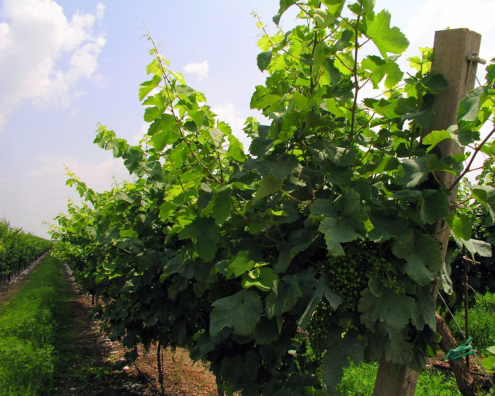

# 格莱拉

格莱拉（Glera）是意大利东北部的白葡萄品种，也是普罗塞克（Prosecco）起泡酒的核心。它的故事有一半写在葡萄园里，另一半写在名称制度里：2009 年之前，品种与酒都叫 Prosecco；此后品种正式改称 Glera，酒名保留 Prosecco，产区边界也被重新划定。理解这段改名史，是理解这款酒为何在全球市场迅速扩张的前提。

图：格莱拉。图片：paul Barker Hemings from seregno, 85，CC BY-SA 2.0，via Wikimedia Commons（[原图页面](https://commons.wikimedia.org/wiki/File:Prosecco_vitigni.jpg)）。

## 定义与别名

格莱拉的意大利语名是 Glera，中文也译作格雷拉。它属于欧洲葡萄 Vitis vinifera。历史上的同义词包括 Prosecco、Prosecco Bianco、Prosecco Nostrano 与 Serprino；其中 Serprino 今天仍用于威尼托尤加内山（Colli Euganei）一带的起泡酒。名称变化属于制度与市场层面的调整，不改变品种本身的植物学特征。酒标上写 Glera 通常意味着品种标注，写 Prosecco 则指向产区与酒类。

## 亲本与起源

格莱拉的亲本关系至今没有定论。早期研究曾把它与特拉米纳（Traminer）联系起来，但后续基因分析没有给出一致的亲本组合；较稳妥的说法是，它属于亚得里亚海北岸的古老品种群，与弗留利、斯洛文尼亚边境一带的白葡萄有亲缘关系。它长期在威尼托与弗留利种植，19 世纪以后才因普罗塞克的商业化而成为区域主角。把“Glera”当成一个新培育品种是误解，改名不等于改种。

## 植物学特征

果穗较大，果粒中等、排列较松，果皮黄绿色、薄，果肉多汁。它发芽中等偏早，成熟期偏晚，属于晚熟品种；果皮薄意味着对灰霉病、日灼与冰雹都比较敏感。糖分积累中等，酸度下降较慢，这一点对起泡酒基酒很重要：基酒需要足够酸度，才能在二次发酵与除渣后保持清爽。与霞多丽相比，格莱拉的果粒更大、皮更薄、香气更偏梨与白花。

## 栽培特性

格莱拉长势旺、产量高，历史上常被过度高产，导致风味稀释。现代规范通过产量上限与采收成熟度要求来控制质量；威尼托的平原与丘陵差异明显，丘陵地块排水好、成熟更均衡，平原产量更高但酸度与香气偏弱。树形以双居由式与平棚式为主，机械化采收在平原较常见，丘陵仍依赖人工。晚熟意味着采收常在 9 月中下旬，遇到秋季降雨时需要快速处理。

## 普罗塞克的法定范围

普罗塞克 DOC 覆盖威尼托与弗留利的九个省，包括特雷维索、威尼斯、维琴察、帕多瓦、贝卢诺，以及弗留利的戈里齐亚、波代诺内、的里雅斯特与乌迪内。两个 DOCG 是 Conegliano Valdobbiadene 与 Asolo，前者在 1969 年获得 DOC、2009 年升为 DOCG，后者同年升格。普罗塞克 DOC 规定格莱拉至少 85%，其余至多 15% 可为 Verdiso、Bianchetta Trevigiana、Perera、Glera Lunga、霞多丽、白皮诺、灰皮诺等；DOCG 的规范同样以格莱拉为主体，但对产量与地块更严格。Cartizze 是 Conegliano Valdobbiadene 内的著名子产区，Rive 则指陡坡单一村地块。

## 酿造与起泡方式

普罗塞克主要使用罐式二次发酵（Charmat/Martinotti），基酒在不锈钢罐中低温发酵，随后加入糖与酵母在密闭罐中进行二次发酵，约 30 天完成，再过滤装瓶。这种方式保留果香与新鲜度，成本低于传统瓶内二次发酵。少数生产者使用瓶内二次发酵或“祖先法”（rifermentazione in bottiglia），风格更复杂但产量有限。残糖决定风格：Brut 为 0 至 12 克/升，Extra Dry 为 12 至 17 克/升，Dry 为 17 至 32 克/升，Demi-Sec 为 32 至 50 克/升。注意 Extra Dry 比 Brut 更甜，这是初学者最容易混淆的地方。

## 感官风格

典型格莱拉起泡酒呈淡柠檬色，气泡细密，香气以青苹果、梨、白桃、白花与柑橘为主，酸度中等，酒体轻到中等。温暖年份果味更甜、酸度更低；凉爽年份更瘦、更柑橘。Cartizze 地块的酒体更饱满、香气更集中；Rive 系列因坡地与老藤，酸度与矿物感更明显。陈年潜力有限，多数适合装瓶后三到五年内饮用，顶级 DOCG 可以更久。

## 与霞多丽、麝香的区别

格莱拉常被拿来与霞多丽比较，但两者角色不同：霞多丽是中性、可塑性强的基酒品种，格莱拉则自带梨与白花香气，酸度更低、酒体更轻。与麝香（Muscat）相比，格莱拉的香气更清淡，没有明显的葡萄与橙花气息。普罗塞克常被误认为“麝香葡萄做的甜酒”，实际上它的甜度来自二次发酵的 dosage，而不是品种本身的麝香香气。

## 代表生产者与市场

普罗塞克产区有大量酒庄与合作社。Nino Franco、Bisol、Ruggeri、Zardetto、Villa Sandi、Carpenè Malvolti 与 Bortolomiol 常被提及；大型合作社在产量中占比很高。市场方面，普罗塞克在 21 世纪成为全球销量最大的起泡酒类别之一，价格亲民、包装鲜明、适合即饮，是它扩张的主要原因；代价是风格同质化与“甜水”形象。DOCG 与 Rive 系列则试图证明这款酒也可以有地块与年份的深度。

## 常见误区

第一，认为 Glera 是新品种。它只是 Prosecco 的改名。第二，把普罗塞克等同于甜酒。Brut 与 Extra Brut 都很干。第三，认为 Extra Dry 比 Brut 更干。实际相反。第四，以为所有普罗塞克都来自同一个产区。DOC 与两个 DOCG 的范围与规则不同。第五，把罐式发酵当成低端工艺。它是风格选择，不等于质量低。第六，认为普罗塞克不能陈年。顶级 DOCG 可以陈放数年，但多数产品确实适合早饮。

对照阅读：[起泡酒](ref:sparkling)、[普罗塞克](ref:prosecco)。

格莱拉是品种名，Prosecco 是产区与酒款名；酒标写 Prosecco 不代表一定纯格莱拉，也可能是允许的混酿比例。

## 延伸阅读

- [起泡酒](ref:sparkling)：起泡酒的总体分类与工艺。
- [意大利](ref:italy)：意大利葡萄酒的产区框架。
- [普罗塞克](ref:prosecco)：以格莱拉为核心的酒款与产区。
- [发酵](ref:fermentation)：二次发酵与罐式法的基本原理。

补充阅读：[艾格尼科](ref:c-extra-1)。

相关条目：[意大利](ref:italy)。

**关键事实。**

| 项目 | 内容 |
| --- | --- |
| 一句话定位 | 意大利威尼托与弗留利的白葡萄品种，2009 年前品种名与酒名同称 Prosecco，后改用格莱拉以保护产区名称；果皮薄、酸度中等，以青苹果、梨与白花香气著称，是普罗塞克的核心品种，在尤加内山一带又称 Serprino |
| 物种 | Vitis vinifera |
| 代表产区 | 意大利 |

**来源与边界。** 本页关于「格莱拉」的关键事实，主要由以下来源交叉核对：International Organisation of Vine and Wine (OIV)（品种描述与 Vitis 物种框架）、Consorzio Tutela Prosecco DOC（普罗塞克的产地范围、品种比例与风格分类）、Oxford University Press（提供关于格莱拉、普罗塞克与威尼托的条目；由原条目末尾参考资料迁移，未逐条复核访问日期）等 5 条来源。价格、批次与状态会变，涉及这些字段时以页面所列来源的最新版本为准。正文为项目自写，来源只作核验，不复制原文。
