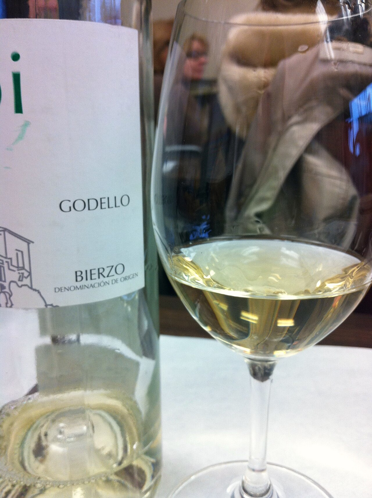

# 格德约

西班牙西北部 Valdeorras、Ribeiro 与 Monterrei 的白葡萄，带柑橘、白花、矿物与坚果，酸度中高、质地饱满；可酿清爽型或橡木桶型。

格德约是西班牙西北部的白葡萄，Valdeorras 与 Ribeiro 是核心产区；它中等酒体、酸度好，带柑橘、白花、茴香与矿物，常经酒泥陈年。

图：Godello：Bierzo Godello（Wikimedia Commons）。图片：Agne27，CC BY-SA 3.0，via Wikimedia Commons（[原图页面](https://commons.wikimedia.org/wiki/File:Bierzo_Godello.JPG)）。

## 定义与命名

格德约是西班牙西北部的白葡萄，核心产区为 Valdeorras、Ribeiro 与 Monterrei；在葡萄牙北部称 Gouveio，可能与格德约同源。它带柑橘、白花、矿物与坚果，酸度中高、质地饱满，可酿清爽型或橡木桶型。

格德约不是阿尔巴利诺（Albariño），也不是弗德乔（Verdejo）；三者都是西班牙白葡萄，但产区、酸度与香气不同。Valdeorras 的板岩土壤与河谷地形给它矿物感，Ribeiro 更温暖、酒体更圆。

在西班牙，Valdeorras DO 对格德约的品种比例与产量有规定；葡萄牙的 Gouveio 常用于杜罗白葡萄酒混酿。名称在不同语言里变化，读标签时要看产区与品种。

格德约的历史常被写成“几乎消失又被找回”：20 世纪中期，高产杂交品种取代了许多老园，1980 年代以后，Valdeorras 的酒农重新选育本地材料。今日的 Godello 复兴，靠的是老藤、板岩土壤与酒泥陈年，而不是某一个酒庄的营销。

格德约在西班牙语写作 Godello，在葡萄牙北部有同源或近缘的品种，但不要与 Verdejo 混淆：Verdejo 在卢埃达，果味更偏青草与柑橘，格德约在加利西亚，更偏白花、茴香与矿物。两者名字相近，产区与风格都不同。

## 起源与传播

格德约的起源在伊比利亚西北部，基因研究把它与葡萄牙 Gouveio 联系起来；20 世纪中期，它一度接近消失，1970–80 年代，Valdeorras 的酒农与苗圃重新选育，才恢复种植。

Rafael Palacios 在 2000 年代用 Valdeorras 的板岩坡地做出 Sorte O Soro 等酒，让格德约进入国际视野；此后 Valdesil、Guímaro 等酒庄跟进，品种从地方白葡萄变成西班牙西北部的名片。

传播到 Bierzo、Ribeiro 与 Monterrei 后，海拔、土壤与降雨改变成熟节奏；大西洋影响强的地区酸度更高，内陆谷地更饱满。

## 植物学与栽培

果粒中等、皮薄，中晚熟；酸度中高，糖分积累较慢，适合凉爽产区。树势中等，容易感病，需要通风与疏叶；产量过高会稀释香气，过低则酸度尖锐。

Valdeorras 的板岩与花岗岩排水好、热量有限，果实成熟慢，保留柑橘与矿物；Ribeiro 的冲积土与温暖气候让酒体更圆。采收通常在 9 月，晚收版本用于酒泥陈年或橡木桶。

格德约的克隆选育在 Valdeorras 与 Ribeiro 进行，不同克隆的果粒大小、成熟期与香气不同；老藤常混种，酒农会按地块分开采收。Valdeorras 的板岩来自古生代沉积，片理发达、排水极强，夏季高温与夜间降温让果实积累柑橘与矿物。

## 风格与味觉

年轻格德约呈浅黄，香气带柠檬、葡萄柚、白花、茴香与湿石；入口酸度中高，酒体比阿尔巴利诺更饱满，收口带坚果与苦韵。

不锈钢罐版本更清爽，酒泥搅拌增加奶油与质地；橡木桶版本带香草、烤面包、榛子与更长的回味。老藤格德约可以陈年 5–10 年，出现蜂蜜、干果与矿物。

与霞多丽比，它的酸度更高、果味更柑橘；与阿尔巴利诺比，它更饱满、更少热带水果。判断典型性，先看产区与是否酒泥/桶陈。

酒泥搅拌（bâtonnage）让酵母自溶带来奶油与坚果，但过度搅拌会让酒浑浊、失去酸度；传统酒庄会控制时间与温度。格德约的采收通常在 9 月中下旬，过晚会让酸度下降、酒精升高；早采则保留柑橘与白花，但可能带青草。

格德约在橡木桶中发酵时，常保留部分酒泥，增加质地与坚果香；它与 Albariño 的区别在酒体与酸度：格德约更饱满，阿尔巴利诺更咸鲜、香气更直接。

## 主要产区与代表酒款

Valdeorras 是核心，板岩坡地与河谷是风土标志；Ribeiro 与 Monterrei 更温暖，酒体更圆；Bierzo 也有少量种植。

代表酒款包括 Rafael Palacios Sorte O Soro 与 Louro、Valdesil Montenovo、Guímaro、Pazo de Monterrey 等；葡萄牙的 Gouveio 常见于杜罗白混酿。

Rafael Palacios 的 Sorte O Soro 用老藤格德约与橡木桶发酵，酒体饱满、带坚果与盐感；Louro 则更清爽，是了解品种的入口。格德约也可用于 Ribeiro 的混酿，与 Treixadura、Albariño 一起增加酒体；在葡萄牙杜罗，Gouveio 与 Malvasia Fina 混酿白葡萄酒。

格德约的酸度与酒泥陈年让它适合搭配加利西亚的海鲜与贝类；Ribeiro 的混酿更偏热带水果。Valdeorras 的葡萄园海拔与坡向差异大，朝南坡地更早熟，朝北坡地更酸。

Valdeorras 的板岩土壤与河谷气候让格德约保留酸度与矿物；Ribeiro 更偏西，海洋影响更强，酒体更轻；Monterrei 与 Valdeorras 的边界地块风格接近。酒标上的“Godello”通常意味着单一品种，但部分酒庄会混入 Treixadura 或 Loureira，读背标更稳。

## 怎么喝与配餐

清爽型温度 10–12°C，橡木桶型 12–14°C；用中等口径白酒杯。配餐适合海鲜、贝类、烤鱼、鸡肉与奶油酱汁；矿物感强的版本可以配山羊奶酪与蔬菜。

开瓶后冷藏，2–3 天喝完；橡木桶版本可以放 3–5 天。不要过度冰镇，低温会压住坚果与白花。

格德约适合配贝类、烤鱼、蔬菜与加利西亚海鲜；酒泥陈年版本可以配奶油酱汁与禽肉。温度 10–12°C，用中等口径白酒杯；年轻酒可短暂醒酒，老酒只需换瓶。

## 选购与常见误区

先看产区与品种名：Valdeorras 的 Godello 通常比 Ribeiro 更矿物；葡萄牙标签写 Gouveio。再看是否酒泥陈年或橡木桶，风格差异很大。

常见误读：把格德约当成阿尔巴利诺；以为西班牙白葡萄酒都该早饮；以为橡木桶版本一定更好。清爽型与桶陈型是两条路线，不是等级高低。

格德约的老藤产量低、风味更集中，但价格也更高；它适合在凉爽年份寻找酸度。

## 参见

- [白葡萄酒](ref:white)：白葡萄的发酵与风格。
- [橡木桶陈酿](ref:oak)：桶发酵与酒泥搅拌。
- [风土（terroir）](ref:terroir)：板岩、河谷与成熟度。
- [发酵](ref:fermentation)：糖转化为酒精。
- [霞多丽](ref:chardonnay)：白葡萄酒的常见对照。

对照阅读：[白葡萄酒](ref:white)、[风土（terroir）](ref:terroir)、[橡木桶陈酿](ref:oak)。

**关键事实。**

| 项目 | 内容 |
| --- | --- |
| 一句话定位 | 西班牙西北部 Valdeorras、Ribeiro 与 Monterrei 的白葡萄，带柑橘、白花、矿物与坚果，酸度中高、质地饱满；可酿清爽型或橡木桶型 |
| 物种 | Vitis vinifera |

**来源与边界。** 本页关于「格德约」的关键事实，主要由以下来源交叉核对：Julius Kühn-Institut（品种名称、同义词、起源与全球分布）、OIV（葡萄品种与栽培框架）、USDA ARS（植物分类、种质与栽培信息）等 4 条来源。价格、批次与状态会变，涉及这些字段时以页面所列来源的最新版本为准。正文为项目自写，来源只作核验，不复制原文。
