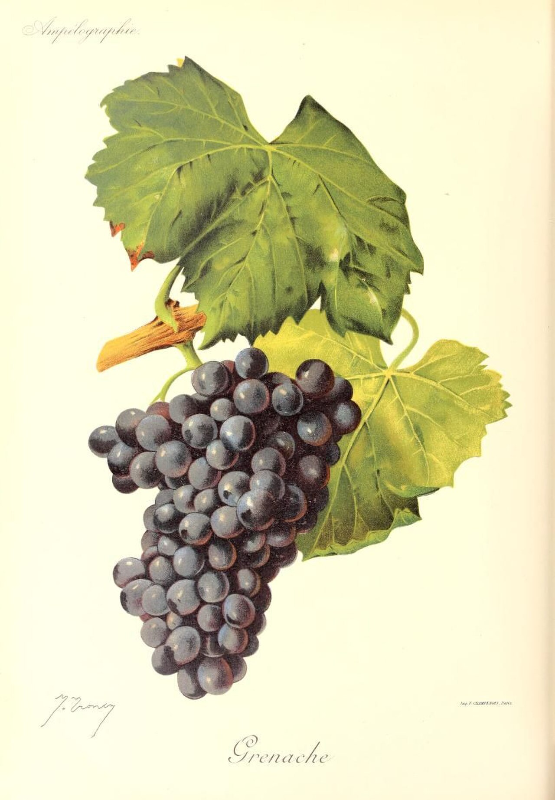
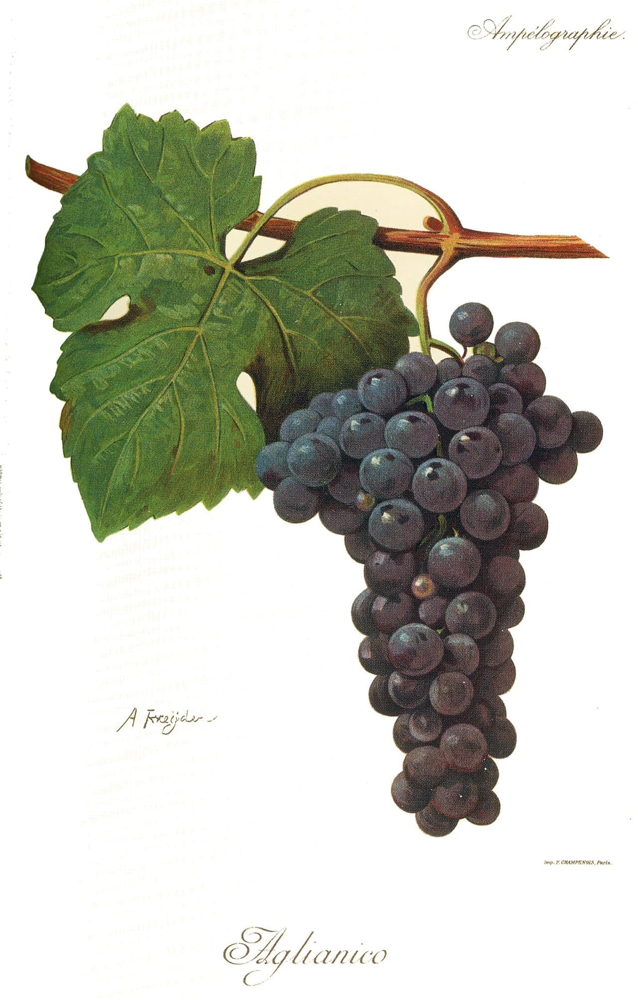

# 歌海娜

歌海娜（Grenache）是地中海沿岸最重要的红葡萄之一：耐热、耐旱、糖分积累快，能在干旱贫瘠的坡地上生存。它的果皮薄、单宁中等、酸度偏低，单喝容易显得松散，却在混酿中承担果味、酒精与香料的支撑。它在西班牙叫 Garnacha，在撒丁岛叫 Cannonau，基因研究确认它们是同一品种。

图：歌海娜。图片：Jules Troncy，Public domain，via Wikimedia Commons（[原图页面](https://commons.wikimedia.org/wiki/File:Grenache_N.jpg)）。

## 定义与别名

歌海娜的英文名是 Grenache，法语名 Grenache Noir。它属于欧洲葡萄 Vitis vinifera。西班牙称 Garnacha，撒丁岛称 Cannonau，加泰罗尼亚语称 Garnatxa，英语世界还用过 Alicante。这些名称常让酒标看起来像不同品种，实际上指同一植物。它的颜色变种包括黑、灰、白三种，白歌海娜（Grenache Blanc）与灰歌海娜（Grenache Gris）都可单独酿酒或用于混酿。

## 亲本与起源

歌海娜的亲本尚未完全确定。多数研究把它的起源放在西班牙东北部的阿拉贡一带，认为它在中世纪沿地中海传播到法国南部、撒丁岛与意大利南部。基因分析显示它与西班牙古老品种群有亲缘关系，但没有确认直接的父母本。它在罗讷河谷的种植史至少可以追溯到 18 世纪，19 世纪以后成为南罗讷混酿的主体。

## 植物学特征

果穗中等偏大，果粒中等，果皮薄、颜色偏紫红，果肉多汁。薄皮意味着色素与单宁都不算高，糖分积累快而酸度下降也快，成熟时酒精度容易偏高。它发芽中等偏早，成熟期中等，抗旱能力强，根系深，适合灌木式（gobelet）整形。老藤歌海娜的产量低、果实小，风味更集中，但抗病能力并不自动更强。

## 栽培特性

歌海娜耐热、耐旱、耐风，适合贫瘠的石灰岩、片岩与砾石土壤。它对水分胁迫的耐受性很好，但在极度干旱年份会出现停止成熟、果实干缩的问题。薄皮让它对灰霉病与日灼都比较敏感，采收需要避开高温时段。灌木式整形在南罗讷与西班牙很常见，藤架贴近地面，既能避风又能利用土壤热量；机械采收在平坦地块逐渐普及。

## 法国的产区

法国南部的罗讷河谷是歌海娜的核心。教皇新堡的混酿以歌海娜为主体，比例可达 70% 以上，常配西拉与慕合怀特；吉恭达斯、瓦凯拉斯与罗讷丘村庄级也大量使用。鲁西永（Roussillon）的巴纽尔斯（Banyuls）与莫里（Maury）用歌海娜酿造天然甜酒（vin doux naturel），在发酵中途加入酒精，保留残糖。朗格多克则多用于混酿与桃红。南罗讷的鹅卵石土壤与密史脱拉风，塑造了歌海娜成熟而不过熟的性格。

## 西班牙与撒丁岛

西班牙是歌海娜种植面积最大的国家。阿拉贡的 Campo de Borja 与 Calatayud 以老藤 Garnacha 著称，Priorat 则用片岩（llicorella）与陡坡老藤酿出浓缩、矿物感强的酒，2009 年升为 DOQ。纳瓦拉与加泰罗尼亚也有种植。撒丁岛的 Cannonau 是当地最重要的红葡萄，风格更偏成熟果味与香料。澳大利亚的 McLaren Vale 与 Barossa 保留了大量 1860 年代种植的老藤，是研究老藤歌海娜的重要资源。

## 酿造与风格

歌海娜的酿造方式多样。红葡萄酒常采用整串发酵或部分二氧化碳浸渍，以增加香气与柔化单宁；桃红则短暂浸渍，保留草莓与柑橘气息；天然甜酒在发酵中途加烈，保留糖分与果味。由于酸度低、pH 高，歌海娜容易氧化，也需要谨慎控制SO2。混酿时，西拉提供颜色、单宁与黑胡椒，慕合怀特提供结构、野味与陈年潜力，歌海娜则提供果味、酒精与柔顺口感。

## 感官风格

年轻歌海娜以草莓、覆盆子、红樱桃、白胡椒与干香草（garrigue）为主，酒体中等偏饱满，单宁柔顺，酸度偏低，酒精常在 14% 至 15% 之间。老藤版本颜色更深、风味更集中，带无花果、皮革与香料。天然甜酒则有黑莓、可可、咖啡与焦糖气息。温度过高会让酒精感突出，饮用时宜稍微冷藏。它与烤肉、炖菜、地中海香料菜肴搭配良好。

## 与西拉、慕合怀特的区别

三者常一起出现，但角色不同。歌海娜果皮薄、单宁低、酸度低、酒精高，提供果味与柔顺感；西拉颜色深、单宁中等、酸度较高，带黑胡椒与烟熏；慕合怀特单宁强、酸度高、颜色深，带野味与皮革，需要较长时间成熟。把三者混为一谈，会忽略混酿的逻辑：歌海娜负责“肉”，西拉负责“骨架”，慕合怀特负责“深度”。

## 代表生产者与年份

南罗讷的代表包括 Château Rayas、Château de Beaucastel 与 Domaine de la Janasse；西班牙有 Álvaro Palacios、Clos Mogador 与 Telmo Rodríguez；澳大利亚有 d'Arenberg 与 Yangarra。年份差异主要来自干旱与热量：干旱年份产量低、果实小、风味集中；炎热年份酒精更高、酸度更低。市场方面，老藤 Garnacha 在过去二十年从“廉价混酿原料”转变为精品酒，价格与关注度明显上升。

## 常见误区

第一，认为歌海娜只能混酿。单一品种的 Garnacha 与 Cannonau 都很常见。第二，把歌海娜当成“高酒精、低质量”的代名词。老藤与高海拔可以带来平衡。第三，认为歌海娜不能陈年。优质教皇新堡与 Priorat 可以陈放二十年以上。第四，把 Garnacha 与 Cannonau 当成不同品种。基因研究确认是同一品种。第五，以为桃红都是甜酒。南罗讷的桃红多为干型。第六，认为歌海娜不需要酸度。低酸是它的特征，但完全失衡的酒会显得松散。

对照阅读：[葡萄酒](ref:wine)、[法国](ref:france)。

## 延伸阅读

- [葡萄酒](ref:wine)：歌海娜在葡萄酒总体分类中的位置。
- [红葡萄酒](ref:red-wine)：歌海娜所属的酒类。
- [法国](ref:france)：法国葡萄酒的法规与产区框架。
- [加强酒](ref:fortified)：巴纽尔斯与莫里的天然甜酒传统。

补充阅读：[艾格尼科](ref:c-extra-1)。

相关条目：[红葡萄酒](ref:red-wine)。

**关键事实。**

| 项目 | 内容 |
| --- | --- |
| 一句话定位 | 耐热、耐旱的红葡萄品种，果皮较薄、糖分积累快、酸度偏低；它在罗讷河谷混酿与西班牙 Priorat 等产区中承担果味与酒精度的支撑 |
| 物种 | Vitis vinifera |
| 代表产区 | 法国 |

**来源与边界。** 本页关于「歌海娜」的关键事实，主要由以下来源交叉核对：International Organisation of Vine and Wine (OIV)（品种描述与 Vitis 物种框架）、Oxford University Press（提供关于歌海娜的起源、混酿与产区条目；由原条目末尾参考资料迁移，未逐条复核访问日期）、INAO（法国原产地命名制度中品种与产区的对应关系）。价格、批次与状态会变，涉及这些字段时以页面所列来源的最新版本为准。正文为项目自写，来源只作核验，不复制原文。

## 相关图像

图：艾格尼科。图片：Alexis Kreyder，Public domain，via Wikimedia Commons（[原图页面](https://commons.wikimedia.org/wiki/File:Aglianico_Viala_Vermorel.jpg)）。关联图像：歌海娜。
