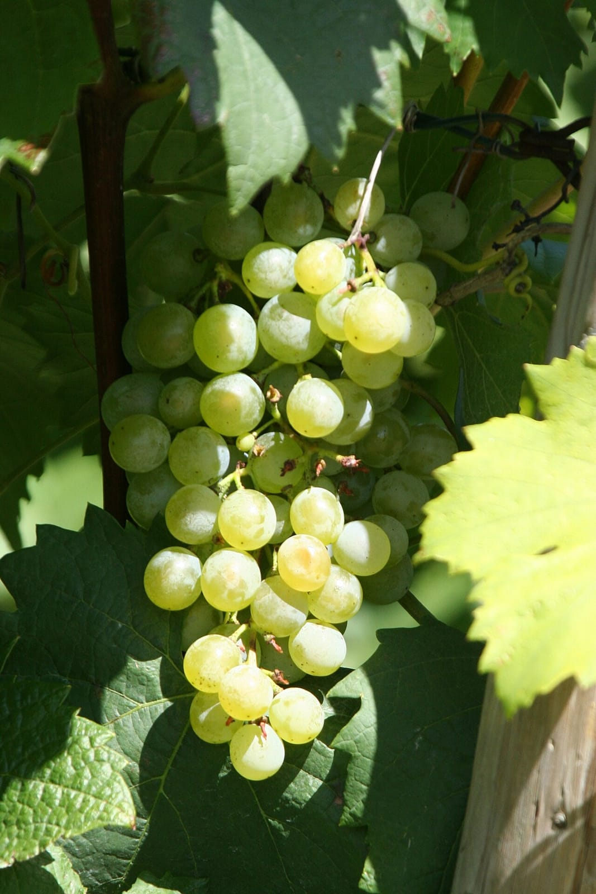
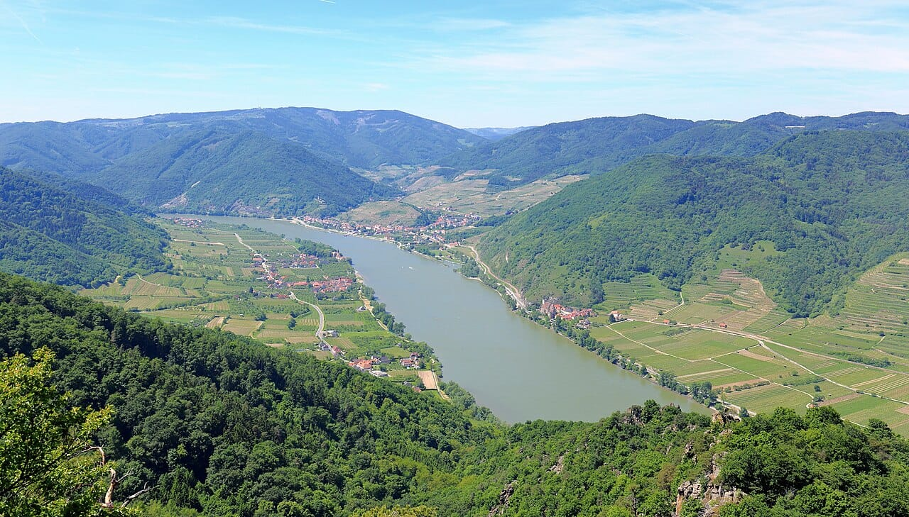

# 绿维特利纳

绿维特利纳（Grüner Veltliner）是奥地利最具代表性的白葡萄品种，在瓦豪、克雷姆斯谷、坎普谷与韦恩维尔特都有广泛种植。它的辨识度来自酸度与香气：柑橘、青豌豆、白胡椒与矿物感，年轻时清爽，成熟后可以变得饱满而有层次。它也是少数能以“白胡椒”作为品种标志的白葡萄，这一香气来自一种名为 rotundone 的化合物。

图：绿维特利纳。图片：Rosenzweig，CC BY-SA 3.0，via Wikimedia Commons（[原图页面](https://commons.wikimedia.org/wiki/File:Gruener_Veltliner_Weinsberg_20060909.jpg)）。

## 定义与别名

绿维特利纳的德文名是 Grüner Veltliner，中文常译作绿维特利纳或绿维特林纳。它属于欧洲葡萄 Vitis vinifera。名称中的“Grüner”指绿色，与果实成熟时的黄绿色调有关；“Veltliner”则可能来自意大利北部的 Valtellina，暗示其阿尔卑斯来源。常见拼写变体包括 Gruener Veltliner 与 Gruner Veltliner，酒标上还可能写作 Weißgipfler，但后者是另一个相关名称，不能一概等同。

## 亲本与起源

DNA 研究显示，绿维特利纳是特拉明（Traminer/Savagnin）与奥地利古老品种 St. Georgen 的自然杂交后代。这个发现解释了它为何既有特拉明系的香料气息，又带有奥地利本土品种的酸度与结构。它的起源地一般认为在奥地利东部，可能是瓦豪或韦恩维尔特一带，但早期传播路线仍有争议。它与雷司令没有直接亲缘关系，两者常被比较，只是因为都是高酸、晚熟的白葡萄。

## 植物学特征

果穗中等偏大，果粒中等、排列较紧，果皮黄绿、较厚。它发芽中等，成熟期偏晚，属于晚熟品种；厚果皮让它对灰霉病有一定耐受性，也利于香气物质积累。糖分积累中等，酸度下降慢，成熟时仍能保持清爽的酸度。与雷司令相比，绿维特利纳的果粒更大、皮更厚、香气更偏胡椒与青豌豆，而不是花香与矿石。

## 栽培特性

绿维特利纳长势旺、产量高，需要通过修剪与绿色采收控制负载。它在黄土（loess）、片麻岩、花岗岩与石灰岩上都能生长，但土壤差异会明显改变风格：韦恩维尔特的黄土赋予更饱满的酒体与柔和酸度，瓦豪的片麻岩与花岗岩梯田则带来更紧致的结构与矿物感。它耐寒性中等，春季霜冻是主要风险；晚熟也意味着采收常在 10 月，秋季降雨会影响年份质量。

## 奥地利的产区分布

奥地利约有 1.4 万公顷绿维特利纳，约占全国葡萄园面积的三分之一，是种植最广的白葡萄。核心产区包括瓦豪（Wachau）、克雷姆斯谷（Kremstal）、坎普谷（Kamptal）、特赖森谷（Traisental）、瓦格拉姆（Wagram）与韦恩维尔特（Weinviertel）；施泰尔马克（Styria）也有种植，但更以长相思闻名。下奥地利的多瑙河沿岸是重心，梯田、河谷与黄土台地构成不同的成熟条件。

## 瓦豪的三级体系

瓦豪产区用一种独特的酒精度分级来标识成熟度与风格，而不是常见的糖度分级。Steinfeder 是最轻的一级，酒精度上限为 11.5%，酒体轻盈、适合早饮；Federspiel 为 11.5% 至 12.5%，风格中等、酸度清晰；Smaragd 最低酒精度为 12.5%，酒体最饱满、陈年潜力最好。三级名称来自当地植物与鸟类，法规同时限制加糖与产量。其他产区则多用 DAC 体系：韦恩维尔特 DAC 于 2002 年成为奥地利第一个 DAC 产区，强调干型与胡椒香气。

## 酿造与风格

绿维特利纳的酿造以不锈钢罐为主，强调新鲜果香与酸度；Smaragd 与顶级单一园常使用大旧桶或部分新桶，增加质地与复杂度。苹果酸-乳酸发酵通常被抑制，以保留酸度；酒泥搅拌可以增加圆润感。典型风格是柑橘、青苹果、青豌豆、白胡椒与湿石，入口干爽，酸度高，余味带辛香。陈年后会出现蜂蜜、烤面包与白胡椒的复合气息。它可以酿成干型、半干型与少量甜型，但以干白为主。

## 与雷司令的区别

两者都是奥地利的高酸白葡萄，但风格不同。雷司令更偏花香、白桃与矿石，酸度更锋利，陈年后出现汽油味；绿维特利纳更偏青豌豆、白胡椒与柑橘，酒体更宽、酸度略柔，年轻时更容易入口。雷司令在瓦豪与坎普谷多种在陡坡，绿维特利纳则分布更广。把绿维特利纳当作“奥地利的雷司令”会忽略它独有的胡椒香气与配餐优势。

## 代表生产者与年份

瓦豪的代表酒庄包括 F.X. Pichler、Emmerich Knoll、Prager 与 Hirtzberger；坎普谷有 Bründlmayer 与 Loimer；韦恩维尔特则以合作社与中型酒庄为主。年份差异主要来自秋季降雨与成熟度：干燥温暖的年份酒体更饱满、酒精更高；凉爽多雨的年份酸度更锋利、产量更低。市场方面，绿维特利纳在 21 世纪初因“白胡椒”风味在国际市场走红，价格从日常酒到顶级单一园跨度很大。

## 常见误区

第一，认为绿维特利纳只产自瓦豪。它遍布下奥地利与施泰尔马克。第二，把 Smaragd 当成葡萄园等级。它是酒精度与成熟度分级，不是地块分级。第三，认为绿维特利纳一定带胡椒味。胡椒香气受年份、土壤与酿造影响。第四，把它当成雷司令的替代品。两者香气与结构不同。第五，认为它不能陈年。优质 Smaragd 可以陈放十年以上。第六，以为所有绿维特利纳都要早饮。日常级适合早饮，顶级酒款需要时间。

对照阅读：[葡萄酒](ref:wine)、[瓦豪](ref:wachau)。

## 延伸阅读

- [葡萄酒](ref:wine)：绿维特利纳在葡萄酒总体分类中的位置。
- [白葡萄酒](ref:white-wine)：绿维特利纳所属的酒类。
- [瓦豪](ref:wachau)：绿维特利纳的核心产区与三级体系。
- [施泰尔马克](ref:styria)：奥地利另一个重要产区。
- [雷司令](ref:riesling)：常与绿维特利纳比较的品种。

相关条目：[白葡萄酒](ref:white-wine)。

**关键事实。**

| 项目 | 内容 |
| --- | --- |
| 一句话定位 | 奥地利的代表性白葡萄品种，晚熟、酸度高，典型香气为柑橘、青豌豆与白胡椒；DNA 研究显示它是特拉明与奥地利古老品种 St. Georgen 的自然杂交后代，在瓦豪按酒精度分为 Steinfeder、Federspiel 与 Smaragd 三级 |
| 物种 | Vitis vinifera |
| 代表产区 | 施泰尔马克、瓦豪 |

**来源与边界。** 本页关于「绿维特利纳」的关键事实，主要由以下来源交叉核对：International Organisation of Vine and Wine (OIV)（品种描述与 Vitis 物种框架）、Oxford University Press（提供关于绿维特利纳、瓦豪与奥地利白葡萄酒的条目；由原条目末尾参考资料迁移，未逐条复核访问日期）、Austrian Wine Marketing Board（绿维特利纳的种植面积、瓦豪分级与奥地利产区框架）等 5 条来源。价格、批次与状态会变，涉及这些字段时以页面所列来源的最新版本为准。正文为项目自写，来源只作核验，不复制原文。

## 相关图像

图：瓦豪。图片：C.Stadler/Bwag，CC BY-SA 4.0，via Wikimedia Commons（[原图页面](https://commons.wikimedia.org/wiki/File:Wachau_(2).JPG)）。关联图像：绿维特利纳。
