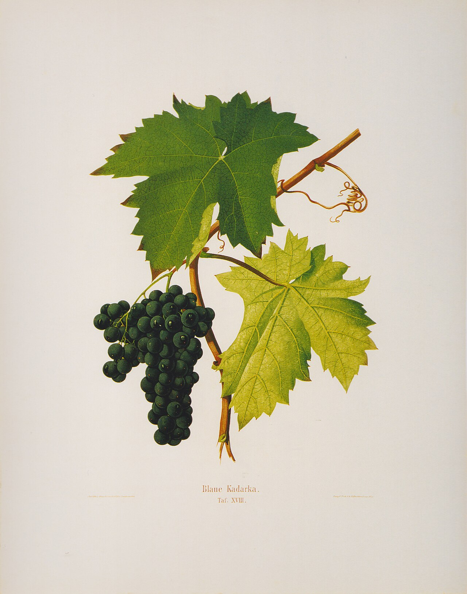

# 卡达卡

匈牙利与巴尔干的红葡萄，酒色浅、酸度高、单宁低，带红樱桃、香料与胡椒；曾是匈牙利最重要的红葡萄，现为 Szekszárd 与 Eger 的传统品种。

卡达卡是匈牙利与巴尔干的红葡萄，塞克萨德与埃格尔是核心产区；它晚熟、皮薄、色浅，带红樱桃、香料与胡椒，常参与公牛血混酿。

图：Kadarka：Kreuzer Ampelographie 144 Blaue Kadarka（Wikimedia Commons）。图片：Vinzenz Kreuzer / Conrad Kreuzer，Public domain，via Wikimedia Commons（[原图页面](https://commons.wikimedia.org/wiki/File:Kreuzer_Ampelographie_144_Blaue_Kadarka.jpg)）。

## 定义与命名

卡达卡是匈牙利与巴尔干的红葡萄，酒色浅、酸度高、单宁低，带红樱桃、草莓、香料与胡椒；它曾是匈牙利最重要的红葡萄，现为塞克萨德（Szekszárd）与埃格尔（Eger）的传统品种。

卡达卡的名字与“Kadarka”有关，可能来自塞尔维亚语或地方昵称；它与蓝弗兰克（Kékfrankos）不是同一品种，但常被一起混酿。匈牙利语里“Kékfrankos”是蓝弗兰克，“Kadarka”是卡达卡，标签上不会互换。

20 世纪，卡达卡被产量更高的卡法兰克斯与梅洛取代，种植面积大幅下降；近二十年，塞克萨德与埃格尔的酒农重新种植老克隆，把它当作轻酒体、高酸度的传统品种。

## 起源与传播

卡达卡原产巴尔干半岛，可能经塞尔维亚进入匈牙利；18–19 世纪，它在匈牙利大平原与多瑙河沿岸广泛种植，是当地红葡萄酒的主力。

19 世纪后期，葡萄根瘤蚜与战争让种植结构改变；社会主义时期，合作社偏好高产、易机械化的品种，卡达卡进一步退让。1990 年代以后，小型酒庄用老藤与低产量恢复其风格。

在塞尔维亚、罗马尼亚与保加利亚也有类似品种或同名酒；传播过程中，克隆选择让颜色、酸度与香气出现差异。

## 植物学与栽培

果粒中等、皮薄，晚熟，酸度高、单宁低；颜色浅，容易在温暖年份失去酸度。树势中等，产量不稳定，需要控制产量与采收时间。

皮薄让它容易感染灰霉，雨季需要通风与疏叶；塞克萨德的黄土与石灰岩、埃格尔的火山土提供热量与排水。传统整串发酵可以增加结构，但过度浸渍会带来苦味。

卡达卡的克隆包括 Kadarka 60、Kadarka 65 等，匈牙利育种机构筛选出更抗病、成熟更一致的品系；老藤混种仍保留多样性。塞克萨德的黄土与石灰岩母质排水好、保水适中，秋季长，卡达卡可以晚采；埃格尔的火山土更暖，酸度略低。

## 风格与味觉

酒色浅 ruby，香气带红樱桃、草莓、酸樱桃、胡椒、肉桂与泥土；入口酸度高、单宁低，酒体轻到中等，收口清爽。

传统派用大桶或旧桶，强调轻盈与香料；现代派用整串发酵、短浸渍与少量新桶，增加结构与颜色。与蓝弗兰克混酿时，卡达卡提供酸度与红色果味，蓝弗兰克提供单宁与深色。

它不适合长时间单独陈年，3–8 年是常见适饮期；老藤版本可以更久。判断典型性，先看颜色浅、酸度高、单宁低这三个特征。

传统“公牛血”混酿以卡达卡、蓝弗兰克与梅洛为主，卡达卡提供酸度与红色果味，蓝弗兰克提供单宁与颜色；现代版本比例更自由。卡达卡皮薄，浸渍时间通常较短，避免萃取过多苦味；整串发酵可以增加香料与结构，但需要控制茎秆比例。

卡达卡的颜色来自短浸渍，酒液常比蓝弗兰克浅；单品种版本可以轻度冷藏后饮用。塞克萨德的酒农会把卡达卡与蓝弗兰克、梅洛混酿，增加颜色与单宁；在埃格尔的“公牛血”里，它通常只占一部分，不是主导品种。

## 主要产区与代表酒款

塞克萨德是卡达卡的核心，黄土与暖气候让酒更饱满；埃格尔的火山土与山地让酸度更高，常用于“公牛血”混酿；Kunság 与大平原也有种植。

代表生产者包括 Takler、Vida、Heimann、Bock 等；卡达卡常与 Kékfrankos、Merlot、Cabernet Franc 混酿，单品种版本较少。

塞克萨德（Szekszárd）的黄土与河谷气候让卡达卡更饱满、香料更足；埃格尔（Eger）偏北，酸度更高、红樱桃更亮。公牛血（Egri Bikavér）是混酿，卡达卡可以是成分之一，但不是唯一品种；酒标写“Kadarka”时才是单一品种或主导品种。

## 怎么喝与配餐

饮用温度 13–15°C，用中等口径红酒杯；年轻酒不必长时间醒，老酒短暂换瓶即可。配餐适合红椒粉鸡肉、炖猪肉、香肠、野味与中等硬质奶酪；高酸能切开油脂。

不要配重酱汁或高单宁食物，卡达卡的结构撑不住。开瓶后冷藏，2–3 天喝完；单品种版本尤其容易氧化。

卡达卡的酒精度通常 12–13.5%，残糖低，适合配红椒粉与酸奶油菜肴；单品种版本适合早饮，3–5 年，混酿版本可以陈年 5–10 年。

卡达卡适合配红椒粉、酸奶油与炖猪肉，不适合配清淡海鲜。

## 选购与常见误区

先看品种名与产区：匈牙利标签写 Kadarka，混酿会标出比例；再看年份与酒精度。价格高可能来自老藤或名庄，不代表单品种一定比混酿好。

常见误读：把卡达卡当成蓝弗兰克；以为颜色浅就没有风味；以为所有匈牙利红葡萄酒都厚重。卡达卡的价值在轻盈、酸度与香料，而不是力量。

卡达卡皮薄、色浅，单品种酒通常比公牛血更轻、更红樱桃；混酿版本的单宁与酒体来自 Kékfrankos 等品种。不要把公牛血当成卡达卡单品种，也不要用深色判断它的浓度。

## 参见

- [蓝弗兰克](ref:blaufrankisch)：常与卡达卡混酿的品种。
- [红葡萄酒](ref:red)：带皮发酵与单宁。
- [风土（terroir）](ref:terroir)：塞克萨德与埃格尔的土壤。
- [橡木桶陈酿](ref:oak)：旧桶与大桶的影响。
- [年份](ref:vintage)：酸度与成熟度的年际差异。

对照阅读：[蓝弗兰克](ref:blaufrankisch)、[红葡萄酒](ref:red)、[风土（terroir）](ref:terroir)。

**关键事实。**

| 项目 | 内容 |
| --- | --- |
| 一句话定位 | 匈牙利与巴尔干的红葡萄，酒色浅、酸度高、单宁低，带红樱桃、香料与胡椒；曾是匈牙利最重要的红葡萄，现为 Szekszárd 与 Eger 的传统品种 |
| 物种 | Vitis vinifera |

**来源与边界。** 本页关于「卡达卡」的关键事实，主要由以下来源交叉核对：Julius Kühn-Institut（品种名称、同义词、起源与全球分布）、OIV（葡萄品种与栽培框架）、USDA ARS（植物分类、种质与栽培信息）等 4 条来源。价格、批次与状态会变，涉及这些字段时以页面所列来源的最新版本为准。正文为项目自写，来源只作核验，不复制原文。

**并读。** 把「卡达卡」与「蓝弗兰克」、「红葡萄酒」、「风土（terroir）」放在一起读时，先确认它们是同一层级还是上下游关系：先确认品种身份与允许产区，再比较成熟期、抗性、克隆与酿造表现。本页负责给出品种的基本坐标，对照条目补上具体案例与差异；读完再回到本页，才能分清哪些差别属于品种本身，哪些只是产地、批次或品牌选择。
