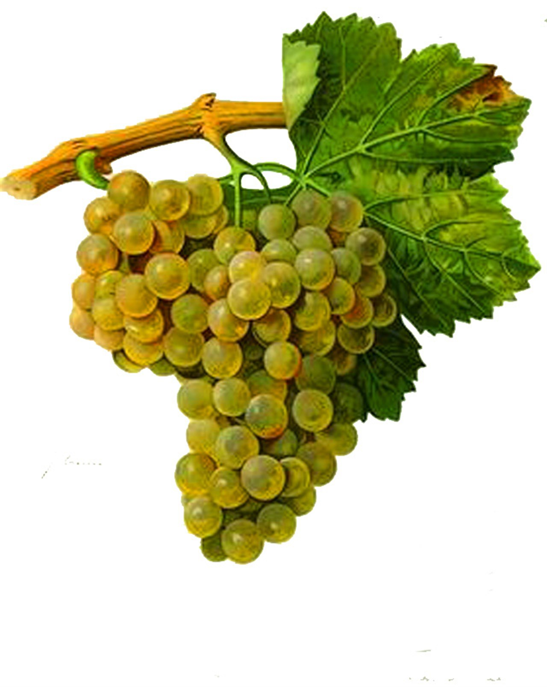

# 马卡贝奥

马卡贝奥（Macabeo）是西班牙种植最广的白葡萄之一，在里奥哈与纳瓦拉称 Viura，在加泰罗尼亚与法国鲁西永称 Macabeu。它产量高、适应性强，酸度中等、香气偏青苹果、白花与柑橘，既是卡瓦起泡酒的基础品种，也是里奥哈白葡萄酒的主角，在不锈钢罐里走清爽路线，经橡木陈酿后则转向蜂蜜、坚果与矿物质感。

读这个品种时要先分清两条主线：一条是加泰罗尼亚与卡瓦体系里的起泡基酒，追求新鲜、果香与平衡酸度；另一条是里奥哈体系里的静止白葡萄酒，可经长时间橡木与瓶陈发展出坚果、蜂蜡与咸鲜质感。同名品种在不同产区的风格差距，往往比品种名单上的笼统描述更能说明问题。

图：Macabeo：Maccabeo blanc（Wikimedia Commons）。图片：Viala et Vermorel，Public domain，via Wikimedia Commons（[原图页面](https://commons.wikimedia.org/wiki/File:Maccabeo_blanc.jpg)）。

## 定义与命名

马卡贝奥学名为 Vitis vinifera，是白葡萄品种。Castilian 语区称 Macabeo，里奥哈与相邻的纳瓦拉习惯叫 Viura，加泰罗尼亚语区与法国南部写作 Macabeu。登记同义词还包括 Alcañón、Alcañol、Blanca de Daroca、Forcalla、Gredelín、Lardot、Lloza、Macaban、Maccabeo、Subirat、Rossan 等；其中部分名字同时被其他品种使用，不能单凭俗名对号入座。

最需要记住的一点是，Viura 与 Macabeo 是同一个品种在里奥哈与加泰罗尼亚的两种叫法，而不是两个相邻但不同的葡萄。辨识上，它果穗长而紧凑、果粒中等、果皮偏厚，发芽与成熟都偏晚，为保留酸度通常提前采收；汁相对耐氧化，这也是它能进橡木陈酿的原因。里奥哈白与卡瓦酒标若标注单一品种，可按产区法规核对品种构成；Alcañón、Alcañol 等俗名同时被其他品种借用，遇到这类名字应回到产区与酒款资料确认，不能单凭俗名对号入座。

## 起源与传播

马卡贝奥很可能起源于加泰罗尼亚的佩内德斯（Penedès）地区，最早的文献记录见于 1617 年 Fray Miquel Agustí 的著作，地点在 Vilafranca 一带。家谱研究把它的亲本指向 Hebén 与 Brustiano faux 两个品种，但亲本结论仍以最新遗传登记为准。它在西班牙北部与地中海沿岸栽培了数百年，根瘤蚜病害之后才进入里奥哈，在当地部分取代了马尔维萨与白歌海娜。

面积上，西班牙 2015 年的种植面积接近 45,000 公顷，是该国第二大白葡萄品种；法国 2007 年登记约 2,800 公顷，几乎全部集中在朗格多克-鲁西永。除西班牙本土外，以色列自 2009 年起也有少量种植。在西班牙境内，它分布在里奥哈、纳瓦拉、阿拉贡（Calatayud、Somontano、Costers del Segre、Terra Alta）、加泰罗尼亚（佩内德斯、Tarragona、Conca de Barberà）以及 Valencia、Yecla、Jumilla、Utiel-Requena、Rueda 等产区。

## 植物学与栽培

马卡贝奥果穗长而紧凑，果粒中等，果皮偏厚，长势旺、产量高。它生长周期长、发芽与成熟都偏晚，但为保留酸度通常提前采收。糖度与酸度都属中等水平，果皮中抗氧化物质含量较高，压榨出的汁相对耐氧化，这也是它适合橡木陈酿的原因之一。

栽培上的核心仍是叶果平衡：叶面积太小则糖分积累不足，枝叶过密造成遮阴又会降低酸度、加重病害。修剪方式、引缚高度、疏叶时机与灌溉都在这条平衡线上调整。作为高产品种，控制负载是获得集中香气的前提；土壤与朝向决定成熟节奏，坡地排水好、日照足的地块更适合做有陈年潜力的酒，平坦肥沃地块则多用于清爽的年轻酒与起泡基酒。

## 风格与味觉

提前采收、不锈钢罐发酵的马卡贝奥风格轻盈利落，香气以青苹果、梨、白柑橘、白花与少量茴香草本为主，酸度清爽、口感顺滑优雅，是年轻即饮型白葡萄酒与起泡基酒的典型面貌。采收稍晚、经橡木桶发酵或陈酿的版本酒体更厚，出现蜂蜜、烤坚果、蜂蜡与淡淡咸鲜矿物感，酸度仍然撑起骨架。

在里奥哈，Viura 常与马尔维萨 Riojana、白歌海娜混酿，也有少量被调入红葡萄酒中；传统派做长时间橡木与瓶陈的珍藏白，数年甚至数十年后发展出柠檬皮、干苹果、蜂蜡、坚果与近似菲诺雪莉的咸鲜余味。酿造变量包括发酵容器、橡木比例、酒泥接触时间与是否过桶；品种本身香气不算浓烈，工艺选择对最终风格的影响很大（ref:fermentation）。

## 主要产区与代表酒款

卡瓦法定产区内，马卡贝奥是种植面积最大的品种，登记 13,955 公顷，占卡瓦品种总面积的 36.58%；其次是 Xarel·lo 的 9,825 公顷与 Parellada 的 7,385 公顷。经典卡瓦由三者调配，马卡贝奥贡献活力、新鲜度与果香，酸度平衡、香气细腻；其他授权品种还包括 Chardonnay、Subirat Parent 与红 Garnacha、Trepat、Monastrell、Pinot Noir。

里奥哈代表生产者包括 R. López de Heredia：酒庄 1877 年创立于 Haro，旗下 Viña Tondonia Blanco Reserva 与 Gran Reserva 以 Viura 混马尔维萨、长期美国橡木桶陈酿著称，Viña Gravonia 则是更入门的陈酿白；CVNE 的 Monopole Blanco、Marqués de Murrieta、Luis Cañas 的桶酿老藤白也都以 Viura 为基础。加泰罗尼亚起泡酒一线，Recaredo 的 Reserva Particular 由 53% Macabeu 与 47% Xarel·lo 老藤酿成，有机与生物动力种植，酒精度约 11%；Gramona、Freixenet、Codorníu、Segura Viudas 也都在卡瓦或 Corpinnat 体系中使用马卡贝奥。法国鲁西永的 Macabeu 既可做干型 Corbières、Minervois，也晚收用于 Banyuls、Maury 的天然甜酒。

## 怎么喝与配餐

清爽型年轻白与卡瓦适合在 8–10 °C 饮用，杯型用中等肚径的白葡萄酒杯即可；橡木陈酿、质感厚重的里奥哈白可以放到 10–12 °C，让坚果与矿物香气展开。卡瓦开瓶前几分钟再开，避免气泡一次散尽；陈年里奥哈白不必长时间冰镇，侍酒温度太低会压住蜂蜡与咸鲜层次。

配餐上，新鲜马卡贝奥与海鲜、贝类、烤鱼、蒜香虾仁、白肉与轻沙拉搭配稳妥；里奥哈传统白适合 bacalao al pil-pil、青汁鳕鱼、烤海鲈或比目鱼、香草烤鸡等口味中等偏重的菜式。它的酸度能切割油脂，香气不抢戏，是西班牙塔帕斯与前菜的常见搭配；辣味菜式则选果味更清爽、酒精度更低的版本。

## 选购与常见误区

第一个误区是把 Viura 与 Macabeo 当成两个品种；它们名称不同，实为同一葡萄。第二个误区是把马卡贝奥当成平淡的中性酿酒葡萄：不锈钢版确实清爽，但老藤、橡木与长陈酿版本有完整的陈年结构。第三个误区是以为卡瓦三者比例固定；不同酒庄与等级的调配差异很大，马卡贝奥比例高的更清新果香，Xarel·lo 比例高的更有骨架。

看酒标时先分清产区（DOCa Rioja、DO Cava 或具体 Catalonia 产区）、类型（静止白、起泡、天然甜酒）、年份与混酿比例。年轻酒适合两三年内饮用，珍藏级里奥哈白与长陈酿卡瓦则具备多年瓶陈空间。储存上避免高温、强光与震动；它在海外以专业进口渠道为主，购买时留意储存条件，过热仓库里的白葡萄酒容易出现果味发闷、酸度突兀。

相关条目：[里奥哈](ref:rioja)、[白葡萄酒](ref:white)、[起泡酒](ref:sparkling)。

## 延伸阅读与另见

- 相关条目：[rioja](ref:rioja)、[white-wine](ref:white)、[sparkling-wine](ref:sparkling)、[fermentation](ref:fermentation)、[terroir](ref:terroir)。
- 想比较卡瓦与里奥哈两条路线，可同一年份选一款清爽卡瓦与一款橡木陈酿里奥哈白，对比果香浓度、酸度亮度与坚果矿物层次。
