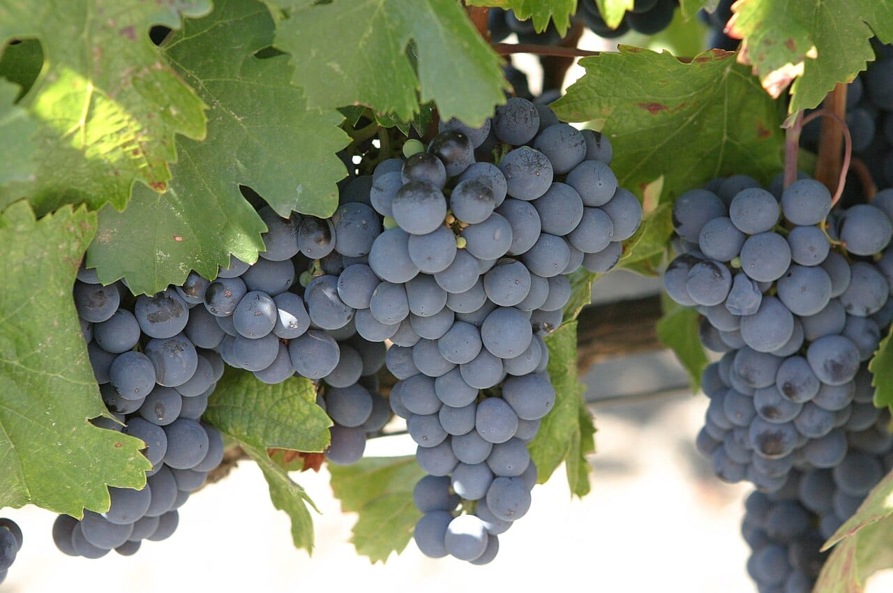
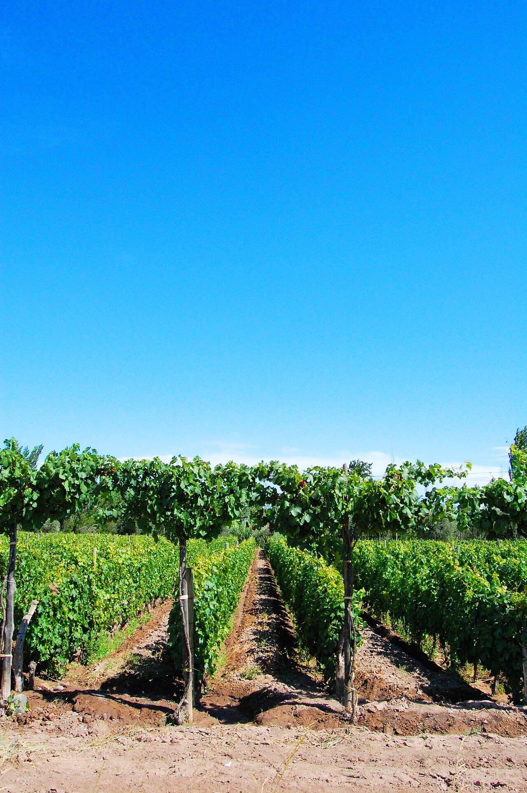

# 马尔贝克

马尔贝克是原产于法国西南部的红葡萄品种，在法国常被称为科特（Côt）。它曾经是波尔多混酿中的五个法定红品种之一，后来在阿根廷找到了更大的舞台。今天提到马尔贝克，多数人首先想到的是门多萨的高海拔葡萄园，而不是法国卡奥尔的黑酒。

图：马尔贝克。图片：Ian L，CC BY 2.0，via Wikimedia Commons（[原图页面](https://commons.wikimedia.org/wiki/File:Malbec_grapes.jpg)）。

## 定义与别名

马尔贝克的英文名是 Malbec，法国西南部也使用 Côt 这一名称。它属于欧洲葡萄 Vitis vinifera，与梅洛、品丽珠等同属波尔多品种群。名称差异反映的是地域传统，而不是不同品种：Malbec 与 Côt 在植物学上被视为同一品种的不同叫法。

把马尔贝克当作“阿根廷的梅洛”并不准确。两者在果皮厚度、单宁结构与成熟节奏上都有差异，混酿中的角色也不同。

## 植物学特征

马尔贝克的果穗较松散，果粒中等，果皮颜色深、厚度中等偏厚，因而容易酿出深色、单宁充沛的酒。它的芽眼萌动较早，开花期遇到低温容易坐果不良（coulure），导致产量不稳定；这也是它在波尔多逐渐被边缘化的原因之一。

马尔贝克需要较多热量才能充分成熟，但在过热的条件下会失去酸度与香气细节。果皮中的色素丰富，单宁较紧实，年轻时可能显得封闭，需要时间或混酿来柔化。

## 主要产区

法国是马尔贝克的原产地。波尔多曾广泛种植，如今主要留在部分右岸与两海之间地带；西南部的卡奥尔以马尔贝克为主导品种，酿出颜色深、结构强的“黑酒”。卢瓦尔河谷也有少量种植。

阿根廷是当今马尔贝克种植面积最大的国家，门多萨的高海拔葡萄园昼夜温差大、日照强，能带来成熟的黑色水果风味与较完整的酸度。此外，智利、澳大利亚、美国与中国也有种植。产区的海拔、温差与水分条件，比品种名更能解释具体风格。

## 典型风味

马尔贝克的典型香气包括黑李子、黑莓、蓝莓，常伴随紫罗兰、可可与甘草。酒体中等偏饱满，单宁较充沛，酸度中等。年轻时以深色果味为主，陈年后可能出现皮革、烟草与泥土气息。

与[梅洛](ref:merlot)相比，马尔贝克通常颜色更深、单宁更明显、结构更紧；与赤霞珠相比，它的酸度往往略低，果味更偏熟甜。混酿时，马尔贝克常用来补充颜色与中段的果味厚度。

## 代表酒款

在波尔多，马尔贝克不再是主流品种，但仍是允许的混酿成分，历史酒款中可找到它的痕迹。在阿根廷，以马尔贝克为主的正牌酒很多，风格从清爽果味到浓缩强劲都有，读者可把它们作为理解“同一品种在不同海拔与酿造方式下的差异”的样本。

具体酒款的配比与风格会随年份、酒庄与产地变化，不能把某一款酒的风格当作品种的固定属性。

## 栽培要点

马尔贝克的主要难点是坐果稳定性与成熟度管理。开花期低温、阴雨容易导致落花落果，产量骤降；成熟期则需要足够热量，否则单宁与果味不成熟，出现青草与蔬菜感。

在阿根廷的高海拔产区，强日照与昼夜温差有助于保持酸度；在法国西南部，生产者更依赖采收时机与混酿比例来平衡结构。产量控制对马尔贝克尤其重要，过高产量会稀释颜色与风味。

## 常见误区

第一，马尔贝克只产于阿根廷。它是法国品种，在法国仍有种植与传统。

第二，马尔贝克等于“深色、厚重、高酒精”。它可以强劲，也可以做得较清爽，取决于产区与酿造。

第三，马尔贝克与梅洛可以随意互换。颜色、单宁与成熟需求不同。

第四，波尔多混酿不含马尔贝克。历史上它是法定品种之一，今天仍被允许。

第五，卡奥尔的“黑酒”只是营销说法。它描述的是颜色深、结构强的风格传统，而不是某个品牌。

马尔贝克原产法国西南部，深色果皮、充沛单宁，对霜冻与坐果不良敏感；在阿根廷门多萨的高海拔环境下成为标志性品种，形成更成熟的黑果与花香。它和梅洛、品丽珠同属波尔多品种家族，但颜色、单宁与气候适应不同；高海拔不是唯一风格，具体产区与酿造仍决定酒体。门多萨的高海拔带来强日照与大日较差，但不同海拔、土壤与灌溉方式仍会造成明显差异；法国原产地的马尔贝克则更常呈现酸度与结构。把高海拔当成单一风格，会忽略这些变量。

对照阅读：[葡萄酒](ref:wine)、[波尔多](ref:bordeaux)。

## 延伸阅读

- [葡萄酒](ref:wine)：理解马尔贝克的分类、酿造与产区框架。
- [红葡萄酒](ref:red-wine)：马尔贝克的单宁、酸度与陈年结构。
- [波尔多](ref:bordeaux)：马尔贝克的历史产区与混酿传统。
- [门多萨](ref:mendoza)：马尔贝克在阿根廷的核心产区。
- [梅洛](ref:merlot)：同属波尔多品种群，可对照理解品种差异。

**关键事实。**

| 项目 | 内容 |
| --- | --- |
| 一句话定位 | 原产于法国西南部的红葡萄品种，果皮深色、单宁充沛，对霜冻与坐果不良敏感；在阿根廷门多萨的高海拔环境下成为标志性品种 |
| 物种 | Vitis vinifera |
| 代表产区 | 门多萨、波尔多 |

**来源与边界。** 本页关于「马尔贝克」的关键事实，主要由以下来源交叉核对：International Organisation of Vine and Wine (OIV)（品种描述与 Vitis 物种框架）、Oxford University Press（提供关于马尔贝克、科特与阿根廷种植的条目；由原条目末尾参考资料迁移，未逐条复核访问日期）、Instituto Nacional de Vitivinicultura (INV)（阿根廷葡萄酒管理机构与马尔贝克种植背景）。价格、批次与状态会变，涉及这些字段时以页面所列来源的最新版本为准。正文为项目自写，来源只作核验，不复制原文。

**并读。** 把「马尔贝克」与「葡萄酒」、「红葡萄酒」、「波尔多」放在一起读时，先确认它们是同一层级还是上下游关系：先确认品种身份与允许产区，再比较成熟期、抗性、克隆与酿造表现。本页负责给出品种的基本坐标，对照条目补上具体案例与差异；读完再回到本页，才能分清哪些差别属于品种本身，哪些只是产地、批次或品牌选择。

**适用边界。** 对「马尔贝克」而言，品种表现随产区、气候与克隆选择变化；同名品种在不同国家可能指不同材料。

**更新提示。** 「马尔贝克」最近核对于 2026-11-07；允许产区、克隆与栽培数据会更新，引种前以官方品种目录为准。

## 相关图像

图：Mendoza Vineyard。图片：Justin De La Ornellas，CC BY 2.0，via Wikimedia Commons（[原图页面](https://commons.wikimedia.org/w/index.php?curid=25786871)）。关联图像：马尔贝克。
