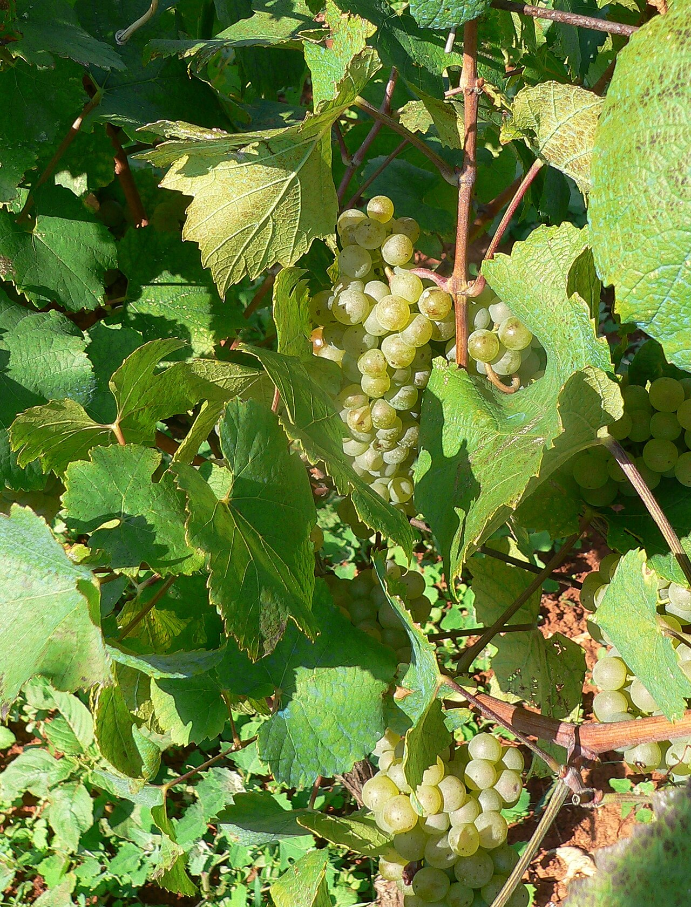

# 玛尔维萨

地中海与伊比利亚的白色品种家族，包含多个克隆与变种；香气从白花、杏、蜂蜜到香料，可酿干白、甜酒与加强酒，不能当作单一品种。

玛尔维萨是一个跨地中海的白色品种家族：从希腊港口名称，到意大利岛屿甜酒、西班牙里奥哈与葡萄牙马德拉，同名异种很多。读它要先区分类型、产区与甜度，再谈香气。

图：Malvasia：Malvasia grapes（Wikimedia Commons）。图片：No machine-readable author provided. Scops~commonswiki assumed (based on copyright claims).，CC BY-SA 3.0，via Wikimedia Commons（[原图页面](https://commons.wikimedia.org/wiki/File:Malvasia_grapes.JPG)）。

## 定义与命名

玛尔维萨不是单一品种，而是一个地中海白葡萄家族：Malvasia Bianca、Malvasia di Candia、Malvasia delle Lipari、Malvasia Riojana、Madeira Malvasia 等类型在形态、香气与用途上都不同。它可酿干白、甜酒、[加强酒](ref:fortified)与马德拉，不能当作一个固定配方。

名称可能来自希腊港口 Monemvasia（莫奈姆瓦夏），中世纪威尼斯与热那亚商人把那里的甜酒称为 Malvasia，后来名称扩展到一系列白葡萄。它不是“马尔瓦西亚”单一克隆，也不是某一个产区的专利；读标签时先看地区与类型。

在意大利，Malvasia 常指芳香型白葡萄；在西班牙，Malvasia Riojana 与 Malvasia de Sitges 是不同的地方品种；在葡萄牙，Malvasia 是马德拉的四大白葡萄之一。同名异种很常见，植物学鉴定比名字更重要。

## 起源与传播

玛尔维萨家族随地中海贸易扩散：希腊、意大利南部、西西里、撒丁岛、西班牙、葡萄牙与马德拉都有各自的类型。威尼斯商人把甜型 Malvasia 运到欧洲北部，使其成为文艺复兴时期的奢侈甜酒。

19 世纪根瘤蚜与战争让许多老园消失，20 世纪合作社又偏好高产、易种的品种；近几十年，Lipari、Bosa、Rioja 与马德拉的酒农重新选育地方类型，恢复芳香与酸度的平衡。

传播不是简单复制：同一名称在不同岛上经过克隆选择，有的香气极浓、有的更中性；栽培方式与风干/加强工艺也随地方法规变化。

马德拉的 Malvasia 在 16–17 世纪随大西洋贸易兴起；19 世纪白粉病与根瘤蚜后，部分老园改种其他品种。今日马德拉的 Malvasia 多用于甜型加强酒，风格从焦糖到干果不等，是岛屿氧化陈年的结果。

意大利南部的 Malvasia 在 20 世纪一度被高产品种替代，Lipari 与 Bosa 的老园直到 1980 年代才被重新发现；西班牙 Rioja 的 Malvasia 则更多留在混酿里，很少单独装瓶。

## 植物学与栽培

果粒中等、皮薄，中晚熟，酸度中等；芳香型类型带白花、杏、桃、蜂蜜与柑橘，中性类型更偏苹果与矿物。家族内不同 biotype 的果粒大小、成熟期与香气差异很大。

皮薄让它容易感染灰霉，但贵腐菌也是甜型 Malvasia 的原料基础；在 Lipari 与 Bosa，海风与火山土提供排水与成熟度，这是[风土](ref:terroir)最直接的表现；在 Rioja，大陆性气候让酸度更稳。

产量控制是关键：高产时香气淡、酒体水；老藤与低产量能带出蜂蜜、杏干与香料。部分类型用于风干（passito），糖分浓缩后再发酵或加强。

Malvasia 的甜型与干型对成熟度的要求不同：干型要早采保留酸度，甜型要晚采或风干浓缩糖分；同一块园子的采收时间，可能决定它最终是清爽干白还是杏干甜酒。

在 Lipari，海风与火山土让果皮保持健康，风干时不易霉变；在 Bosa，山谷风与昼夜温差让酸度更稳。马德拉的 Malvasia 则靠海拔与海风控制成熟，采收后立即加强，保留残糖。

## 风格与味觉

干型 Malvasia 呈浅金，香气带白花、杏、柑橘、蜂蜜与香料；入口酸度中等，酒体从轻到饱满，收口带苦韵。甜型 passito 带杏干、无花果、蜂蜜与坚果，酒精度与残糖都高。

马德拉 Malvasia 经过氧化与加热陈年，带焦糖、干果、香料与咸感；Lipari 的 Malvasia delle Lipari 甜酒带杏干、蜂蜜与海风。加强型与甜型的差别在酒精与残糖，不在品种。

与[霞多丽](ref:chardonnay)比，Malvasia 的香气更花香、更蜂蜜；与麝香葡萄比，它更少葡萄味、更多杏与香料。判断典型性，先看类型与产区，再看甜度与酒精度。

Malvasia 的甜型并不等于“加糖”：Lipari 用风干葡萄浓缩糖分，马德拉用加强酒精中止发酵，Vin Santo 用风干与长时间陈年。三条路径带来不同的酸度、酒精与氧化风味，不能用一个“甜”字概括。

## 主要产区与代表酒款

意大利 Lipari 的 Malvasia delle Lipari DOC 是甜型代表；撒丁岛 Bosa 的 Malvasia di Bosa 做干型与甜型；托斯卡纳的 Vin Santo 常用 Malvasia 与 Trebbiano 混酿。

西班牙 Rioja 的 Malvasia Riojana 多用于混酿；葡萄牙马德拉的 Malvasia 是四大品种之一；克罗地亚、斯洛文尼亚与希腊也有地方类型。代表生产者包括 Lipari 的 Salvatore D’Amico、Bosa 的 Columbu、马德拉的 Blandy’s 等。

葡萄牙马德拉的 Malvasia 分为 Malmsey 等类型，甜度高、酸度也高；西班牙 Rioja 的 Malvasia 多用于混酿，给酒体与花香；克罗地亚的 Malvazija Istarska 是另一品种，不要混为一谈。

## 怎么喝与配餐

干型温度 10–12°C，甜型 12–14°C，马德拉 14–16°C；用中等口径白酒杯或小甜酒杯。干型配海鲜、蔬菜、香料菜肴；甜型配蓝纹奶酪、杏子塔、坚果；马德拉配干果与巧克力。

开瓶后冷藏，干型 2–3 天，甜型 1–2 周，马德拉可放数月。不要用冰镇压住蜂蜜与杏香；甜型的酸度是平衡关键。

马德拉 Malvasia 的甜度与酸度都高，配巧克力、干果与蓝纹奶酪比配清淡海鲜更合适；Lipari 甜酒适合杏仁饼与柑橘塔。干型 Malvasia 可以配香料菜肴与烤蔬菜，但不宜配过酸或过辣的菜。

## 选购与常见误区

先看产区与类型：Lipari、Bosa、Rioja、Madeira 的 Malvasia 风格差异极大；再看甜度、酒精度与是否加强。价格高可能来自风干或老藤，不代表所有 Malvasia 都甜。

常见误读：把 Malvasia 当成单一品种；以为所有 Malvasia 都是甜酒；把马德拉 Malvasia 与普通 Malvasia 混为一谈。它是一个家族，不是一个配方。

## 参见

- [白葡萄酒](ref:white)：白葡萄的发酵与风格。
- [加强葡萄酒](ref:fortified)：加酒精稳定的甜酒。
- [风土（terroir）](ref:terroir)：岛屿、海风与土壤。
- [发酵](ref:fermentation)：糖转化为酒精。
- [霞多丽](ref:chardonnay)：白葡萄的常见对照。

**关键事实。**

| 项目 | 内容 |
| --- | --- |
| 一句话定位 | 地中海与伊比利亚的白色品种家族，包含多个克隆与变种；香气从白花、杏、蜂蜜到香料，可酿干白、甜酒与加强酒，不能当作单一品种 |
| 物种 | Vitis vinifera |

**来源与边界。** 本页关于「玛尔维萨」的关键事实，主要由以下来源交叉核对：Julius Kühn-Institut（品种名称、同义词、起源与全球分布）、OIV（葡萄品种与栽培框架）、USDA ARS（植物分类、种质与栽培信息）等 4 条来源。价格、批次与状态会变，涉及这些字段时以页面所列来源的最新版本为准。正文为项目自写，来源只作核验，不复制原文。
