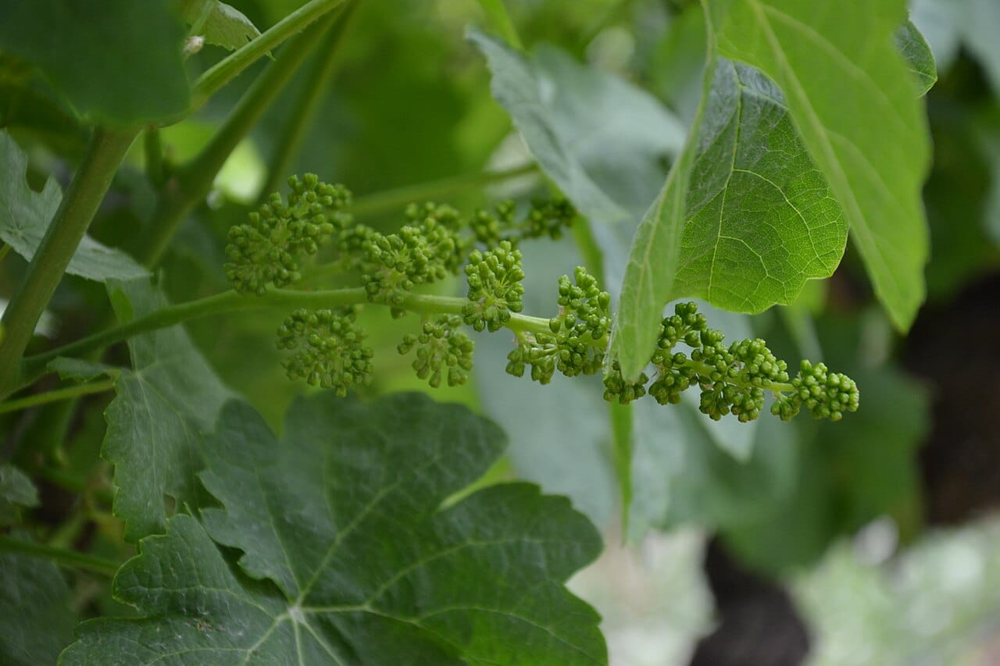
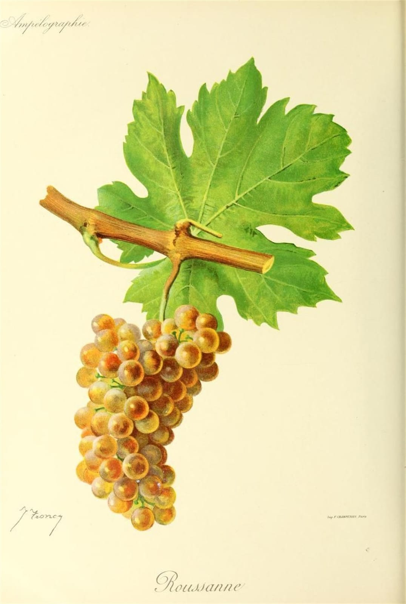

# 玛珊

北罗讷河谷的白葡萄，常与胡珊混酿；酒体饱满、酸度低、带蜂蜜、蜂蜡、坚果与白花，陈年后更显圆润，是埃米塔日白葡萄酒的主要品种。

玛珊是北罗讷河谷的白葡萄，常与胡珊混酿；它酒体饱满、酸度偏低，带蜂蜜、蜂蜡、坚果与白花。在埃米塔日白葡萄酒里，它承担的是骨架与质地，而不是高酸。

图：Marsanne：Marsanne - inflorescence（Wikimedia Commons）。图片：Marianne Casamance，CC BY-SA 4.0，via Wikimedia Commons（[原图页面](https://commons.wikimedia.org/wiki/File:Marsanne_-_inflorescence.jpg)）。

## 定义与命名

玛珊是[罗讷河谷](ref:rhone)的白葡萄，核心产区为埃米塔日（Hermitage）、克罗兹-埃米塔日（Crozes-Hermitage）与圣约瑟夫（Saint-Joseph）；它常与胡珊（Roussanne）混酿。酒体饱满、酸度低，带蜂蜜、蜂蜡、坚果与白花，陈年后更圆润。

玛珊原产法国德龙省（Drôme）的 Marsanne 村，名称即来自地名；它与胡珊是北罗讷白葡萄酒的两大品种，但比例与风格不同。玛珊提供酒体与蜂蜜，胡珊提供酸度与花香。

在澳大利亚、美国与瑞士也有种植，常与胡珊或维欧尼混酿；法国法规对埃米塔日白葡萄酒的品种比例有规定，玛珊可以是主导或与胡珊并列。

## 起源与传播

玛珊在 19 世纪已见于北罗讷，20 世纪前半叶，埃米塔日白葡萄酒产量小、价格高，主要卖给酒商与餐厅；二战以后，白葡萄酒一度被红葡萄酒的声誉掩盖。

1980–90 年代，Chapoutier、Jaboulet、Chave 等酒庄重新强调玛珊的老藤与桶陈，埃米塔日白葡萄酒成为收藏对象；澳大利亚的 Tahbilk 等酒庄也用玛珊做单一品种，证明它能在新世界成熟。

传播到温暖地区后，玛珊的酸度更容易偏低，酒体更饱满；在冷凉地区，它保留更多白花与柑橘。

玛珊在埃米塔日的白葡萄酒历史上常被当作“配角”，因为红葡萄酒更受关注；20 世纪后期，酒庄开始单独装瓶老藤玛珊，让它的蜂蜜与坚果风味被看见。澳大利亚 Tahbilk 从 19 世纪起种植玛珊，是南半球最长命的单一品种版本之一。

## 植物学与栽培

果粒中等、皮薄，中晚熟，产量较高；酸度偏低，糖分积累快，成熟时带白花、蜂蜜、蜂蜡、杏仁与坚果。树势旺，需要控制产量与冠层，避免遮阴。

埃米塔日的花岗岩坡地排水好、热量足，玛珊可以充分成熟，也适合[橡木桶](ref:oak)发酵与陈年；克罗兹-埃米塔日的平原与丘陵更宽，风格更轻。皮薄让它容易感染灰霉，采收窗口较窄。

老藤玛珊产量低、风味集中，可以陈年 10–20 年；年轻藤产量高，适合早饮。部分酒庄用整串压榨，增加草本与结构。

玛珊的酸度低，不代表它不能陈年：酒体、酒精与蜂蜜风味提供抗氧化骨架，老酒会出现干果、皮革与蜂蜜。采收过晚会让酸度进一步下降，酒体显得沉重；早采则保留白花与柑橘。

## 风格与味觉

酒液金黄，香气带白花、蜂蜜、蜂蜡、杏仁、榛子与熟苹果；入口酒体饱满、酸度低，质地圆润，收口带苦韵与矿物。年轻时可能显得“厚而软”，陈年后出现干果、皮革与蜂蜜。

橡木桶发酵与酒泥搅拌增加奶油、香草与烤面包；不锈钢罐版本更清爽，但玛珊的酸度仍然偏低。与胡珊混酿时，胡珊提供酸度与花香，玛珊提供酒体与蜂蜜。

与霞多丽比，玛珊更蜂蜜、更少柑橘；与维欧尼比，它更少花香、更多坚果。判断典型性，先看酸度与酒体，再看是否与胡珊混酿。

玛珊与[胡珊](ref:roussanne)混酿时，比例常是 70/30 或 50/50；胡珊给酸度与花香，玛珊给酒体与蜂蜜。单品种玛珊更厚、更蜂蜜，单品种胡珊更香、更酸；两者不是替代关系。

## 主要产区与代表酒款

埃米塔日白葡萄酒是核心，产量小、价格高；克罗兹-埃米塔日与圣约瑟夫的白葡萄酒更易饮；圣佩雷（Saint-Péray）以胡珊与玛珊混酿起泡酒。

代表生产者包括 Chapoutier（Ermitage l’Ermite、De l’Orée）、Jaboulet（La Chapelle 白）、Chave、Yann Chave 等；澳大利亚 Tahbilk 的 Marsanne 是南半球的代表。

圣佩雷（Saint-Péray）的起泡酒用玛珊与胡珊混酿，是北罗讷少见的白起泡；克罗兹-埃米塔日的白葡萄酒更轻、更适合早饮。埃米塔日白葡萄酒产量小，价格高，老藤版本更值得陈年。

## 怎么喝与配餐

饮用温度 12–14°C，用中等口径白酒杯；年轻酒可以短暂醒酒，老酒只需换瓶。配餐适合烤鸡、奶油酱汁、龙虾、蘑菇与硬质奶酪；酒体饱满，不适合配清淡海鲜。

开瓶后冷藏，2–3 天喝完；老酒氧化更快。不要过度冰镇，低温会压住蜂蜜与坚果。

玛珊的饱满酒体适合烤鸡、奶油蘑菇、龙虾与硬质奶酪；埃米塔日白葡萄酒可以配鹅肝与烤小牛肉。它不适合配生蚝与清淡海鲜，低酸会被海鲜的咸鲜压住。

老玛珊开瓶后容易氧化，建议用大肚白酒杯，让香气展开；如果酒龄超过十年，换瓶去沉淀，但不要长时间醒酒。剩余酒冷藏可放 2–3 天，风味会逐渐变坚果与蜂蜜。

## 选购与常见误区

先看产区与品种比例：埃米塔日白葡萄酒可能以玛珊为主，也可能与胡珊并列；克罗兹-埃米塔日更轻。再看年份与桶陈，老藤版本更值得陈年。

常见误读：把玛珊当成胡珊；以为北罗讷只有红葡萄酒；以为酸度低就没有陈年潜力。玛珊的陈年靠酒体与蜂蜜，不是靠酸度。

常见误读还包括把“Hermitage Blanc”当成玛珊单品种：法规允许胡珊参与，实际比例因酒庄与年份而异。买之前看背标品种比例，比看正标产区名更有用；老藤玛珊的产量很低，价格高并不奇怪。

## 参见

- [罗讷河谷](ref:rhone)：北罗讷的产区体系。
- [胡珊](ref:roussanne)：常与玛珊混酿的白葡萄。
- [白葡萄酒](ref:white)：白葡萄的发酵与风格。
- [橡木桶陈酿](ref:oak)：桶发酵与酒泥搅拌。
- [风土（terroir）](ref:terroir)：花岗岩坡地与成熟度。

**关键事实。**

| 项目 | 内容 |
| --- | --- |
| 一句话定位 | 北罗讷河谷的白葡萄，常与胡珊混酿；酒体饱满、酸度低、带蜂蜜、蜂蜡、坚果与白花，陈年后更显圆润，是埃米塔日白葡萄酒的主要品种 |
| 物种 | Vitis vinifera |
| 代表产区 | 罗讷河谷 |

**来源与边界。** 本页关于「玛珊」的关键事实，主要由以下来源交叉核对：Julius Kühn-Institut（品种名称、同义词、起源与全球分布）、OIV（葡萄品种与栽培框架）、USDA ARS（植物分类、种质与栽培信息）等 4 条来源。价格、批次与状态会变，涉及这些字段时以页面所列来源的最新版本为准。正文为项目自写，来源只作核验，不复制原文。

## 相关图像

图：Roussanne：Roussanne（Wikimedia Commons）。图片：Jules Troncy，Public domain，via Wikimedia Commons（[原图页面](https://commons.wikimedia.org/wiki/File:Roussanne.jpg)）。关联图像：玛珊。
