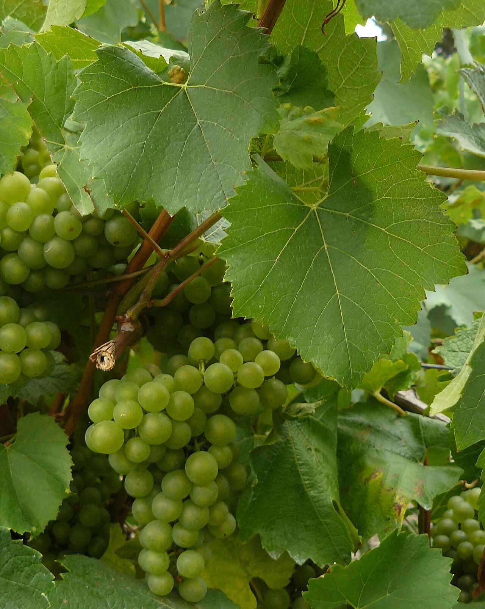

# 勃艮第甜瓜

勃艮第甜瓜（Melon de Bourgogne）是一个容易被名字误导的品种。它既不是甜瓜，也不是麝香葡萄，而是原产勃艮第、今天却在卢瓦尔河谷南特一带成为主角的白葡萄品种。理解它的关键有三点：与霞多丽共享亲本、酸度高而香气中性、以及密斯卡岱的“酒泥陈酿”传统。

图：勃艮第甜瓜。图片：Cyril5555，CC BY-SA 3.0，via Wikimedia Commons（[原图页面](https://commons.wikimedia.org/wiki/File:Melon_de_bourgogne.jpg)）。

## 定义与名称

法语名 Melon de Bourgogne 中的“Melon”据说来自叶片形状，与果实香气无关。它在南特地区被称为 Muscadet，但 Muscadet 同时是四个法定产区名称的统称，品种名与产区名必须分开。中文里“勃艮第甜瓜”是直译，“密斯卡岱”则更常指酒。它属于欧洲葡萄 Vitis vinifera，与麝香类（Muscat）没有亲缘关系，名称相近只是历史巧合。

## 亲本与起源

DNA 研究确认，勃艮第甜瓜是 Gouais Blanc 与黑皮诺（Pinot）的自然杂交后代。这个组合正好也是霞多丽与阿里高特的来源，因此它与霞多丽是“半同胞”关系，而不是同一个品种。它在勃艮第有数百年种植记录，曾广泛分布于博讷与第戎周边；根瘤蚜之后，勃艮第的法定产区体系逐渐只承认霞多丽等少数白葡萄，勃艮第甜瓜被排除在大多数勃艮第白葡萄酒之外，种植重心才转移到卢瓦尔河下游。

## 植物学特征

果穗中等偏大，果粒偏小到中等，果皮黄绿、较薄，成熟期偏早。它发芽早，春季霜冻是主要风险；果皮薄意味着对灰霉病与机械损伤都比较敏感。与霞多丽相比，它的果粒更圆、叶形更接近圆形，这也是“Melon”一名的来源。糖分积累不算高，酸度下降慢，采收窗口相对宽，但过晚采收会失去清新的柑橘感。

## 栽培特性

勃艮第甜瓜长势旺，产量高，需要控制负载才能保证成熟度与风味集中度。南特的海洋性气候温和、湿度高，成熟期比勃艮第更长，酸度得以保留。土壤以片岩、片麻岩、花岗岩与黏土为主，排水与保水的差异直接影响酒体：石质坡地更瘦、更矿物，黏土地块更圆润。密斯卡岱的多数葡萄园位于缓坡或平原，机械化程度较高，这也解释了它为何能长期保持亲民价格。

## 南特与密斯卡岱产区

密斯卡岱的核心在南特周边，塞夫尔河与曼恩河交汇的坡地是最重要的子产区。四个法定产区分别是 Muscadet、Muscadet Sèvre-et-Maine、Muscadet Coteaux de la Loire 与 Muscadet Côtes de Grandlieu。其中 Sèvre-et-Maine 产量最大，常被认为质量上限最高。自 2011 年起，产区还设立了市镇级“ crus communaux ”，包括 Clisson、Le Pallet、Gorges、Monnières-Saint-Fiacre、La Haye-Fouassière、Château-Thébaud、Goulaine 与 Mouzillon-Tillières，要求更长的酒泥接触与更严格的产量。

## 酿造与酒泥陈酿

密斯卡岱的典型做法是低温发酵，随后让酒液与细酒泥一起过冬，直到次年春天装瓶，这就是“sur lie”。酒泥中的酵母细胞自溶会释放甘露糖蛋白，增加圆润感与面包、奶油气息，同时保留酸度。部分酒庄会做苹果酸-乳酸发酵以降低酸度，但多数传统派刻意避免，以保持锋利感。新桶使用极少，风格以不锈钢罐为主；市镇级 crus 可能使用旧桶或更长的酒泥接触。

## 感官风格与配餐

年轻密斯卡岱以青苹果、柠檬、白花、湿石与轻微咸鲜为主，酸度高、酒体轻到中等，余味干净。酒泥陈酿带来奶油与烤面包气息，但不会掩盖柑橘主线。它最适合搭配生蚝、贻贝、蛤蜊与清蒸鱼，也能配山羊奶酪与清淡的鸡肉。市镇级 crus 的陈年潜力更好，五到十年后会出现蜂蜡与坚果气息。

## 与霞多丽的区别

两者共享 Gouais Blanc 与黑皮诺的亲本，却走向不同风格。霞多丽果皮更厚、香气更宽，能承受新桶与苹乳发酵；勃艮第甜瓜果皮薄、香气中性，靠酸度与酒泥质地立身。霞多丽在勃艮第是法定主力，勃艮第甜瓜则被排除在勃艮第白葡萄酒之外；在南特，它是密斯卡岱的唯一主角。把密斯卡岱当作“便宜的霞多丽”会错过它真正的价值。

## 密斯卡岱的用法与常见误解

密斯卡岱常被当作“海鲜专用酒”，这一定位没有错，但过于狭窄。它也可以是餐前酒、夏日冰镇酒，或搭配沙拉与软奶酪。常见误解包括：以为 Muscadet 是麝香葡萄；以为所有密斯卡岱都带气泡；以为酒泥陈酿等于加糖；以为它不能陈年。事实上，市镇级 crus 可以陈放十年以上。另一个误解是“勃艮第甜瓜已经消失”，它在南特仍有数千公顷的种植，只是不再属于勃艮第的主流。

## 代表生产者与年份

南特有不少家族酒庄与合作社。Domaine de la Pépière、Jo Landron、Pierre Luneau-Papin 与 Domaine des Herbauges 常被提及；大型酒商则保证了超市渠道的供应。年份差异主要来自春季霜冻与采收期降雨：冷凉年份酸度更高、酒体更瘦，温暖年份果味更足、酒精度略升。选购时应优先看“sur lie”与市镇级标注，而不是只看“Muscadet”大字。

## 延伸阅读

- [白葡萄酒](ref:white-wine)：密斯卡岱所属的酒类。
- [法国](ref:france)：法国葡萄酒的总体框架。
- [卢瓦尔河谷](ref:loire)：密斯卡岱的上级产区。
- [密斯卡岱](ref:muscadet)：以该品种为核心的酒款与产区。

补充阅读：[艾格尼科](ref:c-extra-1)。

相关条目：[法国](ref:france)。

把密斯卡岱放回卢瓦尔河谷的白葡萄酒语境，可对照[白葡萄酒](ref:white-wine)与[卢瓦尔河谷](ref:loire)。

**关键事实。**

| 项目 | 内容 |
| --- | --- |
| 一句话定位 | 白葡萄品种，原产法国勃艮第，现主要种植于卢瓦尔河谷南特一带，用于酿制密斯卡岱；与霞多丽同为 Gouais Blanc 与黑皮诺的后代，酸度高、香气中性，常经酒泥陈酿获得圆润质地 |
| 物种 | Vitis vinifera |
| 代表产区 | 法国、卢瓦尔河谷 |

**来源与边界。** 本页关于「勃艮第甜瓜」的关键事实，主要由以下来源交叉核对：International Organisation of Vine and Wine (OIV)（品种描述与 Vitis 物种框架）、InterLoire（勃艮第甜瓜在南特产区的种植与酒泥陈酿传统；由原条目末尾参考资料迁移，未逐条复核访问日期）、Oxford University Press（提供关于勃艮第甜瓜与密斯卡岱的条目；由原条目末尾参考资料迁移，未逐条复核访问日期）。价格、批次与状态会变，涉及这些字段时以页面所列来源的最新版本为准。正文为项目自写，来源只作核验，不复制原文。

**并读。** 把「勃艮第甜瓜」与「白葡萄酒」、「法国」、「卢瓦尔河谷」放在一起读时，先确认它们是同一层级还是上下游关系：先确认品种身份与允许产区，再比较成熟期、抗性、克隆与酿造表现。本页负责给出品种的基本坐标，对照条目补上具体案例与差异；读完再回到本页，才能分清哪些差别属于品种本身，哪些只是产地、批次或品牌选择。
