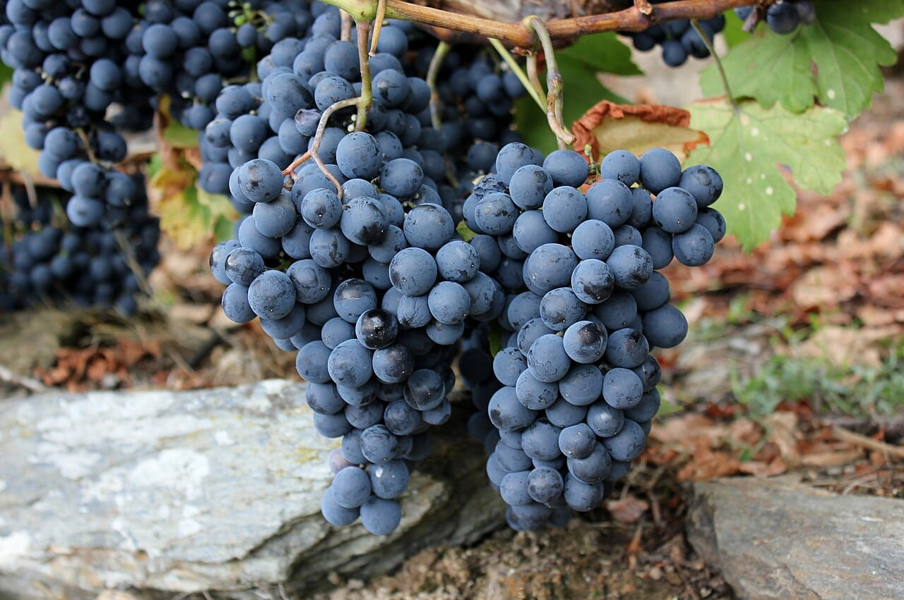
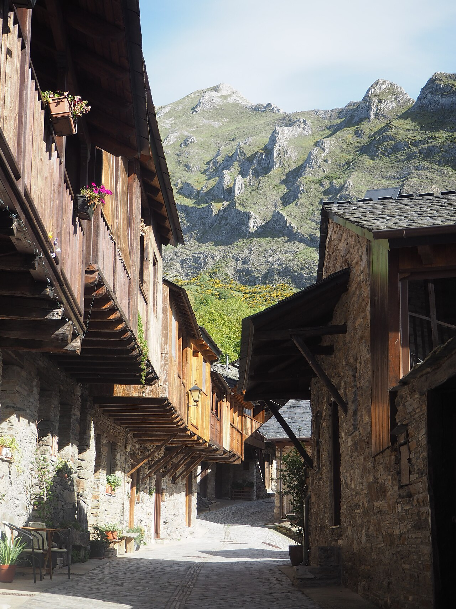

# 门西亚

门西亚（Mencía）是伊比利亚半岛西北部的本土红葡萄，核心产区在西班牙西北部的 Bierzo 与 Galicia 的 Ribeira Sacra、Valdeorras、Monterrei。它香气芬芳、酸度明亮、单宁细致中等，带黑樱桃、覆盆子、紫罗兰、干草药与板岩矿物气息；二十世纪末从平淡的大宗混酿品种，复兴为欧洲最受关注的伊比利亚原生红品种之一（ref:bierzo）。

读这个品种要先分清两条风土线：Bierzo 的片岩与红黏土坡地出产结构清晰、带石墨感的酒；Ribeira Sacra 沿 Sil 与 Miño 峡谷的陡坡梯田更清爽、草本与矿物突出。同一品种在不同坡度、海拔与土壤上的轮廓差别，比品种名单上的笼统描述更具体。

图：Mencía：48-Uvas de mencía en socalco, Doade, Sober (Lugo)（Wikimedia Commons）。图片：feelSacra，CC BY-SA 4.0，via Wikimedia Commons（[原图页面](https://commons.wikimedia.org/wiki/File:48-Uvas_de_menc%C3%ADa_en_socalco,_Doade,_Sober_(Lugo).jpg)）。

## 定义与命名

门西亚学名为 Vitis vinifera，黑皮红葡萄，VIVC 编号 7623。在葡萄牙它被称作 Jaen 或 Jaen do Dão，分子指纹确认两者为同一品种。同义词包括 Fernao Pires Tinta、Giao、Loureiro Tinto、Mencin、Negra、Negro、Mencia Roble、Tinto Mencia、Tinto Mollar；在莱昂地区又称 Jaén colorado，注意与 Jaén blanco、Jaén rosado（均属 Cayetana 变种）及韦尔瓦的 Jaén tinto 区分。

历史上它曾被长期误认为品丽珠的古老克隆，因为两者共享部分芳香；马德里理工大学的 DNA 分析已经排除了这一亲缘说法。辨识上，它果穗小到中等、紧凑，果粒中等、大小均匀、蓝黑色，果肉不着色，发芽与成熟偏早；采收时机是关键，过晚采摘会损失品种赖以立身的高天然酸度。市场上偶尔把冷凉地块的门西亚类比为黑皮诺或佳美，把较暖地块的版本类比为品丽珠，这些只是风格参照，不等于品种同源（ref:cabernet-franc）。

## 起源与传播

DNA 谱系研究显示，门西亚很可能起源于葡萄牙，是 Dão 的 Alfrocheiro 与 Douro 的 Patorra 两个葡萄牙红品种的自然杂交后代；这也解释了它在半岛西北侧西班牙与葡萄牙边境两侧的分布。关于它随圣地亚哥朝圣之路从法国传入的说法，已被基因证据否定。

面积上，西班牙境内种植超过 9,100 公顷，葡萄牙约 2,500 公顷。西班牙产区集中在 Bierzo（Castilla y León 的 León 省）与 Galicia 的 Ribeira Sacra、Valdeorras、Monterrei、Ribeiro，Tierra de León、Cigales 与 Sil 河上游有少量地块；葡萄牙 Dão DOC 与 Beira Interior 以 Jaen 名义参与混酿，加州有零星种植。Bierzo DO 于 1988 年 6 月 3 日临时认定、1989 年 11 月 11 日正式确认，Ribeira Sacra DO 则在 1996 年设立。

## 植物学与栽培

果穗小到中等、紧凑，果粒中等、大小均匀、蓝黑色，果肉不着色；长势旺盛，产量偏低，发芽与成熟偏早。采收时机是关键：过晚采收会损失品种赖以立身的高天然酸度。片岩、花岗岩与陡坡排水良好，白天积温与夜间降温形成的昼夜温差保留香气与酸度；平坦肥沃地块容易长出清淡松散的果实。

栽培上延续老藤灌木式（bush vine）管理，枝条贴近地面，根系深入石质土壤。叶果平衡、疏叶与有限灌溉决定果味集中度；潮湿年份需防控霜霉与灰霉。Bierzo 产区内门西亚占种植葡萄的 70.5%，是当之无愧的主导红品种（ref:terroir）。Bierzo 葡萄园集中在 Villafranca del Bierzo 周边的片岩与红黏土坡地；Ribeira Sacra 的梯田沿峡谷修在花岗岩与片岩上，石块朝向与坡度决定排水和日照，是地块风格差异的直接来源。

## 风格与味觉

典型门西亚呈中等酒体，明亮到偏高的酸度，单宁细腻中等；香气以红樱桃、黑樱桃、覆盆子、李子与紫罗兰开场，接干草药、黑胡椒、碎板岩与石墨、铅笔芯般的矿物骨架。酒精度通常在 13–14%，入门款清新多汁、单宁柔和，老藤与单一园版本更集中、单宁更紧致。冷凉、高海拔地块的门西亚偏透亮果香与细单宁，较暖地块更稠密、更有结构；品种对采收时机敏感，早摘保留酸度与花香，晚摘则果味更熟、酒精度更高。

酿造路线分化明显：传统派多用大桶或水泥罐，强调果味与矿物；现代派采用整串发酵、部分新桶与短浸渍，增加香料感与结构。顶级老藤酒自然发酵、在中性大木桶中陈酿，以保留地块纯度。普通款适合年轻时饮用，Bierzo 与 Ribeira Sacra 的顶级酒款具备 15–25 年的瓶陈潜力，头十年果味鲜亮，第二个十年发展出皮革与干花的次级香气（ref:oak）。

## 主要产区与代表酒款

Bierzo 是门西亚复兴的核心。Descendientes de J. Palacios 由 Álvaro Palacios 与侄子 Ricardo Pérez Palacios 于 1999 年在 Corullón 创立，葡萄园为陡坡老藤灌木；基础款 Pétalos 来自周边村落老藤，Villa de Corullón 选自 60–100 年生藤株，旗舰 La Faraona 来自 Corullón 上方一处朝北、坡度极陡的小片片岩园，生物动力种植、自然发酵、中性大木桶陈酿，2017 年份酒精度 14.5%。Raúl Pérez 出身 Castro Ventosa 家族酒庄，家族在 Valtuille de Abajo 的种藤历史可追溯到 1752 年，旗下 Ultreia Saint Jacques、Ultreia de Valtuille 与 El Rapolao 都是 Bierzo 标杆；此外还有 Mengoba、Estefanía、Guímaro、Pittacum 等生产者。

Galicia 一侧，Ribeira Sacra 的梯田沿 Sil、Miño 峡谷展开，Valdeorras 与 Godello 白品种共享片岩土；葡萄牙 Dão 的 Jaen 常与 Touriga Nacional、Tinta Roriz、Alfrocheiro 混酿，花岗岩与片岩土海拔约 400–500 米，昼夜温差大，酒款清爽有矿物感。

## 怎么喝与配餐

门西亚建议在 14–16 °C 饮用：年轻果香款偏低，结构集中的老藤款略高。杯子用中等肚径红酒杯；顶级款开瓶后可短时间醒酒，普通款即开即饮。它单宁不重、酸度明亮，配餐弹性比多数厚重西班牙红酒更大。

搭配上，Galician 海鲜如章鱼、七鳃鳗，烤猪肉、野味、羊肉、蘑菇菜与硬质羊奶奶酪都稳妥；番茄酱汁炖菜与火腿前菜也合适。清淡甜酱或浓郁奶油菜与它的矿物酸度不搭。

## 选购与常见误区

第一个误区是把历史误认当成品种亲缘：门西亚不是品丽珠克隆，DNA 已经排除这一关系。第二个误区是以为门西亚只能做清淡桃红式轻红：老藤单一园与顶层酒款结构扎实、陈年漫长。第三个误区是只看品种名，不读产区与地块：Bierzo 与 Ribeira Sacra 的风格、坡度与土壤差别明显，同一产区内村庄级与单一园也分层清楚。

看酒标先分清 DO 产区、是基础款还是单一村/单一园（如 Villa de Corullón、La Faraona）、年份与酒精度。年轻款三五年内饮用，顶级款可长期瓶陈；储存平放、避光、远离温度波动。海外市场以专业进口渠道为主，购买时留意储存条件。

相关条目：[品丽珠](ref:cabernet-franc)。

## 延伸阅读与另见

- 相关条目：[bierzo](ref:bierzo)、[cabernet-franc](ref:cabernet-franc)、[red-wine](ref:red)、[terroir](ref:terroir)、[oak-ageing](ref:oak)。
- 想比较两条风土线，可选同一年份一款 Bierzo 老藤与一款 Ribeira Sacra 梯田酒，对比果香浓度、单宁粗细与矿物石墨气息。

对照阅读：[比埃尔索](ref:bierzo)、[红葡萄酒](ref:red)。

**关键事实。**

| 项目 | 内容 |
| --- | --- |
| 一句话定位 | 西班牙西北部 Bierzo 与 Ribeira Sacra 的红葡萄，带黑樱桃、草药、香料与板岩矿物，酸度明亮、单宁细致中等；历史上曾被误认成品丽珠，市场上有时类比黑皮诺或佳美 |
| 物种 | Vitis vinifera |
| 代表产区 | 比埃尔索 |

## 相关图像

图：比埃尔索。图片：Fogar Mozárabe，CC BY-SA 4.0，via Wikimedia Commons（[原图页面](https://commons.wikimedia.org/wiki/File:Arquitectura_tradicional_de_El_Bierzo.jpg)）。关联图像：门西亚。
