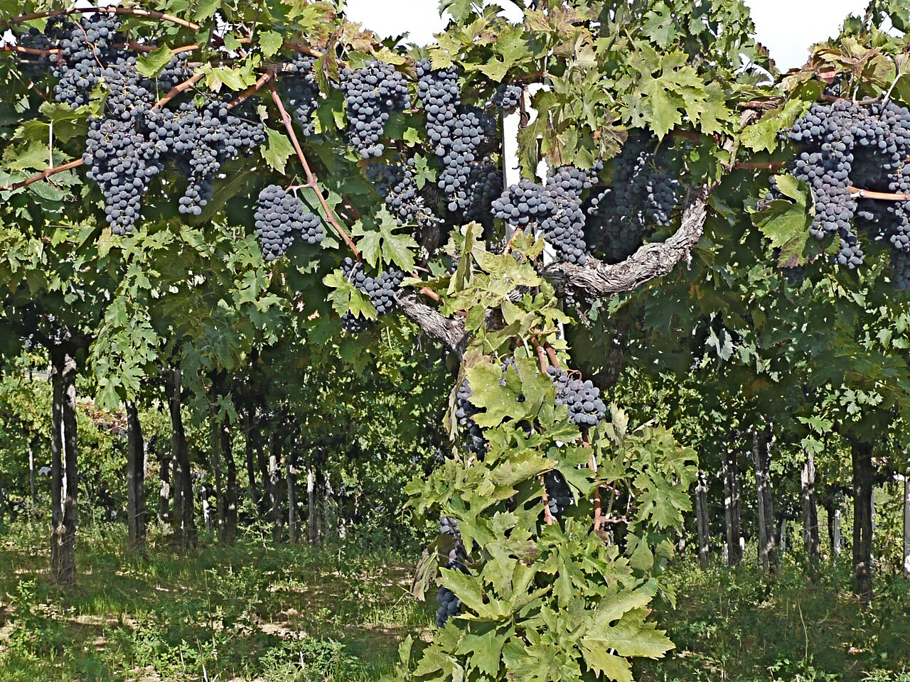

# 蒙特普尔恰诺

蒙特普尔恰诺是意大利中部与南部分布很广的红葡萄，核心产区在阿布鲁佐；酒色深、单宁中低、酸度中高，带黑樱桃、李子、李子干与甘草香料，既能做年轻易饮的日常红，也能酿出有陈年潜力的珍藏款。它与托斯卡纳的蒙特普尔恰诺小镇并无品种上的关系。

图：Montepulciano：Montepulciano grapes growing in Abruzzi（Wikimedia Commons）。图片：Peter Forster，CC BY-SA 2.0，via Wikimedia Commons（[原图页面](https://commons.wikimedia.org/wiki/File:Montepulciano_grapes_growing_in_Abruzzi.jpg)）。

## 定义与命名

蒙特普尔恰诺是 Vitis vinifera 红葡萄，名称同时是阿布鲁佐一个品种与托斯卡纳一座小镇的名字，二者必须分开读：托斯卡纳的 Vino Nobile di Montepulciano 以桑娇维塞（Sangiovese，当地称 Prugnolo Gentile）为主酿，酒里并不要求蒙特普尔恰诺葡萄；本页讲的是阿布鲁佐及中南部广泛种植的这个红品种（[sangiovese](ref:sangiovese)）。

品种的亲本关系尚未由基因研究确定，现有资料没有把它归入某个已知杂交组合；酒标上的 Montepulciano d'Abruzzo 是产区酒名，不等于单一品种证明，法规允许按比例混入桑娇维塞等其他红葡萄。

## 起源与传播

这一品种在意大利中南部扎根已久，19 世纪后期栽培向沿海扩展，二战后成为阿布鲁佐种植最广的红葡萄。它在阿布鲁佐四个省（L'Aquila、Chieti、Pescara、Teramo）都有种植，约三分之二产量来自南部肥沃的 Chieti 省；口碑最受认可的低产地块多在北部 Teramo 与 Pescara 的含铁黏土与石灰岩坡地。

法定等级上，Montepulciano d'Abruzzo 于 1968 年获得 DOC 认证；北部 Teramo 省的 Colline Teramane 子区 1995 年先列为 DOC，2003 年升格为独立 DOCG，法规要求蒙特普尔恰诺比例不低于 90%，桑娇维塞最高 10%，最低酒精度 12.50% vol，总酸度不低于 4.5 g/l，干浸出物不低于 25 g/l。

品种还进入邻近产区：马尔凯的 Rosso Conero、Rosso Piceno Superiore，Offida Rosso DOCG，以及 Molise、Lazio、Umbria、Puglia 的部分 DOC 酒款；意大利 95 个省中有 20 个省的 DOC 允许使用它。北部意大利很少种植，因为它晚熟，采收过早会留下明显青梗草本味。按 ISMEA 基于 AGEA 地块台账的 2021 年统计，全国种植约 30,829 公顷，是意大利面积前列的红葡萄之一（[italy](ref:italy)）。

## 植物学与栽培

果串中等偏大，果粒中等、皮厚，成熟期偏晚；厚皮与深色色素带来深宝石红到紫红的酒色，成熟充分时浸出物与酒精度都不低，酸度中等偏高，单宁相对柔和、不粗涩。放任高产后果味变薄、颜色与结构被稀释，是这个品种最常见的质量风险。

栽培上需要足够的生长季完成成熟，坡地排水好、光照足的地块果味更集中；平原肥沃地块容易丰产松散。叶幕管理、疏果与采收时间比品种天性更能决定最终风格：过早采摘酸度突兀、草本味重，过晚则酸度流失、酒精感发冲。老藤棚架（pergola）地块在 Teramo 一带保留至今，低产老藤是精品酒的重要来源（[terroir](ref:terroir)）。

## 风格与味觉

典型蒙特普尔恰诺呈深红宝石红，陈年后偏石榴红；香气以黑樱桃、李子、李子干、黑莓、甘草、 licorice、干香草、泥土与香料为主，陈酿后出现烟草、皮革、可可与暗巧克力。口感干型，中等酒体，单宁柔和圆润，酸度支撑余味，入门款多汁易饮，珍藏款结构更扎实、果味更浓缩。

酿造路线分化明显：轻快款在不锈钢罐短发酵，追求新鲜果味，适合当年或几年内饮用；经典款浸渍 10–20 天，在橡木桶或大桶陈酿数月；珍藏款长时间萃取、小橡木桶陈酿，顶级地块有 5–15 年甚至更长的瓶陈潜力。部分自然派酒庄刻意不用橡木，用玻璃衬里水泥罐陈酿，保留品种本身的黑果与草本骨架（[oak-ageing](ref:oak)）。

它也用来酿深色桃红（rosato），以及作为混酿成分补充颜色、酒体与果香。判断一款蒙特普尔恰诺的潜力，重点看酸度是否完整、单宁是否成熟，而不是单凭颜色深浅；高产量批量款通常不具备长期陈年条件。

## 主要产区与代表酒款

阿布鲁佐是核心：Chieti 省产量最大，Teramo 与 Pescara 坡地出产评价更高的地块酒；Colline Teramane DOCG 是北部最受关注的子区。马尔凯 Conero 一带的 Rosso Conero 以蒙特普尔恰诺为主，常带更明显的皮革与矿物感；中南部其他产区则多把它用作调配或本地日常红。

代表生产者包括：Emidio Pepe 位于 Teramo 的 Torano Nuovo，采用棚架老藤，手工去梗后以浸渍方式发酵 7–9 天，在玻璃衬里水泥罐陈酿 18–24 个月、从不使用橡木，瓶陈至少五年后按订单手工换瓶，不过滤、零添加硫化物，是把这个品种推向收藏级的标志性酒庄；Masciarelli 的 Villa Gemma 是较早用法国橡木桶陈酿蒙特普尔恰诺的代表；Illuminati、Cantina Zaccagnini（Tralcetto 珍藏款浸渍 15–20 天、28–30°C 发酵，橡木桶陈至少 9 个月、瓶陈至少 6 个月，酒精度约 14%）、La Valentina 与 Cataldi Madonna 也是产区常被引用的参照（[red-wine](ref:red)）。

市场上蒙特普尔恰诺价格带很宽，从大包装餐酒到单一园珍藏款都有；同一名下，高产平原酒与低产坡地老藤在浓度、单宁与陈年潜力上差距明显，生产者、地块与法规等级比品种名更能预测杯中风格。

## 怎么喝与配餐

经典蒙特普尔恰诺侍酒温度约 14–18°C：轻快年轻款偏凉，珍藏与高酒精度款略高，温度过高会让酒精与单宁显得粗糙。杯型用中等偏大的红酒杯，年轻款可短暂醒酒 30 分钟，珍藏款提前一小时 decant 以柔化单宁、展开果香与烟草气息。

配餐是它的强项：冷切腌肉、肉酱意面、烤肉、炖肉、野味与陈年奶酪都接得住它的酸度与果香；蘑菇、烤蔬菜与中等硬度奶酪也搭配得当。单宁不厚重，不必配极肥腻的浓酱，香辣菜式可以选果味更成熟、酒精度稍高的年份。

## 选购与常见误区

误区一：把蒙特普尔恰诺与 Vino Nobile di Montepulciano 当成同一种酒。前者是阿布鲁佐品种，后者是托斯卡纳桑娇维塞酒，名称同源纯属地名巧合，买酒时先看产区与主要品种。误区二：以为深颜色等于重单宁。蒙特普尔恰诺颜色深但单宁通常柔和，多数款型是中等酒体，颜色来自厚皮与色素，不等于结构雄健。

误区三：认为这个品种只能做平价日常红。低产地块、长浸渍与水泥或橡木陈酿的珍藏款有多年瓶陈潜力，Emidio Pepe 一类酒款甚至具备二十年以上的演化空间；判断时看地块产量、酿造等级与年份，而不是品种的普遍印象。选购留意装瓶时间与储存条件，经过长期库存或受热的酒会失去黑果香气，单宁也显得干涩发柴。

## 延伸阅读与另见

对照练习：把一款 Colline Teramane 或 Teramo 坡地珍藏与一款 Chieti 平原日常款同场比较，记录果味浓度、单宁粗细与酸度差别；再对比不锈钢年轻款与水泥罐或橡木陈酿款，看清工艺在这条品种线上推到了哪里。

蒙特普尔恰诺的面积、克隆与海外种植仍随品种调查更新，正式引用以意大利农业部、ISMEA 统计、VIVC 登记与各产区法规为准。

- 相关条目：[italy](ref:italy)、[sangiovese](ref:sangiovese)、[red-wine](ref:red)、[oak-ageing](ref:oak)、[terroir](ref:terroir)。
