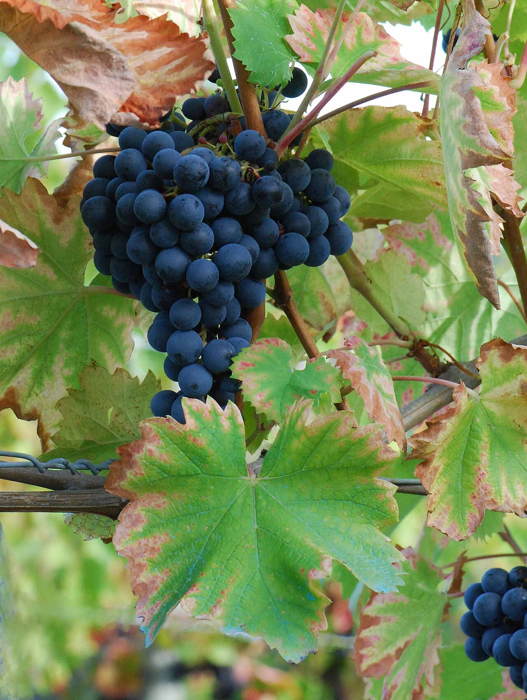

# 慕合怀特

慕合怀特是地中海沿岸的红葡萄品种，在西班牙被称为莫纳斯特雷尔（Monastrell），在澳大利亚被称为马塔罗（Mataro）。它的果皮厚、成熟晚、耐热耐旱，常被当作混酿中的“结构与颜色提供者”。在法国普罗旺斯的邦多尔与罗讷河谷南部，它常与歌海娜、西拉一起出现。

图：慕合怀特。图片：Pancrat，CC BY-SA 3.0，via Wikimedia Commons（[原图页面](https://commons.wikimedia.org/wiki/File:Balzac_noir-mourvedre.jpg)）。

## 定义与别名

慕合怀特的英文名是 Mourvèdre，西班牙语名 Monastrell，澳大利亚常用 Mataro。这些名称指同一品种在不同产区的习惯叫法，而不是不同品种。它属于欧洲葡萄 Vitis vinifera，与歌海娜、西拉同属地中海品种群。

在西班牙，莫纳斯特雷尔是许多传统产区的核心品种；在法国，慕合怀特更常作为混酿成分出现。名称差异会影响酒标阅读，但不应影响品种判断。

## 植物学特征

慕合怀特的果穗中等、果粒偏小，果皮厚，色素与单宁含量高。它发芽较早，但成熟期很晚，需要较长的高温季节才能充分成熟；在凉爽产区或秋季多雨的年份，容易出现成熟不足、单宁生青。

厚皮带来较强的抗病性与耐热性，也带来较紧实的单宁结构。它的枝叶生长势较旺，需要合理的冠层管理与产量控制，否则容易枝叶过密、果实受光不足。

## 主要产区

西班牙是慕合怀特的重要原产地与种植中心，穆尔西亚、胡米利亚、阿利坎特等地有大量莫纳斯特雷尔。法国普罗旺斯的邦多尔以慕合怀特为主要品种之一，罗讷河谷南部的教皇新堡等产区也广泛使用。

澳大利亚、美国加州与南非也有种植，通常以 Mataro 或 Monastrell 的名称出现。产区的热量与采收时机，对这个晚熟品种尤为关键：热量不足，单宁与果味都不成熟；热量足够，才能得到深色果味与香料气息。

## 典型风味

慕合怀特的典型香气包括黑莓、黑李子、桑葚，常伴随黑胡椒、皮革、泥土与野味气息。酒体中等偏饱满，单宁较强，酸度中等，酒精度往往偏高。年轻时可能显得紧实、封闭，陈年后发展出更复杂的香料与动物气息。

与[歌海娜](ref:grenache)相比，慕合怀特颜色更深、单宁更强、酸度更高；与[西拉](ref:syrah)相比，它的果味更偏深色浆果与泥土，黑胡椒感略弱。混酿时，三者常形成“果味—结构—香料”的互补。

## 代表酒款

邦多尔的混酿通常以慕合怀特为主，辅以歌海娜与神索，风格带有深色果味、香料与地中海草本气息。罗讷河谷南部的混酿中，慕合怀特提供颜色与骨架，歌海娜提供果味与酒精，西拉提供香料与酸度。

具体酒款的比例随年份与酒庄变化，不能把某一款酒的配比当作所有地中海混酿的固定公式。品种页描述的是品种潜力，酒款页才记录具体配方。

## 栽培要点

慕合怀特的最大挑战是成熟期。它需要充足的积温，采收过晚则酒精度过高、酸度不足；采收过早则单宁生青、果味不足。在多雨年份，厚皮能提供一定保护，但仍需注意灰霉与酸腐。

产量控制同样重要。产量过高会让颜色与单宁变淡，酒体变得单薄；适度的水分胁迫有助于浓缩风味，但过度干旱会阻碍成熟。不同产区的灌溉条件与传统，会显著改变栽培策略。

## 常见误区

第一，慕合怀特是西班牙品种还是法国品种。它在两国都有悠久种植，名称不同但品种相同。

第二，慕合怀特只能做混酿。它可以单独酿酒，邦多尔就有以它为主的作品。

第三，慕合怀特等于“粗糙、高单宁”。成熟良好的慕合怀特可以有细致的香料与果味层次。

第四，Mataro 是另一个品种。它是慕合怀特在澳大利亚的名称。

第五，晚熟品种一定适合炎热产区。热量足够才成立，过热也会失去酸度与细节。

慕合怀特原产西班牙与地中海沿岸，晚熟、皮厚、单宁强、耐热耐旱；在法国普罗旺斯与罗讷河谷常与歌海娜、西拉混酿，为酒体提供颜色、结构与野味气息。它需要足够热量才能成熟，因而在不同产区的表现差异很大；不要把“慕合怀特”当成单一香料味标签。在邦多尔等地，慕合怀特常与歌海娜、神索混酿，单宁与耐热性让它承担骨架；在西班牙 Monastrell 的名义下，它又能呈现更成熟的黑果与草本。名称不同，品种相同，标签传统却不同。

对照阅读：[葡萄酒](ref:wine)、[西班牙](ref:spain)。

## 延伸阅读

- [葡萄酒](ref:wine)：理解慕合怀特的分类、酿造与产区框架。
- [红葡萄酒](ref:red-wine)：慕合怀特的单宁、酸度与陈年结构。
- [西班牙](ref:spain)：莫纳斯特雷尔的核心种植国。
- [罗讷河谷](ref:rhone)：慕合怀特在南法混酿中的位置。
- [普罗旺斯](ref:provence)：邦多尔等产区的背景。
- [歌海娜](ref:grenache)：常见混酿搭档。
- [西拉](ref:syrah)：常见混酿搭档。

**关键事实。**

| 项目 | 内容 |
| --- | --- |
| 一句话定位 | 原产于西班牙与地中海沿岸的晚熟红葡萄品种，皮厚、单宁强、耐热耐旱；在法国普罗旺斯与罗讷河谷常与歌海娜、西拉混酿 |
| 物种 | Vitis vinifera |
| 代表产区 | 罗讷河谷、西班牙 |

**来源与边界。** 本页关于「慕合怀特」的关键事实，主要由以下来源交叉核对：International Organisation of Vine and Wine (OIV)（品种描述与 Vitis 物种框架）、Oxford University Press（提供关于慕合怀特、莫纳斯特雷尔与地中海种植的条目；由原条目末尾参考资料迁移，未逐条复核访问日期）、Maison des Vins de Bandol（邦多尔产区与慕合怀特在混酿中的地位）。价格、批次与状态会变，涉及这些字段时以页面所列来源的最新版本为准。正文为项目自写，来源只作核验，不复制原文。

**并读。** 把「慕合怀特」与「葡萄酒」、「红葡萄酒」、「西班牙」放在一起读时，先确认它们是同一层级还是上下游关系：先确认品种身份与允许产区，再比较成熟期、抗性、克隆与酿造表现。本页负责给出品种的基本坐标，对照条目补上具体案例与差异；读完再回到本页，才能分清哪些差别属于品种本身，哪些只是产地、批次或品牌选择。

**适用边界。** 对「慕合怀特」而言，品种表现随产区、气候与克隆选择变化；同名品种在不同国家可能指不同材料。

**更新提示。** 「慕合怀特」最近核对于 2026-11-07；允许产区、克隆与栽培数据会更新，引种前以官方品种目录为准。
