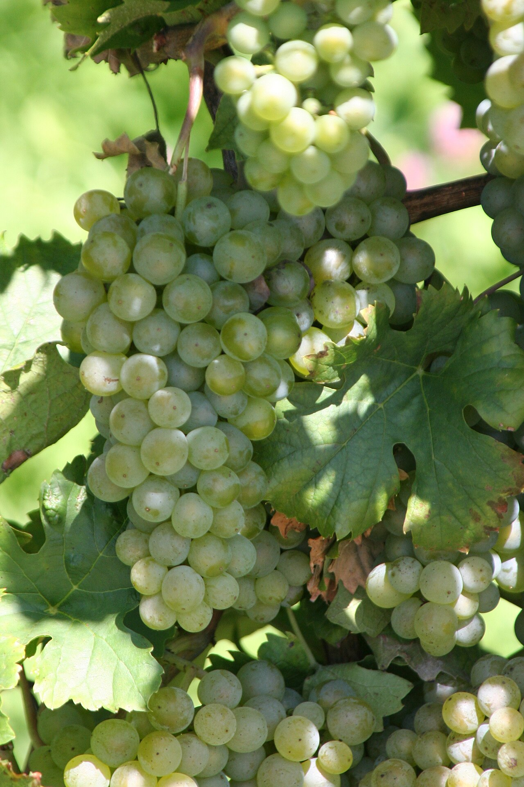

# 米勒-图高

德国培育的白葡萄，由雷司令与马德雷尔（Madeleine Royale）杂交而来；早熟、产量高，带花香、柑橘与轻微麝香，是德国种植面积最大的白葡萄之一。

米勒-图高是德国 19 世纪培育的白葡萄，早熟、高产、酸度中等。它曾是德国种植面积最大的品种，也因 Liebfraumilch 与廉价甜白联系在一起，后来随雷司令复兴而收缩。

图：Müller-Thurgau：Mueller-Thurgau Weinsberg 20060909（Wikimedia Commons）。图片：Rosenzweig，CC BY-SA 3.0，via Wikimedia Commons（[原图页面](https://commons.wikimedia.org/wiki/File:Mueller-Thurgau_Weinsberg_20060909.jpg)）。

## 定义与命名

米勒-图高是德国培育的白葡萄，由雷司令与马德雷尔（Madeleine Royale）杂交而来；1882 年由瑞士裔德国育种家 Hermann Müller 在瑞士图高培育。它早熟、产量高，带花香、柑橘与轻微麝香，是[德国](ref:germany)种植面积最大的白葡萄之一。

它也称 Rivaner、Riesling-Silvaner；这些名字容易与雷司令混淆，但两者不是同一品种。米勒-图高的酸度比雷司令低、成熟更早，适合冷凉地区与大众市场。

在德国，它曾用于 Liebfraumilch 等调和酒；在奥地利、瑞士、意大利北部、新西兰与英国也有种植。欧盟没有为它单列法规，品种名与产区名要分开读。

米勒-图高与雷司令的亲缘关系常被简化为“雷司令的杂交后代”，但它的酸度、香气与陈年潜力都更接近日常白葡萄。理解这一点，就不会用雷司令的标准去要求它，也不会把它的清淡误当成缺陷。

## 起源与传播

米勒-图高的兴衰与德国战后市场紧密相关：20 世纪 50–70 年代，它支撑了 Liebfraumilch 等大众甜白的出口；1980 年代以后，消费者转向雷司令与更清爽的干白，它的种植面积才逐步下降。

1970–80 年代，Liebfraumilch 与类似调和酒大量出口，米勒-图高的名字与“廉价甜白”绑定；1990 年代以后，雷司令复兴，米勒-图高的种植面积下降，但在 Rheinhessen、Pfalz 与 Baden 仍有大量种植。

在新西兰、英国与奥地利，它被用于早熟、清爽的干白；在意大利北部，它常与其它品种混酿。传播过程中，克隆选择让成熟期与香气出现差异。

米勒-图高在 20 世纪初也被称为 Riesling-Silvaner，因被误认为雷司令与西万尼的杂交；后来基因研究确认亲本是雷司令与 Madeleine Royale。名字的混乱让它在市场上长期被当成“廉价雷司令”。

## 植物学与栽培

果粒中等、皮薄，早熟，酸度中等；成熟时带白花、柑橘、青苹果与轻微麝香。树势旺，产量高，容易过产，需要控制产量与采收时间。

早熟让它适合短生长季，但也容易在暖秋失去酸度；皮薄让它易感灰霉，雨季需要疏叶与早采。在德国，它常种在雷司令不够成熟的冷凉地块。

高产版本香气淡、酒体水；低产与老藤版本可以带出更多花香与柑橘。部分酒庄用整串压榨与低温发酵保留香气。

米勒-图高早熟、产量高，适合德国冷凉地块；但高产会让酸度与香气变淡，酒体水。酒农通过控制产量、提早采收与低温[发酵](ref:fermentation)保留花香与柑橘；在暖秋，它比雷司令更早失去酸度。

## 风格与味觉

酒液浅黄，香气带白花、青苹果、柑橘、杏与轻微麝香；入口酸度中等，酒体轻到中等，收口干净。干型（trocken）与半干型都常见，甜型少见。

Rivaner 版本通常更清爽、更适合日常；Liebfraumilch 是混酿，米勒-图高只是成分之一，不能代表单一品种风格。与[雷司令](ref:riesling)比，它更少矿物与高酸，更多花香与早熟果味。

判断典型性，先看酸度与香气；如果酒标写 Rivaner，可按米勒-图高对待；如果写 Riesling，不要混淆。

干型米勒-图高带青苹果、白花、柑橘与轻微麝香，酒体轻；半干型更常见，残糖掩盖了它不高的酸度。与雷司令比，它没有明显的矿物与汽油味，陈年潜力也短得多。

## 主要产区与代表酒款

德国 Rheinhessen、Pfalz、Baden 与 Franken 都有种植；奥地利、瑞士、意大利北部、新西兰与英国也有。德国常见干型与半干型，酒精度通常 11–12.5%。

米勒-图高很少进入高端酒单，代表性来自日常干白与 Rivaner；Rheinhessen 与 Pfalz 的合作社与酒庄都有稳定产品，风格以清爽、早饮为主。

德国 Rheinhessen 与 Pfalz 的米勒-图高多用于日常干白与 Rivaner；Baden 的更饱满，Franken 的更紧。奥地利与瑞士的版本常更清爽；新西兰与英国的版本带更多青草与柑橘。

## 怎么喝与配餐

饮用温度 8–10°C，用中等口径白酒杯；不要过度冰镇，低温会压住花香。配餐适合沙拉、蔬菜、淡水鱼、鸡肉与轻奶酪；半干型可以配亚洲香料菜肴。

开瓶后冷藏，2–3 天喝完；它不适合长期陈年，最好在 1–3 年内饮用。

米勒-图高的轻盈酒体适合沙拉、蔬菜、淡水鱼、鸡肉与轻奶酪；半干型可以配亚洲香料、泰国菜与微辣菜肴。它不适合配重红肉或浓酱汁，酸度与酒体都会被压住。

温度 8–10°C 即可，过度冰镇会让花香与麝香消失；用中等口径白酒杯，不要用太小的高脚杯。开瓶后冷藏 2–3 天，不适合长期陈年，买来尽早喝。

## 选购与常见误区

先看品种名：Müller-Thurgau 或 Rivaner，不要与 Riesling 混淆；再看甜度与产区。价格低不代表品质差，它是日常白葡萄酒，不是高端收藏品种。

常见误读：把米勒-图高当成雷司令；以为 Liebfraumilch 是单一品种；以为早熟品种只能做甜酒。它可以是干的、清爽的，也可以是半干的。

看到“Rivaner”可以按米勒-图高对待；看到“Riesling”则不是。Liebfraumilch 是混酿，品种比例不一定高；价格极低的甜白可能靠残糖与浓缩，而不是品种本身。

## 参见

- [德国](ref:germany)：产区与法规背景。
- [雷司令](ref:riesling)：常被混淆的品种。
- [白葡萄酒](ref:white)：白葡萄的发酵与风格。
- [发酵](ref:fermentation)：低温发酵与香气。
- [风土（terroir）](ref:terroir)：冷凉产区的成熟度。

**关键事实。**

| 项目 | 内容 |
| --- | --- |
| 一句话定位 | 德国培育的白葡萄，由雷司令与马德雷尔（Madeleine Royale）杂交而来；早熟、产量高，带花香、柑橘与轻微麝香，是德国种植面积最大的白葡萄之一 |
| 物种 | Vitis vinifera |
| 代表产区 | 德国 |

**来源与边界。** 本页关于「米勒-图高」的关键事实，主要由以下来源交叉核对：Julius Kühn-Institut（品种名称、同义词、起源与全球分布）、OIV（葡萄品种与栽培框架）、USDA ARS（植物分类、种质与栽培信息）等 4 条来源。价格、批次与状态会变，涉及这些字段时以页面所列来源的最新版本为准。正文为项目自写，来源只作核验，不复制原文。

**并读。** 把「米勒-图高」与「德国」、「雷司令」、「白葡萄酒」放在一起读时，先确认它们是同一层级还是上下游关系：先确认品种身份与允许产区，再比较成熟期、抗性、克隆与酿造表现。本页负责给出品种的基本坐标，对照条目补上具体案例与差异；读完再回到本页，才能分清哪些差别属于品种本身，哪些只是产地、批次或品牌选择。
