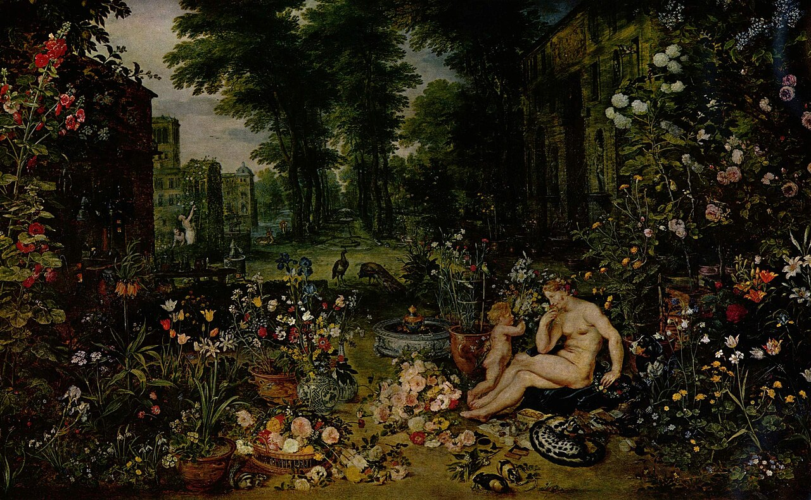

# 麝香

麝香（Muscat）不是单一品种，而是一个横跨欧亚、成员众多的古老品种群。它最鲜明的共同点是香气：花香、葡萄香、蜂蜜与柑橘往往在年轻时就非常突出，几乎不需要陈年就能被辨认。也正因为香气强，麝香被用来酿几乎所有形态的葡萄酒——干白、甜白、微起泡、全起泡、加强甜酒，甚至葡萄干酒。理解麝香的关键，是先分清眼前的是“哪一个麝香”。

图：麝香。图片：Tristan，CC BY 2.0，via Wikimedia Commons（[原图页面](https://commons.wikimedia.org/wiki/File:Al_Alam_Palace.jpg)）。

> **先给结论**
> **一句话：** 这页判断麝香适不适合你，以及怎么比较其他品种。
>
> - **适合谁：** 正在比较麝香与其他品种、想弄懂风味差异的人。
> - **不适合谁：** 只想要单一名庄推荐、不关心品种本身的人。
> - **先看这两点：**
>   - “麝香”是中文对 Muscat 家族的统称。
>   - 麝香家族的起源通常追溯到地中海东部与小亚细亚，古希腊与古罗马文献中已有甜味麝香酒的记载，罗马人把它带到高卢、伊比利亚与多瑙河流域。

## 定义与别名

“麝香”是中文对 Muscat 家族的统称。家族中最重要的是小粒麝香（Muscat Blanc à Petits Grains），意大利称 Moscato bianco，法语中也叫 Muscat de Frontignan；其次是亚历山大麝香（Muscat of Alexandria），在西西里潘泰莱里亚岛称 Zibibbo；再次是奥托内麝香（Muscat Ottonel），成熟较早、香气较淡，常见于阿尔萨斯与中东欧。中文里的“莫斯卡托”通常指意大利的麝香酒，尤其是皮埃蒙特的 Moscato d'Asti，而不是一个独立于麝香的物种。酒标上的 Muscat、Moscato、Muskateller、Moscatel 往往是同一家族在不同语言中的名字。

## 亲本与起源

麝香家族的起源通常追溯到地中海东部与小亚细亚，古希腊与古罗马文献中已有甜味麝香酒的记载，罗马人把它带到高卢、伊比利亚与多瑙河流域。小粒麝香被许多研究者视为最古老、香气最纯的麝香类型；亚历山大麝香同样古老，果粒更大、产量更高，历史上更多作为鲜食葡萄与葡萄干品种。两者的亲缘关系仍有讨论，基因研究显示麝香家族内部存在多个独立起源与长期无性繁殖的分支，不能简单理解为“一个品种的变种”。可以确认的是，麝香在阿尔萨斯、意大利、法国南部、西班牙、葡萄牙、奥地利、匈牙利、希腊、南非与澳大利亚都形成了地方名称与地方风格。

## 植物学特征

小粒麝香的果穗小到中等，果粒小、皮薄，成熟时呈黄绿到淡粉红色，有时带明显粉晕；果肉多汁，糖分积累快，酸度中等。亚历山大麝香的果穗与果粒都明显更大，果皮较厚，颜色偏黄绿，成熟更晚，产量更高，香气浓度通常低于小粒麝香。奥托内麝香果粒中等，成熟早，酸度偏低。三者都具有典型的麝香香气，但浓度、果粒大小与成熟节奏不同。小粒麝香因为皮薄、穗紧，既容易感染灰霉病，也容易在成熟后期失去酸度，这让采收时机成为品质关键。

## 栽培特性

麝香家族整体喜温、喜光，但不同成员适应性不同。小粒麝香产量低、果穗紧、皮薄，对灰霉病、白粉病和春霜都较敏感，适合在排水良好、贫瘠的坡地种植；控制产量是保留香气与酸度的前提。亚历山大麝香长势旺、产量高、耐热耐旱，在地中海气候下表现稳定，常用于鲜食、制干与甜酒。奥托内麝香成熟早，适合气候较凉的产区，但酸度下降快。麝香的一个共同难题是“香气与酸度的平衡”：过热会得到浓甜、低酸的葡萄，过凉则香气不足、成熟不彻底。

## 产区分布

意大利是麝香多样性最丰富的国家之一：皮埃蒙特的 Moscato d'Asti 与 Asti 用 Moscato bianco 酿微起泡与起泡甜酒；西西里潘泰莱里亚岛用 Zibibbo 酿 passito 甜酒；南部与岛屿还有大量 Moscato 甜酒。法国南部以天然甜酒闻名，包括 Muscat de Beaumes-de-Venise、Muscat de Rivesaltes 与 Muscat de Frontignan；阿尔萨斯则酿以干型为主的 Muscat d'Alsace。西班牙的 Moscatel 常见于瓦伦西亚与马拉加，葡萄牙的 Moscatel 见于塞图巴尔。奥地利与德国称 Muskateller，多为干型；匈牙利、希腊、南非、澳大利亚与美国加州也都有种植。澳大利亚路斯格兰（Rutherglen）以陈年加强麝香著称。

## 法定规则

麝香的法定名称非常多，规则也各不相同。意大利的 Moscato d'Asti 与 Asti 是 DOCG，前者为轻微起泡、酒精度低、甜型，后者为完全起泡；两者都要求以 Moscato bianco 为主。阿尔萨斯的 Muscat d'Alsace 是 AOC，风格通常为干型，允许使用小粒麝香与奥托内麝香等家族成员，具体名单以最新产区规范为准。法国南部的 Muscat de Beaumes-de-Venise、Muscat de Rivesaltes 等属于天然甜酒（vin doux naturel），通过添加中性酒精中止发酵保留糖分。澳大利亚的 Rutherglen Muscat 有按陈年时间分级的地方体系。各地对最低酒精度、残糖、品种比例与陈年时间的要求不同，酒标上的产区名往往比“Muscat”这个词更能说明甜度与风格。

## 酿造与风格谱系

麝香可以酿成一条完整的风格光谱。最轻盈的是意大利 Moscato d'Asti：低温发酵、在压力罐中保留少量二氧化碳，酒精度通常只有百分之五到六，甜而不腻，适合年轻饮用。Asti 的起泡更强，气泡更持久。干型麝香以阿尔萨斯为代表，通常在不锈钢罐中发酵，避免橡木掩盖香气，偶尔进行酒泥陈酿以增加质地。天然甜酒在发酵中途加入中性葡萄酒精，保留大量残糖，同时保留麝香的新鲜花果香；陈年加强麝香则在橡木桶中长期氧化，发展出焦糖、橙皮、咖啡与坚果。passito 麝香把葡萄在架子上或阳光下风干，浓缩糖分与香气后再发酵。不同工艺的共同目标是：尽量保留萜烯类香气，同时用酸度或酒精支撑甜度。

## 感官风格

麝香的典型香气包括橙花、玫瑰、金银花、麝香葡萄、荔枝、杏、蜂蜜与柑橘皮。小粒麝香的香气最集中，常带有明显的葡萄与花香；亚历山大麝香更偏熟果、橙皮与蜂蜜，香气宽而不细腻；奥托内麝香较淡，适合干型。干型麝香酒体轻到中等，酸度中等，收口常带轻微苦味，这是它搭配芦笋、亚洲香料与辛辣菜肴的优势。甜型麝香则以花果香与甜度的平衡取胜，优质酒款不会显得粘腻。加强麝香陈年后会出现葡萄干、无花果、焦糖、咖啡与雪松，口感浓稠，适合少量饮用。

## 代表生产者与年份

阿尔萨斯的 Trimbach、Hugel 与 Weinbach 等酒庄常酿干型 Muscat；意大利皮埃蒙特的 Saracco、Vietti 与 La Spinetta 以 Moscato d'Asti 闻名；西西里的 Donnafugata 以潘泰莱里亚的 Zibibbo 甜酒著称；澳大利亚路斯格兰的 Chambers 与 Campbells 以陈年加强麝香为代表；法国罗讷河谷的 Domaine de Durban 常被提及为 Beaumes-de-Venise 的代表。年份对麝香的影响主要体现在酸度与贵腐菌：凉爽年份酸度更好、香气更清晰，炎热年份糖分高、酸度低；秋季潮湿则可能带来贵腐菌，既可能提升甜酒的复杂度，也可能造成灰霉腐烂。购买时应关注酒庄的采收日期与残糖标识，而不是只看“Muscat”字样。

## 常见误区

第一，把麝香当成单一品种。它是一个庞大的家族，同名不同种的情况很多。第二，认为麝香一定是甜酒。阿尔萨斯、奥地利与德国的 Muskateller 常是干型。第三，把 Moscato 与 Muscat 当成两个物种。Moscato 是意大利语名称。第四，认为亚历山大麝香就是小粒麝香。两者果粒、产量与香气浓度差异明显。第五，以为加强麝香只是“加了酒精的甜酒”。优质酒款依靠氧化陈年形成复杂香气。第六，认为麝香不能配餐。干型麝香配芦笋、海鲜与辛辣菜式都很合适。

## 延伸阅读

- [葡萄酒](ref:wine)：麝香所属的总体酒类。
- [白葡萄酒](ref:white-wine)：麝香最常见的酒类形态。
- [香气](ref:aroma)：理解麝香萜烯香气的入口。
- [加强酒](ref:fortification)：天然甜酒与加强麝香的关键工艺。
- [阿尔萨斯](ref:alsace)：干型麝香的代表产区。
- [意大利](ref:italy)：莫斯卡托与 Zibibbo 的核心产地。

相关条目：[葡萄酒](ref:wine)、[白葡萄酒](ref:white-wine)。

**关键事实。**

| 项目 | 内容 |
| --- | --- |
| 一句话定位 | 麝香是一个古老而庞大的葡萄家族，小粒麝香香气最浓，亚历山大麝香果粒更大；从阿尔萨斯干白、意大利莫斯卡托微起泡到法国与澳洲的加强甜酒，风格跨度极大，核心是浓郁的花香与葡萄香 |
| 物种 | Vitis vinifera |
| 代表产区 | 阿尔萨斯、意大利 |

## 相关图像

图：香气（aroma）。图片：Jan Brueghel the Elder / Peter Paul Rubens，Public domain，via Wikimedia Commons（[原图页面](https://commons.wikimedia.org/wiki/File:Jan_Brueghel_d._O._-_Allegorie_van_de_geur.jpg)）。关联图像：麝香。
