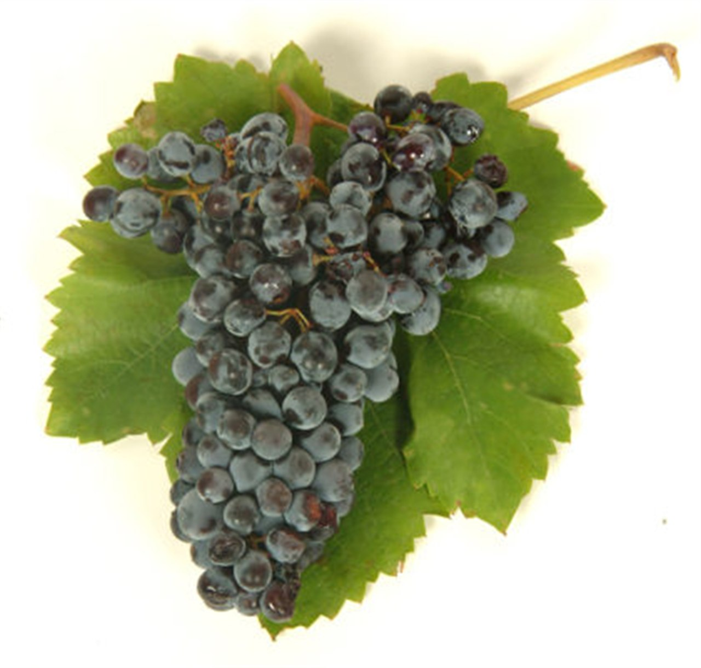
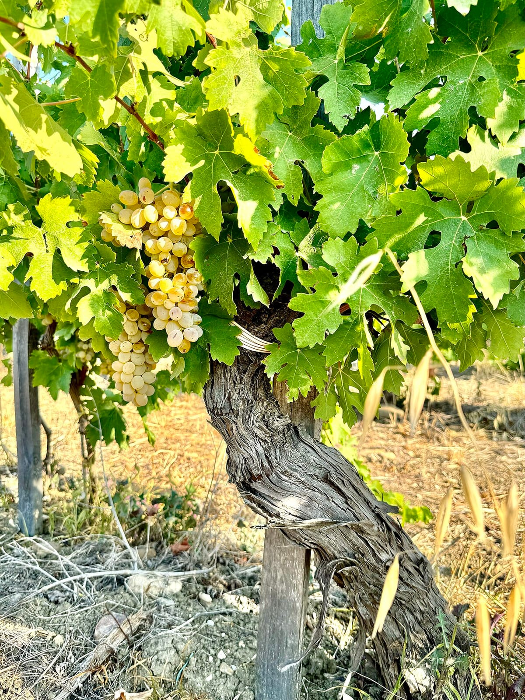

# 黑达沃拉

西西里最重要的红葡萄，颜色深、单宁中高，带黑莓、黑樱桃、李子与香料；在 Noto、Vittoria 与 Etna 周边表现不同，常与弗拉帕托混酿。

图：Nero d’Avola：Grappolo di Nero d'Avola（Wikimedia Commons）。图片：Fabio Ingrosso from Italy，CC BY 2.0，via Wikimedia Commons（[原图页面](https://commons.wikimedia.org/wiki/File:Grappolo_di_Nero_d%27Avola.jpg)）。

## 定义与命名

黑达沃拉（Nero d'Avola）是西西里种植最广、最具代表性的本土红葡萄。在意大利农业部的酿酒葡萄名录里，它的登记学名是 Calabrese，意为"卡拉布里亚的"，Nero d'Avola 只是官方注册别称；旧说认为品种经卡拉布里亚传入西西里，后来多方研究并未证实这一路径。名称字面意为"来自阿沃拉的黑葡萄"，Avola 是西西里东南锡拉库萨省靠近帕基诺的小镇，当地早在 15 世纪就有栽培记载。

酒标上的 Nero d'Avola、Calabrese 指同一品种，不要与西西里其他深色本地红葡萄混淆。品种层级之外，标签还会写 Vittoria、Noto、Etna 等产区或单一园名称，地块与风土对风格的影响往往大于品种本身。读这个品种时，需要把登记名、产区法规与市场上"西西里主力红"的笼统印象分开。

## 起源与传播

品种的具体祖先与传入路径仍有讨论空间。一种说法是古希腊人殖民西西里时把葡萄与爱琴海灌木栽培法一同带来；Calabrese 这个登记名则保留了早年关于卡拉布里亚来源的推测，但现代研究不支持这条传播路线。可以确定的是，今天意大利约 98% 的黑达沃拉种植集中在西西里岛，本土根脉远比海外深。全岛种植面积约 16,000 公顷，是西西里第一大红葡萄，在意大利全国栽培品种中排第六位上下。

它在岛内的分布与地形气候对应：东南 Noto、Pachino 一带平原温暖干燥，果实成熟度高；中部海拔 300 至 600 米的黏土石灰岩山地更凉爽，酸度保留更好；西部 Trapani、Marsala 周边传统上与国际品种混种；东北部 Etna 火山土海拔高、气温偏低，风格更紧窄。海外美国、澳大利亚、南非与南美有少量试种，但规模与影响力都有限，这个品种的表达基本仍以西西里为中心。

## 植物学与栽培

果粒中等、果皮厚、颜色深，果串中等偏大，中晚熟，耐热耐旱，适合西西里强烈的日照。植株长势旺盛，放任高产会稀释颜色与结构，果味偏薄；限产与疏果后，皮果比提高，颜色、单宁与果香才集中。叶片与果串对病害的抵抗力中等，成熟期若遇降雨需要注意串腐与成熟不均。

栽培上要在成熟度与酸度之间取舍：东南低地容易过熟，酒精感膨胀、鲜度下降；中部高地与火山土成熟慢，酸度与花香保留更好，但年份之间波动较大。传统灌木形（alberello）与现代篱架都有使用，种植密度、修剪方式与采收批次直接影响成品风格。老藤根系深、产量自然压低，是高端单一园酒款的基础。

## 风格与味觉

典型黑达沃拉颜色深浓，香气以黑莓、黑樱桃、李子、炖李子、甜香料、黑巧克力与温热泥土为主，单宁中高，酒体饱满，酸度随地块冷热而松紧。东南温暖地块偏果酱、成熟果味与酒精感；中部山地更优雅，带紫罗兰花香与清晰酸度；Etna 周边则更偏矿物与火山岩气息。年轻果香直接，陈年后出现干果、皮革与熏香料层次，优质款可陈年 3 至 15 年，旗舰酒款超过十年。

最经典的混酿是与弗拉帕托（Frappato）搭配：黑达沃拉提供颜色、酒体与结构，弗拉帕托补花香、轻盈与鲜红果。单一品种酒的风格跨度很大，从清爽易饮的日常红到浓缩厚重的旗舰款都有，取决于地块、产量、萃取与桶陈。与 [sicily](ref:sicily) 其他红葡萄相比，它的强项是深色果味与色素，而不是纤细花香；发酵温度、浸渍时间与新桶比例决定最终是偏果味还是偏结构。

## 主要产区与代表酒款

Cerasuolo di Vittoria 是西西里唯一的 DOCG，位于拉古萨与卡尔塔尼塞塔一带，法规要求以黑达沃拉与弗拉帕托混酿，弗拉帕托占 30% 至 50%，其余为黑达沃拉；两类葡萄分别发酵，短时间温控浸渍，酒精发酵结束后混合。东南 Noto 与 Pachino 出产成熟浓郁的单一品种红，中部 Regaleali 一带走优雅高酸路线，Etna 周边则有火山土风格的表达。

代表生产者中，Azienda Agricola COS 位于 Vittoria，创立于 1980 年，代表人物 Giusto Occhipinti；Pithos 为 100% 黑达沃拉，在黏土石灰岩红土、海拔 230 米的地块以居由式栽培，藤龄约 25 年，9 月底至 10 月初采收，在陶罐中自发发酵与陈酿。Gulfi 同样位于 Vittoria，Cerasuolo di Vittoria 是其代表性混酿；Pietradolce 深耕 Etna 火山地块，Tasca d'Almerita 的 Regaleali 庄园在 San Lucio 地块自 1954 年起种植黑达沃拉；Cusumano、Morgante、Donnafugata、Firriato 也是岛内常见名字。

## 怎么喝与配餐

中等饱满的黑达沃拉适合 14–16°C 饮用，厚重旗舰款可放到 16–18°C；温度偏低会把单宁与酸感收紧，偏高则酒精与果酱味放大。单宁强的酒款提前醒酒半小时左右，老年份缓慢滗除沉淀。杯型选大肚宽杯，给深色果香与香料留出展开空间。

配餐围绕西西里与地中海红肉：烤羊肉、炖牛肉、香肠与腌腊、茄子番茄料理、蘑菇炖菜与硬质陈年奶酪都能接住它的单宁与酸度。番茄酱汁的 pasta、烤肉与野味是稳妥组合；清淡海鲜或辛辣菜式会被酒中的单宁与酒精压住，不宜搭配。作为 [red-wine](ref:red)，它的浓郁度适合分量扎实的主菜。

## 选购与常见误区

常见误区之一，是把黑达沃拉一概当作浓郁果酱红。这更多来自东南低地高产款；中部山地、火山土与低产老藤款酸度更清晰、香气更细，风格并不厚重。另一个误区是只看品种名：Vittoria 混酿、Noto 单一品种、Etna 火山款与 Regaleali 山地款在成熟度、酸度和单宁上差别明显，年份对炎热岛屿的采收节奏影响很大。

购买时先分清 DOCG 混酿、DOC 单一品种与 IGT 层级，再看地块、生产者与年份。老藤不是法律等级，具体产量与树龄以酒庄说明为准；高酒精度不等于品质好，平衡感才是关键。储存避开高温、强光与震动，结构红葡萄酒开瓶后可放两到三天，真空塞能减缓氧化。

## 延伸阅读与另见

比较这个品种最直接的方式，是同年份试一支 Cerasuolo di Vittoria 混酿、一支 Noto 单一品种与一支 Etna 或 Regaleali 山地款，对照酸度、果香与单宁粗细。它与 [terroir](ref:terroir) 层面的火山土与山地风土、[oak-ageing](ref:oak) 桶陈选择、[vintage](ref:vintage) 带来的成熟度差异密切相关，也可与弗拉帕托等混酿伙伴的条目对照阅读。

- 相关条目：[sicily](ref:sicily)、[red-wine](ref:red)、[terroir](ref:terroir)、[oak-ageing](ref:oak)、[vintage](ref:vintage)。

## 相关图像

图：Sicily：Old Inzolia vine in vineyard Dietro le Case, Menfi, Sicily（Wikimedia Commons）。图片：Marilena.CantineBarbera，CC BY 4.0，via Wikimedia Commons（[原图页面](https://commons.wikimedia.org/wiki/File:Old_Inzolia_vine_in_vineyard_Dietro_le_Case,_Menfi,_Sicily.jpg)）。关联图像：黑达沃拉。
