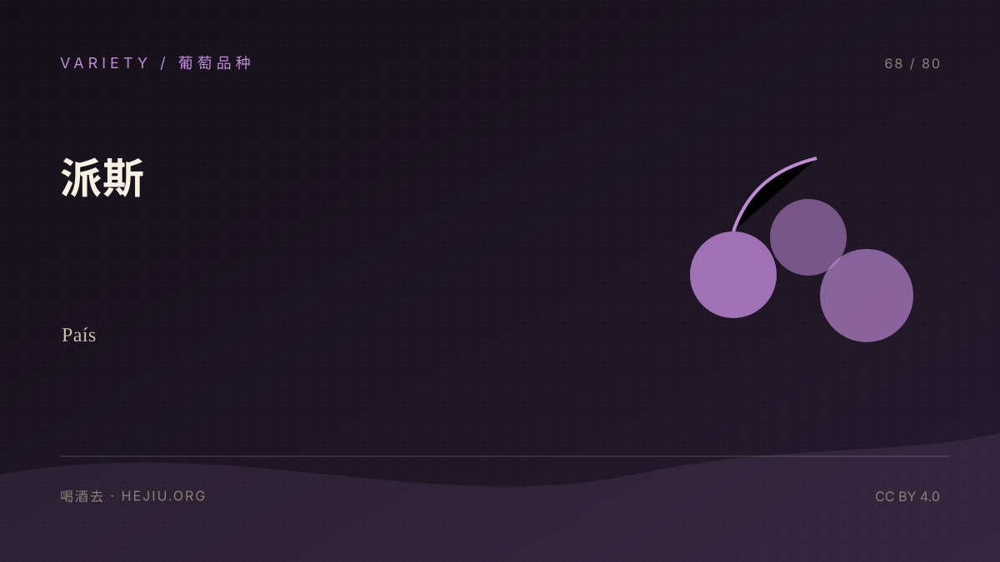

# 派斯

派斯是智利栽培历史最久的红葡萄之一，今天主要留在 Maule、Itata 与 Bío-Bío 南部干旱老园中；果粒皮薄、颜色偏浅，酸度高而单宁柔和，常见红樱桃、草莓、干草、白胡椒与泥土气息。它既是智利批量酒时代的工作品种，也是近二十年自然酒复兴中被重新估价的老藤代表。

图：派斯栏目示意图。项目自产或类别插图，用于葡萄品种语境，不是该对象的实拍。

> **先给结论**
> **一句话：** 这页判断派斯适不适合你，以及怎么比较其他品种。
>
> - **适合谁：** 正在比较派斯与其他品种、想弄懂风味差异的人。
> - **不适合谁：** 只想要单一名庄推荐、不关心品种本身的人。
> - **先看这两点：**
>   - 派斯按轻酒体红葡萄酒对待，饮用温度约 14–16°C，天热可降到十二三度，让酸度与果香更挺；温度过高则酒精与草本苦味容易浮上来。
>   - 第一个误区是把派斯整体当作廉价酒：历史上它确实承担大量批量生产，但同一名称下旱地老藤、低产小园与工业化高产地块可以是两种完全不同的酒。

## 定义与命名

País 本义是西班牙语“国家”，酒标与资料中还能见到 Negra Criolla、Criolla 等地方叫法；它在加州被称作 Mission，在阿根廷门多萨对应 Criolla Chica，背后是同一组从西班牙跨大西洋带到美洲的古老实生苗后代。名称容易造成两处混淆：派斯常被写作 Listán Negro 的后代，较新的基因指纹研究把它对应到西班牙 Listán Prieto，与加那利群岛残存的同名老品种同源；而它与 Criolla Chica、Mission 经过数百年隔离，已形成各自的克隆差异，味道并不完全相同。作为 Vitis vinifera 红葡萄，派斯没有广泛流通的现代克隆编号，商业化种植多沿用园地自选老藤材料，真正决定表现的是树龄、树形与地块（[terroir](ref:terroir)）。

## 起源与传播

派斯进入南美与殖民扩张同步：16 世纪西班牙征服者把葡萄带到墨西哥，再经秘鲁向南传入智利，文献常把 1520 年 Cortés 带入墨西哥的早期葡萄作为路线起点。智利的修道院、传教站与大庄园用它酿造礼仪用酒与日常餐酒，此后四百多年它一直是智利最主要的酿酒红葡萄，直到 20 世纪末波尔多品种大规模种植才退居次要位置。

2024 年一项针对智利古老 Criolla 品种的基因研究显示，智利早期葡萄园几乎全部建立在 Listán Prieto 这一基础品种上，派斯正是它在智利的地方类型；同一基础品种在加州演变为 Mission，在阿根廷演变为 Criolla Chica。研究还指出，17 世纪以后传入的亚历山大麝香与该基础品种杂交，产生了一批美洲原生 Criolla 品种，派斯则保留了更早的遗传背景。

20 世纪中后期，派斯因产量大、酒体轻被归入廉价批量酒，不少干旱河谷老藤被拔除，改种赤霞珠、梅洛等国际品种。2000 年代以后，侍酒师、自然派酿酒人与南部小园重新找到树龄两三百年、旱地不灌溉的老藤地块，派斯才从散装原料酒回到餐厅酒单与精品酒款的讨论中。

## 植物学与栽培

派斯果粒中等偏小、果皮薄，果串中等紧凑，属中晚熟品种，在南部较凉河谷需要充足秋阳才能达到理想成熟度。成熟果实颜色偏浅、出酒率高，天生酸度保留好，单宁与果皮厚度都不算高，这是它酒风轻淡的植物学来源。传统老园采用灌木形（gobelet）头状整枝，不少地块完全靠降雨耕作、不设灌溉，根系扎进沿海山脉砾石与火山灰土寻找水分；低产弱势让果粒浓缩，产量放开后果味立刻变稀，颜色与结构也被冲淡。

栽培风险集中在成熟节奏与病害两端：南部春季潮湿与花期降雨影响坐果，皮薄果串在采收期更易受真菌压力；采收拖晚则酸度下降、酒精感变冲，提前采摘又留下青梗与草本味。老藤园对修剪、疏果与叶幕管理的依赖并不比现代品种低，只是工具与树形更传统。

## 风格与味觉

典型派斯呈浅宝石红到紫红，香气以红樱桃、草莓、蔓越莓、干香草、白胡椒与潮湿泥土为主，有时带橘皮与野生花卉；入口轻淡、酸度明亮，单宁细而不厚，余味偏干。它不是深色浓雄品种，果香与草本清新感通常比橡木桶味靠前，杯中的结构骨架主要由酸度而非单宁支撑。

最传统的做法是 pipeño：整串或轻压发酵，常在陶罐、旧桶或水泥罐中完成，保留少量二氧化碳与自然浑浊，装在一升左右大瓶里，果味新鲜、气泡微弱、酒精度不高。精品化后部分酒庄改用受控发酵、澄清与陈酿，做出更干净、更有层次的单一园派斯（[fermentation](ref:fermentation)）。派斯多数适合年轻时饮用，优质老藤低产地块可瓶陈数年，逐渐出现干果、皮革与香料，但它不依赖长期橡木桶陈酿，新桶比例过高反而盖住清淡果香；判断潜力重点看酸度是否完整、单宁是否柔和成熟，而非颜色深浅（[oak-ageing](ref:oak)）。

## 主要产区与代表酒款

智利国内派斯最集中在中部偏南：Maule Valley 是面积最大的传统种植区之一，Wines of Chile 统计里 Maule 派斯约 5,991 公顷；Itata Valley 位于更靠南的沿海山脉之间，冷凉气候与花岗岩、板岩地块集中了一批复兴派斯的小酒庄；Bío-Bío 的 Yumbel 一带保留了家庭世传老藤园。美国加州、墨西哥与阿根廷的 Mission/Criolla 类型属于同一脉络的海外分支（[itata](ref:itata)）。

据 2004 年智利品种面积统计，全国派斯约 14,858 公顷，约占当时葡萄园总面积 13%，是仅次于赤霞珠的第二大红葡萄；其中相当一部分历史上用于瓶装批量酒与勾兑原料，进入精品渠道的只是南部老藤园中很小比例。今天公开统计面积已较峰值回落，但老藤地块知名度反而上升。

代表生产者包括：Maule 的 J. Bouchon 以 Pais Viejo 老藤酒款建立口碑；Bío-Bío Yumbel 的 Cacique Maravilla 由 Manuel Moraga 家族经营，园地可追溯至 1776 年，葡萄面积约 16 公顷，旱地灌木老藤；Pedro Parra y Familia 与 Clos des Fous 从地质与地块角度做 Itata、Maule 传统品种；De Martino 在 Itata 的 Las Olvidadas 系列使用 Guarilihue 老藤派斯与神索混酿；Los Vinateros Bravos、Garage Wine Co 与 Louis-Antoine Luyt 在 pipeño 与自然酒方向各有尝试。

## 怎么喝与配餐

派斯按轻酒体红葡萄酒对待，饮用温度约 14–16°C，天热可降到十二三度，让酸度与果香更挺；温度过高则酒精与草本苦味容易浮上来。杯子选中等肚径通用红杯即可，年轻 pipeño 开瓶后趁新鲜喝，不需要长时间醒酒，静置太久反而失去活泼气泡与果香。

配餐围绕轻、鲜、咸：智利 empanada 肉馅饼、烤海鲜、ceviche、烤鸡肉与轻度冷切都能接上它的高酸，软质奶酪、草本沙拉与胡椒调味菜肴也合适。单宁轻意味着不必配厚重红肉，酱汁浓重肥腻的菜式会压住派斯果味，不如换一款结构更强的红葡萄酒（[red-wine](ref:red)）。

## 选购与常见误区

第一个误区是把派斯整体当作廉价酒：历史上它确实承担大量批量生产，但同一名称下旱地老藤、低产小园与工业化高产地块可以是两种完全不同的酒，产区、生产者与树龄说明比品种名更能预测风格。第二个误区是把“老藤”读成法定等级：智利老藤表述来自园地历史，不是认证分级，老藤也可能因管理松散而表现平平。

第三个误区是把派斯与 Listán Negro、Mission 或 Criolla Chica 简单画等号：它们同源但经数百年隔离选种，克隆与风味已有差别，跨品种比较应连同产地、年份与酿造方式一起看。选购时留意进口商储存与运输温度，轻酒体高酸派斯对受热更敏感，高温仓库放过的酒开瓶后容易果味发闷、酸度突兀。

## 延伸阅读与另见

想理解派斯的价值，最有效的对照是把一款 Itata 或 Maule 老藤派斯与同产地传统神索、卡利尼安放在一起比较，记录酸度、果味浓度与单宁差别；再选一款 pipeño 风格自然酒对照精品化版本，看清工艺在这条品种线上推到哪里。派斯仍是区域性品种，同义词、克隆归属与面积数字会随调查年份变化，正式引用以 VIVC 登记与产区官方统计为准。

- 相关条目：[itata](ref:itata)、[red-wine](ref:red)、[terroir](ref:terroir)、[fermentation](ref:fermentation)、[oak-ageing](ref:oak)。

**关键事实。**

| 项目 | 内容 |
| --- | --- |
| 一句话定位 | 智利的老藤红葡萄，源自西班牙的 Listán Negro/Gros Collet，在 Itata 与 Maule 的干旱老园中保留；酒色浅、酸度高、单宁低，带红樱桃、干草与香料 |
| 物种 | Vitis vinifera |
| 代表产区 | 伊塔塔谷 |
