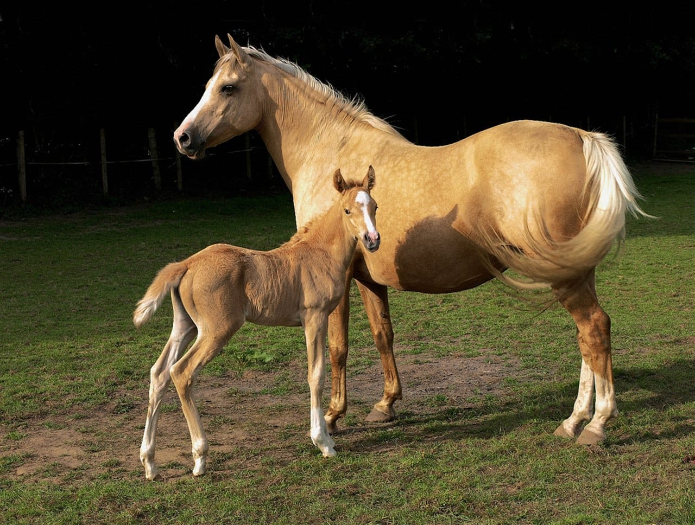
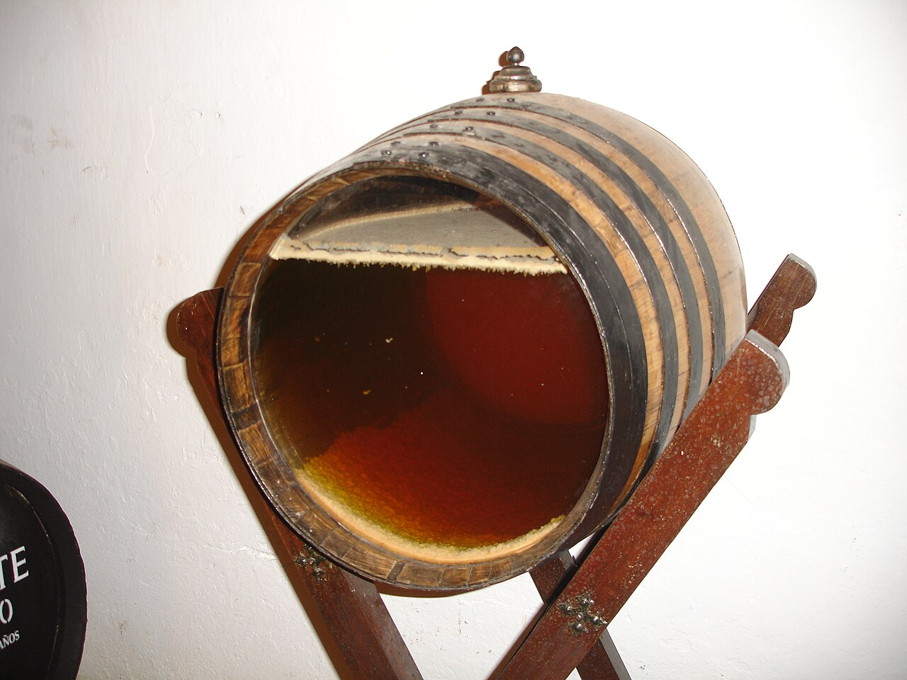

# 帕洛米诺

帕洛米诺（Palomino）是西班牙安达卢西亚的白葡萄，也是雪莉酒最主要的品种。它本身并不"香"：酸度低、糖分不高、风味中性，单喝往往平淡。但正是这种中性，让它在赫雷斯的酒窖里成为生物陈酿与氧化陈酿的空白画布。理解帕洛米诺，重点不在葡萄本身，而在加强、陈酿与索莱拉系统如何把一款朴素的白酒变成从 Fino 到 Oloroso 的完整谱系（ref:fortified-wine）。

图：帕洛米诺。图片：(a friend of) Kvetina-Marie，CC BY 2.0，via Wikimedia Commons（[原图页面](https://commons.wikimedia.org/wiki/File:Mare_and_foal_(Kvetina-Marie).jpg)）。

## 定义与别名

品种名为 Palomino，中文音译帕洛米诺。雪莉产区的正式名称是 Palomino Fino，强调它是用于菲诺型雪莉的精选品系；在加那利群岛它叫 Listán Blanco，在赫雷斯本地旧文献中也写作 Palomino de Jerez。南非曾把它称作 White French，与法国的品种名无关。它属于 Vitis vinifera。需要区分的是：Palomino 是葡萄，Sherry 与 Jerez 是加强酒，Fino、Manzanilla、Oloroso 是酒的风格，Pedro Ximénez 是另一个品种。把"帕洛米诺"和"雪莉"当成同义词，是最常见的混淆。

## 亲本与起源

帕洛米诺的亲本尚未确定。有研究把它与西班牙中部的古老品种群联系起来，但亲子关系没有定论。名字的来源有两种流行说法：一是纪念 13 世纪卡斯蒂利亚国王阿方索十世麾下的骑士 Fernán Yáñez Palomino，二是来自西班牙语 paloma（鸽子），指果粒颜色或叶片形状。两种说法都缺乏确证。可以确认的是，它在安达卢西亚已有数百年栽培史，并在 19 世纪雪莉贸易的黄金期成为产区的主力品种。赫雷斯的白垩土与干燥气候，也在很大程度上塑造了它的栽培方式。

## 植物学特征

果穗大、较松散，果粒大、圆形，成熟时黄绿色，果皮薄。薄皮意味着它对灰霉病与白粉病敏感，也意味着压榨时必须轻柔，避免提取过多苦味。果肉多汁，糖分积累中等偏低，酸度低，香气中性。叶片大、五裂。帕洛米诺的酒精潜力不高，这正是雪莉基酒通常只有 11% 至 12% 的原因；后续的酒精度靠加入葡萄蒸馏酒提升（ref:fortification）。它的"缺点"——低酸、低糖、淡味——在蒸馏与陈酿体系里反而成了优点。

## 栽培特性

帕洛米诺长势旺、产量高，如果不控产，果实风味会更淡。它适应赫雷斯的 albariza 白垩土：这种土壤含碳酸钙与镁，表面在干燥季节形成硬壳（bujeo），既能减少蒸发，又能在冬季储存雨水，供葡萄在干旱的夏季使用。传统整枝为 vara y pulgar（短梢加一个替换枝），种植密度较低。采收通常在九月上旬，手工或机械采摘，要求快速运到酒厂以避免氧化。高产与薄皮是它的两个管理难点，也是酒农必须提前规划的部分。

## 产区分布

核心是西班牙南部的雪莉三角：赫雷斯-德拉弗龙特拉、圣卢卡尔-德巴拉梅达与埃尔波多黎各-德圣玛丽亚，都属于 DO Jerez-Xérès-Sherry 或 DO Manzanilla-Sanlúcar de Barrameda 的范围（ref:jerez）。韦尔瓦伯爵领（Condado de Huelva）有种植，蒙蒂利亚-莫里莱斯（Montilla-Moriles）以 Pedro Ximénez 为主但也有帕洛米诺。加那利群岛以 Listán Blanco 之名种植，用于当地白葡萄酒。南非、澳大利亚与美国有少量栽培，多用于雪莉风格酒或蒸馏。

## 法定规则

雪莉的法定产区体系由 DO Jerez-Xérès-Sherry 与 DO Manzanilla-Sanlúcar de Barrameda 管理，允许的品种包括帕洛米诺、Pedro Ximénez 与 Moscatel，其中帕洛米诺占绝大部分。加强后的酒精度是关键分界：约 15% 至 15.5% 的酒精度适合 flor 生长，走生物陈酿路线；约 17% 至 18% 则抑制 flor，走氧化陈酿路线。陈年时间、索莱拉层数与标签术语（Fino、Amontillado、Oloroso、Palo Cortado、Cream、VORS 等）都有规定。具体的酒精度与陈年门槛以最新法规为准。

## 酿造：两条陈酿路线

基酒在不锈钢罐或旧桶中低温发酵，做成干型、酸度低、酒精度约 11% 至 12% 的白酒，然后加入葡萄蒸馏酒加强。生物陈酿路线把酒精度定在 15% 左右，让 flor（一层酵母膜）在酒液表面生长（ref:flor）。flor 消耗酒精与氧气，产生乙醛与酵母香气，同时保护酒液不被氧化。圣卢卡尔沿海湿度高，flor 更厚，酒更轻、更咸，这就是 Manzanilla 与 Fino 的差别。氧化陈酿路线把酒精度提高到 17% 以上，flor 无法存活，酒在橡木桶中与空气接触，逐渐出现坚果、焦糖与香料的气息。Amontillado 先经历生物陈酿，再转为氧化；Palo Cortado 则是介于两者之间的罕见走向。

## 索莱拉系统

雪莉的陈年不靠单一年份，而靠索莱拉（solera）系统：同一风格的新酒放在上层（criadera），逐层向下混合，最下层（solera）装瓶（ref:solera）。每年从 solera 取出一定比例的酒（saca），再用上一层的酒补充（rocío），如此循环，使成品风格稳定。这套系统意味着"年份"在雪莉里意义有限，直到近年才出现单一年份（añada）与单一酒窖的装瓶。VORS 表示酒的平均年龄至少 30 年，属于稀有老酒级别。

## 感官风格

Fino 与 Manzanilla 呈浅稻草色，香气是面包酵母、杏仁、青苹果、海盐与淡淡药草，入口干、轻、酸度不高但咸感明显，余味带苦杏仁。Amontillado 颜色转琥珀，出现榛子、焦糖、皮革与橙皮。Oloroso 更深，香气是核桃、太妃糖、肉桂与干果，酒体饱满。Palo Cortado 兼具前者的精致与后者的厚度。Cream 与 PX 甜型雪莉的甜味来自添加 Pedro Ximénez 或浓缩葡萄汁，不是帕洛米诺本身。

## 配餐与侍酒

Fino 与 Manzanilla 适合配橄榄、伊比利亚火腿、炸鱼、海鲜与西班牙小吃，饮用温度 6 至 8 摄氏度，开瓶后应尽快喝完。Amontillado 可以配汤、蘑菇、家禽与半硬奶酪；Oloroso 适合红肉、野味与浓味奶酪；PX 与 Cream 配甜点与蓝纹奶酪。雪莉是加强酒中最适合佐餐的一类，不应只当作餐后甜酒（ref:wine）。这也是它在本土酒吧文化中长期作为"配餐酒"存在的原因。

## 代表生产者与年份

赫雷斯的代表包括 González Byass（Tío Pepe）、Barbadillo、Lustau、Valdespino、Osborne、Williams & Humbert 与 Hidalgo-La Gitana（Manzanilla）；近年以精选桶装闻名的 Equipo Navazos 与 Callejuela 也值得关注。因为索莱拉系统，年份差异被平均化；但在单一年份装瓶与 VORS 老酒中，气候与酒窖位置仍会留下痕迹。购买时更应看风格、酒龄与酒窖，而不是年份。

## 常见误区

第一，认为帕洛米诺是甜葡萄；它本身是干型、中性的，甜味来自 PX 或浓缩汁。第二，认为雪莉都是甜的；Fino、Manzanilla、Amontillado、Oloroso 大多是干型。第三，把 flor 当成葡萄品种或添加剂；它是一层天然酵母膜。第四，认为帕洛米诺只能做雪莉；它也用于 Brandy de Jerez 与静止白葡萄酒。第五，把 Manzanilla 当成葡萄；它是圣卢卡尔的雪莉风格。第六，认为雪莉没有年份概念；传统如此，但单一年份装瓶正在增多。

## 延伸阅读

- [葡萄酒](ref:wine)：帕洛米诺所属的饮料大类。
- [加强葡萄酒](ref:fortified-wine)：雪莉所属的酒类。
- [赫雷斯](ref:jerez)：帕洛米诺的核心产区。
- [加强](ref:fortification)：雪莉酒精度与风格分岔的关键工艺。
- [酒花（flor）](ref:flor)：生物陈酿的核心。
- [索莱拉](ref:solera)：雪莉的混合陈年系统。

相关条目：[葡萄酒](ref:wine)、[加强葡萄酒](ref:fortified-wine)。

## 相关图像

图：酒花（flor）。图片：El Pantera，CC BY-SA 3.0，via Wikimedia Commons（[原图页面](https://commons.wikimedia.org/wiki/File:FLOR-ValdiviaJerez59.jpg)）。关联图像：帕洛米诺。
