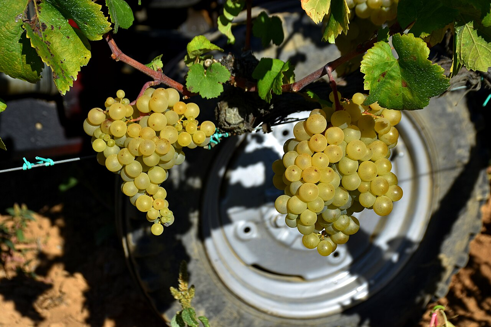

# 帕雷亚达

加泰罗尼亚佩内德斯的白葡萄，卡瓦三大品种之一；酸度高、酒体轻、带青苹果、柑橘与白花，常与沙雷洛、马卡贝奥混酿增加清爽感。

帕雷亚达是佩内德斯与卡瓦的传统白葡萄，酸高、体轻，常与马卡贝奥、沙雷洛混酿。它的价值在骨架与清爽感，而不是单独的浓郁香气；单品种版本反而少见。

图：Parellada：Temps de verema Parellada la més tardana. - Flickr - Angela Llop（Wikimedia Commons）。图片：Angela Llop from Spain，CC BY-SA 2.0，via Wikimedia Commons（[原图页面](https://commons.wikimedia.org/wiki/File:Temps_de_verema_Parellada_la_m%C3%A9s_tardana._-_Flickr_-_Angela_Llop.jpg)）。

## 定义与命名

帕雷亚达是加泰罗尼亚佩内德斯（Penedès）的白葡萄，[卡瓦](ref:sparkling)三大品种之一；它与 Macabeo、Xarel·lo 一起构成卡瓦的传统混酿。酸度高、酒体轻，带青苹果、柑橘与白花，常用来增加清爽感。

帕雷亚达的名称可能来自“parell”或地块名，具体词源没有定论；它不是 Parellada 与 Macabeo 的混称，而是独立品种。在卡瓦标签上，它通常不单独出现，而是隐藏在“Cava”与混酿比例里。

除卡瓦外，它也可酿静止白，但酒体轻、香气不浓，常需与 Macabeo、Xarel·lo 或 Chardonnay 混酿。西班牙法规对卡瓦的品种与陈年有规定，帕雷亚达是传统三品种之一。

帕雷亚达在加泰罗尼亚语写作 Parellada，在卡瓦法规里属于传统品种；它与 Macabeo（马卡贝奥）、Xarel·lo（沙雷洛）并称三大基酒品种。名称有时被拼成 Parellada Blanc，但“Blanc”只是白葡萄的说明，不是另一个品种。

在佩内德斯，帕雷亚达常种在海拔较高、成熟较晚的地块；它的高酸来自晚熟与凉爽夜晚，而不是未成熟。酒标上如果只写“Cava”，品种比例由酒庄决定；写“Parellada”才表示以它为主。

## 起源与传播

帕雷亚达原产佩内德斯，19 世纪后期卡瓦起泡酒兴起时，它已与[马卡贝奥](ref:macabeo)、[沙雷洛](ref:xarello)一起种植；20 世纪，卡瓦成为西班牙最重要的起泡酒，帕雷亚达的种植面积随之扩大。

它适应地中海气候与石灰岩土壤，酸度高、酒体轻；在高海拔与海风地块表现更好，平原高产版本更淡。根瘤蚜与战争后，部分老园被改种其他品种。

传播到西班牙其他产区与南美、澳洲的少量种植，但卡瓦仍是核心；名称在加泰罗尼亚语中写作 Parellada，西班牙语同形。

卡瓦的法规在 20 世纪逐步成型：传统 Cava 要求二次发酵与至少 9 个月的酒泥陈年，Reserva 与 Gran Reserva 的陈年更长。帕雷亚达在这些规则里承担基酒的酸度，而不是主导香气。

## 植物学与栽培

果粒中等、皮薄，中晚熟，酸度高；糖分积累慢，适合起泡酒的基酒。树势中等，容易感病，需要通风与疏叶；产量过高会稀释酸度与香气。

佩内德斯的石灰岩与黏土土壤、地中海海风与昼夜温差，让帕雷亚达保留青苹果与柑橘；高海拔地块更晚熟、更酸，平原更早熟、更轻。

采收通常在 9 月，基酒要保留高酸与低酒精度；部分酒庄用整串压榨，减少果皮苦味。

帕雷亚达晚熟、酸高，适合起泡酒基酒；但皮薄、易感灰霉，采收窗口窄。高产时酒体水、香气淡；低产与高海拔地块能带出白花、茴香与矿物。它的糖分积累慢，酒精通常不高。

## 风格与味觉

静止帕雷亚达呈浅黄，香气带青苹果、柠檬、白花、茴香与矿物；入口酸度高、酒体轻，收口清爽。单品种版本较少，混酿中它提供酸度与骨架。

在卡瓦中，帕雷亚达与 Macabeo、Xarel·lo 混酿，[二次发酵](ref:fermentation)与酒泥陈年带来面包、坚果与奶油；它本身的香气被起泡工艺覆盖，酸度仍是结构核心。

与 Macabeo 比，帕雷亚达更酸、更轻；与 Xarel·lo 比，它更少草本与结构。判断典型性，先看酸度与酒体，再看是否用于卡瓦。

单品种帕雷亚达常显得瘦、酸，缺少中间酒体；混酿中它提供酸度与清爽，Macabeo 给花香与圆润，Xarel·lo 给结构与草本。卡瓦的二次发酵与酒泥陈年再叠加面包、坚果与奶油。

## 主要产区与代表酒款

佩内德斯是核心，Alt Penedès、Baix Penedès 与 Costers del Segre 都有种植；卡瓦的 DO 覆盖更广，帕雷亚达是传统三品种之一。

代表酒款包括 Recaredo、Gramona、Codorníu、Freixenet 的卡瓦混酿；静止白较少，Can Ràfols dels Caus 等酒庄有实验性混酿。

佩内德斯的土壤从石灰岩、黏土到砂土都有，海拔与海风影响成熟；帕雷亚达在排水好的坡地表现更好，平原高产版本更淡。读酒标时，Alt Penedès 与 Baix Penedès 的地名差异，往往比品种名更能说明酸度与酒体。

## 怎么喝与配餐

卡瓦温度 6–8°C，静止白 8–10°C；用郁金香杯或白酒杯。配餐适合海鲜、油炸食物、坚果、沙拉与轻奶酪；卡瓦也可以配伊比利亚火腿与西班牙小吃。

开瓶后尽快喝完，起泡酒碳酸会流失；静止白冷藏 1–2 天。不要加冰，稀释会破坏酸度。

卡瓦配油炸食物与海鲜时，帕雷亚达的酸度能切油；配伊比利亚火腿时，它的清爽能平衡咸鲜。静止帕雷亚达不适合重酱汁，适合沙拉、蔬菜与清淡鱼类。

卡瓦通常作为开胃酒，但帕雷亚达的酸度也适合搭配油炸小鱼、章鱼与西班牙土豆蛋饼；甜型卡瓦少见，配甜点时要看残糖标注。静止帕雷亚达适合在 8–10°C 饮用，温度过高会显得松散。

## 选购与常见误区

先看是卡瓦还是静止白：卡瓦的品种比例与陈年标注更重要；静止白要看是否混酿。价格高可能来自长时间酒泥陈年，不代表帕雷亚达本身更香。

常见误读：把帕雷亚达当成 Macabeo；以为卡瓦只有一种葡萄；以为酸度高就是“未熟”。它的价值在酸度与轻盈，是起泡酒的骨架。

帕雷亚达不是 Macabeo 的别名；卡瓦也不是单一品种。酸度高不是缺点，而是起泡酒骨架；单品种版本少，不代表它不重要。

## 参见

- [沙雷洛](ref:xarello)：卡瓦三大品种之一。
- [马卡贝奥](ref:macabeo)：卡瓦混酿的另一品种。
- [起泡酒](ref:sparkling)：二次发酵与酒泥陈年。
- [白葡萄酒](ref:white)：白葡萄的发酵与风格。
- [发酵](ref:fermentation)：基酒与二次发酵。

**关键事实。**

| 项目 | 内容 |
| --- | --- |
| 一句话定位 | 加泰罗尼亚佩内德斯的白葡萄，卡瓦三大品种之一；酸度高、酒体轻、带青苹果、柑橘与白花，常与沙雷洛、马卡贝奥混酿增加清爽感 |
| 物种 | Vitis vinifera |

**来源与边界。** 本页关于「帕雷亚达」的关键事实，主要由以下来源交叉核对：Julius Kühn-Institut（品种名称、同义词、起源与全球分布）、OIV（葡萄品种与栽培框架）、USDA ARS（植物分类、种质与栽培信息）等 4 条来源。价格、批次与状态会变，涉及这些字段时以页面所列来源的最新版本为准。正文为项目自写，来源只作核验，不复制原文。
