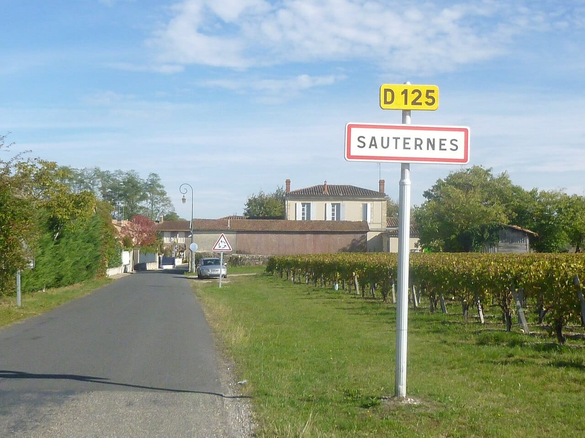

# 小芒森

法国西南部 Jurançon 的白葡萄，果粒小、皮厚、晚熟，带热带水果、柑橘、蜂蜜与高酸；可酿甜型、半干与干型，是法国最耐陈年的白葡萄之一。

图："小芒森"的产区风貌。摄影：File:Vineyard in Sauternes.jpg。署名：davitydave，CC BY 2.0，来自 Wikimedia Commons（[来源](https://commons.wikimedia.org/w/index.php?curid=25673556)）。这张照片用于说明"小芒森"的主要种植环境，不是小芒森的品种标本照。

## 定义与命名

小芒森（Petit Manseng）是法国西南部的白葡萄品种，在 Jurançon 与 Pacherenc du Vic-Bilh 两个产区与大芒森（Gros Manseng）成对出现。名称里的 Petit 指果粒小，而非植株矮小；它与大芒森的区分直到 1783 至 1784 年才被清晰记录，此前两地常把两种 Manseng 混在同一名称下。品种别名 Petit Manseng Blanc，酒标有时直接写 Manseng，需要结合产区判断具体所指。

基因分析显示，小芒森是 Savagnin 的后代，同时又是大芒森的亲本之一；也就是说它处在这条西南法品种谱系的中间环节。把它当成单一风味标签很容易失真：干型、半干与晚收甜酒用的是同一葡萄，靠采收日期、浓缩方式与残糖拉开差距，真正稳定的结构特征是晚熟、高酸、厚皮与浓郁香气家族。

## 起源与传播

小芒森的栽培史与比利牛斯山麓的 Jurançon 产区绑定。产区位于波城西南的比利牛斯山前丘陵，葡萄园沿坡地与黏土石灰岩分布，葡萄园总面积约 650 公顷。文献可追溯至 16 世纪，现代声誉则建立在甜型晚收酒之上；1975 年 Jurançon Sec 干型条款加入，1995 年又增补 Vendanges Tardives 晚收条款，形成今天干、甜两条并行的产品线。

除了 Jurançon，相邻的 Pacherenc du Vic-Bilh 横跨 Gers、Hautes-Pyrénées 与 Pyrénées-Atlantiques 三省，同样用小芒森做干白、半甜与 liquoreux 甜酒。品种在 20 世纪后期一度局限于西南法，近年随国际甜白与高酸白的兴趣向外传播：美国弗吉尼亚是最重要的新世界落点，种植面积从 2011 年的 68 英亩增长到 2020 年代初的 179 英亩，占全球种植一成以上；澳大利亚早年以小芒森名义引入的植株，经 CSIRO 2020 年 DNA 分析确认实际是 1979 年错名进口的大芒森。西班牙巴斯克地区、意大利、新西兰、南非与乌拉圭也有少量试种。

## 植物学与栽培

果粒小、果皮厚、果串松散，晚熟是它最突出的植物学特征。厚皮与松散串型让它对灰霉与串腐有较强抵抗力，能够留在藤上继续风干浓缩，糖分不断提高的同时仍然保住高酸度，这正是它能平衡高残糖的关键。天然产量不高，果串小，疏果空间有限，产量控制更多靠地块选择与采收节奏。

栽培上要在晚熟风险与浓缩度之间取舍：比利牛斯山麓秋季天气不稳定，连续阴雨可能破坏晚收计划；向阳坡、排水快的黏土石灰岩最利于糖酸同步积累。修剪、叶幕管理与采收批次安排比所谓品种天性更能决定质量。同一地块若遮阴过重或采收过早，酸度与香气细节会明显损失；过熟则酒精感上升、鲜度下降。

## 风格与味觉

干型小芒森以葡萄柚、榅桲、白花与柑橘皮为主，酸度锐利，质地有厚度；甜型与晚收款则释放菠萝、芒果、杏、蜜饯菠萝、蜂蜜、姜与香料，残糖很高，但高酸把甜感托住，不显腻口。年轻时热带水果与花香主导，陈年后逐渐出现坚果、干果、蜂蜡与蜂蜜的三层香气，是法国最耐陈年的白葡萄之一。

酿造方式决定风格方向：干款多在不锈钢罐或旧桶发酵，保留清新与果香；甜款通过晚收、藤上风干（passerillage），条件合适时辅以贵腐浓缩，分批采收、逐串挑选。部分酒庄用新橡木桶发酵与陈年来增加质地与层次，如 Quintessence 一类 cuvée 产量极低、桶陈两年以上。判断陈年潜力要看酸度、结构与酒精度平衡，而不是颜色深浅；高酸是它长期瓶陈的核心支撑。

## 主要产区与代表酒款

Jurançon 是核心舞台。法规上 Jurançon Sec 残糖不超过 4 g/L，普通 Jurançon 最低残糖 40 g/L，Vendanges Tardives 最低 55 g/L；小芒森与大芒森在普通款混酿中合计至少占一半，晚收款则只允许这两个 Manseng 品种。小芒森提供细腻香气与酸度，大芒森贡献体量与产量。

代表生产者中，Domaine Cauhapé 位于 Monein，由 Henri Ramonteu 于 1980 年创立，今天种植 47 公顷、出品 13 款 cuvée；Symphonie de Novembre 为 100% 小芒森、11 月初采收，高端款 Quintessence du Petit Manseng 延至 12 月分批采摘，产量仅 9 hl/ha，在全新法国橡木桶中发酵陈酿两年以上。Clos Uroulat 始建于 1775 年，1983 年由 Charles Hours 接手，旗舰甜款 Clos Uroulat 为 100% 小芒森，干款 Cuvée Marie 同样受关注；Domaine Bellegarde、Clos Lapeyre、Domaine Larredya 也是产区内的可靠名字。

## 怎么喝与配餐

甜型小芒森适合 6–8°C 饮用，温度过高会放大甜味与酒精，过低则封住蜂蜜与干果香；干型可以稍高，10–12°C 更能展开柑橘与花香。杯型用中等肚径白葡萄酒杯即可，甜酒可选用略小的收口杯集中香气。晚收甜酒开瓶后在冷藏条件下可存放数周，残糖与酸度都能延缓氧化。

配餐上，甜款搭配鹅肝、蓝纹奶酪、水果塔与杏桃甜点，也可单独作为餐后酒；酸度足够高，遇到偏甜的菜式不会失衡。干型适合搭配白肉、烤鱼、贝壳类与带奶油酱汁的家禽，柑橘与花香能接住菜肴的细腻。辛辣或烟熏重菜会凸显酒中的甜与酒精，不是稳妥组合。

## 选购与常见误区

常见误区之一，是把 Manseng 一名直接等同于小芒森：大芒森果粒更大、酒体更宽、香气偏粗，混酿款里两者比例决定风格，酒标不写比例时要看生产者说明。另一个误区是认为甜白都不耐放：小芒森恰恰以高酸支撑长期瓶陈，好的晚收款可以放十余年，逐渐发展出坚果与蜂蜡层次。

购买时先分清 Sec 干型、普通甜型与 Vendanges Tardives 三个层级，残糖与价位差别明显。生产者比品种名更能说明风格：同一葡萄在不同酒庄手里可以做成清爽高酸或浓郁甜润。新世界试种款的风土表现仍在积累，选酒时优先看法国西南产区的参照款建立基准，再比较海外版本。

## 延伸阅读与另见

理解小芒森的直接方式，是同年份对比一支 Jurançon 干款、一支普通甜款与一支晚收款，观察酸度如何随残糖变化。它与 [white-wine](ref:white) 的类型划分、[terroir](ref:terroir) 山麓黏土石灰岩风土、[fermentation](ref:fermentation) 与 [oak-ageing](ref:oak) 的工艺选择相互关联，也可与 [chardonnay](ref:chardonnay) 一类国际白葡萄的结构做参照。

- 相关条目：[white-wine](ref:white)、[terroir](ref:terroir)、[fermentation](ref:fermentation)、[chardonnay](ref:chardonnay)、[oak-ageing](ref:oak)。

## 相关图像

图：发酵。图片：Tjhackmann，CC BY-SA 4.0，via Wikimedia Commons（[原图页面](https://commons.wikimedia.org/wiki/File:Phylogenetic_tree_of_bacteria_and_archaea,_highlighting_those_that_carry_out_fermentation.png)）。关联图像：小芒森。
