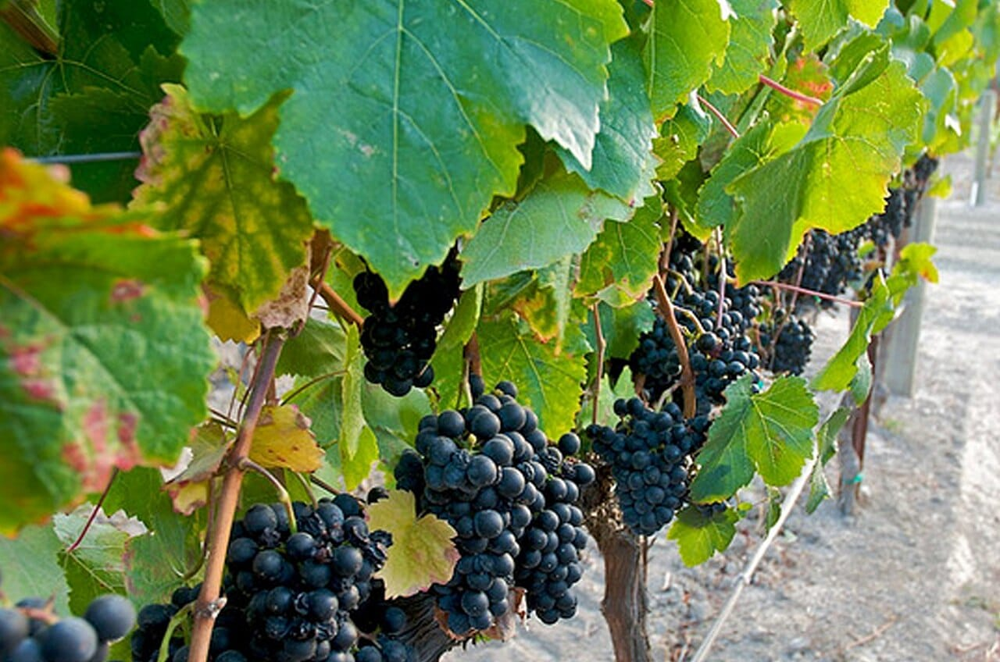

# 小维多

小维多是波尔多传统混酿中的次要红葡萄，晚熟、皮厚、籽多、颜色深、单宁强；在凉爽的波尔多常难完全成熟，而在澳大利亚、西班牙、美国与南美等温暖产区常被酿成单一品种酒，用来补充结构、颜色与中段厚度。

图：Petit Verdot：01 Petit verdot（Wikimedia Commons）。图片：Eric 先魁 Hwang，CC BY 2.0，via Wikimedia Commons（[原图页面](https://commons.wikimedia.org/wiki/File:01_Petit_verdot.jpg)）。

## 定义与命名

Petit Verdot 字面意思是“小绿”，指的不是果粒大小，而是它成熟期偏晚：在气候不够理想的年份，其他品种已经采收，它的果实往往还留在发青的状态。它是 Vitis vinifera 红葡萄，传统上与赤霞珠、梅洛、品丽珠、马尔贝克一起构成波尔多式调配；旧资料里也有 Verdot、lambrusquet 等别名（[bordeaux](ref:bordeaux)）。

基因研究没有证实它与赤霞珠、品丽珠存在直接亲缘，它是西南法国独立发展起来的品种；VIVC 登记编号 12974。商业种植以选定克隆为主，酒标一般不标注克隆与砧木，地块成熟度、产量与橡木工艺对风格的影响更直接。

## 起源与传播

小维多的起源地可能在比利牛斯山区的贝阿恩（Béarn）一带，17 世纪已有栽培痕迹，后来才进入吉伦特省，在梅多克与格拉夫立足。数个世纪里它在波尔多混酿中一直扮演次要但关键的角色：比例通常只有 2%–10%，却提供额外单宁、深颜色与香料花香。

20 世纪，由于栽培难度高、在波尔多凉爽年份常不能成熟，它在本土的种植面积一度萎缩，几近消失。1980 年代以后，夏季更暖的产区重新发现这个品种：它在温暖气候下可以稳定成熟，单一品种酒结构扎实、颜色浓郁，澳大利亚、西班牙、美国加州与弗吉尼亚、阿根廷、智利、乌拉圭与南非都陆续有种植。

它与赤霞珠、梅洛的搭配关系带出波尔多混酿的基本逻辑：小维多负责中段厚度、颜色与单宁骨架，赤霞珠提供结构与酸度，梅洛贡献圆润与果香。在波尔多本地，它至今仍是调配成分；在海外暖区，它更多以单品酒或赤霞珠混酿配角的身份出现（[cabernet-sauvignon](ref:cabernet)）。

## 植物学与栽培

果串紧凑呈圆柱形，果粒小、皮深蓝黑、籽多，新梢长势偏弱。萌芽早，容易受春霜影响；成熟后果粒偶尔裂果，容易招惹灰霉。它比赤霞珠晚熟约两到三周，需要长而温暖的生长季，在排水良好的砾石壤土表现最好；梅多克的砾石台地与圣埃米利永的石灰岩地块是波尔多本地较适合它的环境。

栽培上的核心矛盾是晚熟与成熟度：波尔多冷凉年份，果实达不到完全成熟，单宁生青、带苦味；只有在成熟充分时，厚皮与多籽才转化为深色果皮色素与成熟单宁。控制产量、保证叶幕光照与避开花期霜冻，是让它顺利成熟的基本条件；高产或遮阴会让酒色与结构都松散下来。

## 风格与味觉

充分成熟的小维多颜色极深、近饱和墨红，年轻时常有香蕉、铅笔芯屑、黑醋栗、黑樱桃、紫罗兰与薄荷气息；随陈年发展出皮革、雪松、烟草、松露、李子干与无花果。口感饱满，单宁坚定有力量，酸度鲜活，中段厚实，是混酿里“撑住酒体”的成分。

在波尔多调配中，小维多占比虽小，却放大质地、力量与香气深度；珍藏级波尔多常经木桶与大桶陈酿二十个月以上，单宁在长时间陈酿中逐渐整合。海外单一品种酒通常萃取更充分、橡木味更明显，果味更黑更浓；优质酒款有 10–20 年陈年潜力，陈年后果干、皮革与香料层次展开，紫罗兰花香可以保留很久（[oak-ageing](ref:oak)）。

判断一款小维多的潜力，重点看单宁是否成熟、酸度是否完整，而不是颜色深浅；未成熟年份生青苦涩，即使颜色深也不具备好的陈年条件。它的酒精度通常偏高，搭配时需要考虑酒体重量。

## 主要产区与代表酒款

波尔多本地，小维多只占红葡萄种植面积约 1.3%，集中在梅多克、格拉夫等左岸产区；列级酒庄的旗舰调配常加入少量小维多。以 Château Palmer 为例，2004 年份调配为 47% 梅洛、46% 赤霞珠、7% 小维多，2025 年份为 55% 梅洛、41% 赤霞珠、4% 小维多，酒精度约 13.5%，经橡木桶与大桶陈酿二十个月以上；Château Margaux 等左岸名庄的调配中也能见到它的少量身影（[merlot](ref:merlot)）。

海外产区里，澳大利亚（西澳、南澳与东南部内陆河谷）、西班牙中部与东南部、美国加州纳帕与帕索罗布尔斯、弗吉尼亚，以及阿根廷、智利、乌拉圭都有小维多地块；暖白天加长夜晚凉的产区能给它足够成熟度，同时保留酸度，是单品酒表现较好的环境。这些产区的单品酒价格带从日常浓郁红到收藏级珍藏款都有，生产者与地块比品种名更能预测杯中风格。

## 怎么喝与配餐

小维多按饱满结构红葡萄酒侍酒，温度约 16–18°C；温度过低会压住香料与橡木气息，过高则酒精与粗涩单宁浮上来。杯型用大肚红酒杯，年轻或高单宁款提前 30–60 分钟醒酒，让单宁柔化、果香与紫罗兰展开；陈年款可短暂 decant 后即饮。

配餐遵循“强度对等”：烤牛排、羊排、炖牛肋、野味、烧烤与墨西哥 Mole 一类浓味炖菜最搭，高单宁能清解肥肉油脂；陈年硬质奶酪如曼彻格、陈年高达、斯蒂尔顿，以及波多贝罗蘑菇、栗子坚果料理也合适。清淡海鲜、白肉与轻酱汁压不住它的结构，不是首选搭配（[red-wine](ref:red)）。

## 选购与常见误区

误区一：把“Petit（小）”理解为酒体轻。这个词指晚熟发青的果粒，不是轻淡风格；成熟小维多通常饱满、单宁强、颜色深，不能按轻酒体红葡萄酒的期待去买。误区二：以为它是赤霞珠的克隆或变种。二者只是波尔多混酿搭档，基因上没有直接亲缘，小维多的晚熟、多籽与厚皮是独立特征。

误区三：认为深色浓单宁的酒必须趁年轻喝掉。恰恰相反，完整酸度与坚定单宁是长期陈年的基础，优质小维多瓶陈十年以上会从黑果转向皮革、干果与香料；判断时看成熟度、地块产量与陈酿方式，而不是品种的普遍印象。选购留意年份是否成熟、装瓶时间与储存条件，受热或长期库存的酒会失去黑果与紫罗兰香气，单宁也显得干涩发柴。

## 延伸阅读与另见

对照练习：把一款波尔多列级调配里的小维多贡献，与一款海外单一品种小维多同场比较，看调配如何收住力量、单品酒如何放大黑果与单宁；再对比成熟年份与偏凉年份，辨认生青苦涩与成熟单宁的差别。

小维多的海外种植面积、克隆与亲本研究仍随品种调查更新，正式引用以 VIVC 登记、波尔多行业机构与各产区法规为准。

- 相关条目：[bordeaux](ref:bordeaux)、[cabernet-sauvignon](ref:cabernet)、[merlot](ref:merlot)、[red-wine](ref:red)、[oak-ageing](ref:oak)。

## 相关图像

图：梅洛。图片：Felloni claire，CC BY-SA 4.0，via Wikimedia Commons（[原图页面](https://commons.wikimedia.org/wiki/File:Merlot.jpg)）。关联图像：小维多。
