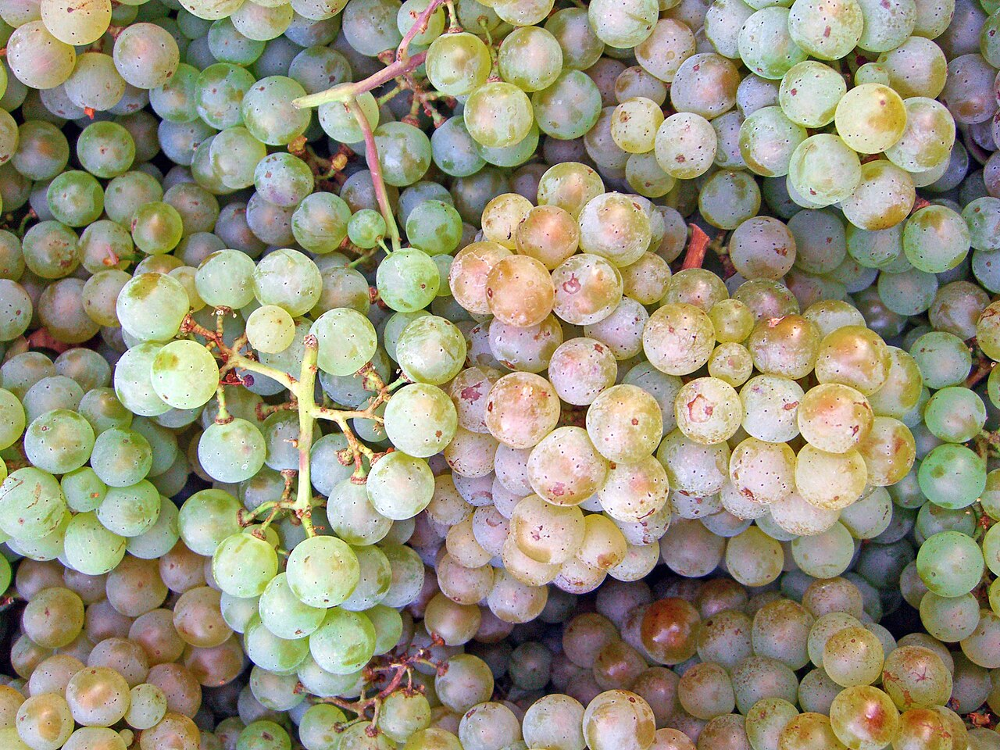

# 白皮诺

白皮诺（Pinot Blanc）是黑皮诺家族中的白色成员，常被形容为“安静的白葡萄”：香气不张扬，酸度中等到偏高，酒体圆润，配餐适应性强。它在阿尔萨斯、德国与意大利北部都有稳定表现，却长期活在接受度更高的霞多丽与雷司令的阴影里。真正理解白皮诺，需要把它放回黑皮诺的变异谱系，并区分阿尔萨斯、德国与意大利三条传统。

图：白皮诺。图片：User:Themightyquill，CC BY-SA 2.5，via Wikimedia Commons（[原图页面](https://commons.wikimedia.org/wiki/File:Pinot-blanc.jpg)）。

## 定义与别名

白皮诺是黑皮诺的白色变异，属于欧洲葡萄 Vitis vinifera。德语名 Weissburgunder（魏斯堡格），意大利语名 Pinot Bianco，阿尔萨斯传统上也用 Klevner 或 Clevner 指称。它和灰皮诺（Pinot Gris / Grauburgunder）、黑皮诺（Pinot Noir / Spätburgunder）同属皮诺家族，但颜色、果皮厚度与香气不同。酒标上的 Pinot Blanc、Weissburgunder、Pinot Bianco 通常指同一品种；阿尔萨斯的“Pinot”有时是白皮诺与欧塞瓦（Auxerrois）的混酿，并不等于单一品种。把白皮诺与霞多丽混为一谈是常见错误：两者都可能是中性白葡萄，但白皮诺酸度通常更低、口感更圆，香气更偏杏仁与青苹果。

## 亲本与起源

白皮诺的起源与勃艮第的皮诺家族紧密相关。它被认为是黑皮诺的体细胞变异，也有研究把它与灰皮诺视为同一谱系中的不同突变。皮诺家族在勃艮第有长期种植记录，白皮诺随后传播到阿尔萨斯、德国西南部与意大利北部。19 世纪以来，阿尔萨斯把白皮诺作为日常白葡萄酒的重要品种；德国则把它称为 Weissburgunder，与 Spätburgunder、Grauburgunder 形成“三色皮诺”的名称体系。它不是杂交品种，而是无性繁殖保留下来的变异，因此不同克隆之间的酸度、产量与香气差异很大。

## 植物学特征

白皮诺的果穗小到中等，果粒小、皮薄，成熟时呈黄绿色，有时带淡粉色晕。果肉多汁，糖分积累中等，酸度下降较慢，因此在凉爽产区能保持清爽。它的芽眼较早萌动，嫩梢抗寒性一般；果皮薄意味着对灰霉病、白粉病与日灼都较敏感。与灰皮诺相比，它的果皮颜色更浅、香气更清淡；与霞多丽相比，它的酸度通常更低、香气更中性。正因为皮薄，白皮诺更适合轻柔压榨，避免提取过多苦味与酚类物质。

## 栽培特性

白皮诺长势中等偏旺，容易高产，但高产会迅速稀释风味，因此需要控制负载。它发芽早，春霜是主要风险；果穗紧、皮薄，潮湿年份容易发生灰霉病，冰雹与日灼也会造成损失。它对土壤的适应性较强，石灰岩、泥灰岩与砾石土壤都能种植，但在排水良好、肥力较低的坡地上香气与酸度更平衡。成熟期中等偏早，过晚采收会失去酸度、出现苦味。阿尔萨斯与德国南部的优质酒庄通常通过绿色采收、严格控产与适时采收之间的平衡来获得成熟度与酸度的兼顾。

## 产区分布

阿尔萨斯是白皮诺最经典的产区之一，Pinot Blanc AOC 可以来自白皮诺与欧塞瓦，常表现为干型、酒体中等的日常白葡萄酒；Crémant d'Alsace 也大量使用白皮诺。德国把白皮诺称为 Weissburgunder，集中在巴登（Baden）、法尔茨（Pfalz）与莱茵黑森（Rheinhessen），风格从干型到少量甜型都有，巴登的酒体通常更饱满。意大利北部的上阿迪杰（Alto Adige / Südtirol）以 Pinot Bianco 著称，常带山地清爽感；弗留利（Friuli）与伦巴第也有种植，Franciacorta 的法规允许白皮诺参与混酿，但实际比例很低。奥地利、瑞士、匈牙利与斯洛文尼亚有少量栽培；勃艮第本土种植面积很小；香槟法定品种中包括白皮诺，但实际使用极少。

## 法定规则

阿尔萨斯的 Pinot Blanc AOC 允许白皮诺与欧塞瓦混酿，酒标可以写 Pinot Blanc 或传统的 Klevner；具体品种比例与产地规范以最新法令为准。Crémant d'Alsace AOC 允许白皮诺参与混酿或单酿。德国没有单独的 Weissburgunder 法定产区，而是按 Qualitätswein 与 Prädikat 体系管理，品种名可以出现在酒标上。意大利的上阿迪杰 DOC 允许 Pinot Bianco 作为品种酒标注，具体最低品种比例与产量由产区规范规定。香槟 AOC 的法定品种包括白皮诺，但它在香槟中占比很小。各地规则会调整，购买时以酒标与最新产区规范为准。

## 酿造

白皮诺的酿造以“少干预”为主。不锈钢罐低温发酵可以保留青苹果、梨与柑橘的清新；酒泥陈酿会增加奶油感与质地；部分优质酒款使用旧橡木桶发酵，增加复杂度而避免香草味过重。苹果酸-乳酸发酵可以选择性地进行：完全进行会降低酸度、增加圆润感，阻止则保留更明亮的酸度。白皮诺的单宁与酚类较少，压榨要轻柔，避免苦味。起泡酒基酒通常强调酸度与中性，以便二次发酵与陈年。总体而言，白皮诺的酿造目标不是制造强香气，而是保持平衡、质地与配餐性。

## 感官风格

白皮诺的典型香气是青苹果、梨、白桃、柠檬、杏仁与白花，有时带湿石与轻微烟熏。酒体中等，酸度中等偏高，收口常带轻微的苦杏仁感，这是它与霞多丽的重要区别。阿尔萨斯版本通常干爽、清爽、适合佐餐；德国 Weissburgunder 酒体更饱满，成熟年份会出现梨、榅桲与坚果；上阿迪杰的 Pinot Bianco 更偏山地风格，酸度明亮、矿物感明显。陈年潜力中等，优质酒款可以陈放数年，但通常不适合长期窖藏。它不适合用“香气浓郁”来衡量，而应以平衡、质地与配餐表现来评价。

## 代表生产者与年份

阿尔萨斯的 Trimbach、Hugel 与 Weinbach 等酒庄长期生产 Pinot Blanc；上阿迪杰的 Cantina Terlano、Tramin 与 Nals Margreid 以 Pinot Bianco 著称；德国巴登与法尔茨的一些家族酒庄以 Weissburgunder 建立声誉。年份差异主要体现在酸度与成熟度：凉爽年份酸度更高、酒体更轻，适合尽早饮用；温暖年份酒体更圆、酸度较低，可能出现苦味或酒精感。白皮诺对采收时机敏感，过早采收会显得青涩，过晚则失去清爽。购买时关注产区、酒庄与年份，比单纯看 Pinot Blanc 更有意义。

## 常见误区

第一，把白皮诺当作霞多丽。两者亲缘与风格不同，白皮诺通常更圆、酸度更低。第二，认为阿尔萨斯 Pinot Blanc 一定是单一品种。它常与欧塞瓦混酿。第三，把 Weissburgunder 与 Grauburgunder 混淆。后者是灰皮诺。第四，把 Pinot Bianco 与 Pinot Grigio 当成同一品种。两者颜色与风格不同。第五，认为白皮诺只能酿便宜酒。上阿迪杰与阿尔萨斯的优质单一园可以很有深度。第六，认为白皮诺没有酸度。凉爽产区的白皮诺酸度可以相当高。第七，以为香槟不使用白皮诺。它在法定品种中，只是实际使用极少。

## 延伸阅读

- [葡萄酒](ref:wine)：白皮诺所属的总体酒类。
- [白葡萄酒](ref:white-wine)：白皮诺的主要酒类形态。
- [酸度](ref:acidity)：判断白皮诺风格与配餐的关键。
- [阿尔萨斯](ref:alsace)：白皮诺与欧塞瓦混酿的经典产区。
- [意大利](ref:italy)：上阿迪杰皮诺比安科的核心产地。

相关条目：[葡萄酒](ref:wine)、[白葡萄酒](ref:white-wine)、[酸度（acidity）](ref:acidity)。
