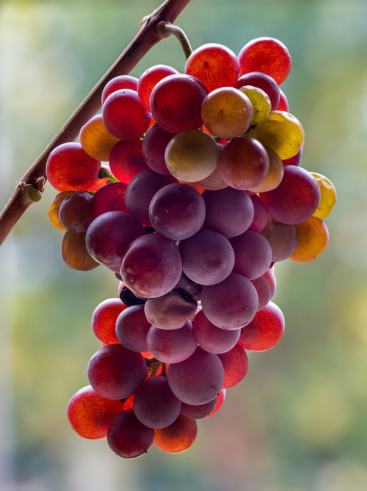

# 灰皮诺

灰皮诺（Pinot Gris）是黑皮诺的果皮颜色变种，果实呈现灰粉色而不是紫黑色。它早熟、皮薄、酸度偏低，酿出的酒通常颜色浅、香气以梨与苹果为主。同一个品种在阿尔萨斯可以做得饱满浓郁，在意大利则可以做得清爽轻盈，风格差异主要来自产区与酿造，而不是品种本身。

图：灰皮诺。图片：Ermell，CC BY-SA 4.0，via Wikimedia Commons（[原图页面](https://commons.wikimedia.org/wiki/File:Pinot_Grigio-20201027-RM-114053.jpg)）。

## 定义与别名

灰皮诺的英文名是 Pinot Gris，意大利语称 Pinot Grigio，德语称 Grauburgunder 或 Ruländer。它属于欧洲葡萄 Vitis vinifera，是黑皮诺的颜色突变，不是独立物种。Ruländer 这个名字来自 18 世纪德国商人 Johann Seger Ruland，传统上多指甜型或饱满风格；Grauburgunder 则更常用于干型。酒标上的名称往往暗示风格：Pinot Grigio 通常清淡，Grauburgunder 通常更饱满。

## 亲本与起源

灰皮诺是黑皮诺（Pinot Noir）的果皮颜色突变，属于皮诺家族的一员。皮诺家族还包括黑皮诺、白皮诺（Pinot Blanc）与莫尼耶皮诺（Pinot Meunier），它们之间的基因差异很小，主要通过果皮颜色与香气特征区分。灰皮诺的起源地一般追溯到勃艮第，随后传入阿尔萨斯、德国与意大利北部。它不是灰皮诺与霞多丽的杂交，也不是“灰比诺”这一中文译名所暗示的独立品种。

## 植物学特征

果穗小到中等，果粒小、排列紧，果皮呈灰粉色到浅紫灰色，果肉多汁。它发芽早，成熟期早，糖分积累快而酸度下降也快；果皮薄，容易感染灰霉病与贵腐菌。果粒小意味着皮汁比高，颜色与香气物质容易提取，但也让产量偏低、成熟不整齐。与黑皮诺相比，灰皮诺的果皮色素少、单宁低，酿出的酒颜色从浅金到铜色都有可能。

## 栽培特性

灰皮诺长势中等，产量偏低，适合凉爽、排水良好的坡地。它发芽早，春霜是主要风险；果皮薄，秋季降雨容易造成灰霉病。阿尔萨斯的石灰岩与泥灰岩、德国巴登的火山岩、意大利北部的砾石与冲积土，都能给出不同风格。它对产量控制敏感：高产时香气寡淡、酸度不足；控产后质地与香气明显提升。意大利的大批量 Pinot Grigio 多种在平原，产量高、采收早。

## 阿尔萨斯

阿尔萨斯是灰皮诺最经典的产区之一，它与雷司令、琼瑶浆、麝香并称“四种贵族品种”。阿尔萨斯有 51 个特级园，灰皮诺是允许种植的品种之一；晚收（Vendanges Tardives）与贵腐粒选（Sélection de Grains Nobles）是甜型级别，灰皮诺在这两类酒中表现突出。历史上阿尔萨斯曾把灰皮诺标为“Tokay d'Alsace”，这一名称在 2007 年后不再允许使用，以避免与匈牙利托卡伊混淆。阿尔萨斯的灰皮诺通常酒体饱满、酸度低，带蜂蜡、梨与杏仁气息。

## 德国与意大利

德国把灰皮诺称为 Grauburgunder 或 Ruländer，巴登与普法尔茨是主要产区，风格从干型到甜型都有。意大利是灰皮诺产量最大的国家，威尼托与弗留利是核心；2017 年设立的 delle Venezie DOC 覆盖威尼托与弗留利的大部分产量，规定了品种比例与风格。意大利的 Pinot Grigio 通常早采、低温发酵，风格清淡、酸度中等，适合即饮；弗留利的“ramato”则通过短暂皮接触酿出铜色、带香料的风格。

## 酿造与风格

灰皮诺的酿造方式决定风格走向。清淡型 Pinot Grigio 在不锈钢罐中低温发酵，避免苹乳发酵，以保留梨、苹果与柑橘气息；饱满型 Grauburgunder 与阿尔萨斯版本可能使用橡木桶、酒泥搅拌与苹乳发酵，增加质地与蜂蜡感。短暂皮接触（maceration）可以提取颜色与香气，酿出铜色的 ramato；过度浸渍会带来苦味。残糖从干型到半干型不等，取决于产区与酒庄。

## 感官风格与配餐

年轻灰皮诺以梨、青苹果、白桃、柑橘与杏仁为主，酸度中低，酒体轻到中等；阿尔萨斯与德国版本更饱满，带蜂蜡、蜂蜜与香料。ramato 风格则有草莓、红茶与生姜气息。它适合搭配海鲜、白肉、沙拉与软奶酪；清淡型适合作为餐前酒，饱满型可以搭配奶油酱汁与烤禽。由于酸度低，它不适合搭配过酸的菜肴。

## 与琼瑶浆的区别

灰皮诺与琼瑶浆都是阿尔萨斯“贵族品种”，果皮都偏粉，但两者差异明显。灰皮诺是黑皮诺的颜色突变，香气以梨、苹果、杏仁为主，酸度略高、质地更细腻；琼瑶浆是萨瓦宁的芳香突变，香气以荔枝、玫瑰、姜为主，酸度更低、酒体更饱满。把两者混为一谈，会忽略灰皮诺的克制与琼瑶浆的张扬。意大利的 Pinot Grigio 与阿尔萨斯的 Pinot Gris 是同一品种，但风格差距很大。

## 代表生产者与年份

阿尔萨斯的代表包括 Zind-Humbrecht、Trimbach 与 Domaine Weinbach；德国的 Dr. Heger 与 Rebholz 以 Grauburgunder 著称；意大利有 Jermann、Livio Felluga 与 Venica；美国俄勒冈的 King Estate 是 Pinot Gris 的重要生产者。年份差异主要来自早熟与秋季降雨：炎热年份酸度更低、酒精更高；凉爽年份更清爽、香气更细腻。市场方面，Pinot Grigio 是全球销量最大的白葡萄酒之一，但高端灰皮诺仍集中在阿尔萨斯与德国。

## 常见误区

第一，认为 Pinot Grigio 与 Pinot Gris 是不同品种。它们是同一品种的不同语言名称。第二，认为灰皮诺都是清淡无味的。阿尔萨斯与德国版本可以很饱满。第三，把灰皮诺当成灰皮诺与霞多丽的杂交。它是黑皮诺的颜色突变。第四，以为 ramato 是桃红葡萄酒。它是白葡萄短暂皮接触酿成的铜色酒。第五，认为灰皮诺不能陈年。优质阿尔萨斯与德国版本可以陈放十年以上。第六，把灰皮诺与琼瑶浆混淆。两者的香气与酸度完全不同。

对照阅读：[葡萄酒](ref:wine)、[阿尔萨斯](ref:alsace)。

灰皮诺的果皮偏灰粉，不等于酿出的酒一定是粉色；颜色深浅取决于浸皮时间与压榨方式，不能只看品种名。

## 延伸阅读

- [葡萄酒](ref:wine)：灰皮诺在葡萄酒总体分类中的位置。
- [白葡萄酒](ref:white-wine)：灰皮诺所属的酒类。
- [阿尔萨斯](ref:alsace)：灰皮诺的经典产区。
- [意大利](ref:italy)：Pinot Grigio 的主要产地。
- [黑皮诺](ref:pinot-noir)：灰皮诺的母本品种。

相关条目：[白葡萄酒](ref:white-wine)。

**关键事实。**

| 项目 | 内容 |
| --- | --- |
| 一句话定位 | 黑皮诺的灰色果皮变种，早熟、皮薄、酸度偏低；在阿尔萨斯可酿出饱满浓郁的风格，在意大利则以清爽轻盈的灰皮诺（Pinot Grigio）为主流 |
| 物种 | Vitis vinifera |
| 代表产区 | 意大利、阿尔萨斯 |

**来源与边界。** 本页关于「灰皮诺」的关键事实，主要由以下来源交叉核对：International Organisation of Vine and Wine (OIV)（品种描述与 Vitis 物种框架）、Oxford University Press（提供关于灰皮诺、灰比诺与阿尔萨斯风格的条目；由原条目末尾参考资料迁移，未逐条复核访问日期）、Conseil Interprofessionnel des Vins d'Alsace（阿尔萨斯贵族品种体系与灰皮诺的产区地位）等 5 条来源。价格、批次与状态会变，涉及这些字段时以页面所列来源的最新版本为准。正文为项目自写，来源只作核验，不复制原文。
