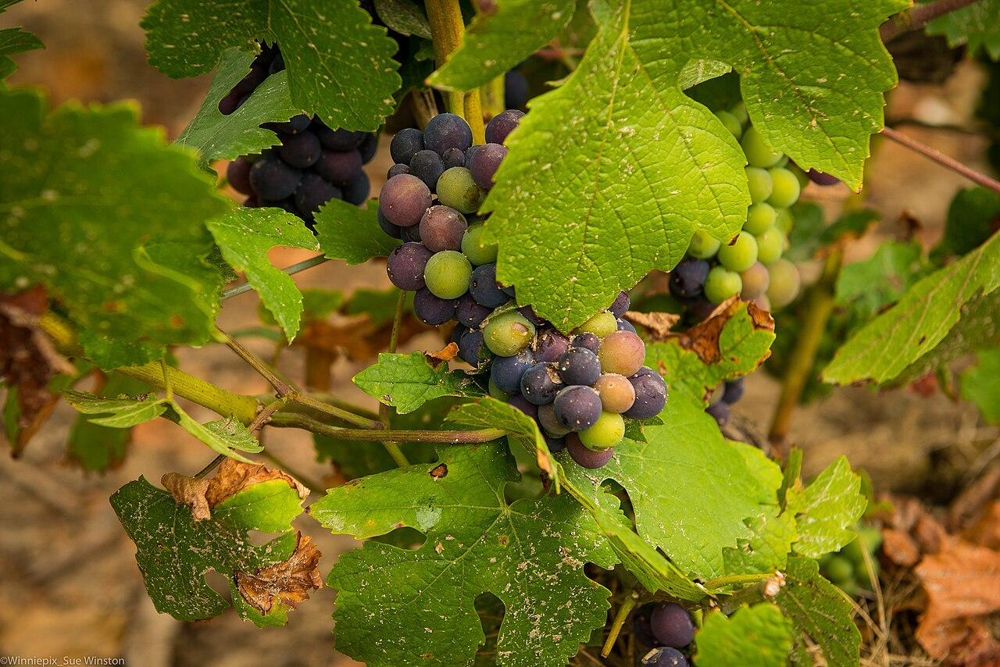

# 莫尼耶皮诺

莫尼耶皮诺（Pinot Meunier）是香槟三大法定品种中最容易被低估的一个。它是黑皮诺的深色变异，果皮深、果肉白，发芽与成熟都偏早，在香槟马恩河谷的黏土坡地上表现稳定。长期以来，它被视为给混酿增加果味与圆润度的“配角”；近二十年，单酿莫尼耶与“黑中白”香槟的兴起，让人们重新认识它的价值。

图：莫尼耶皮诺。摄影：Pinot meunier or pinot noir? (28732275257)。署名：Winniepix，CC BY 2.0，来自 Wikimedia Commons（[来源](https://commons.wikimedia.org/w/index.php?curid=156677934)）。

## 定义与别名

莫尼耶皮诺的正式名称是 Pinot Meunier，简称 Meunier。德语名 Schwarzriesling 字面意思是“黑雷司令”，但它与雷司令没有亲缘关系，只是果皮深、酸度结构让人联想到雷司令；另一个德语名 Müllerrebe 意为“磨坊主之葡萄”，与法语 meunier（磨坊主）同源。它的叶片背面有白色绒毛，像撒了一层面粉，名字即由此而来。Samtrot 是莫尼耶皮诺的一个突变系，在德国符腾堡有少量种植。它不是独立物种，而是皮诺家族中的无性变异，酒标上的 Meunier、Pinot Meunier、Schwarzriesling 通常指同一品种。

## 亲本与起源

莫尼耶皮诺与黑皮诺的基因几乎相同，差异来自某些细胞层的突变，因此它常被描述为“嵌合体”。这种突变影响了叶片绒毛与果实颜色，也让它在成熟节奏与香气上略有不同。皮诺家族在勃艮第有长期种植历史，莫尼耶皮诺后来在香槟地区大量种植，尤其在马恩河谷。它不是 19 世纪才出现的杂交品种，而是通过无性繁殖保留下来的老变异；不同克隆在产量、果粒大小与抗病性上差异明显。关于它和黑皮诺谁先出现的讨论，目前没有定论，更准确的说法是两者同属一个不断突变的品种群。

## 植物学特征

莫尼耶皮诺的果穗小，果粒小、皮薄，成熟时呈蓝黑色，果肉为白色。最直观的特征是叶片：嫩叶与成叶背面覆盖浓密白色绒毛，这也是它得名的原因。它发芽早，成熟也早，比黑皮诺略早；酸度中等，单宁比黑皮诺柔和。果皮薄意味着色素与风味容易提取，但也让它对灰霉病与日灼更敏感。与黑皮诺相比，莫尼耶皮诺的果串有时更紧，果粒略大，产量潜力更高。它的香气以红色水果为主，陈年后会出现蘑菇与林地气息。

## 栽培特性

莫尼耶皮诺长势旺，容易高产，但高产会稀释果味，因此需要严格控产。它发芽早，春霜是香槟地区的主要风险；在马恩河谷的黏土与泥灰岩坡地上，它的早熟特性反而成为优势，可以在秋季降雨来临前采收。它对霜霉病与灰霉病较敏感，潮湿年份需要更细的田间管理。与黑皮诺相比，它更耐寒、更容易稳定结果，但在极热年份容易失去酸度、出现果酱感。老藤莫尼耶皮诺产量低、果实集中，常被用于单酿香槟。香槟的种植规则对修剪、产量与采收有严格限制，具体参数以最新法规为准。

## 产区分布

莫尼耶皮诺的核心产区是法国香槟，尤其是马恩河谷（Vallée de la Marne），在兰斯山与白丘也有种植，但比例较低。香槟之外，法国的卢瓦尔河谷、阿尔萨斯与勃艮第有零星种植，主要用于混酿或实验性酒款。德国符腾堡（Württemberg）是 Schwarzriesling 的主要产地，巴登与法尔茨也有种植，多用于桃红与轻酒体红酒。澳大利亚、新西兰、美国加州与意大利北部有少量栽培，常被用于起泡酒混酿。由于莫尼耶皮诺早熟，它在气候凉爽、春霜风险高的产区比黑皮诺更容易稳定成熟。

## 法定规则

在香槟 AOC 中，莫尼耶皮诺是法定品种之一，与霞多丽、黑皮诺并列为三大主力；香槟法规还允许白皮诺、灰皮诺、阿巴内与 petit meslier，但种植面积极小。香槟的混酿比例、最低酒精度、产量上限、压榨与陈年时间都有规定，具体数值以最新法规为准。标注“Blanc de Noirs”的香槟可以由莫尼耶皮诺单酿或与黑皮诺混酿，酒液颜色为白色，因为葡萄汁在压榨后迅速与果皮分离。Coteaux Champenois 允许用莫尼耶皮诺酿静止红葡萄酒或桃红葡萄酒。德国的 Schwarzriesling 按 Qualitätswein 体系管理，可在符腾堡等产区标注品种名。

## 酿造

莫尼耶皮诺在香槟中通常采用整串压榨，轻柔提取果汁，避免过多色素与酚类；第一次发酵可以在不锈钢罐或橡木桶中进行，苹果酸-乳酸发酵常用于柔化酸度。混酿（assemblage）是香槟的核心工艺：不同村庄、不同年份、不同品种的基酒按比例调配，以达到风格一致性。莫尼耶皮诺为混酿提供红色果味、圆润口感与早期可饮性。单酿莫尼耶香槟需要更精细的压榨与更长的酒泥陈年，以增加复杂度。静止红葡萄酒则通过短时间浸渍提取颜色与果味，单宁轻、适合年轻时饮用。二次发酵与酒泥陈年是香槟气泡与烘焙香气的来源。

## 感官风格

莫尼耶皮诺的典型香气是草莓、覆盆子、红樱桃、李子与紫罗兰，陈年后出现烤面包、奶油、蘑菇与林地气息。作为香槟，它酒体中等、酸度中等，果味充沛、口感圆润，常比年轻的霞多丽香槟更易入口；优质单酿可以陈年，发展出蜂蜜与坚果。作为静止红葡萄酒，它颜色偏浅、单宁柔和，适合搭配家禽、猪肉与菌菇。桃红香槟中的莫尼耶皮诺会带来草莓与红醋栗的清新感。它的酸度不如霞多丽尖锐，因此在高酸年份可以平衡酒体，在炎热年份则需要注意采收时机。

## 代表生产者与年份

香槟的单酿莫尼耶代表包括 Jérôme Prévost 的 La Closerie、Chartogne-Taillet、Egly-Ouriet 与 Michel Loriot；大型酒庄中，Krug 与 Bollinger 的混酿也使用莫尼耶皮诺，为酒体增加果味与宽度。德国符腾堡的酒庄用 Schwarzriesling 酿桃红与轻红。年份差异主要来自春霜与秋季降雨：春霜严重的年份会显著降低莫尼耶皮诺的产量，凉爽年份果味清新、酸度较好，炎热年份则更成熟、酒体更重。由于莫尼耶皮诺常被用于无年份混酿，单一年份的表现更多体现在单酿与年份香槟中。

## 常见误区

第一，认为莫尼耶皮诺是劣质品种。优质单酿可以非常精细。第二，认为它只能用于混酿。Blanc de Noirs 单酿已经证明它的独立性。第三，把 Schwarzriesling 当成雷司令。两者没有亲缘关系。第四，认为莫尼耶皮诺是白葡萄。它是深色葡萄，只是果肉为白色。第五，把 Blanc de Noirs 理解成“白葡萄品种”。它指用深色葡萄酿成的白色香槟。第六，认为莫尼耶皮诺不能陈年。优质单酿与年份香槟可以陈放多年。第七，把莫尼耶皮诺与黑皮诺完全等同。两者同属皮诺家族，但克隆与风格不同。

## 延伸阅读

- [葡萄酒](ref:wine)：莫尼耶皮诺所属的总体酒类。
- [起泡酒](ref:sparkling-wine)：莫尼耶皮诺最重要的酒类形态。
- [混酿](ref:blending)：理解香槟 assemblage 的关键工艺。
- [香槟](ref:champagne)：莫尼耶皮诺的核心产区。
- [法国](ref:france)：法国葡萄酒的产区与法规框架。

相关条目：[葡萄酒](ref:wine)、[起泡酒](ref:sparkling-wine)、[调配](ref:blending)。
