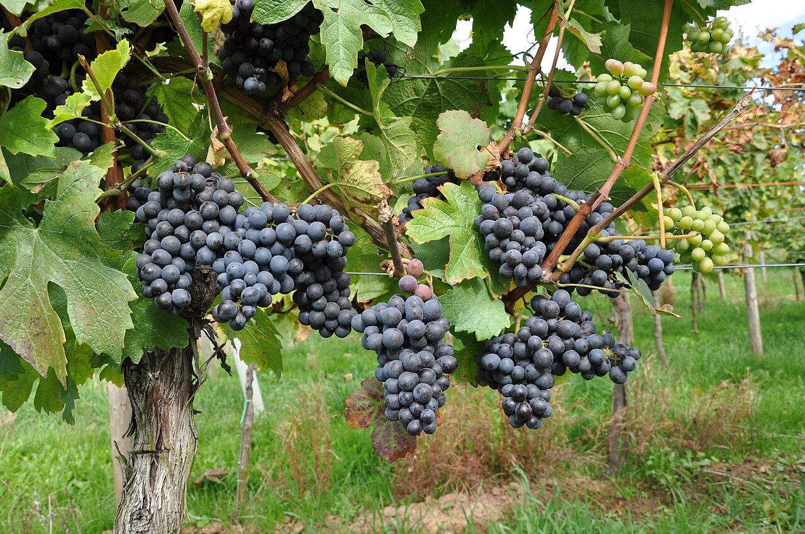

# 皮诺塔吉

皮诺塔吉（Pinotage）是南非独有的红葡萄品种，也是 20 世纪少数由人工杂交育成、并在国际上获得独立身份的红葡萄。它由黑皮诺与神索杂交而来，兼具前者的小果粒与香气潜力，以及后者的抗性与产量。酒色深、单宁结实，年轻时可以是鲜亮的桑葚与李子，经过橡木与瓶陈后又会出现咖啡、烟熏、皮革与泥土气息。皮诺塔吉的口碑起伏很大，理解它的关键不是记住“香蕉味”这类标签，而是看清克隆、树龄、采收与发酵温度如何共同决定风格(ref:wine)。

图：皮诺塔吉。图片：Please note: This photo can be reproduced. Please quote the source as indicated below: Doris Schneider, Julius Kühn-Institut (JKI), Federal Research Centre for ，CC BY-SA 4.0，via Wikimedia Commons（[原图页面](https://commons.wikimedia.org/wiki/File:VIVC9286_PINOTAGE_Full_plant_3638.jpg)）。

> **先给结论**
> **一句话：** 这页判断皮诺塔吉适不适合你，以及怎么比较其他品种。
>
> - **适合谁：** 正在比较皮诺塔吉与其他品种、想弄懂风味差异的人。
> - **不适合谁：** 只想要单一名庄推荐、不关心品种本身的人。
> - **先看这两点：**
>   - 皮诺塔吉属于欧洲葡萄 Vitis vinifera，是红葡萄品种，名称来自 Pinot（黑皮诺）与 Hermitage（神索在南非的旧称）的组合。
>   - 1925 年，斯泰伦博斯大学（Stellenbosch University）的教授 Abraham Izak Perold 在实验园中用黑皮诺的花粉授给神索。

## 定义与别名

皮诺塔吉属于欧洲葡萄 Vitis vinifera，是红葡萄品种，名称来自 Pinot（黑皮诺）与 Hermitage（神索在南非的旧称）的组合。它不是黑皮诺的变种，也不是“黑皮诺与西拉”的杂交；它的另一个亲本是神索（Cinsaut），在南非历史上常被称为 Hermitage。皮诺塔吉是人工杂交（crossing），不是种间杂种（hybrid），因为两个亲本都属于 Vitis vinifera。中文名“皮诺塔吉”是音译，酒标上通常直接写 Pinotage(ref:red-wine)。

## 亲本与起源

1925 年，斯泰伦博斯大学（Stellenbosch University）的教授 Abraham Izak Perold 在实验园中用黑皮诺的花粉授给神索，得到第一批皮诺塔吉实生苗。由于当时的研究条件有限，这批苗一度被冷落，后来才被移植到埃尔森堡（Elsenburg）并进入育种计划。1940 年代起，皮诺塔吉开始推广种植与试验酿造，1959 年正式采用“Pinotage”这个名称，1961 年首次出现在酒标上。1995 年，南非成立皮诺塔吉协会，推动品种的国际认知与品质提升。它的诞生背景是 20 世纪初欧洲葡萄病害频发，育种者希望结合黑皮诺的品质与神索的适应力，这一目标也解释了它后来在风格上的两面性。

## 植物学特征

皮诺塔吉的果粒较小，果皮较厚，颜色深，色素与单宁含量都较高。果穗中等偏紧，糖分积累快，酸度中等，成熟期通常早于赤霞珠。厚果皮让它在炎热干燥的南非环境下有一定抗性，但也意味着如果浸渍过重，酒会显得粗犷。它的叶片与黑皮诺有相似之处，但长势更强，产量也更高。由于亲本之一是神索，皮诺塔吉的果实往往带有较强的果味与较高的pH值，酿造时需要关注酸度平衡。不同克隆之间的差异明显，这也是同一品种可以呈现从轻盈鲜果到浓重烟熏两种极端风格的原因之一。

## 栽培特性

皮诺塔吉长势旺，适应性强，既能做篱架栽培，也能做灌木式（bush vine）老藤栽培。它对干旱有较好的耐受性，适合南非西开普的旱地条件；但在湿润年份或灌溉过量时，枝叶过旺会遮挡果实，增加病害风险。产量控制是品质关键：负载过高时，酒会显得稀薄、带有生青与指甲油般的气味；低产老藤则能给出更深的颜色与更细致的单宁。斯沃特兰（Swartland）的老灌木藤与旱地种植尤其能体现这种潜力。由于成熟期较早，酒农需要根据目标风格决定采收时间：早采保留酸度与鲜果，晚采则增加酒精与黑色果味。

## 产区分布

南非是皮诺塔吉的绝对核心(ref:south-africa)。斯泰伦博斯（Stellenbosch）是传统重镇，Kanonkop、Simonsig 等酒庄在这里奠定了品种的声誉；斯沃特兰（Swartland）以老灌木藤、旱地种植与低干预酿造给出更紧致、带香料与泥土感的版本(ref:swartland)。帕尔（Paarl）、德班维尔（Durbanville）、罗伯逊（Robertson）与惠灵顿（Wellington）也有种植。南非之外，加利福尼亚、新西兰、津巴布韦与巴西有少量实验性栽培，但规模与影响力都远不及南非。不同产区的共同点是充足日照与较长成熟期，差异则主要来自土壤、水分与树龄。

## 法定规则

南非葡萄酒实行原产地（Wine of Origin，WO）制度，品种标注通常要求酒液中至少 85% 来自所标注的品种，年份与产区标注也有相应比例要求。皮诺塔吉是南非官方认可的品种名称；“Cape Blend”则是南非业界约定的混酿类别（并非严格的法定等级），要求皮诺塔吉占 30% 至 70%，且自 2019 年份起应为最大成分，其余为其他红葡萄品种。这个类别既保护了皮诺塔吉的身份，也给酒庄留下了调配空间。具体比例、酒精度与陈年要求以南非葡萄酒法规的最新版本为准。由于“Pinotage”在南非具有品种与品牌双重意义，酒标使用受到严格管理。

## 酿造

皮诺塔吉的酿造方式跨度很大。追求清新风格的酒庄会较早采收、低温发酵、缩短浸渍，并避免过度使用新橡木；追求浓郁风格的酒庄则延长浸渍、使用较高比例的法国或美国橡木桶(ref:oak-ageing)，甚至采用整串发酵与野生酵母。历史上皮诺塔吉常被批评带有香蕉、指甲油或丙酮气味，这主要与发酵温度过高、酵母营养不足或果实成熟度不均有关；现代酒庄通过控温、分选与温和萃取来减少这些缺陷。苹果酸-乳酸发酵可以柔化酸度，但是否进行取决于目标风格。混酿方面，皮诺塔吉常与赤霞珠、梅洛、西拉或神索搭配，Cape Blend 就是这种思路的行业化表达。

## 感官风格

年轻皮诺塔吉以桑葚、黑莓、李子、黑樱桃与紫罗兰为主，常伴随香蕉、咖啡、摩卡、黑巧克力与烟熏气息。酒体中等偏饱满，单宁结实，酸度中等，酒精通常偏高。轻盈版本强调鲜果与香料，适合年轻时饮用；浓郁版本则带有皮革、泥土、烟草与野味，需要瓶中陈年才能舒展。橡木使用会明显改变风格：新桶增加香草、椰子和烘烤感，旧桶则更强调果味与泥土。优质皮诺塔吉的陈年潜力可达十年以上，老藤与低产酒款尤其明显。

## 代表生产者与年份

南非代表酒庄包括 Kanonkop、Beyerskloof、Simonsig、Delheim、Warwick、L'Avenir 与 Ashbourne。Kanonkop 的 Pinotage 常被视为品种标杆，Beyerskloof 以稳定的品种表达与较高性价比著称，Simonsig 则与皮诺塔吉的早期商业化历史关系密切。斯沃特兰的老藤生产者更强调旱地、灌木藤与低干预，风格偏向香料、泥土与紧致酸度。年份差异主要来自冬季降雨、春季霜冻与夏季高温：干燥温暖的年份果实更集中，凉爽年份酸度更好但成熟度可能不均；具体表现仍取决于地块、树龄与采收决策。

## 常见误区

第一，把皮诺塔吉当成黑皮诺。两者只是亲子关系，品种特征与酒风完全不同。第二，认为皮诺塔吉必然带香蕉或指甲油味。那是特定发酵条件下的缺陷，不是品种的必然属性。第三，把“Hermitage”当成西拉。在南非历史语境中，Hermitage 常指神索，而不是法国罗讷的 Hermitage。第四，以为皮诺塔吉只能做廉价酒。老藤、低产与精细酿造可以产出结构完整、可陈年的酒。第五，认为皮诺塔吉只产自斯泰伦博斯。斯沃特兰、帕尔等地同样重要。第六，把 Cape Blend 当成纯皮诺塔吉。业界约定皮诺塔吉占 30% 至 70%，其余为其他红葡萄。

皮诺塔吉不是简单的黑皮诺与神索混合，而是 1925 年育成的杂交品种；它的咖啡、烟熏味来自品种与酿造，不是添加物。

## 延伸阅读

- [葡萄酒](ref:wine)：从葡萄到成酒的总体脉络。
- [红葡萄酒](ref:red-wine)：皮诺塔吉所属的酒类。
- [南非](ref:south-africa)：皮诺塔吉的核心产区与法规背景。
- [斯沃特兰](ref:swartland)：老灌木藤皮诺塔吉的重要产区。
- [橡木陈年](ref:oak-ageing)：影响皮诺塔吉风格的关键工艺。

**关键事实。**

| 项目 | 内容 |
| --- | --- |
| 一句话定位 | 1925 年由南非斯泰伦博斯大学的 Perold 将黑皮诺与神索杂交而成；果色深、单宁结实，风格从鲜亮果味到咖啡、烟熏不等，是南非最具代表性的红葡萄品种，也是 20 世纪人工育种成功的少数红葡萄之一 |
| 物种 | Vitis vinifera |
| 代表产区 | 南非、斯沃特兰 |
