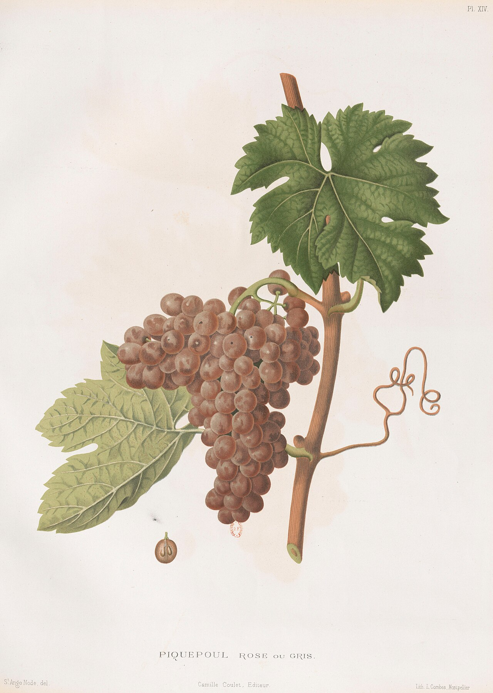

# 匹格普勒

匹格普勒（Piquepoul，亦拼 Picpoul、Picapoll）是法国南部朗格多克的古老白葡萄，最著名的表达是地中海 Étang de Thau 湖畔的 Picpoul de Pinet AOP。它晚熟、天然酸度高，酒色浅金黄带绿，柠檬、青苹果、白花之上有明显海盐与碘味矿物感，是地中海“海水感”干白的代表，常年配 Bouzigues 牡蛎与湖海鲜贝（ref:white）。

读这个品种要先分清三个皮格普勒类型：最常见的 Piquepoul Blanc 白葡萄，以及种植很少的 Piquepoul Noir 黑葡萄与 Piquepoul Gris 灰葡萄；酒标上的 Picpoul de Pinet 是 100% 白品种单酿产区，不等于黑、灰类型。理解了这层区分，再看湖边石灰岩、海风与晚熟节奏如何塑造它的酸度与咸鲜。

图：Piquepoul：Piquepoul rose - Henri Marès（Wikimedia Commons）。图片：Charles Node-Saint-Ange, Louis Combes (Lithographe)，CC0，via Wikimedia Commons（[原图页面](https://commons.wikimedia.org/wiki/File:Piquepoul_rose_-_Henri_Mar%C3%A8s.jpg)）。

## 定义与命名

匹格普勒学名为 Vitis vinifera，VIVC 编号 9298。法语名 Piquepoul 字面可解作“扎嘴唇”，指的就是它入口让人精神一振的高酸度。登记同义词包括 Avello、Avillo、Extra、Feher Piquepoul、Languedocien、Picapoll、Picapolla、Picapulla、Picpoul、Picpoul de Pinet、Piquepoul blanc、Piquepoul de Pinet；在西班牙加泰罗尼亚称 Picapoll。

三个类型要靠果皮颜色与用途区分：Blanc 用于干白，Noir 是罗讷河谷南部混酿中允许的小众红品种，也出现在 Châteauneuf-du-Pape 的传统品种名单里，Gris 种植量极小。辨识上，它发芽偏晚、生长周期长，通常 9 月中旬到 10 月初采收，果皮薄、成熟后仍保留高天然酸度，耐旱，能适应海边石灰岩与偏盐碱土壤。Picpoul de Pinet AOP 酒款法定用 100% Piquepoul Blanc；法国登记的 Blanc 认证克隆编号为 176、237、238、463，1994 年在埃罗省还建立了近 400 个克隆的保存圃。

## 起源与传播

品种起源于法国南部，最早的书面记录见于 1384 年图卢兹一份葡萄园租约；罗马时期的 Via Domitia 古道穿过今天的葡萄园，说明这一带栽藤历史久远。它最初是深色品种，后来才分化出白、灰类型；1910 年布鲁塞尔世博会获奖后，匹格普勒开始获得国际声誉。家谱资料显示，白类型是黑类型的白色芽变。

传播上，它长期集中在朗格多克-鲁西永与罗讷河谷南部，西班牙加泰罗尼亚有同名 Picapoll 栽培；二十世纪后期曾被忽视，近年随 Picpoul de Pinet 单一品种白葡萄酒的复兴重新受到关注。法国 2000 年 Blanc 种植约 1,000 公顷，之后呈增长趋势。

## 植物学与栽培

匹格普勒发芽偏晚、生长周期长，通常 9 月中旬到 10 月初采收；果皮薄，成熟后仍保留高天然酸度，耐旱性好，能适应海边石灰岩与偏盐碱的土壤。它对白粉病较敏感，潮湿年份需要重点防治。夜间与清晨采收可以锁住酸度与花香。

栽培上的核心仍是叶果平衡：叶面积太小则糖分积累不足，枝叶过密造成遮阴又会降低酸度、加重病害。修剪、引缚、疏叶与有限灌溉都围绕这条平衡线调整。湖边台地以白垩质黏土、湖相石灰岩与片岩为主，平均海拔约 40 米，海风与 Cers 西风调节昼夜温度，夜间雾气保留清新感；排水好、日照足的地块更适合做有矿物层次的酒（ref:terroir）。

## 风格与味觉

典型 Picpoul de Pinet 呈浅柠檬黄带绿调，干型、轻到中等酒体，酸度明亮到偏高，是酒款的定义性特征。香气以柠檬、青柠、青苹果、白梨、葡萄柚开场，接金合欢、山楂花等白花，以及茴香、茴香籽、白胡椒与百里香等草本；中后段有来自泻湖环境的咸鲜与碘味矿物，口感偏瘦长线性，不以肥厚果味取胜。

酿造上多数酒庄用温控不锈钢罐或水泥罐发酵，很少使用橡木，以保留品种纯度与清新香气；苹果乳酸发酵通常不做，以免磨掉脆爽酸度。普通款在酒泥上停留两到四个月，酒精度一般在 11.5–13.5%。2018 年起产区推出 Patience 高端层级：选用老藤、延长酒泥接触、软木塞与棕色瓶封装、瓶陈至少一年再上市，质地与复杂度更高，可放五年以上；普通款则建议一到两年内饮用（ref:fermentation）。

## 主要产区与代表酒款

Picpoul de Pinet AOP 是朗格多克最大、也是唯一的静止干白单一品种产区，葡萄园位于 Agde、Pézenas、Sète 三角内、Étang de Thau 西北岸，覆盖 Castelnau-de-Guers、Florensac、Mèze、Montagnac、Pinet、Pomérols 六个市镇，法定品种为 100% Piquepoul Blanc。2024 年申报面积约 1,514 公顷，产量约 86,334 百升；生产者包括约 24 家独立酒庄与 4 家合作社，标准产量上限 66 百升/公顷、封顶 72 百升/公顷；约三分之二产量出口，英国是最大市场。

代表生产者方面，独立酒庄以 Domaine de la Croix Gratiot 与 Château de Pinet 为代表，合作社 Cave de l'Ormarine 也是产区主力。产区历史节点包括 1954 年获 VDQS 资格、1985 年成为 Coteaux du Languedoc 下属地理命名、2013 年 2 月 INAO 一致通过独立 AOC、2013 年 9 月 23 日法令正式颁布，2017 年获欧盟 AOP 地位。

## 怎么喝与配餐

匹格普勒建议在 8–10 °C 饮用，杯型用中等肚径白葡萄酒杯；不需要醒酒，开瓶即饮。温度太低会压住花香与矿物，太高则酸度显得尖锐。它是典型的开胃酒与配餐型白葡萄酒。

搭配上，最经典的是 Bouzigues 牡蛎、贻贝、蛤蜊等湖海鲜贝，以及烤鱼、烤虾、蒜香海鲜、鱼汤与 bouillabaisse；山羊奶酪、轻沙拉与香草白肉也稳妥，配腌橄榄、冷切前菜同样轻松开胃。油脂厚重的奶油菜、甜味甜点与它的脆爽酸度不搭。湖畔传统吃法是把刚打捞的贻贝、牡蛎配柠檬与白葡萄酒清蒸，酒中的海盐碘味正好呼应贝类的海气；夏天冰镇后作开胃酒，也能配茴香大蒜调味的南法海鲜炖菜。

## 选购与常见误区

第一个误区是把三个类型混为一谈：酒标写 Picpoul de Pinet 的是 Blanc 单酿，Noir 与 Gris 不在这个产区白葡萄酒里。第二个误区是以为匹格普勒靠橡木增味：传统与现代主流都少用或不用橡木，品种卖点是酸度、花香与咸鲜矿物。第三个误区是只看品种名不读产区：朗格多克其他地区的匹格普勒可能进入混酿，风格与单一品种 AOP 不同。

看酒标先分清是否 Picpoul de Pinet AOP、普通款还是 Patience 层级、年份与酒精度。普通款三五年内饮用，Patience 款可长期瓶陈；储存平放、避光、远离温度波动。海外市场上英国渠道占比高，购买时留意储存条件，过热仓库会让清新果香与酸度受损。

相关条目：[白葡萄酒](ref:white)、[风土（terroir）](ref:terroir)、[发酵](ref:fermentation)。

## 延伸阅读与另见

- 相关条目：[white-wine](ref:white)、[terroir](ref:terroir)、[fermentation](ref:fermentation)、[chardonnay](ref:chardonnay)、[oak-ageing](ref:oak)。
- 想比较普通款与 Patience 层级，可选同一年份两款同酒庄酒，对比酒泥质地、柑橘深度与咸鲜余味的长短。

**关键事实。**

| 项目 | 内容 |
| --- | --- |
| 一句话定位 | 法国朗格多克的白葡萄，核心是 Picpoul de Pinet；高酸、柠檬、海盐与白花，适合配牡蛎与海鲜，是地中海“海水感”白葡萄酒的代表 |
| 物种 | Vitis vinifera |

## 相关图像

图：霞多丽。图片：Jenavive at English Wikipedia，Public domain，via Wikimedia Commons（[原图页面](https://commons.wikimedia.org/wiki/File:Chardonnay.jpg)）。关联图像：匹格普勒。
