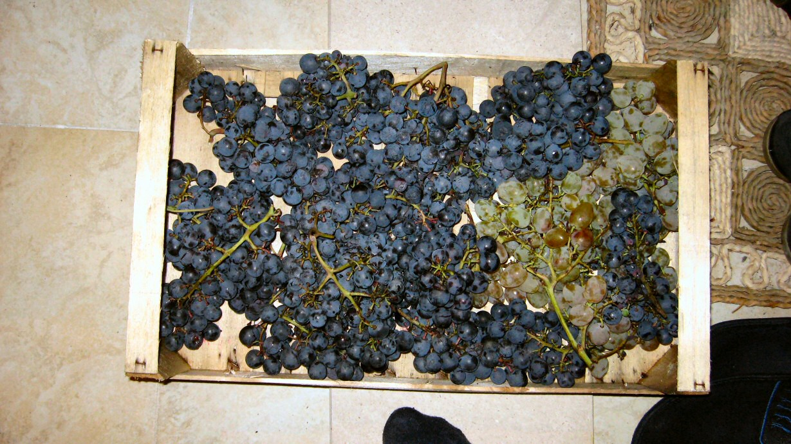

# 普拉瓦茨马里

克罗地亚达尔马提亚海岸的红葡萄，由 Tribidrag（即仙粉黛）与 Dobričić 杂交而来；高单宁、高酒精、带黑莓、干果与香料，Dingač 是核心产区。

图：Plavac Mali：Plavac mali N（Wikimedia Commons）。图片：Pero Kvrzica，CC BY 2.0，via Wikimedia Commons（[原图页面](https://commons.wikimedia.org/wiki/File:Plavac_mali_N.jpg)）。

## 定义与命名

普拉瓦茨马里（Plavac Mali）是克罗地亚达尔马提亚海岸最具代表性的红葡萄品种，名称在克罗地亚语里意为"小的蓝葡萄"，Plavac 指深色果皮，mali 指果粒相对偏小。当地简称 Plavac，酒标上也常见 Plavac Mali 全名。它与仙粉黛（Zinfandel）、普里米蒂沃（Primitivo）以及克罗地亚本土的 Crljenak Kaštelanski 长期被混为一谈，名称谱系直到 DNA 时代才逐步理清。

作为达尔马提亚本土品种，它集中种植在 Pelješac 半岛、Brač、Hvar、Vis 等沿海半岛与岛屿，石灰岩坡地与地中海气候塑造了它高单宁、高酒精的骨架。读这个品种时，需要把植物学亲缘、产区法规与市场上"巴尔干仙粉黛"的通俗说法分开；由于它在本土长期与 Tribidrag（仙粉黛/普里米蒂沃）同名混淆，亲缘结论又随 SSR 到 SNP 的检测方法反复修订，酒标上的 Plavac Mali 不能只按品种名读，需要结合 Dingač、Postup 等产区与生产者判断地块与风格。

## 起源与传播

20 世纪很长一段时间里，普拉瓦茨马里被认为与加州仙粉黛是同一品种。克罗地亚裔酿酒师 Mike Grgich 曾凭少年时代在家乡喝过的印象指出两者相似，加州大学戴维斯分校与萨格勒布大学随后展开联合取样研究。1998 年前后，Meredith 团队确认两者并不相同，但存在亲缘；2000 年发现 Primitivo/Zinfandel 是普拉瓦茨马里的亲本之一，另一亲本由 Ivan Pejić 与 Edi Maletić 鉴定为来自 Šolta 岛的古老品种 Dobričić。

这一亲本结论后来经历了反复。2004 年基于 25 个 SSR 标记的研究（Maletić 等）提出 Tribidrag 与 Dobričić 的杂交组合；2013 年 Lacombe 等与 2020 年 Žulj Mihaljević 等在补充位点与叶绿体标记上发现不符合孟德尔遗传规律的矛盾，对该亲本关系提出质疑。2024 年 Marinov 等基于 SNP 标记的分析进一步确认，普拉瓦茨马里并非 Tribidrag 与 Dobričić 的后代，只是与两者亲缘都很近。也就是说，早期"仙粉黛 × Dobričić 杂交"的说法曾是主流假说，但最新基因组证据已不支持直接亲本关系；它的具体祖先仍待进一步研究。

## 植物学与栽培

果粒中等偏小、果皮厚，果串不算大，属于晚熟品种，需要充足阳光与热量才能达到生理成熟。植株耐热耐旱，适合海岸陡坡与石灰岩、风化岩土；海风与反射光帮助果皮积累颜色与单宁，坡地排水快，产量自然受限。它在背阴或低洼地块容易成熟不足，酸度与生青味偏重。

栽培上的难点是平衡成熟度与酸度：Dalmatian 夏季炎热干燥，过熟采收会让酒精感膨胀、单宁粗糙；采收过早则果味单薄、草本气息重。传统多为灌木形（bush vine）低干栽培，叶幕低矮贴近地面反射热；疏果、限产与采收日期判断是品质关键。老藤根系深、产量低，果味更集中，是高端酒款的基础。

## 风格与味觉

典型普拉瓦茨马里颜色深浓，香气以黑莓、黑樱桃、李子干、甘草、黑胡椒与烟熏香料为主，常带干果与泥土气息；单宁强劲、酸度中等偏高，酒精度容易达到 14–16%，结构厚重、有陈年潜力。传统酿法用大橡木桶长期陈酿，风格浓郁雄浑；现代派酒庄更早采收、控制萃取强度，做出更平衡、果香更清晰的版本。

年轻时果味直接，单宁偏紧；瓶陈数年后逐渐出现皮革、干果、烟草与蘑菇等三层香气。高酒精与强单宁是它的双刃剑：萃取过重会显得粗粝，采收过晚则甜腻。混酿在克罗地亚本土并不常见，多数代表性酒款为单一品种；与 [zinfandel](ref:zinfandel) 相比，它通常更厚重、单宁更硬，果香更偏深色干果而非新鲜红果。

## 主要产区与代表酒款

Dingač 是最核心的法定产区：1961 年成为克罗地亚第一个受保护原产地名称（ZOI），也是前南斯拉夫境内首个获得该地位的葡萄酒产区。它位于 Pelješac 半岛 Potomje 村上方的向阳陡坡，法规要求 100% 普拉瓦茨马里，出产全国最浓郁、最集中的红葡萄酒，酒精度高，深色果味、烟草与干草药交织。相邻的 Postup 坡度稍缓，风格相对优雅，同样以单一品种为主；Brač、Hvar 等岛屿地块也有代表性酒款。

代表生产者包括 Pelješac 上的 Miloš（Frano Miloš），其桶陈与 Stagnum 系列被视为产区标杆；Matuško 同时覆盖 Dingač 与 Postup、价位层次丰富；Saints Hills 走现代风格，年轻时即可饮用；Grgić Vina 由 Grgich 家族创立；Skaramuca、Korta Katarina、Badel 1862 与 Vinarija Dingač 也是常见名字。海外几乎没有规模化种植，这个品种的表达基本集中在达尔马提亚本地。

## 怎么喝与配餐

厚重的普拉瓦茨马里适合 16–18°C 饮用，温度偏低会把单宁与酸感收紧，偏高则酒精与粗粝感突出。单宁强的酒款提前半小时到一小时醒酒，让果香与单宁逐步展开；老年份酒注意缓慢滗除沉淀。杯型选大肚宽杯，给香气留出展开空间。

配餐围绕亚得里亚海岸与内陆红肉：烤羊肉、炖牛肉、野味、烟熏火腿（pršut）与腌腊制品、硬质陈年奶酪都能接住它的单宁与酸度。海鲜清淡菜式或辛辣菜肴会被酒中的酒精与苦味压住，不宜搭配；分量扎实的主菜、烤肉与炖菜是稳妥方向。作为 [red-wine](ref:red)，它的浓度更适合餐桌中段，而不是开胃时段。

## 选购与常见误区

一个常见误区是把它直接当"仙粉黛复刻"。两者亲缘相近，但普拉瓦茨马里更厚重、单宁更硬、酒精更高，风格并不等同；通俗类比不能代替对地块与酿造的判断。另一个误区是只看品种名：Dingač 陡坡、Postup 缓坡与岛屿地块的成熟度、酸度和集中度差别明显，年份对炎热海岸的采收节奏影响很大。

选购时先分辨产区层级（Dingač、Postup 或岛屿 IGT），再看生产者、树龄与年份。老藤不是法律等级，具体产量与树龄以酒庄说明为准；高酒精度不等于品质好，平衡感才是关键。储存避开高温、强光与震动，结构强的红葡萄酒开瓶后可放两到三天，真空塞能延缓氧化。

## 延伸阅读与另见

比较这个品种最直接的方式，是同年份试一支 Dingač 陡坡款、一支 Postup 款与一支岛屿地块酒，对照单宁粗细、果味与酒精感的差别。它与 [terroir](ref:terroir) 层面的石灰岩海岸风土、[oak-ageing](ref:oak) 的桶陈传统、[vintage](ref:vintage) 带来的成熟度差异密切相关，也可与仙粉黛条目对照理解亲缘与风格分野。

- 相关条目：[zinfandel](ref:zinfandel)、[red-wine](ref:red)、[terroir](ref:terroir)、[oak-ageing](ref:oak)、[vintage](ref:vintage)。

对照阅读：[仙粉黛](ref:zinfandel)、[风土（terroir）](ref:terroir)。
