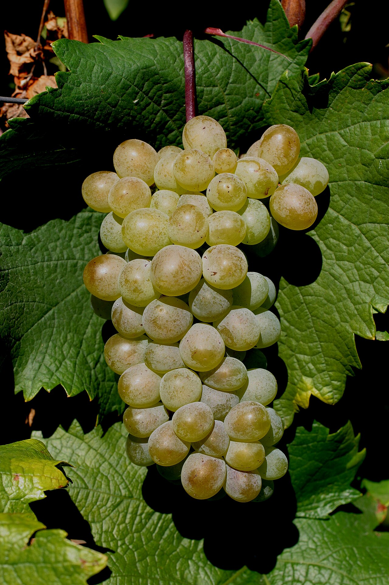

# 白羽

格鲁吉亚最古老的白葡萄之一，酸度高、带青苹果、白花与香料；可酿清爽干白，也可用陶罐带皮发酵成琥珀色葡萄酒，是格鲁吉亚陶罐传统的核心品种。

白羽是格鲁吉亚最重要的白葡萄之一，酸度高、皮厚；它既能酿清爽干白，也能用陶罐带皮发酵成琥珀酒。读它时，颜色与工艺比品种名更能说明风格。

图：Rkatsiteli：VIVC10116 RKATSITELI Cluster in the field 9065（Wikimedia Commons）。图片：Please note: This photo can be reproduced. Please quote the source as indicated below: Doris Schneider, Julius Kühn-Institut (JKI), Federal Research Centre for ，CC BY-SA 4.0，via Wikimedia Commons（[原图页面](https://commons.wikimedia.org/wiki/File:VIVC10116_RKATSITELI_Cluster_in_the_field_9065.jpg)）。

## 定义与命名

白羽是格鲁吉亚最重要的白葡萄之一，格鲁吉亚语名 Rkatsiteli 的字面意思常被解作“红茎”或“红穗轴”，指成熟时果穗或枝梗带红色。它酸度高、皮厚，既能酿清爽[白葡萄酒](ref:white)，也能用陶罐带皮发酵成琥珀酒。

“白羽”是中文意译，不是官方品种名；在格鲁吉亚、亚美尼亚、阿塞拜疆、乌克兰、俄罗斯与摩尔多瓦，它还有各自的转写。读酒标时，Rkatsiteli 与“白羽”指同一品种，但风格取决于是否带皮发酵与是否用 qvevri。

它不是“格鲁吉亚红酒”的同义词：格鲁吉亚还有 Saperavi 等红葡萄，Rkatsiteli 是白葡萄，陶罐琥珀酒只是它的一种工艺，不是品种本身。

“白羽”这个中文名容易让人以为它是白羽鸡或某种白色原料，其实它只是 Rkatsiteli 的意译。格鲁吉亚本地还有 Mtsvane、Kisi 等白葡萄，Rkatsiteli 是其中种植最广、工艺跨度最大的一个。

## 起源与传播

白羽原产格鲁吉亚卡赫季（Kakheti），是当地最古老的白葡萄之一；考古与文献把陶罐酿酒追溯到数千年前，但现代品种登记与克隆选择是 20 世纪的事。苏联时期，它被广泛种到黑海沿岸与中亚灌溉区。

1990 年代以后，格鲁吉亚酒农重新强调 qvevri 陶罐、带皮发酵与长时间浸渍，白羽成为“琥珀酒”复兴的核心；Pheasant’s Tears、Vinifera、Teliani Valley 等酒庄把它的酸度与香料带进国际市场。

在乌克兰与摩尔多瓦，白羽多酿清爽干白；在亚美尼亚与阿塞拜疆，它常与地方品种混酿。传播到新世界较少，主要仍在高加索与东欧。

卡赫季的 qvevri 通常埋在地下，容量从几百升到几千升不等；陶罐的微氧与厚壁让温度稳定，带皮发酵数周甚至数月，萃取出颜色、单宁与坚果香。现代酒庄会用玻璃钢或混凝土罐替代，但“qvevri”仍是工艺与地理标志的一部分。

## 植物学与栽培

果粒中等、皮厚，晚熟，酸度高；成熟时带青苹果、梨、白花、柑橘与香料。皮厚让它适合带皮发酵，也让它比许多白葡萄更耐潮湿；在卡赫季，日照充足、昼夜温差大，酸度得以保留，这是当地[风土](ref:terroir)的核心。

白羽树势旺，产量高，需要控产与引缚；高产时酒体水、香气淡。陶罐埋在地下，温度稳定，带皮[发酵](ref:fermentation)给酒增加单宁、颜色与结构；不带皮发酵则更接近清爽干白。

采收时间决定风格：早采保留青苹果与高酸，适合起泡或清爽干白；晚采糖分更高，适合琥珀酒或加强型。贵腐菌在秋季雾季出现，但白羽的琥珀酒主要靠浸渍而非贵腐。

白羽的克隆差异明显：有的克隆酸度更高、适合干白，有的香气更浓、适合琥珀酒。老藤产量低，果实更小、皮更厚，单宁与香料更集中；年轻藤高产，适合清爽风格。

## 风格与味觉

清爽干白呈浅黄，香气带青苹果、梨、白花、柑橘与茴香；入口酸度高，酒体中等，收口干净。带皮发酵的琥珀酒呈琥珀色，带杏干、蜂蜜、坚果、茶叶与香料，单宁明显，结构更像轻红酒。

qvevri 陶罐的微氧与长时间浸渍带来坚果、茶叶与咸感；现代不锈钢版本更清爽、更果味。与霞多丽比，白羽更酸、更少奶油；与雷司令比，它更少矿物、更多梨与香料。

判断典型性，先看颜色与单宁：白葡萄酒版本清爽，琥珀版本带涩感与茶香；两者都来自白羽，但工艺不同。

琥珀酒的单宁来自果皮与果梗，颜色来自浸渍，不是氧化变坏；它与红酒一样需要配餐，单宁会随陈年变柔。干白版本则更接近霞多丽或雷司令的清爽路线，但酸度更高、梨香更明显。

## 主要产区与代表酒款

卡赫季是核心，Tsinandali、Gurjaani、Vazisubani 等微产区各有风格；Tsinandali 以干白混酿闻名，Rkatsiteli 是主要成分。Kartli 与 Imereti 也有种植，风格更轻。

代表生产者包括 Pheasant’s Tears、Vinifera、Teliani Valley、Chateau Mukhrani 等；琥珀酒版本常标“qvevri”或“amber”，干白版本更常见。

Tsinandali 的干白常是 Rkatsiteli 与 Mtsvane 混酿，酸度与花香更平衡；Gurjaani 的琥珀酒更厚、更坚果。读酒标时，Tsinandali 是产区名，不是品种名；Rkatsiteli 才是品种。

## 怎么喝与配餐

干白温度 8–10°C，琥珀酒 12–14°C；用中等口径白酒杯。干白配海鲜、蔬菜、沙拉与轻奶酪；琥珀酒配烤鸡、香料菜肴、坚果与硬质奶酪，单宁让它能配更重的菜。

开瓶后冷藏，干白 2–3 天，琥珀酒 3–5 天；琥珀酒的单宁会随氧化变柔，但不要长期敞口。

## 选购与常见误区

先看颜色与工艺：标“amber”或“qvevri”的是带皮发酵，标“white”的是常规干白；两者风格差异大。再看产区与年份，卡赫季的干白通常更酸、更香料。

常见误读：把白羽当成“格鲁吉亚红酒”；以为琥珀酒是氧化变坏；以为白葡萄不能有单宁。白羽的皮厚与陶罐工艺，正是它能有单宁的原因。

价格高不一定代表更好：琥珀酒的陶罐工艺成本高，但干白版本可能更便宜、更适合日常。先确定自己想要清爽还是带单宁的风格，再选颜色与工艺。

## 参见

- [白葡萄酒](ref:white)：白葡萄的发酵与风格。
- [风土（terroir）](ref:terroir)：卡赫季的气候与土壤。
- [发酵](ref:fermentation)：带皮发酵与陶罐。
- [霞多丽](ref:chardonnay)：白葡萄的常见对照。
- [橡木桶陈酿](ref:oak)：陶罐之外的陈年选择。

**关键事实。**

| 项目 | 内容 |
| --- | --- |
| 一句话定位 | 格鲁吉亚最古老的白葡萄之一，酸度高、带青苹果、白花与香料；可酿清爽干白，也可用陶罐带皮发酵成琥珀色葡萄酒，是格鲁吉亚陶罐传统的核心品种 |
| 物种 | Vitis vinifera |

**来源与边界。** 本页关于「白羽」的关键事实，主要由以下来源交叉核对：Julius Kühn-Institut（品种名称、同义词、起源与全球分布）、OIV（葡萄品种与栽培框架）、USDA ARS（植物分类、种质与栽培信息）等 4 条来源。价格、批次与状态会变，涉及这些字段时以页面所列来源的最新版本为准。正文为项目自写，来源只作核验，不复制原文。
