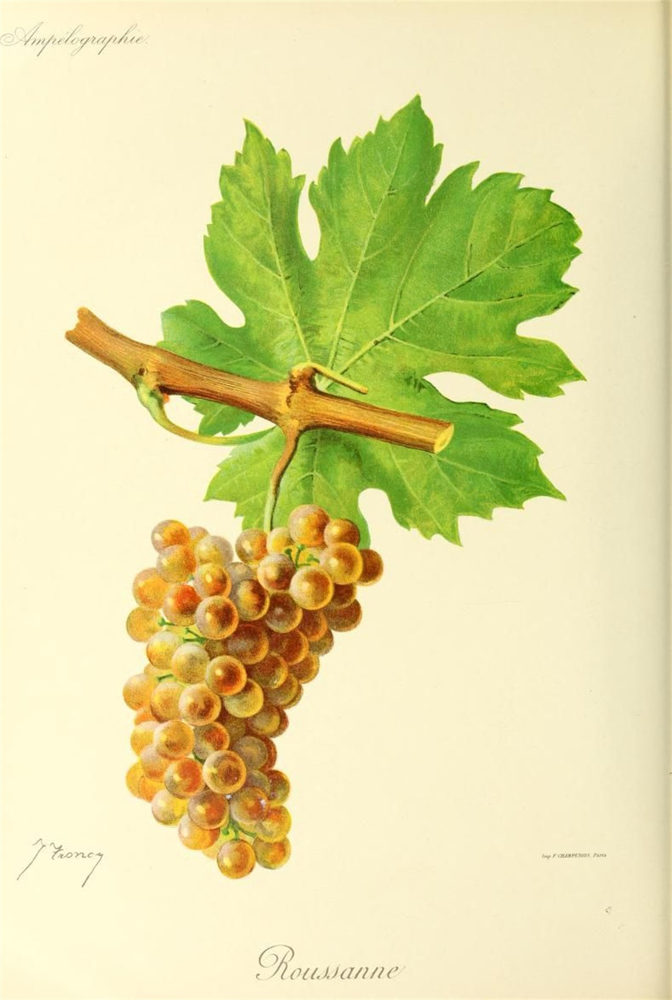

# 胡珊

北罗讷河谷的白葡萄，带白花、杏仁、蜂蜜与草药香气，酸度比玛珊高、产量低；常与玛珊混酿，也在萨伏依与朗格多克种植。

图：Roussanne：Roussanne（Wikimedia Commons）。图片：Jules Troncy，Public domain，via Wikimedia Commons（[原图页面](https://commons.wikimedia.org/wiki/File:Roussanne.jpg)）。

## 定义与命名

胡珊（Roussanne）是北罗讷河谷的经典白葡萄品种，名称被认为来自法语 roux（红褐），指成熟果粒表面带斑点的金褐色外观。它在萨伏依当地名为 Bergeron，伊泽尔省称 Fromental 或 Fromentau，其他同义词还有 Barbin、Martin Cot 与 Petite Roussette。酒标上出现 Bergeron 时，指的通常就是萨伏依 Chignin-Bergeron 产区的同一品种。

它与长期混酿伙伴玛珊（Marsanne）有基因上的亲本—后代关系，但两者栽培性格差别明显：玛珊更 hardy、产量高、结构宽，胡珊香气更细、更难伺候。把胡珊当成固定风味标签会失真，它的表现随地块成熟度、混酿比例与桶陈方式变化很大，稳定的结构特征是晚熟、高酸潜力与芳香强度。

## 起源与传播

品种最可能起源于北罗讷河谷，18 世纪晚期才有最早的文字记载。基因证据显示它与玛珊存在亲本—后代关系，具体哪一方为亲本仍有讨论余地。历史上它在罗讷河谷北部的 Hermitage、Saint-Joseph、Crozes-Hermitage 与 Saint-Péray 扎根，Saint-Péray 同时用它做静止白与起泡酒；南部罗讷河谷的 Châteauneuf-du-Pape 白葡萄酒允许胡珊，却不允许玛珊。

2010 年全球种植面积约 1,746 公顷，几乎全部集中在法国，且自 2000 年以来法国面积翻了一倍。出了罗讷河谷，它在萨伏依以 Bergeron 之名进入 Chignin-Bergeron 子产区，在朗格多克、鲁西永与普罗旺斯常与霞多丽、玛珊、维蒙蒂诺混酿；意大利利古里亚与托斯卡纳的 Montecarlo Bianco 允许使用。海外方面，澳大利亚维多利亚早在 1882 年就有胡珊种植记录，今天维多利亚与南澳有数十家生产商；美国加州中央海岸与尤巴县、以色列戈兰高地、南非也有少量地块。

## 植物学与栽培

胡珊是出了名难种的品种。萌芽期居中，成熟期中晚，在白葡萄里偏晚；长势中等但产量不稳，对灰腐、白粉病和风害都敏感，冷凉气候下常常难以充分成熟。采收时机是关键：欠熟时酸度尖锐、香气青涩，过熟则酒精度容易突破 14%，酸度回落、香气发闷。

它需要温暖地块、长日照与避风坡地才能把芳香与糖分同时养足。叶幕管理、疏果与病害防治比一般白葡萄更费工；因为产量低且不稳定，种植者在北罗讷河谷更倾向于种更省心的玛珊，这也是胡珊面积长期小于伙伴品种的原因。好地块上的胡珊能长出紧致酸度与精细花香，平地或低洼地块则容易单薄松散。

## 风格与味觉

胡珊酒体中等至饱满，酸度清亮、质地有纹理，典型香气包括桃、榅桲、杏花、青柠皮、梨与金银花，伴随茶叶与干草类草本气息。年轻时花香与柑橘主导，陈年后发展出蜂蜜、黄油糖霜、蜂蜡、坚果与干果层次。与玛珊混酿时，胡珊提供芳香强度与嗅觉层次，玛珊补足结构、酒体与蜡质质地；两者搭配的白葡萄酒通常有十年以上陈年潜力。

酿造上它常经橡木桶发酵或带酒泥陈年来增加质地，部分酒庄也用不锈钢罐保留清爽。单一品种胡珊在新世界更常见，罗讷河谷传统上以混酿为主。欠熟采收会显尖锐草本，过熟则酒精感压过香气；发酵温度、桶龄与酒泥接触决定最终是偏清新果香还是偏饱满坚果。判断陈年潜力要看酸度、结构与酒精度平衡，而不是颜色深浅。

## 主要产区与代表酒款

北罗讷河谷是核心：Hermitage、Saint-Joseph、Crozes-Hermitage 的白葡萄酒多为胡珊与玛珊混酿，Saint-Péray 用它做静止与起泡酒。Chapoutier 与 Jaboulet 是 Hermitage 与 Saint-Joseph 一带的代表性大酒庄，出品以玛珊—胡珊混酿为主。南部 Châteauneuf-du-Pape 的 Château Beaucastel Roussanne Vieilles Vignes 是少数以 100% 老藤胡珊酿造的知名酒款，产量很小。

萨伏依的 Chignin-Bergeron 是胡珊在罗讷河谷之外最清爽的表达，当地直接用 Bergeron 名上标。朗格多克与普罗旺斯的地区餐酒里，它常作为芳香成分与其他白葡萄调配。海外方面，加州中央海岸的 Sine Qua Non 出产世界上价位最高的胡珊酒款之一；澳大利亚维多利亚与南澳的酒庄多做单一品种或与玛珊、维欧尼混酿。

## 怎么喝与配餐

中等至饱满的胡珊适合 10–12°C 饮用，温度过低会关闭花香与蜂蜜香，偏高则酒精与坚果感放大。桶陈、质地宽的款可以稍暖，年轻清爽款略凉。杯型用中等肚径白葡萄酒杯即可；年轻酒不必长时间醒酒，开瓶后放几分钟让香气展开。

配餐上，它的质地与酸度适合白肉、家禽、奶油酱料理、烤海鱼与带壳海鲜，杏仁、榛子与草本调味的菜式能呼应酒中的坚果与花香。中等硬度奶酪、芦笋与朝鲜蓟也能搭配。过重油或浓重红肉会压住它的精细香气；辛辣菜式会放大酒精感，选果香更成熟的年份更稳妥。

## 选购与常见误区

常见误读之一，是把胡珊与玛珊当作可互换的同义词。两者常一起出现，但角色不同：胡珊出香、玛珊出骨，混酿比例直接影响酒的宽瘦与香气浓度。另一个误区是只看品种名：北罗讷河谷坡地、萨伏依冷凉山地与新世界温暖海岸的成熟度和酸度差别很大，年份对晚熟品种的表现影响尤其明显。

购买时先分清单一品种还是玛珊混酿，再看产区层级、桶陈方式与年份。胡珊产量低、种植难度高，精品款价位不低；新世界单一品种款风格可能更饱满甜美，与罗讷河谷传统调配并不相同。储存避开高温、强光与震动，开瓶后饱满白葡萄酒可存放两到三天，真空塞能减缓氧化。

## 延伸阅读与另见

理解胡珊最直接的方式，是同年份比较一支 Hermitage 玛珊—胡珊混酿、一支 Chignin-Bergeron 单一品种与一支新世界单品种酒，对照香气、质地与酸度。它与 [rhone](ref:rhone) 产区风土、[marsanne](ref:marsanne) 混酿伙伴、[white-wine](ref:white) 类型划分、[oak-ageing](ref:oak) 桶陈选择以及 [fermentation](ref:fermentation) 工艺都相互关联。

- 相关条目：[rhone](ref:rhone)、[marsanne](ref:marsanne)、[white-wine](ref:white)、[oak-ageing](ref:oak)、[fermentation](ref:fermentation)。

对照阅读：[罗讷河谷](ref:rhone)、[白葡萄酒](ref:white)。

**关键事实。**

| 项目 | 内容 |
| --- | --- |
| 一句话定位 | 北罗讷河谷的白葡萄，带白花、杏仁、蜂蜜与草药香气，酸度比玛珊高、产量低；常与玛珊混酿，也在萨伏依与朗格多克种植 |
| 物种 | Vitis vinifera |
| 代表产区 | 罗讷河谷 |
