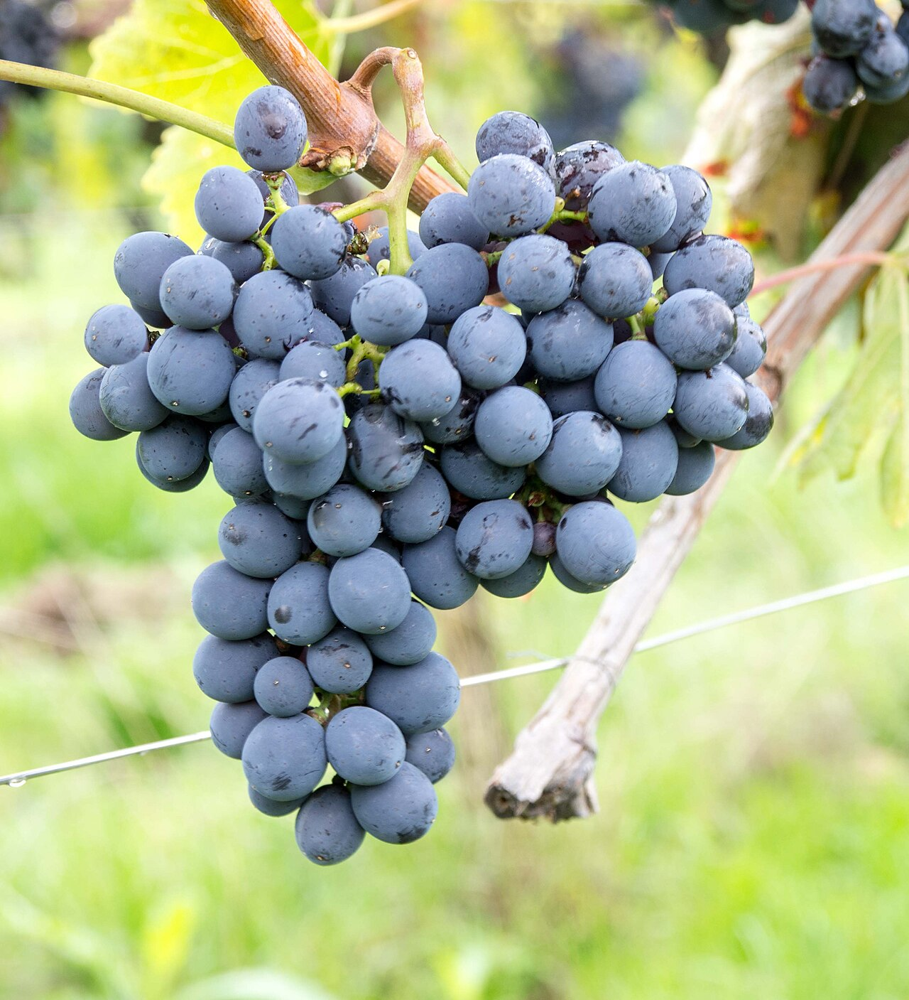

# 桑娇维塞

桑娇维塞是意大利托斯卡纳最具代表性的红葡萄品种，酸度高、单宁中等，带酸樱桃、番茄叶、皮革与泥土气息。它是基安蒂与布鲁奈罗蒙塔希诺的核心品种，也用于酿造桃红葡萄酒。桑娇维塞的克隆差异很大，同一品种在不同产区可以呈现不同风格。

图：桑娇维塞。图片：Please note: This photo can be reproduced. Please quote the source as indicated below: Ursula Brühl, Julius Kühn-Institut (JKI) Bundesforschungsinstitut für Kul，CC BY-SA 4.0，via Wikimedia Commons（[原图页面](https://commons.wikimedia.org/wiki/File:VIVC10680_SANGIOVESE_Cluster_in_the_field_20354.jpg)）。

## 定义与别名

桑娇维塞的英文名是 Sangiovese，中文也译作桑娇维赛。它属于欧洲葡萄 Vitis vinifera，名称来源有不同说法。桑娇维塞不是“意大利的梅洛”，它的酸度更高、果味更偏酸樱桃与草本；把它当作柔顺型品种，会误判它的结构与配餐方式。

桑娇维塞有多个克隆与地方类型，例如 Brunello、Prugnolo Gentile 等。不同克隆在果粒大小、成熟期与香气上存在差异，这也是托斯卡纳不同产区风格差异的原因之一。

## 植物学特征

桑娇维塞果穗中等、果粒较圆，果皮较厚，色素与单宁含量中等。它的芽眼萌动较晚，成熟期偏晚，适合温暖至温和的气候。果皮厚让它对灰霉病有一定抵抗力，但在潮湿年份仍需注意冠层管理。

桑娇维塞的酸度很高，这是它最鲜明的结构特征之一。高酸度让它在配餐时显得清爽，但也要求足够的果味与单宁来平衡。不同克隆与产区的成熟度差异，会改变酸度与果味的比例。

## 主要产区

桑娇维塞的原产地是意大利，托斯卡纳是核心产区。基安蒂、经典基安蒂、布鲁奈罗蒙塔希诺与蒙特普齐亚诺贵族酒都以桑娇维塞为主。意大利其他地区以及美国、澳大利亚、阿根廷也有种植，但托斯卡纳的传统最完整。

托斯卡纳不同子产区的风格差异明显。基安蒂的桑娇维塞通常酸度高、带酸樱桃与草本气息；布鲁奈罗蒙塔希诺则更浓缩、结构更强，常经长时间橡木桶陈酿。产区的海拔、土壤与克隆，比品种名更能解释具体风格。

## 典型风味

桑娇维塞的典型香气包括酸樱桃、红李子、番茄叶、皮革、烟草与泥土。它的酸度高，单宁中等，酒体中等。年轻时以酸樱桃与草本气息为主，经[橡木桶陈年](ref:oak-ageing)后可能增加香草、香料与烟熏气息，陈年后发展出皮革、干果与泥土气息。

桑娇维塞的“番茄叶”气息常被当作辨识特征，但它并非所有酒款都明显。成熟度、克隆与酿造方式都会改变香气表达。评价桑娇维塞时应看酸度是否与果味平衡、单宁是否细腻，以及橡木是否掩盖了品种特征。

## 代表酒款

基安蒂与布鲁奈罗蒙塔希诺是桑娇维塞的两类代表。基安蒂通常更清爽、适合较早饮用；布鲁奈罗则更浓缩、需要更长时间陈年。托斯卡纳也生产以桑娇维塞为主的桃红葡萄酒，[桃红葡萄酒](ref:rose)中的桑娇维塞通常带酸樱桃与花香，风格清爽。

具体酒款的配方与风格会随产区、年份与酒庄选择变化。品种页描述的是桑娇维塞的潜力与限制，酒款页才记录具体酒庄的栽培与酿造决策。

## 栽培要点

桑娇维塞的栽培重点是成熟度与酸度平衡。它成熟偏晚，在冷凉年份可能成熟不足、酸度过高；在温暖年份则可能酸度下降、果味变熟。生产者常通过海拔选择、采收时间与克隆选择来平衡成熟度与结构。

桑娇维塞的产量控制也会影响风味浓度。产量过高时，果味被稀释、单宁显得粗糙；适度控制产量能带来更集中的酸樱桃与草本气息。不同产区的昼夜温差与土壤排水，会改变成熟节奏与酸度保留。

## 常见误区

第一，桑娇维塞就是酸涩的红酒。高酸度需要与果味、单宁和配餐一起理解。

第二，桑娇维塞只能做基安蒂。它也用于布鲁奈罗与桃红葡萄酒。

第三，桑娇维塞越陈越好。陈年效果取决于年份、结构与储存条件。

第四，桑娇维塞的番茄叶味是缺陷。适度的草本气息是品种特征之一。

第五，所有桑娇维塞都一样。克隆、产区与酿造方式会带来明显差异。

桑娇维塞是托斯卡纳的代表品种，酸度高、单宁中等，酸樱桃、番茄叶与泥土气息明显；基安蒂与布鲁奈罗都以它为核心。它有多个克隆与地方类型，颜色、单宁与成熟期并不完全一致；不要把“桑娇维塞”当成单一风味，子产区与混酿比例会显著改变酒体。

对照阅读：[葡萄酒](ref:wine)、[桃红葡萄酒](ref:rose)。

## 延伸阅读

- [葡萄酒](ref:wine)：理解桑娇维塞的分类、酿造与产区框架。
- [红葡萄酒](ref:red-wine)：桑娇维塞的单宁、酸度与陈年结构。
- [桃红葡萄酒](ref:rose)：桑娇维塞在桃红葡萄酒中的用途。
- [橡木桶陈年](ref:oak-ageing)：布鲁奈罗的桶陈传统。

**关键事实。**

| 项目 | 内容 |
| --- | --- |
| 一句话定位 | 意大利托斯卡纳的代表性红葡萄品种，酸度高、单宁中等，带酸樱桃、番茄叶与泥土气息；它是基安蒂与布鲁奈罗的核心品种 |
| 物种 | Vitis vinifera |

**来源与边界。** 本页关于「桑娇维塞」的关键事实，主要由以下来源交叉核对：International Organisation of Vine and Wine (OIV)（品种描述与 Vitis 物种框架）、Oxford University Press（提供关于桑娇维塞的克隆、产区与风格条目；由原条目末尾参考资料迁移，未逐条复核访问日期）、European Union（欧盟葡萄酒产区与标签框架）。价格、批次与状态会变，涉及这些字段时以页面所列来源的最新版本为准。正文为项目自写，来源只作核验，不复制原文。

**并读。** 把「桑娇维塞」与「葡萄酒」、「红葡萄酒」、「桃红葡萄酒」放在一起读时，先确认它们是同一层级还是上下游关系：先确认品种身份与允许产区，再比较成熟期、抗性、克隆与酿造表现。本页负责给出品种的基本坐标，对照条目补上具体案例与差异；读完再回到本页，才能分清哪些差别属于品种本身，哪些只是产地、批次或品牌选择。

**适用边界。** 对「桑娇维塞」而言，品种表现随产区、气候与克隆选择变化；同名品种在不同国家可能指不同材料。

**更新提示。** 「桑娇维塞」最近核对于 2026-11-04；允许产区、克隆与栽培数据会更新，引种前以官方品种目录为准。

**编者注。** 本页把「桑娇维塞」作为品种条目处理：定义、流程与关键数字以正文表格为准，与「葡萄酒」、「红葡萄酒」的差异用对照阅读验证；遇到价格、批次或地址，回到页面所列来源核对。
