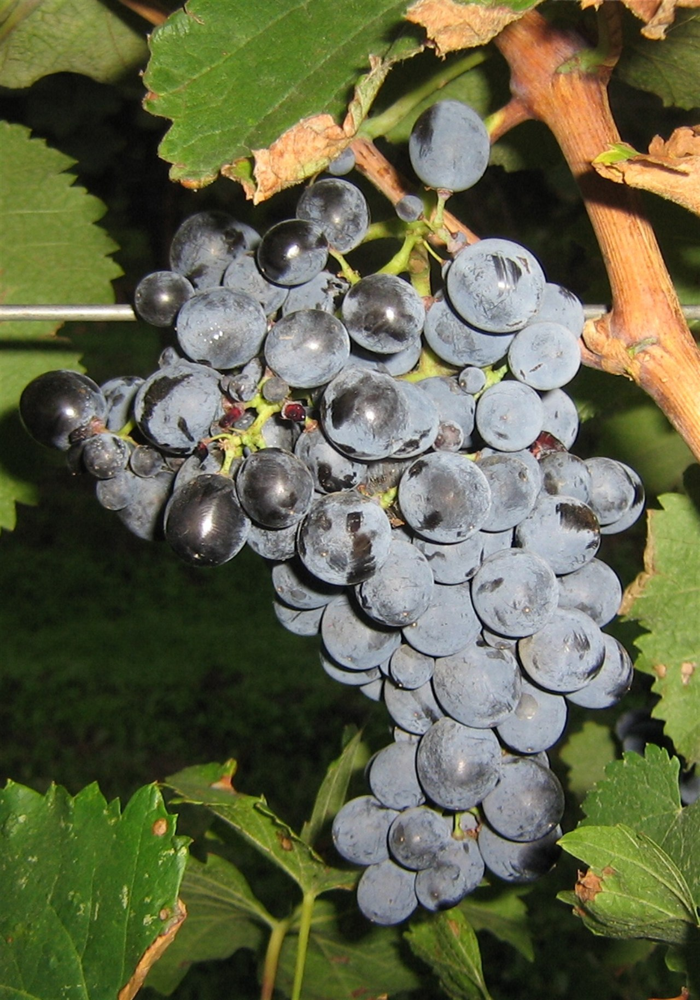

# 萨佩拉维

萨佩拉维是格鲁吉亚最重要的红葡萄，属罕见的染色品种（teinturier），果肉与果皮都带红色色素；酒色深近墨黑，酸度高、单宁扎实，可酿干红、半甜、甜型与加强酒，传统陶罐（qvevri）与欧洲式酿造并存，是格鲁吉亚葡萄酒的国家标志。

图：Saperavi：Saperavibunch（Wikimedia Commons）。图片：Lebowskyclone，CC BY-SA 3.0，via Wikimedia Commons（[原图页面](https://commons.wikimedia.org/wiki/File:Saperavibunch.jpg)）。

## 定义与命名

Saperavi 在格鲁吉亚语里意为“染料、上色之物”，直接指向它红色果肉带来的强染色能力。多数红葡萄的色素只存在于果皮，榨汁后果汁偏浅粉；萨佩拉维的果肉（ pulp ）本身含花青素，压碎后流出的汁液就是饱和的紫红深红，酿成的酒年轻时常常近不透明，这是它最直观的识别特征。

作为 Vitis vinifera 古老品种，萨佩拉维在格鲁吉亚有大量地方类型与克隆：一百五十多年来的 ampelography 研究讨论过至少 17 个变异类型，名称各有地方色彩。它与高加索地区其他古老实生苗的亲缘关系尚未由基因研究完全厘清，酒标上的 Saperavi 通常不标注克隆，地块、海拔与酿造方式对风格的影响更直接（[terroir](ref:terroir)）。

## 起源与传播

萨佩拉维是格鲁吉亚本土品种，栽培史与该国八千年酿酒传统交织在一起，核心产区在东部卡赫季（Kakheti），Mukuzani、Khashmi、Anaga、Kardenakhi、Shilda、Napareuli、Kondoli 与 Tsinandali 等村庄都以它闻名。它耐寒性极强，可承受低至 -27°C 的霜冻，适合高海拔与内陆大陆性气候，成熟期偏晚，从萌芽到完全成熟约需 160 天。

从高加索地区向外，萨佩拉维传入摩尔多瓦、乌克兰、保加利亚、俄罗斯、阿塞拜疆与亚美尼亚；近年又到了美国纽约 Finger Lakes（1958 年由 Konstantin Frank 首次引种）、澳大利亚（1990 年代起立足）与其他新世界产区。按行业统计，全球萨佩拉维葡萄园约 6,500 公顷，其中约 73% 在格鲁吉亚；俄罗斯约 716 公顷、摩尔多瓦约 573 公顷、哈萨克斯坦约 428 公顷，是海外面积较大的几个国家。

格鲁吉亚国内，它是种植最广的红葡萄：国家葡萄酒机构统计全国超过 4,000 公顷，约占全部葡萄种植面积的 10%，在全国葡萄酒产量中占比更高。20 世纪苏联时期，它大量用于调配与批量红酒；独立以后，精品酒庄重新把单一园、陶罐陈酿与老藤地块推到台前。

## 植物学与栽培

果串中等，果粒中等偏小、皮厚，果肉深红；植株长势强健，抗病与耐寒能力在红葡萄里属于强项。晚熟要求足够长的生长季，在过凉或过晚采收的地块容易保留草本与青梗味；温暖、深色土壤的地块果味更黑、酒精度更高，受山地凉风影响的地块则以红果为主、口感更优雅，香气对风土相当敏感。

栽培上需要控制产量以保证浓缩度：低产老藤地块的果味、酸度与单宁平衡最好，放任高产则颜色虽深，果味与结构却松散。叶幕管理、疏果与采收时机决定果实是否达到理想成熟度；卡赫季半干旱气候下，降雨少、日照足，传统地块多靠自然降水与山地灌溉结合。

## 风格与味觉

典型萨佩拉维呈深墨红到石榴黑，香气以黑莓、黑醋栗、酸樱桃、李子、甘草、烟草、烤肉、巧克力与香料为主；口感多汁、单宁扎实，酸度可观，酒精度通常在 12–14% 之间。凉爽地块偏红果与优雅，温暖地块偏黑果、肉感与更高酒精度，风格跨度很大。

酿造分两条路线。传统 qvevri 方式把葡萄（常带整串）放入埋入地下的大型陶罐发酵陈酿，果皮与果肉长时间接触，酒款带泥土、干草、坚果与矿物感，单宁与酸度更突出，优质陶罐酒可陈年 40–50 年。欧洲式方式在不锈钢罐或橡木桶中发酵，可用法国、美国、斯拉沃尼亚、俄罗斯或匈牙利橡木陈酿，果香更干净，结构由桶陈与浸渍共同塑造（[oak-ageing](ref:oak)）。

按甜度与风格，它可以是干红、半甜、甜型或加强酒：Mukuzani 是干型代表，法规要求采收糖度不低于 19%，完全发酵至干，单产上限 10 吨/公顷，每吨葡萄出酒不超过 650 升，传统标准为橡木桶陈酿至少三年；Kindzmarauli 是 Kvareli 地区的天然半甜红，1942 年开始生产，100% 萨佩拉维，酒精度 12–13.5%；Akhasheni 则是 Gurjaani 一带的半甜类型。普通装瓶可瓶陈 10 年以上，优质地块有 15–20 年甚至更长的演化空间（[vintage](ref:vintage)）。

## 主要产区与代表酒款

卡赫季是核心：Mukuzani 子区以干型、橡木陈酿的扎实风格著称；Kvareli 的 Duruji 河谷黑色页岩土壤孕育 Kindzmarauli 半甜红；Tsinandali、Napareuli、Khashmi 等村庄各有单一园地块。格鲁吉亚其他产区以及摩尔多瓦、俄罗斯、乌克兰等海外产区也有种植，但风格参照仍以卡赫季为准。

代表生产者包括：Pheasant's Tears 在 Tibaani 用 4 个克隆、约 25 年树龄、4 公顷老藤园做陶罐萨佩拉维，70% 去梗破碎、30% 整串，半碳浸渍减轻萃取、增加细腻度，建议 16–18°C 侍酒、醒酒，陈年 5–15 年；Tsinandali Estate 与 Teliani Valley 是国内大型参照；Kindzmarauli Marani 以半甜经典款见长；Tbilvino、Château Mukhrani 的珍藏款、Chelti 与 Orilo 的 Khashmi 单一园也是常被引用的名字。

市场定位上，萨佩拉维从日常餐酒到收藏级陶罐款价格带很宽；同一名下，不锈钢年轻款与低产老藤、长陈酿款在浓度、单宁与陈年潜力上差距明显，生产者、地块与法规等级比品种名更能预测杯中风格。它常被拿来与赤霞珠比较结构与陈年能力，但果皮色素与高加索风土带来的黑果、肉感与香料是独立的表达（[cabernet-sauvignon](ref:cabernet)）。

## 怎么喝与配餐

干型与珍藏萨佩拉维侍酒温度约 16–18°C；半甜款可略凉，约 14–16°C。杯型用大肚红酒杯聚拢香气；年轻酒与陶罐款提前 20–30 分钟醒酒，单宁会更柔、果香与烟草气息展开。温度过高会让酒精与单宁显得粗糙，过冷则压住香料与矿物层次。

配餐是它的强项：烤牛排、羊肉、排骨、炖肉、红烧牛肉与野味都接得住它的酸度与单宁；陈年奶酪、番茄肉酱意面与披萨也搭配得当。半甜版本可配辣味或微甜的菜式，平衡单宁的干涩；清淡海鲜与白肉通常压不住它的结构，不是首选搭配。

## 选购与常见误区

误区一：把染色品种当成颜色深的普通红葡萄。萨佩拉维的色素在果肉里，颜色来自品种本身，不是后期浸泡或调色；它的深色伴随高酸与扎实单宁，不能只按颜色判断酒体轻重。误区二：以为萨佩拉维只有干红。从干型到半甜、甜型与加强酒都有，甜度风格由产区法规与酿造决定，买酒时先看是 Mukuzani 干型、Kindzmarauli 半甜还是其他类型。

误区三：认为高单宁高酸的红酒必须趁年轻喝掉。恰恰相反，完整酸度与单宁结构是它长期陈年的基础，优质萨佩拉维瓶陈十几年后会从黑果转向皮革、无花果干与香料；判断时看地块产量、陈酿方式与年份，而不是品种的普遍印象。选购留意装瓶时间、储存与运输温度，受热或长期库存的酒会失去黑果香气，单宁也显得干涩发柴。

## 延伸阅读与另见

对照练习：把一款 Mukuzani 橡木干红与一款 qvevri 陶罐萨佩拉维同场比较，记录果香、泥土矿物与单宁质地的差别；再对比 Kindzmarauli 半甜与干型版本，看清残留糖对酸度与结构表达的影响。

萨佩拉维的面积、克隆与海外种植仍随品种调查更新，正式引用以格鲁吉亚国家葡萄酒机构、VIVC 登记与各产区法规为准。

- 相关条目：[red-wine](ref:red)、[terroir](ref:terroir)、[oak-ageing](ref:oak)、[vintage](ref:vintage)、[cabernet-sauvignon](ref:cabernet)。

**关键事实。**

| 项目 | 内容 |
| --- | --- |
| 一句话定位 | 格鲁吉亚卡赫季的红葡萄，以红肉果皮（teinturier）带来的深色与高酸著称；可酿干红、半甜、甜型与加强酒，是格鲁吉亚葡萄酒的国家标志 |
| 物种 | Vitis vinifera |

**来源与边界。** 本页关于「萨佩拉维」的关键事实，主要由以下来源交叉核对：Julius Kühn-Institut（品种名称、同义词、起源与全球分布）、OIV（葡萄品种与栽培框架）、USDA ARS（植物分类、种质与栽培信息）等 8 条来源。价格、批次与状态会变，涉及这些字段时以页面所列来源的最新版本为准。正文为项目自写，来源只作核验，不复制原文。
