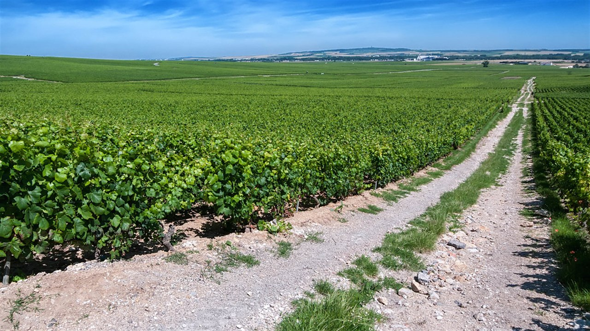

# 长相思

长相思是香气最外放的白葡萄品种之一。它的果皮较薄、酸度较高，常带有柑橘、青草、醋栗与热带水果气息；在凉爽产区表现清爽，在温暖产区则更偏热带水果。它既可以单独酿造，也常与赛美蓉等品种混酿。

图：长相思相关实景照片。图片：Geolina163 + 1971markus，CC BY-SA 4.0，via Wikimedia Commons（[原图页面](https://commons.wikimedia.org/wiki/File:HBLA_Klosterneuburg_Sauvignon_Blanc_2.jpg)）。

## 定义与别名

长相思的英文名是 Sauvignon Blanc，中文也译作白苏维浓。它属于欧洲葡萄 Vitis vinifera，与品丽珠、赤霞珠有亲缘关系。长相思的名称在中文里带有文学色彩，但它与“相思”并无植物学关联，只是译名。

长相思与赛美蓉、密斯卡岱的混酿在波尔多很常见，用于平衡香气与酒体。把长相思当作只能做“青草味白葡萄酒”的品种，会忽略它在混酿与不同产区中的多样性。

## 植物学特征

长相思果穗较小、果粒紧凑，果皮薄，酸度较高。它的芽眼萌动较晚，成熟期中等，适合凉爽至温和的气候。皮薄使它对灰霉病较敏感，采收期遇雨容易影响果实质量。

长相思的香气与硫化物代谢密切相关。不同克隆、酵母与酿造温度会改变香气表达：低温发酵与惰性容器更利于保留柑橘与青草气息，橡木桶发酵则会增加奶油与香料层次。

## 主要产区

长相思的原产地是法国，卢瓦尔河谷与波尔多是两个重要产区。卢瓦尔的桑塞尔与普伊-富美以清爽、矿物感强的长相思著称；波尔多则常用长相思与赛美蓉混酿，生产干白与甜白。新西兰马尔堡、澳大利亚、智利与美国也有重要种植。

不同产区的风格差异明显。[法国](ref:france)凉爽产区的长相思酸度高、柑橘与青草气息清晰；新西兰马尔堡则常带更外放的醋栗、百香果与青椒气息；温暖产区的果味更熟，酸度较低。产区气候与采收时间，比品种名更能解释具体风格。

## 典型风味

长相思的典型香气包括柠檬、青柠、葡萄柚、青草、醋栗、青椒与百香果。它的酸度高，酒体偏轻到中等，通常不适合长期陈年，但优质酒款可以在瓶中发展出蜂蜜与坚果气息。

“青草味”常被当作长相思的标志，但它并不是唯一风味。过熟的果实会失去青草气息，转向热带水果；过生的果实则可能过酸、带有未成熟的青涩感。评价长相思时应看香气的纯净度、酸度的平衡与余味的长度。

## 代表酒款

[波尔多](ref:bordeaux)的干白常以长相思与赛美蓉混酿，长相思提供香气与酸度，赛美蓉补充酒体与圆润感。卢瓦尔的桑塞尔与普伊-富美则以单一长相思展现矿物与柑橘风格。读者可以把这两类酒款当作理解长相思“混酿”与“单一品种”两种路线的样本。

具体酒款的配方与酿造方式会随酒庄与年份变化。品种页描述的是长相思的香气潜力与结构特征，酒款页才记录具体酒庄的决策。

## 栽培要点

长相思的栽培重点是成熟度与香气平衡。采收过早，酸度过高、香气偏青；采收过晚，青草气息消失、果味变熟。生产者常通过多次采样与分批采收来寻找最佳窗口。

长相思对灰霉病较敏感，潮湿年份需要加强冠层通风与病害管理。产量控制也会影响香气浓度；产量过高时，香气被稀释，酒体显得单薄。不同产区的昼夜温差与水分条件，会改变成熟节奏与酸度保留。

## 常见误区

第一，长相思只有青草味。不同产区、克隆与酿造方式会带来柑橘、热带水果与矿物感。

第二，长相思越酸越好。酸度需要与酒体、香气与余味平衡。

第三，长相思都适合长期陈年。多数长相思适合年轻时饮用，少数优质酒款可以短期陈年。

第四，长相思只能单独酿造。波尔多等产区常与赛美蓉混酿。

第五，长相思与赤霞珠没有关系。二者在亲缘与香气代谢上有联系。

长相思香气外放，柑橘、青草、醋栗与热带水果气息随产区与成熟度变化；高酸、适合凉爽产区，在卢瓦尔、波尔多与新西兰表现各异。它能做成干型、甜型或起泡酒，也能因酿造与酵母选择呈现不同果香；不要把“长相思”固定成一种青草味。卢瓦尔的学习重点在火石与矿物感，波尔多常与赛美蓉混酿，新西兰则更强调热带果香；这些差异来自气候、成熟度与酵母，而不是品种名的固定含义。先看产区与酿造，再判断风格。

对照阅读：[葡萄酒](ref:wine)、[波尔多](ref:bordeaux)。

## 延伸阅读

- [葡萄酒](ref:wine)：理解长相思的分类、酿造与产区框架。
- [白葡萄酒](ref:white-wine)：白葡萄酒的酿造与风格基础。
- [波尔多](ref:bordeaux)：长相思与赛美蓉混酿的产区背景。
- [法国](ref:france)：卢瓦尔与波尔多两大产区的国家框架。

**关键事实。**

| 项目 | 内容 |
| --- | --- |
| 一句话定位 | 香气外放的白葡萄品种，以柑橘、青草、醋栗与热带水果气息著称；酸度高、适合凉爽产区，在卢瓦尔、波尔多与新西兰表现各异 |
| 物种 | Vitis vinifera |
| 代表产区 | 波尔多、法国 |

**来源与边界。** 本页关于「长相思」的关键事实，主要由以下来源交叉核对：International Organisation of Vine and Wine (OIV)（品种描述与 Vitis 物种框架）、Oxford University Press（提供关于长相思的香气、产区与酿造条目；由原条目末尾参考资料迁移，未逐条复核访问日期）、INAO（法国原产地命名制度中品种与产区的对应关系）。价格、批次与状态会变，涉及这些字段时以页面所列来源的最新版本为准。正文为项目自写，来源只作核验，不复制原文。

**并读。** 把「长相思」与「葡萄酒」、「白葡萄酒」、「波尔多」放在一起读时，先确认它们是同一层级还是上下游关系：先确认品种身份与允许产区，再比较成熟期、抗性、克隆与酿造表现。本页负责给出品种的基本坐标，对照条目补上具体案例与差异；读完再回到本页，才能分清哪些差别属于品种本身，哪些只是产地、批次或品牌选择。

**适用边界。** 对「长相思」而言，品种表现随产区、气候与克隆选择变化；同名品种在不同国家可能指不同材料。

**更新提示。** 「长相思」最近核对于 2026-11-04；允许产区、克隆与栽培数据会更新，引种前以官方品种目录为准。

**编者注。** 本页把「长相思」作为品种条目处理：定义、流程与关键数字以正文表格为准，与「葡萄酒」、「白葡萄酒」的差异用对照阅读验证；遇到价格、批次或地址，回到页面所列来源核对。

## 相关图像

图：Moët & Chandon vineyards in Verzenay, Champagne, France。摄影：Mustang Joe，CC0，来自 Flickr / Openverse。。图片：Mustang Joe，CC0，via Wikimedia Commons（[原图页面](https://www.flickr.com/photos/63234672@N04/13180177073)）。关联图像：长相思。
