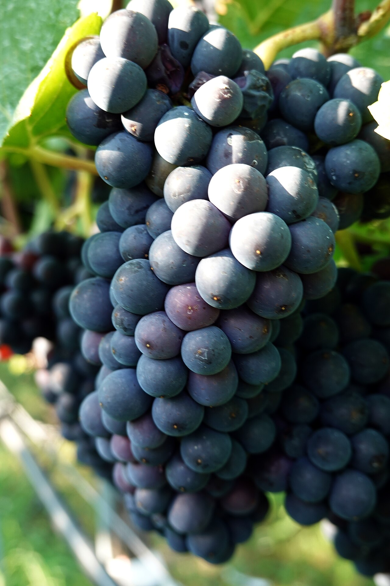

# 圣劳伦特

圣劳伦特（St. Laurent，德语 Sankt Laurent，捷克语 Svatovavřinecké）是中欧冷凉气候下的深色红葡萄，核心产区在奥地利 Niederösterreich、Burgenland 与捷克摩拉维亚。它香气浓郁、酒色深，酸度明亮、单宁中等偏上，年轻时紧涩，陈年后转为丝绒般圆润，带黑樱桃、酸樱桃、黑莓、李子、紫罗兰与香料泥土气息，风格常被放在黑皮诺与蓝弗兰克之间比较（ref:pinot）。

读这个品种要先理解它在葡萄园里的“难养”：长势不稳、皮薄易感病、需要石质土壤与精细冠层管理，也正因为如此，优质酒款带有鲜明地块表达。理解了栽培难度，再看它在奥地利温泉区、布尔根兰湖畔与捷克摩拉维亚的不同轮廓，比单看品种名更可靠。

图：St. Laurent：HBLA Klosterneuburg St Laurent 1（Wikimedia Commons）。图片：Geolina163 + 1971markus，CC BY-SA 4.0，via Wikimedia Commons（[原图页面](https://commons.wikimedia.org/wiki/File:HBLA_Klosterneuburg_St_Laurent_1.jpg)）。

## 定义与命名

圣劳伦特学名为 Vitis vinifera，VIVC 编号 10470，黑皮红葡萄。德语名 Sankt Laurent，法语区作 Saint Laurent；捷克语 Svatovavřinecké，匈牙利语 Szent Lőrinc。同义词包括 Blauer Saint Laurent、Laurenzitraube、Laurenztraube、Lorentstraube、Lorenztraube、Lovrenac Crni、Lovrijenac、Saint Laurent noir、Saint Lorentz、Schwarzer Lorenztraube、Sentlovrenka 等。

名称来自圣劳伦斯瞻礼日（8 月 10 日），大致对应葡萄开始转色的时节，与法国名为 Saint-Laurent 的村庄并无直接关系。辨识上，它叶片中等、三角或五边形，果穗中等、圆锥形、紧密，果粒蓝黑、椭圆形、皮薄；发芽偏早，易受春季霜冻，皮薄对霜霉、白粉与灰霉都较敏感。DNA 分析显示它与黑皮诺同属 Pinot 家族，可能是黑皮诺与另一亲本（有说法为 Savagnin）的后代，第二亲本尚未最终确认；这一亲缘结论仍在讨论中（ref:terroir）。

## 起源与传播

品种起源尚无定论，最可能来自奥地利，十九世纪已有文献记录于维也纳以南的温泉区（Thermenregion）；另有假说认为它经阿尔萨斯、德国传入中欧。它在奥地利是第三大红葡萄品种，2008 年种植约 794 公顷，2000 年代随奥地利红酒趋势扩张；捷克是种植面积最大的国家，称 Svatovavřinecké，占全国葡萄园约 6%、约 1,053 公顷，集中在摩拉维亚，1941 年进入捷克国家品种登记。

此外，斯洛伐克、德国普法尔茨、匈牙利有少量种植，加拿大、新西兰与加州处于试验阶段。作为亲本，它在 1922 年与蓝弗兰克杂交育成奥地利最广植的红品种茨威格（Zweigelt）；1960 年又与蓝弗兰克育成 André，1980 年进入捷克国家登记（ref:blaufrankisch）。

## 植物学与栽培

植株长势旺，叶片中等、三角或五边形；果穗中等、圆锥形、紧密，果粒蓝黑、椭圆形，皮薄。发芽偏早，易受春季霜冻；皮薄对霜霉、白粉与灰霉都较敏感，需要通风良好的地块与精细冠层管理。产量不稳，采收筛选严格，石质深层土比肥沃黏土更能压制长势、集中果实。

栽培上的核心是控势与叶果平衡：土壤过肥则枝条徒长、果实松散；遮阴加重病害、降低酸度。修剪、引缚、覆盖作物竞争水肥与疏叶都围绕这条平衡线调整。冷凉夜间微风与排水坡地帮助保留酸度与香气；这是一个需要葡萄园耐心的品种，高产地块很难做出有层次的酒。

## 风格与味觉

典型圣劳伦特呈深紫红或石榴红，香气馥郁，开场是黑樱桃、酸樱桃、黑莓、黑加仑与李子，接紫罗兰、玫瑰、覆盆子、小豆蔻、烟熏、香料与森林地表，陈年后发展出皮革、烟草、石墨与黑莓丛气息。口感中等酒体，酸度明亮、单宁中等偏上，年轻时紧涩有结构，瓶陈后单宁变圆润丝绒；余味带咸鲜与苦杏仁。

酿造上，它常用大桶或旧橡木桶陈酿，保留果香与香料；新桶比例过高会压住细腻的 Pinot 式香气。部分酒庄做整串发酵增加结构，多数以去梗发酵为主以保持干净果香。普通款适合年轻时饮用，奥地利优质老藤与单一园版本具备数年到十余年瓶陈空间，长期陈年后才展开经典黑皮诺式的次级香气（ref:oak）。

## 主要产区与代表酒款

奥地利产区集中在维也纳以南的 Thermenregion、布尔根兰的 Neusiedlersee 周边与 Mittelburgenland、Carnuntum、Weinviertel 与维也纳本地。Thermenregion 的 Johanneshof Reinisch 是该品种的标杆，Michael Reinisch 出品基础款与 Holzspur Grand Reserve、Frauenfeld 等单一园酒款；同产区 Stift Klosterneuburg 在 Niederösterreich 与温泉区都有 St. Laurent 出品。布尔根兰代表有 Rosi Schuster、Umathum、Zantho、Keringer、Juris；Niederösterreich 一侧有 R & A Pfaffl、Schloss Gobelsburg、Hans & Philipp Grassl，Carnuntum 的 Johannes Trapl 也以细腻风格见长。

捷克摩拉维亚的 Svatovavřinecké 是当地最主要的红品种，常酿多汁果香的日常红酒，也用于圣马丁新酒；风格比奥地利版本更柔和、酸度随陈酿变圆润。德国普法尔茨与斯洛伐克有少量地块，规模与品牌认知都有限。

## 怎么喝与配餐

圣劳伦特建议略微冰镇，饮用温度约 14–17 °C；年轻果香款偏低，结构集中的陈年款略高。杯子用勃艮第式红酒杯，聚拢 Pinot 式的花香与果香；顶级款开瓶后可短时间醒酒。

搭配上，它适合炖牛肉、红烧红肉、野味、烤鹅或烤鸭、风味浓郁的硬奶酪与腌肉前菜；番茄酱汁炖菜、汉堡与香辣鸡翅也能接上它的咸鲜香料感。清淡海鲜与甜味甜点与它的单宁和酸度不搭。在奥地利本地餐桌，它常出现在野味、烤红肉与山地硬奶酪旁边；摩拉维亚的多汁日常款更配烤肉、香肠与家乡炖菜。年轻果香款适合煎烤类，结构集中的陈年款则能承接浓酱与野味。

## 选购与常见误区

第一个误区是把它直接等同于黑皮诺：两者同属 Pinot 家族，但圣劳伦特颜色更深、单宁更有结构，并非黑皮诺克隆。第二个误区是以为它只能做轻红酒：优质奥地利版本单宁扎实、有陈年潜力，介于黑皮诺与蓝弗兰克之间。第三个误区是只看品种名，不读产区与酒庄：同一品种在捷克日常款与奥地利单一园之间，结构与陈酿方向差距明显。

看酒标先分清国家与产区、是日常款还是 Reserve/单一园、年份与酒精度。年轻款三五年内饮用，陈年款可长期瓶陈；储存平放、避光、远离温度波动。它在海外属于小众中欧品种，购买时留意进口渠道与储存条件。

相关条目：[蓝弗兰克](ref:blaufrankisch)。

## 延伸阅读与另见

- 相关条目：[pinot-noir](ref:pinot)、[blaufrankisch](ref:blaufrankisch)、[red-wine](ref:red)、[terroir](ref:terroir)、[oak-ageing](ref:oak)。
- 想比较两地风格，可选同一年份一款奥地利 Thermenregion 与一款捷克摩拉维亚 Svatovavřinecké，对比果香浓度、单宁粗细与咸鲜余味。

对照阅读：[黑皮诺](ref:pinot)、[红葡萄酒](ref:red)。

**关键事实。**

| 项目 | 内容 |
| --- | --- |
| 一句话定位 | 中欧的红葡萄，与黑皮诺同属 Pinot 家族；酒色深、酸度明亮、单宁中等偏上，年轻时紧涩、陈年后圆润，带黑樱桃、黑莓、香料与泥土，风格介于黑皮诺与蓝弗兰克之间 |
| 物种 | Vitis vinifera |
