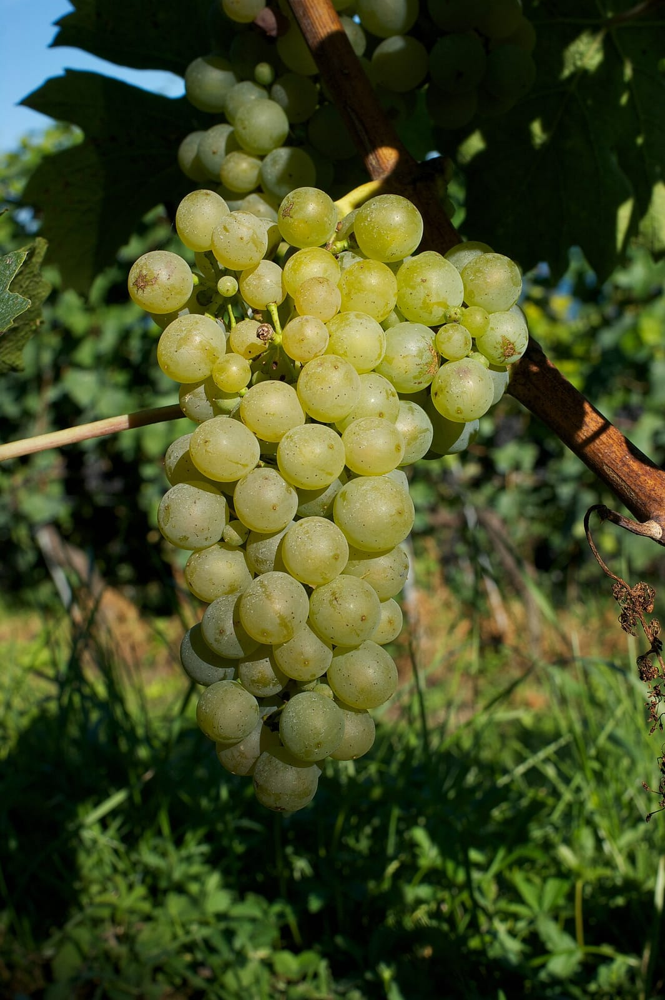
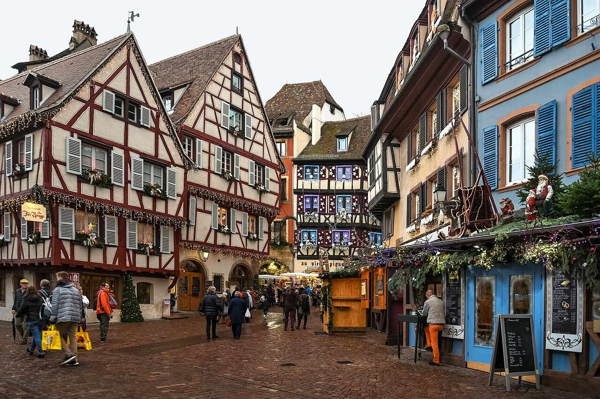

# 西万尼

原产中欧的白葡萄，在阿尔萨斯、德国与奥地利种植；酒体中等、酸度中高，带青苹果、白花、草药与矿物，常被低估。

图：Sylvaner：Cépages du Vully Riesling Sylvaner 2（Wikimedia Commons）。图片：Chandres，CC BY-SA 3.0，via Wikimedia Commons（[原图页面](https://commons.wikimedia.org/wiki/File:C%C3%A9pages_du_Vully_Riesling_Sylvaner_2.jpg)）。

## 定义与命名

西万尼（Sylvaner）在德国官方名录里写作 Grüner Silvaner，书面拼写 Silvaner 同样常见；旧资料还留下 Gros-Rhin、Johannisberger、Sylvaner verde 等同义词。它属于 Vitis vinifera 鲜食兼酿酒白葡萄，名称常被与拉丁语 silva（森林）联系起来，但现代 ampelography 并不据此认定它与野生葡萄有直接亲缘。酒标上同时出现 Sylvaner 与 Silvaner 时，通常只是拼写习惯差异，不必当成两个品种。

读这个品种时，需要把三层信息分开：植物学上的亲本与成熟节奏、产区法规允许的混酿与甜度、市场上被简化的中性印象。西万尼的名声长期被"高产、平淡"四个字概括，但这更多是过去产量失控留下的结果，而不是品种本身的上限。

## 起源与传播

DNA 指纹分析显示，西万尼是 Traminer 与名为 Österreichisch-Weiß（奥地利白）的古老品种的自然杂交后代，由此推断它起源于奥地利帝国一带，文献上也有特兰西瓦尼亚起源的旧说。三十年战争之后，葡萄从奥地利传入德国：现存最早记录是 1659 年 4 月 5 日，弗兰肯 Castell 庄园的管事购入 25 株西万尼，次日栽在 Schlossberg 山下的 Reitsteig 葡萄园；1665 年的 Ebrach 修道院文件也提到了这个品种，1658 至 1686 年在任的修道院院长 Alberich Degen 是早期推广者之一。德国因此在 2009 年纪念西万尼传入 350 周年。

二战以后，西万尼在德国与阿尔萨斯被大面积推广：1960 至 1970 年代，它一度占德国葡萄园面积的约 30%、占阿尔萨斯的约 25%，并在 1970 年前是德国种植最广的白葡萄，直到被 Müller-Thurgau 超过。相当一部分果实进入 Liebfraumilch 这类半甜混酿，产量过剩与口味变化压低了它的声誉，许多老藤被拔除；法国西南以外的阿尔萨斯因为一直以干白方式酿造，保留了更多评价。今天德国约有 5,000 公顷西万尼，占全国葡萄园面积约 4.6%；弗兰肯的种植比例最高，达 24.5%，而面积最大的地块实际在莱茵黑森。

## 植物学与栽培

西万尼长势旺盛、萌芽与成熟偏早，果粒中等、果皮偏薄，天然能达到较高的糖度，同时保留中高酸度。枝条活力强是一把双刃剑：放任不管，产量上来后果味被稀释，香气显得空泛；严格控产之后，地块的矿物、土壤与草本细节才显露出来。它不像雷司令那样以强烈果香见长，更像一块承接风土的空白画布，因此地块选择与修剪力度对成品风格影响很大。

栽培上的主要工作围绕控产与保酸展开。居由式修剪、疏果与限制叶幕厚度，是把糖分、酸度与香气收回到平衡区间的常规手段；花期与成熟期的降雨、霜冻在中欧大陆性气候下仍是风险点。阿尔萨斯与弗兰肯的好地块多位于坡地，排水快、日照足，西万尼在这种条件下能长出比平地高产款更集中的结构。

## 风格与味觉

典型西万尼呈浅金黄至淡黄绿色，香气以青苹果、梨、白花、接骨木花与干草药为主，伴随淡淡的矿物与土壤气息；酒体中等，酸度清晰但不尖锐，余味常带一点草本苦感。弗兰肯的款通常矿物感更重、口感更扎实，阿尔萨斯的款果香更开放、酸度更明快；德国部分地块也用它做晚收或甜型酒，靠高酸平衡残糖。

酿造方式会明显改变走向：不锈钢罐发酵突出清爽与果香，大桶或旧桶发酵增加质地与坚果感；与雷司令、Elbling 混酿可以补足香气骨架，单一品种酒则更能看出地块差异。年轻酒以果味与草本为主，条件好的年份可以放数年，逐渐出现蜂蜜、坚果与干梨的三层香气。判断陈年潜力要看酸度、结构与酒精度，而不是颜色深浅。

## 主要产区与代表酒款

弗兰肯是德国西万尼的核心阵地，传统 Bocksbeutel 扁圆瓶几乎成了它的视觉标志。Juliusspital 位于维尔茨堡，始建于 1576 年，在 Würzburger Stein 等地块种有西万尼，风格矿物、咸鲜而有厚度；Bürgerspital zum Heiligen Geist 创立于 1319 年，同样以维尔茨堡老藤西万尼著称；Castell 的 Fürstlich Castell'sches Domaenenamt 正是 1659 年最早记载种植地的后裔庄园，Rainer Sauer 等 VDP 庄园也在弗兰肯持续产出单一园西万尼。

阿尔萨斯方面，西万尼在 2006 年才被纳入阿尔萨斯特级园允许品种，且只对应 Zotzenberg 一个园，园内西万尼约 14 公顷。代表酒庄包括 Ribeauvillé 一带的 Domaine René Muré（Clos Saint Landelin）、做 Zotzenberg 特级园西万尼的 Boeckel，以及 Ernest Burn、Agathe Bursin、Paul Kubler 等注重地块表达的庄园。奥地利与瑞士瓦莱、意大利上阿迪杰的伊萨克河谷也有少量种植，风格偏清爽草本。

## 怎么喝与配餐

干型西万尼适合 10–12°C 饮用，温度再低会把矿物与花香关住，偏高则草本苦感与酒精感变明显。杯型用中等肚径的通用杯即可；年轻酒不必长时间醒酒，开瓶后稍放几分钟让香气展开就够。

配餐上，它的酸度与草本气息适合德国与阿尔萨斯家常菜肴：猪肉、香肠、烤猪肘、芦笋、蘑菇、奶油烩饭与中等硬度奶酪都能搭配；淡水鱼与白肉也接得住它的酸度。带辣味或烟熏较重的菜式会放大酒中的苦感，选果香更成熟的年份更稳妥。半干或晚收款则适合搭配水果甜点、蓝纹奶酪或作为餐后酒。

## 选购与常见误区

常见误读之一，是把西万尼一概当作平淡的日常白。平淡感多来自高产混酿款；低产单一园、老藤与好地块的西万尼有清晰的酸度骨架与矿物长度，价格与定位并不低。另一个误区是只认品种名：弗兰肯、莱茵黑森、阿尔萨斯与奥地利的地块气候不同，果味、酸度与矿物表现差别明显，年份对中欧白葡萄的成熟度影响也很大。

看酒标时先分清干型、半干与晚收：残糖水平决定配餐方向，不能只凭品种名判断甜度。生产者与地块比品种名更能预测杯中风格；遇到 Liebfraumilch 背景的大宗款，预期应放在易饮清爽，而不是复杂度。储存避开高温与强光，开瓶后清爽型白葡萄酒通常一到三天内喝完。

## 延伸阅读与另见

想把西万尼看明白，最有效的比较是同年份横向喝一支弗兰肯单一园、一支阿尔萨斯 Zotzenberg 与一支莱茵黑森款，记录酸度、果味与矿物的差别。它与 [white-wine](ref:white) 的酿造类型、[terroir](ref:terroir) 层面的坡地风土、[fermentation](ref:fermentation) 工艺选择以及 [chardonnay](ref:chardonnay) 所代表的国际品种参照都可以对照阅读；[alsace](ref:alsace) 产区条目则提供它在法国东北部的种植背景。

- 相关条目：[alsace](ref:alsace)、[white-wine](ref:white)、[terroir](ref:terroir)、[fermentation](ref:fermentation)、[chardonnay](ref:chardonnay)。

## 相关图像

图：阿尔萨斯。图片：Jorge Franganillo from Barcelona, Spain，CC BY 2.0，via Wikimedia Commons（[原图页面](https://commons.wikimedia.org/wiki/File:Colmar_(32350846618).jpg)）。关联图像：西万尼。
