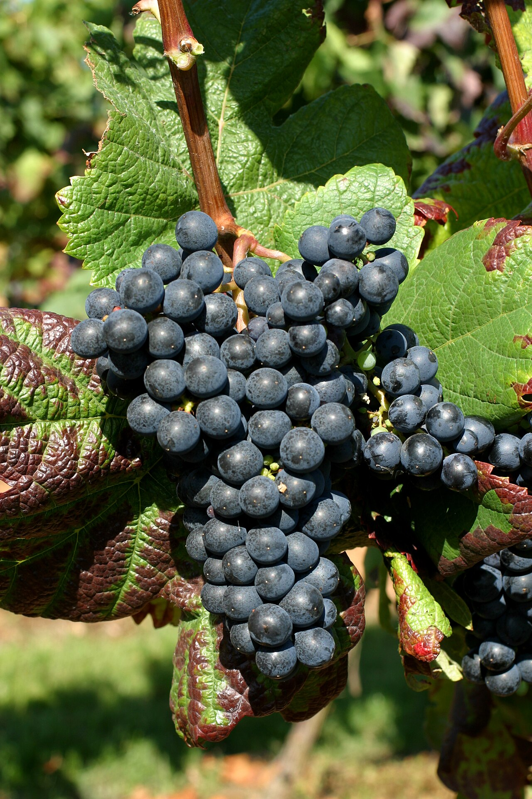

# 丹娜

原产法国西南部马迪朗一带的红葡萄，以高单宁、深色与强陈年潜力著称；在乌拉圭成为国家标志品种，常与梅洛、品丽珠混酿以柔化结构。

丹娜是法国西南部的红葡萄，以高单宁、深色与强陈年潜力著称；它在乌拉圭成为国家标志品种。读它时，先看单宁与产区，再看混酿比例。

图：Tannat：VIVC12257 TANNAT Cluster in the field 8302（Wikimedia Commons）。图片：Please note: This photo can be reproduced. Please quote the source as indicated below: Doris Schneider, Julius Kühn-Institut (JKI), Federal Research Centre for ，CC BY-SA 4.0，via Wikimedia Commons（[原图页面](https://commons.wikimedia.org/wiki/File:VIVC12257_TANNAT_Cluster_in_the_field_8302.jpg)）。

## 定义与命名

丹娜是法国西南部的红葡萄，核心产区为马迪朗（Madiran）、伊鲁莱吉（Irouléguy）与圣蒙（Saint-Mont）；以高单宁、深色与强陈年潜力著称。它在乌拉圭成为国家标志品种，常与梅洛、品丽珠混酿以柔化结构，是当地最重要的[红葡萄酒](ref:red)品种之一。

Tannat 的名称可能与“tannin”（单宁）有关，也可能来自地方词；它不是“丹娜”与“Tannat”两个品种，而是同一品种的中法文写法。在西班牙与意大利有少量种植，但不如法国与乌拉圭重要。

马迪朗法规要求丹娜主导，部分酒款允许加入 Tannat 与 Cabernet 混酿；乌拉圭的 Tannat 更常单独装瓶，风格从强劲到柔顺都有。

丹娜在乌拉圭常被写成 Tannat，在法国也同形；它不是“丹娜”与“Tannat”两个品种。法国西南部还有 Tannat de Pays 等地方名称，但都指同一红葡萄。

## 起源与传播

丹娜原产法国西南部，可能与巴斯克地区有关；18–19 世纪，它在马迪朗与伊鲁莱吉的山坡上种植，用于当地的红葡萄酒。根瘤蚜后，部分老园重建，丹娜仍是主力。

19 世纪后期，巴斯克移民把丹娜带到乌拉圭；20 世纪，它成为乌拉圭最重要的红葡萄，Pisano、Garzón 等酒庄让它进入国际市场。阿根廷、巴西、澳大利亚与美国也有少量种植。

在法国，丹娜常与 Cabernet Sauvignon、Cabernet Franc 混酿，以增加复杂度；在乌拉圭，它更多与 Merlot、Cabernet 混酿，或单独装瓶。

马迪朗的修道院与地方贵族在 18 世纪已推动丹娜种植；19 世纪，它随巴斯克移民与贸易进入乌拉圭，后来成为该国最重要的红葡萄。根瘤蚜后，法国老园重建，丹娜仍是马迪朗的主力。

## 植物学与栽培

果粒中等、皮厚，晚熟，单宁高；成熟时带黑莓、黑樱桃、李子、皮革与香料。皮厚与高单宁让它耐运输、耐陈年，但也需要充足热量才能成熟。

在马迪朗，砾石与黏土土壤、海洋影响与秋季阳光让丹娜缓慢成熟；在乌拉圭，温暖气候与充足日照让单宁更熟、酒体更饱满。产量控制是关键，高产会让单宁粗糙。

采收过晚会让酒精过高、酸度下降；过早则单宁生涩。酒农常通过整串发酵、延长浸渍与[橡木桶](ref:oak)陈年来柔化结构。

丹娜的皮厚、籽多，单宁含量高；它在温暖气候下才能充分成熟，否则单宁生涩。马迪朗的砾石土壤与秋季阳光让果实缓慢成熟，乌拉圭的充足热量让单宁更熟、果味更甜。

## 风格与味觉

丹娜呈深紫红，香气带黑莓、黑樱桃、李子、甘草、皮革与香料；入口单宁高、酸度中等，酒体饱满，收口长。年轻时单宁紧，陈年后出现雪松、皮革、烟草与干果。

马迪朗版本更紧、更矿物，单宁需要时间；乌拉圭版本更熟、更圆润，果味更突出。与梅洛比，丹娜单宁更硬、颜色更深；与西拉比，它更少胡椒、更多皮革。

判断典型性，先看单宁与颜色：高单宁、深色、黑莓与皮革是核心；如果单宁很软，可能经过大量混酿或早采。

乌拉圭丹娜通常比马迪朗更圆润、果味更突出，部分酒款会加入 Merlot 或 Cabernet 柔化单宁；法国丹娜更紧、更矿物，需要更长陈年。两者都保留深色、黑莓与皮革的核心。

## 主要产区与代表酒款

马迪朗是核心，Château Montus、Domaine Capmartin、Château d’Aydie 等是代表；伊鲁莱吉与圣蒙也有丹娜主导的酒款。乌拉圭的 Pisano、Garzón、Bodega Bouza 等酒庄把丹娜做成国家名片。

在阿根廷、巴西、澳大利亚与美国，丹娜多作为实验性品种或混酿成分；法国西南部的丹娜更强调结构，乌拉圭的更强调果味与柔顺。

伊鲁莱吉（Irouléguy）的丹娜更轻、更山间风格；圣蒙（Saint-Mont）的更柔、更适合早饮。乌拉圭的丹娜集中在 Canelones 与 Maldonado，Pisano 与 Garzón 是国际代表。

## 怎么喝与配餐

温度 16–18°C，用大肚红酒杯；年轻丹娜需要醒酒 1–2 小时，老酒只需换瓶。配餐适合牛排、烤肉、野味、硬质奶酪与浓郁炖菜；高单宁能切油脂。

开瓶后冷藏，2–3 天；单宁高的酒可以放更久，但不要超过一周。不要用过低温度，单宁会显得更涩。

丹娜的高单宁适合配脂肪与蛋白质丰富的菜：牛排、羊排、烤肉、硬质奶酪与炖菜。它不适合配清淡海鲜或辛辣菜，单宁会放大辣感与金属味。

## 选购与常见误区

先看产区与年份：马迪朗的丹娜更紧、更需要陈年，乌拉圭的更易饮；老藤与低产量的酒更集中。再看混酿比例，丹娜主导还是少量加入，风格差别大。

常见误读：把丹娜当成“单宁炸弹”而忽略它的果味；以为乌拉圭丹娜只是法国版本的复制；以为高单宁就不能配餐。单宁与脂肪是搭配的关键。

[年份](ref:vintage)对丹娜影响很大：冷凉年份单宁更紧、酸度更高，需要更长时间；温暖年份果味更熟、单宁更圆。买之前看年份与酒精度，比只看酒庄名更有用。

丹娜的“强劲”不等于“难喝”：年轻时的紧涩是正常的，醒酒与配餐能柔化。乌拉圭版本更易饮，法国版本更需要耐心；按风格选，不要只按国家选。

## 参见

- [梅洛](ref:merlot)：常与丹娜混酿的红葡萄。
- [红葡萄酒](ref:red)：红葡萄的发酵与结构。
- [橡木桶陈酿](ref:oak)：单宁柔化与陈年。
- [风土（terroir）](ref:terroir)：马迪朗的土壤与气候。
- [年份](ref:vintage)：丹娜的成熟与陈年差异。

**关键事实。**

| 项目 | 内容 |
| --- | --- |
| 一句话定位 | 原产法国西南部马迪朗一带的红葡萄，以高单宁、深色与强陈年潜力著称；在乌拉圭成为国家标志品种，常与梅洛、品丽珠混酿以柔化结构 |
| 物种 | Vitis vinifera |

**来源与边界。** 本页关于「丹娜」的关键事实，主要由以下来源交叉核对：Julius Kühn-Institut（品种名称、同义词、起源与全球分布）、OIV（葡萄品种与栽培框架）、USDA ARS（植物分类、种质与栽培信息）等 4 条来源。价格、批次与状态会变，涉及这些字段时以页面所列来源的最新版本为准。正文为项目自写，来源只作核验，不复制原文。

## 相关图像

图：梅洛。图片：Felloni claire，CC BY-SA 4.0，via Wikimedia Commons（[原图页面](https://commons.wikimedia.org/wiki/File:Merlot.jpg)）。关联图像：丹娜。
