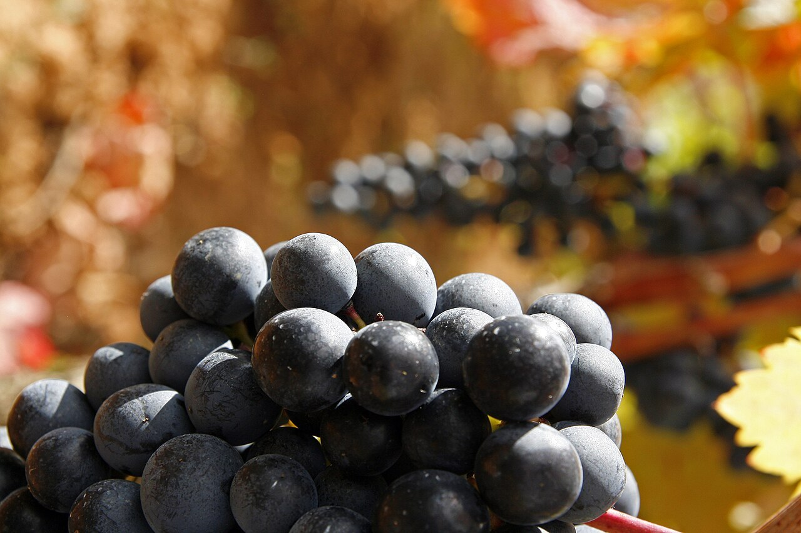

# 丹魄

丹魄是西班牙最具代表性的红葡萄品种之一，果皮较厚、成熟较早，带樱桃、李子、皮革与烟草气息。它在里奥哈与杜埃罗河岸常经过橡木桶陈酿，形成结构完整、适合配餐的风格。丹魄也用于酿造桃红葡萄酒，并在西班牙以外逐渐扩展种植。

图：丹魄。摄影：Tempranillo grapes from Rioja Alavesa。署名：María Jesús Tomé，CC BY 2.0，来自 Wikimedia Commons（[来源](https://commons.wikimedia.org/w/index.php?curid=16191821)）。

## 定义与别名

丹魄的英文名是 Tempranillo，在西班牙不同产区还有 Tinto Fino、Tinta del País 等叫法。它属于欧洲葡萄 Vitis vinifera，名称与“早熟”有关。丹魄不是“西班牙版赤霞珠”，它的酸度、单宁与香气结构都有自己的特点；把它当作赤霞珠的替代品，会忽略它在西班牙传统中的位置。

丹魄的别名较多，购买时应以产区与酒标法规为准，而不是只看品种译名。不同产区的叫法差异，也反映了地方栽培传统。

## 植物学特征

丹魄果穗中等、果粒较圆，果皮较厚，色素与单宁含量中等偏高。它的芽眼萌动较早，成熟期偏早，适合温和至温暖的气候。果皮厚让它对灰霉病有一定抵抗力，但在潮湿年份仍需注意冠层管理。

丹魄的酸度中等，酒体中等偏饱满，陈年后可能发展出皮革、烟草与干果气息。它的香气不如赤霞珠外放，更偏红色水果与香料；不同克隆与产区的表现也有差异。

## 主要产区

丹魄的原产地一般追溯到西班牙北部，里奥哈与杜埃罗河岸是两个核心产区。里奥哈的丹魄常与歌海娜、格拉西亚诺等混酿，经橡木桶陈酿后风格更圆润；杜埃罗河岸的丹魄更浓缩、结构更强。西班牙其他地区以及葡萄牙、阿根廷、澳大利亚也有种植。

不同产区的丹魄风格差异明显。里奥哈的凉爽产区酸度更高、香气更细；杜埃罗河岸的大陆性气候带来更成熟的果味与更紧实的单宁。产区的气候、海拔与土壤，比品种名更能解释具体风格。

## 典型风味

丹魄的典型香气包括樱桃、李子、草莓、皮革、烟草与香草。它的酸度中等，单宁中等偏高，酒体中等偏饱满。年轻时以红色果味为主，经[橡木桶陈年](ref:oak-ageing)后可能增加香草、香料与烟熏气息，陈年后发展出皮革、干果与泥土气息。

丹魄的香气不如赤霞珠浓烈，但结构完整、适合配餐。评价丹魄时应看酸度是否支撑酒体、单宁是否细腻，以及橡木是否与果味融合；只看香气强度会漏掉结构信息。

## 代表酒款

里奥哈的传统酒款常以丹魄为主，经橡木桶陈酿后带香草、皮革与烟草气息；杜埃罗河岸的酒款则更浓缩、结构更强。西班牙的桃红葡萄酒也使用丹魄，[桃红葡萄酒](ref:rose)中的丹魄通常带草莓与樱桃气息，风格清爽。

具体酒款的配方与风格会随产区、年份与酒庄选择变化。品种页描述的是丹魄的潜力与限制，酒款页才记录具体酒庄的栽培与酿造决策。

## 栽培要点

丹魄的栽培重点是成熟期与酸度保留。它成熟较早，在温暖产区可能酸度下降、果味变熟；在凉爽产区则需要注意成熟不足。生产者常通过海拔选择、采收时间与混酿来平衡糖度、酸度与结构。

丹魄的产量控制也会影响风味浓度。产量过高时，果味被稀释、单宁显得粗糙；适度控制产量能带来更集中的红色果味与更完整的结构。不同产区的昼夜温差与水分条件，会改变成熟节奏。

## 常见误区

第一，丹魄就是西班牙的赤霞珠。二者在香气、酸度与单宁结构上不同。

第二，丹魄只能做红葡萄酒。它也用于酿造桃红葡萄酒。

第三，丹魄越陈越好。陈年效果取决于年份、结构与储存条件。

第四，丹魄的橡木味越重越好。橡木需要与果味、酸度平衡。

第五，丹魄只适合西班牙菜。它的结构与酸度也适合多种肉类与奶酪。

丹魄是西班牙代表红葡萄品种，果皮较厚、成熟较早，樱桃、皮革与烟草气息常见；里奥哈与杜埃罗河岸常用橡木桶陈酿塑造结构。它早熟、适合在生长季较短的高海拔地区成熟，但不同产区的克隆与混酿会改变酸度与颜色；不要把“丹魄”直接等同于里奥哈风格。里奥哈的橡木桶分级与杜埃罗河岸的浓密风格，都不是丹魄的固有属性，而是产区法规、气候与酿造选择的结果。读酒标时先看子产区与陈年标识，再把品种名放回具体语境。

对照阅读：[葡萄酒](ref:wine)、[桃红葡萄酒](ref:rose)。

## 延伸阅读

- [葡萄酒](ref:wine)：理解丹魄的分类、酿造与产区框架。
- [红葡萄酒](ref:red-wine)：丹魄的单宁、酸度与陈年结构。
- [桃红葡萄酒](ref:rose)：丹魄在桃红葡萄酒中的用途。
- [橡木桶陈年](ref:oak-ageing)：里奥哈丹魄的桶陈传统。

**关键事实。**

| 项目 | 内容 |
| --- | --- |
| 一句话定位 | 西班牙的代表性红葡萄品种，果皮较厚、成熟较早，带樱桃、皮革与烟草气息；里奥哈与杜埃罗河岸常用橡木桶陈酿塑造其结构 |
| 物种 | Vitis vinifera |

**来源与边界。** 本页关于「丹魄」的关键事实，主要由以下来源交叉核对：International Organisation of Vine and Wine (OIV)（品种描述与 Vitis 物种框架）、Oxford University Press（提供关于丹魄的起源、产区与酿造条目；由原条目末尾参考资料迁移，未逐条复核访问日期）、European Union（欧盟葡萄酒产区与标签框架）。价格、批次与状态会变，涉及这些字段时以页面所列来源的最新版本为准。正文为项目自写，来源只作核验，不复制原文。

**并读。** 把「丹魄」与「葡萄酒」、「红葡萄酒」、「桃红葡萄酒」放在一起读时，先确认它们是同一层级还是上下游关系：先确认品种身份与允许产区，再比较成熟期、抗性、克隆与酿造表现。本页负责给出品种的基本坐标，对照条目补上具体案例与差异；读完再回到本页，才能分清哪些差别属于品种本身，哪些只是产地、批次或品牌选择。

**适用边界。** 对「丹魄」而言，品种表现随产区、气候与克隆选择变化；同名品种在不同国家可能指不同材料。

**更新提示。** 「丹魄」最近核对于 2026-11-04；允许产区、克隆与栽培数据会更新，引种前以官方品种目录为准。

**编者注。** 本页把「丹魄」作为品种条目处理：定义、流程与关键数字以正文表格为准，与「葡萄酒」、「红葡萄酒」的差异用对照阅读验证；遇到价格、批次或地址，回到页面所列来源核对。
