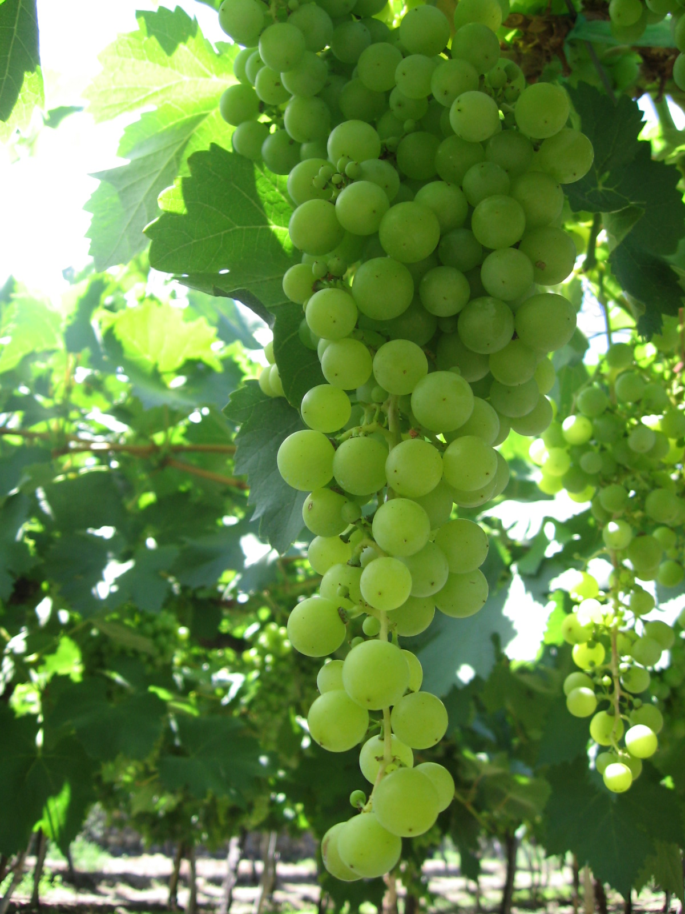

# 特浓情

特浓情是阿根廷最具代表性的本土白葡萄，以玫瑰、橙花、茉莉、荔枝与柑橘香气著称；高海拔萨尔塔版本酸度明亮、香气集中，干型口感却常被误认为麝香家族成员。

图：Torrontés：Torrontes（Wikimedia Commons）。图片：Jnurin Justin Nurin，CC BY-SA 3.0，via Wikimedia Commons（[原图页面](https://commons.wikimedia.org/wiki/File:Torrontes.JPG)）。

## 定义与命名

阿根廷栽培的 Torrontés 实际包含三个不同品种：Torrontés Riojano、Torrontés Sanjuanino 与 Torrontés Mendocino。酒标上只写 Torrontés 时，通常指 Riojano——种植最广、香气最浓、用于优质酒的类型；Sanjuanino 常与其他白葡萄混酿，Mendocino 种植最少、香气也最淡，Torrontel 等地方别名见于老资料。

名称容易造成两处混淆。其一，它虽然香气接近麝香，却不是麝香（Muscat）品种本身；基因研究显示 Riojano 与 Sanjuanino 都是亚历山大麝香 × Criolla Chica 的杂交后代，Mendocino 的另一亲本尚未鉴定。其二，西班牙加利西亚也有名为 Torrontés、与 Albillo Mayor 相关的品种，DNA 证据表明它与阿根廷特浓情并无亲缘，只是共用名称（[muscat](ref:muscat)）。

作为 Vitis vinifera 白葡萄，特浓情果串中等、果粒小而皮薄，中晚熟；商业种植以选定克隆为主，酒标一般不标注克隆与砧木，树龄、海拔与地块对风格的影响更直接（[terroir](ref:terroir)）。

## 起源与传播

特浓情是在阿根廷土地上形成的自然杂交品种，而非从西班牙直接引进。亲本之一 Criolla Chica（即 Mission、Listán Prieto 脉络）是殖民早期传入美洲的基础品种，亚历山大麝香随后在 17 世纪前后传入；两者在阿根廷产区自然杂交，经长期选种形成今天的三个类型。

长期以来，行业曾按 1986 年著作中的说法把它与西班牙 Torrontés 联系起来；后续 DNA 分析推翻了这一对应，近年品种著作才更新这一结论。它的主要传播始终限于阿根廷：萨尔塔、拉里奥哈、圣胡安与门多萨都有种植，海外零星出现在智利、乌拉圭与美国加州，但规模很小。

20 世纪大部分时间，特浓情被当作批量白葡萄酒原料，香气淡、口感松散；1980 年代起，以 Susana Balbo 在 Michel Torino 为代表的酿酒人开始按优质白葡萄方式控制采收温度与发酵，高海拔 Cafayate 版本逐渐获得国际关注。

## 植物学与栽培

果粒小、皮薄，果串中等紧凑，中晚熟；在高海拔山谷，强烈日照与大风加厚果皮、促进芳香物质积累，夜间降温则保留酸度与挥发性香气。低海拔或温暖地块容易失去酸度，香气变得松散、酒精感偏热。

栽培上依赖海拔与昼夜温差：Cafayate 镇海拔约 1,683 米，葡萄园多在 1,700–2,000 米，Colomé 最高地块达 3,111 米；山谷年降雨约 80–250 毫米，靠安第斯融雪灌溉，土壤为贫瘠砂壤土。花期与采收期的风、干旱与强紫外线辐射是常态环境压力。

主要风险：成熟度过高会让花香与荔枝香转成果酱感，酸度下降；采收偏早则草本与青梗味明显。叶幕管理与疏果要在芳香品种所需光照和避免遮阴之间平衡，灌溉量直接影响果粒浓缩度。

## 风格与味觉

典型特浓情呈浅禾秆黄带绿反光，香气以茉莉、玫瑰花瓣、橙花、荔枝、桃子、杏、葡萄柚、青柠与少量白胡椒为主；口感干型、轻到中等酒体，入口清爽圆润，酸度明亮，余味带柑橘与花香。香气浓度与干型口感之间的反差是它的识别要点。

酿造多在不锈钢罐中低温发酵（约 15°C），保留新鲜花香，很少使用新橡木；部分酒庄做少量桶陈或酒泥接触，增加圆润度与坚果气息。除干型年轻酒外，也有晚收（Torrontés Tardío）风格，残留糖分更高，蜂蜜与干果味更明显（[fermentation](ref:fermentation)）。

特浓情通常在采收后 1–2 年内饮用，新鲜香气是核心表达；优质高海拔年份可瓶陈两三年，逐渐出现蜜饯与香料，但不适合长期窖藏。判断潜力看酸度是否完整、香气是否集中，而非酒精度高低（[white-wine](ref:white)）。

## 主要产区与代表酒款

最受认可的产区是萨尔塔的 Calchaquí 山谷，Cafayate 是标杆城镇；拉里奥哈与圣胡安种植 Sanjuanino 与部分 Riojano，门多萨的种植多用于混酿与入门款。阿根廷国内 Riojano 约 8,700 公顷、Sanjuanino 约 4,850 公顷（近年调查），Mendocino 面积最小。

代表生产者：Bodega Colomé 自 1831 年经营，四块葡萄园从 1,700 米延伸到 3,111 米，其 100% 特浓情酒精度约 13%、酸度 6.15 g/l；Bodega Nanni 1897 年由意大利移民创立，第四代家族经营，Chimpa 庄园约 50 公顷、海拔 1,750 米，1996 年起有机认证；Piattelli 在 Cafayate 约 5,890 英尺（约 1,795 米）种植 Riojano；La Linda 采用 30 年树龄、1,700 米地块；El Esteco 的 Don David 与 Susana Balbo 本人品牌也是常被引用的参照（[salta](ref:salta)）。

市场定位上，特浓情是阿根廷出口白葡萄酒的名片之一，价格带从入门餐酒到高海拔单一园都有；同一名下，高海拔小园与平原高产地块在香气浓度和酸度上差距明显，生产者与海拔比品种名更能预测风格。

## 怎么喝与配餐

饮用温度约 8–11°C，偏凉以锁住花香与柑橘香；温度过高，酒精与肥腻口感会盖过芳香。杯型用中等杯口的白葡萄酒杯即可，年轻酒不需要醒酒，作为开胃酒单独饮用也常见。

配餐方向：香辣菜式（辣椒鸡、阿根廷风味烤肉）、海鲜、烤鱼、白肉、开胃小吃与软质奶酪都能搭配，高酸度能接番茄与柑橘酱汁。甜度低的干型特浓情不配太甜的菜肴，晚收版本则可配蓝纹奶酪或干果甜点。

## 选购与常见误区

误区一：把特浓情当成麝香葡萄。它有麝香亲本，香气结构却独立，口感更干、酸度更高，不能按甜型麝香酒的期待去买。误区二：把西班牙 Torrontés 与阿根廷特浓情视为同种；二者只是同名，来源与风格无关。

误区三：认为芳香品种必然低酸。高海拔特浓情恰恰以明亮酸度为骨架；判断时看产区海拔与年份，而不是香气浓淡。选购留意年份与装瓶时间，特浓情适饮窗口短，经过长途运输或长期库存的酒会失去新鲜花香。

## 延伸阅读与另见

对照练习：把一款 Cafayate 高海拔 Riojano 与一款 San Juan 或 Mendoza 的 Sanjuanino 同场比较，记录香气浓度、酸度与酒体差别；再对比干型与晚收版本，看清残留糖对风格的影响。

特浓情的面积、克隆与亲本鉴定仍随品种调查更新，正式引用以阿根廷 INTA 品种资料、VIVC 登记与产区官方统计为准。日常选购时，高海拔 Cafayate 或 Calchaquí 谷地的 Riojano 通常香气更清透、酸度更挺，San Juan 与 Mendoza 的 Sanjuanino 则偏成熟果香，二者风格不宜混为一谈。

- 相关条目：[salta](ref:salta)、[muscat](ref:muscat)、[white-wine](ref:white)、[terroir](ref:terroir)、[fermentation](ref:fermentation)。

对照阅读：[萨尔塔](ref:salta)、[白葡萄酒](ref:white)。
