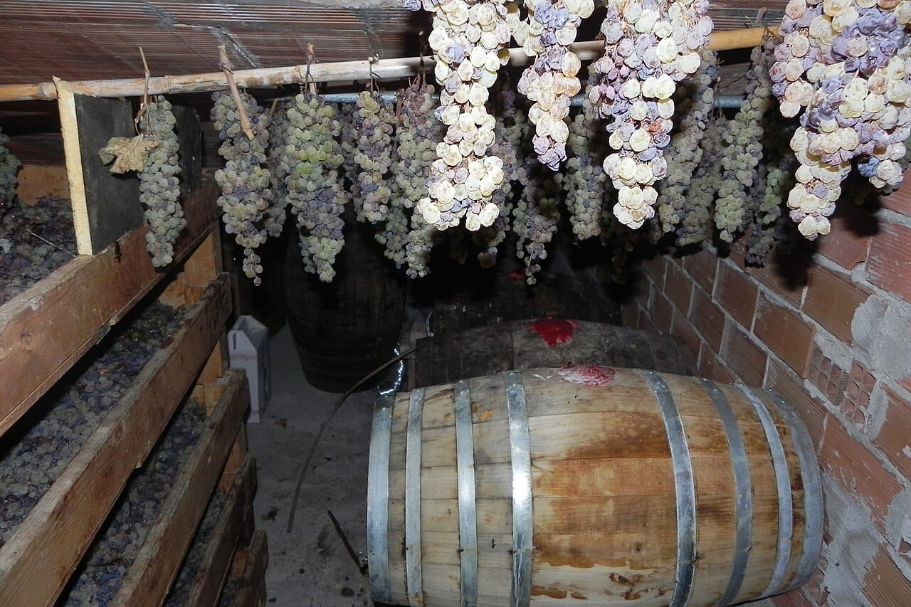

# 特雷比奥罗（白玉霓）

特雷比奥罗（Trebbiano）是一个容易被误解的名字：它既是意大利广泛种植的一类白葡萄，也是法国干邑与雅文邑的主力品种"白玉霓"（Ugni Blanc）。同一个品种在意大利叫 Trebbiano Toscano，在法国叫 Ugni Blanc，在两地扮演完全不同的角色——意大利用它做清淡的白葡萄酒与甜酒的基酒，法国用它蒸馏成世界上最著名的白兰地之一。理解这个品种，必须同时看这两条线索（ref:white-wine）。

图：特雷比奥罗（白玉霓）。摄影：Tuscany Vin Santo (holy wine) dried Trebbiano grapes。署名：Gabriele Cantini，CC BY 2.0，来自 Wikimedia Commons（[来源](https://commons.wikimedia.org/w/index.php?curid=19365493)）。

## 定义与别名

Trebbiano Toscano 是意大利名，Ugni Blanc 是法国名，两者指同一品种；中文通常把后者音译为白玉霓，把前者音译为特雷比奥罗。它属于 Vitis vinifera。问题在于"Trebbiano"还是一族名字：Trebbiano Romagnolo、Trebbiano Spoletino、Trebbiano Giallo 等是不同品种或不同生物型；Trebbiano d'Abruzzo 既是产区名，也长期被当作品种名，现代研究认为当地许多老园实际种的是 Bombino Bianco。酒标上的"Trebbiano"因此可能指向不同遗传背景，需要看产区与酒庄说明。把它当作单一品种，是理解这个页面时最常见的障碍。

## 亲本与起源

特雷比奥罗的起源没有定论。名字可能来自意大利地名（如 Trebula）或古罗马时期的称呼，但它在中世纪已广泛分布于意大利中部。Ugni Blanc 在法国的记载较晚，通常认为它是通过地中海贸易传入普罗旺斯与夏朗德地区。DNA 研究把 Trebbiano Toscano 与地中海西部的品种群联系起来，但亲本组合尚未确认。可以肯定的是，它在 19 世纪根瘤蚜危机后大规模重植，因为高产、晚熟、酸度高，正好适合夏朗德地区的蒸馏产业，这一选择影响了两百多年的干邑风格。

## 植物学特征

果穗大、较紧凑，果粒中等、圆形，成熟时黄绿色，果皮薄。薄皮使它易感灰霉病，也意味着压榨时容易氧化。叶片中等大、五裂。特雷比奥罗发芽晚、成熟晚，在夏朗德这样的海洋性气候里，采收常在十月上旬，果实糖分不高、酸度仍然很高——这正是蒸馏基酒需要的状态。糖分低意味着酒精度低，酸度高则让酒在发酵与蒸馏过程中保持清新（ref:acidity）。它在意大利的表现类似：产量大、颜色浅、酸度突出，香气以中性为主。

## 栽培特性

特雷比奥罗长势旺、产量高，是最容易被"高产"拖累的品种之一。不控产时，酒淡而无味；控产后，香气与质地明显提升。它发芽晚，避开了春霜，但成熟期长，秋雨会造成灰霉与掉果。在干邑地区，酒农通常在葡萄完全成熟前采收，以保留酸度并降低酒精，这与其他产区追求成熟度的逻辑相反。土壤方面，干邑的石灰岩土（Grande Champagne、Petite Champagne 等分区）排水好、保水适中，适合它稳定成熟；意大利的丘陵与冲积平原则给出不同产量与成熟节奏。

## 意大利的产区与风格

在意大利，特雷比奥罗从北到南都有种植。托斯卡纳用它做 Vin Santo 的基酒，也曾在 Chianti 的混酿中占一席之地；翁布里亚的 Orvieto 以 Trebbiano Toscano（当地称 Procanico）与 Grechetto 混酿；阿布鲁佐的 Trebbiano d'Abruzzo 是重要白葡萄酒产区，Valentini 与 Emidio Pepe 的老藤酒证明它可以陈年；艾米利亚-罗马涅的 Trebbiano Romagnolo 常用于日常酒与醋；拉齐奥、马尔凯与西西里也有种植（ref:italy）。意大利的特雷比奥罗通常酒体轻、酸度高、香气中性，适合年轻时饮用，但低产老藤可以做出完全不同的深度。

## 干邑与雅文邑：蒸馏品种

在法国，Ugni Blanc 是干邑与雅文邑的绝对主力，占干邑葡萄园的绝大部分。基酒必须酸度高、酒精度低（通常 8% 至 10%）、香气干净，才能经得起蒸馏。干邑采用夏朗德壶式蒸馏器（alambic charentais）进行两次蒸馏，得到约 70% 的"生命之水"，再进入法国橡木桶陈年（ref:cognac）。雅文邑则多使用连续式蒸馏器（alambic armagnacais），一次蒸馏得到较低酒精度的酒，风格更粗犷、果味更重（ref:armagnac）。两地的法定品种都包括 Ugni Blanc、Colombard 与 Folle Blanche 等，干邑还允许少量其他品种。

## 法定规则

干邑 AOC 成立于 1936 年，规定允许的品种、蒸馏方式、蒸馏截止时间（通常为采收次年 3 月 31 日）与最低陈年。VS、VSOP、XO 的最低陈年分别为 2 年、4 年与 10 年，具体以最新法规为准。雅文邑的规则类似，但蒸馏方式不同，最低陈年要求近年也与干邑趋同。意大利方面，Trebbiano d'Abruzzo、Orvieto 与 Vin Santo 各有 DOC 或 DOCG 规范，品种比例与陈年要求不同。凡涉及比例与年限，都应以最新官方规范为准，酒标上的年份与产区通常比营销术语更可靠。

## 酿造与风格

意大利的干白通常在不锈钢罐中低温发酵，避免苹果酸-乳酸发酵，以保留酸度与柑橘香气；部分酒庄用旧桶与酒泥增加质地。Vin Santo 把葡萄挂在通风处晾干数月，糖分浓缩后慢速发酵，再在小型旧桶中陈年数年，得到琥珀色、带蜂蜜与坚果的甜酒。干邑的基酒则严格控制硫的使用、通常不做苹果酸-乳酸发酵，发酵完成后尽快蒸馏。Ugni Blanc 的香气在蒸馏后表现为葡萄、青苹果与白花，经橡木陈年后转为香草、肉桂、干果与皮革。

## 感官风格

作为白葡萄酒，特雷比奥罗通常是浅柠檬色，香气以柠檬、青苹果、梨、白花与杏仁为主，酒体轻到中等，酸度高，酒精低，余味偏短。翁布里亚与阿布鲁佐的优质版本可以有更长的余味与矿物感，Valentini 的老藤酒甚至能陈放数十年。作为蒸馏酒，Ugni Blanc 提供的是干净的酸度与中性果香，真正的复杂度来自蒸馏与橡木陈年。把两种身份分开看，才不会用"白葡萄酒的标准"去评价干邑，也不会用"干邑的标准"去要求意大利干白。

## 代表生产者与年份

干邑的代表酒庄包括 Hennessy、Rémy Martin、Martell 与 Courvoisier，它们通常混合多个产区与年份；雅文邑有 Darroze、Château de Laubade 与 Delord。意大利方面，Valentini 与 Emidio Pepe 的 Trebbiano d'Abruzzo 被视为老藤典范，托斯卡纳的 Capezzana 等酒庄以 Vin Santo 闻名，Orvieto 有多家历史酒庄。年份对干邑的影响被调配平均化，对意大利干白则很明显：凉爽年份酸度更高、酒体更轻，炎热年份更饱满但容易失去新鲜感。

## 常见误区

第一，认为 Trebbiano 只有一个品种；它是一族名字，遗传背景不同。第二，认为特雷比奥罗只能做廉价酒；老藤与低产可以做出有陈年潜力的白葡萄酒。第三，认为白玉霓只能蒸馏；它也能酿静止白葡萄酒。第四，认为 Trebbiano d'Abruzzo 一定是 Trebbiano Toscano；当地品种构成比名字复杂。第五，把高产当成品种缺陷；问题在栽培管理，不在品种本身。第六，认为所有"Trebbiano"都适合陈年；多数酒款确实适合年轻饮用，只有少数低产老藤值得久放。

## 延伸阅读

- [葡萄酒](ref:wine)：特雷比奥罗所属的饮料大类。
- [白葡萄酒](ref:white-wine)：它在意大利的主要酒种。
- [意大利](ref:italy)：特雷比奥罗在意大利的产区与法规背景。
- [干邑](ref:cognac)：白玉霓最重要的蒸馏产区。
- [雅文邑](ref:armagnac)：另一种以白玉霓为基础的蒸馏酒。
- [酸度](ref:acidity)：它适合蒸馏与清爽白葡萄酒的共同原因。

相关条目：[葡萄酒](ref:wine)、[白葡萄酒](ref:white-wine)。

## 相关图像

图：雅文邑。图片：Rama，CC BY-SA 2.0 fr，via Wikimedia Commons（[原图页面](https://commons.wikimedia.org/wiki/File:Armagnac-img_0465.jpg)）。关联图像：特雷比奥罗（白玉霓）。
