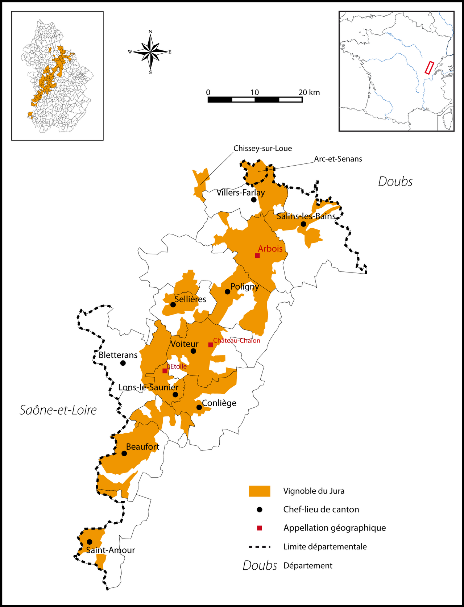

# 特鲁索

法国汝拉的红葡萄，酒色浅、酸度高、单宁低，带红樱桃、香料与泥土；可酿轻红、桃红与起泡，是汝拉“轻酒体”传统的核心。

特鲁索是汝拉的红葡萄，酒色浅、酸度高、单宁低；它可酿轻红、桃红与起泡。读它时，不要用深色红葡萄酒的标准去要求它。

图："特鲁索"的产区风貌配图。图片：DalGobboM ¿!i?，CC BY-SA 3.0，via Wikimedia Commons（[原图页面](https://commons.wikimedia.org/wiki/File:Vignobles_jura.png)）。这张照片用于说明"特鲁索"的主要种植环境，不是特鲁索的品种标本照。

## 定义与命名

特鲁索是法国[汝拉](ref:jura)的红葡萄，酒色浅、酸度高、单宁低，带红樱桃、香料与泥土；可酿轻红、桃红与起泡，是汝拉“轻酒体”传统的核心。它在葡萄牙称 Bastardo，在西班牙与意大利有少量种植。

Trousseau 的名称可能与“trousseau”（一束）或地方词有关，词源没有定论；它不是“特鲁索”与“Trousseau”两个品种，而是同一品种的中法文写法。汝拉还有 Trousseau Gris（灰特鲁索），是颜色变异，不是另一品种。

在汝拉，特鲁索常与 Poulsard、Pinot Noir 混酿或单独装瓶；在葡萄牙，Bastardo 用于混酿与甜酒。读酒标时，Jura 与 Trousseau 的组合比单看品种更能说明风格。

汝拉的 Trousseau Gris 是特鲁索的灰色变异，果皮偏灰、色素更少，常酿浅色酒或直接压榨；它与 Trousseau Noir 不是两个独立品种，而是同一品种的不同类型。

## 起源与传播

特鲁索原产法国东部，汝拉与弗朗什-孔泰是核心；18–19 世纪，它在 Arbois、Côtes du Jura 与 Château-Chalon 的山坡上种植，用于轻红与桃红。根瘤蚜后，部分老园改种更易种的品种。

20 世纪后期，Domaine Overnoy、Ganevat、Tissot、Puffeney 等酒庄重新强调特鲁索的轻酒体与酸度，让它成为汝拉自然酒与轻红复兴的一部分；葡萄牙的 Bastardo 则在杜罗与马德拉有不同用途。

传播到新世界较少，主要仍在法国与葡萄牙；在澳大利亚与美国有实验性种植，但风格多偏轻、偏酸。

汝拉的轻红传统与当地气候有关：秋季凉爽，Pinot Noir 与 Trousseau 都能保留酸度，Poulsard 更浅。20 世纪后期，自然酒与轻红复兴让特鲁索从地方酒变成国际关注的对象。

## 植物学与栽培

果粒中等、皮薄，早中熟，酸度高、单宁低；成熟时带红樱桃、草莓、香料与泥土。皮薄让它颜色浅、易感灰霉，需要通风与早采；在汝拉，石灰岩与黏土土壤给它矿物感。

特鲁索树势中等，产量不高；早熟让它适合凉爽气候，但也容易在暖秋失去酸度。部分酒庄用整串发酵增加香料与结构，部分用去梗发酵保持干净果味。

采收通常在 9 月，早采保留酸度与轻酒体；晚采糖分更高，适合桃红或起泡。

特鲁索的皮薄、色素少，浸渍时间决定颜色与单宁；短浸渍做桃红，长浸渍做轻红。整串发酵带果梗，增加香料与结构；去梗发酵更干净、更果味。

## 风格与味觉

特鲁索酿成的[红葡萄酒](ref:red)呈浅红宝石色，香气带红樱桃、草莓、覆盆子、香料、泥土与花香；入口酸度高、单宁低，酒体轻，收口清爽。它不像勃艮第红那样厚，也不像西拉那样黑。

汝拉的特鲁索常带一种“乡土”气息：湿土、蘑菇、香料与红果；陈年后出现干花、皮革与坚果。[桃红](ref:rose)版本更轻、更酸；起泡版本带红果与面包。

与 Pinot Noir 比，特鲁索更酸、更轻、更香料；与 Gamay 比，它更少香蕉/泡泡糖，更多泥土。判断典型性，先看颜色与酸度，再看是否来自汝拉。

特鲁索的“轻”不是缺陷：高酸、低单宁让它适合配餐，也能在夏天稍凉饮用。陈年后会出现干花、泥土与蘑菇，但不会变成厚重的酒；期待它像勃艮第是不对的。

## 主要产区与代表酒款

汝拉的 Arbois、Côtes du Jura、Château-Chalon 与 Étoile 都有种植；Arbois 的特鲁索更饱满，Château-Chalon 的矿物感更强。葡萄牙的 Bastardo 在杜罗与马德拉用于混酿。

代表生产者包括 Domaine Overnoy、Ganevat、Tissot、Puffeney 等；他们的特鲁索常标“Trousseau”或“Cuvée du…”而不标品种，读背标更稳。

Arbois 的特鲁索更饱满，适合配烤肉；Côtes du Jura 的更轻，适合配蔬菜与禽肉；Étoile 的起泡版本带红果与面包。酒标写“Trousseau”时，通常是单一品种或主导品种。

## 怎么喝与配餐

温度 14–16°C，用中等口径红酒杯；轻红不需要长时间醒酒，桃红与起泡更冷（8–10°C）。配餐适合烤鸡、猪肉、蘑菇、蔬菜与轻奶酪；高酸能切油脂。

开瓶后冷藏，2–3 天；特鲁索不耐长期陈年，最好在 3–8 年内喝。老酒会变得更轻、更干，不要期待它变成厚重的红葡萄酒。

特鲁索适合配烤鸡、猪肉、蘑菇与蔬菜；桃红版本配沙拉、海鲜与轻奶酪。温度 14–16°C，轻红不要冰到 10°C 以下，否则香气会被压住。

特鲁索的轻酒体适合配禽肉、猪肉、蘑菇与蔬菜；它的高酸也能配油炸食物。桃红版本适合沙拉、海鲜与夏日午餐；起泡版本适合开胃。

## 选购与常见误区

先看产区：汝拉的特鲁索更轻、更酸，葡萄牙的 Bastardo 更常用于混酿；再看颜色与年份，浅色不代表兑水，而是品种与工艺。

常见误读：把特鲁索当成“汝拉黑皮诺”；以为浅色就是弱；以为它只能配清淡菜。它的酸度与香料能让它在餐桌上很有存在感。

浅色不等于兑水，也不等于未熟；特鲁索的色素本来就少。买之前看年份与酒庄风格：自然酒版本可能更酸、更野，传统版本更干净。

特鲁索的价格跨度很大：自然酒名庄的版本可能很贵，普通汝拉红更便宜；价格高不代表颜色更深或单宁更强。按酒庄风格与年份选，比按颜色深浅选更可靠。

## 参见

- [汝拉](ref:jura)：汝拉的产区与风格。
- [红葡萄酒](ref:red)：红葡萄的发酵与结构。
- [桃红葡萄酒](ref:rose)：短浸渍与颜色。
- [起泡酒](ref:sparkling)：汝拉起泡与二次发酵。
- [风土（terroir）](ref:terroir)：石灰岩与黏土。

**关键事实。**

| 项目 | 内容 |
| --- | --- |
| 一句话定位 | 法国汝拉的红葡萄，酒色浅、酸度高、单宁低，带红樱桃、香料与泥土；可酿轻红、桃红与起泡，是汝拉“轻酒体”传统的核心 |
| 物种 | Vitis vinifera |
| 代表产区 | 汝拉 |

**来源与边界。** 本页关于「特鲁索」的关键事实，主要由以下来源交叉核对：Julius Kühn-Institut（品种名称、同义词、起源与全球分布）、OIV（葡萄品种与栽培框架）、USDA ARS（植物分类、种质与栽培信息）等 4 条来源。价格、批次与状态会变，涉及这些字段时以页面所列来源的最新版本为准。正文为项目自写，来源只作核验，不复制原文。
